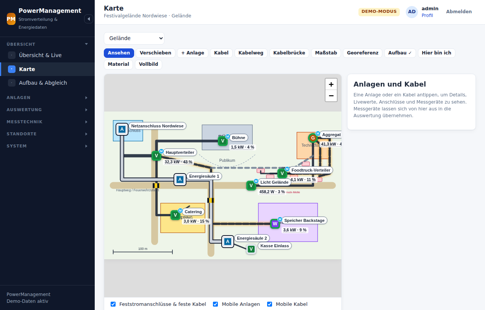
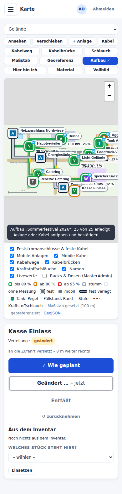
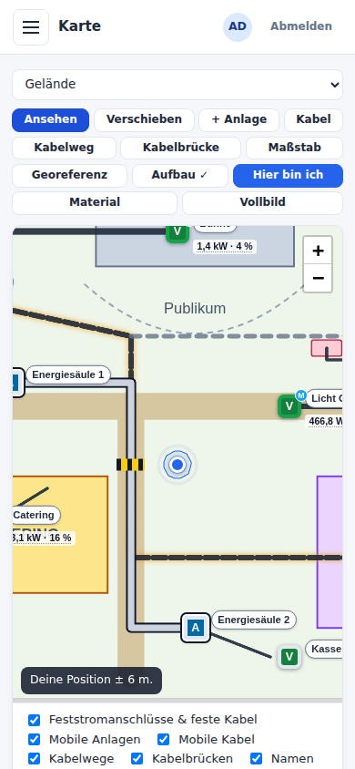
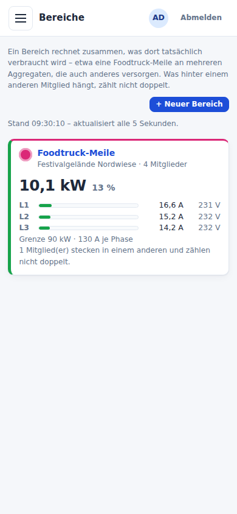

# PowerManagement

Webanwendung für die Stromversorgung von Veranstaltungsgeländen, Messen und
Baustellen: **Stromanschlüsse, Generatoren, Wechselrichter/Speicher und
Verteilungen** dokumentieren, auf dem Grundriss einzeichnen, verbinden,
messen, auswerten und, wo erlaubt, schalten.

Gebaut wie [MasterAdmin](https://github.com/agrotevent/mikrotik-masteradmin):
PHP ohne Framework, SQLite, Leaflet-Grundrisse und derselbe
Location-Abgleich über Git. Für Smartphone und Tablet ausgelegt.



  

Mehr Bilder in der [Bedienungsanleitung](docs/bedienung.md).

## Was es kann

- **Anlagen**: Netzanschlüsse, Aggregate, Speicher/Wechselrichter,
  Verteilungen, Unterverteilungen, Verbraucher, jeweils mit Nennleistung,
  Nennstrom, Seriennummer usw. Jede Anlage ist entweder
  **Feststromanschluss** (gehört zur Location: Hausanschluss, Energiesäule,
  Wandverteiler …) oder **mobil** (gehört zur Veranstaltung).
- **Anschlüsse** je Anlage: Powerlock, CEE 125/63/32/16 A und Schuko ab
  Werk, eigene Steckertypen dazu. Anzahl und Kombination je Verteilung frei.
- **Sicherungen und RCDs** (HS, RCD, RCBO, LS, NH) als Baum, jedem Abgang
  zugeordnet, mit Vorschlagsfunktion. Dazu ein **Verteilerplan** als
  Schaltbild.
- **Standard-Verteiler**: Katalog fertig bestückter Verteiler, die sich auf
  der Karte platzieren lassen.
- **Katalog-Import**: Stromverteiler, Generatoren und Tanks aus einem
  Katalog-Paket (etwa der BSS-Strombibel) mit Vorschau – neue werden
  angelegt, hier korrigierte nur auf ausdrücklichen Wunsch überschrieben.
- **Tanks** im Plan, **Tanksensoren** (Shelly) mit Füllstand, Verbrauch und
  Restlaufzeit: Rohwerte in der InfluxDB, Kennlinie je Einbau, Kalibrieren
  vor Ort mit Peilung und Betankung, Kraftstoffschlauch zum Generator,
  Verbrauch je Tag.
- **Karte**: Grundrisse (PDF/Bild/SVG) mit Feststromanschlüssen, mobilen
  Verteilern, **Kabeln, Kabelwegen und Kabelbrücken**. Anlagen per Kabel verbinden, mit Prüfung von
  Belastbarkeit, Steckern und **Spannungsfall**, dazu Maßstab und Livewerte.
  **Georeferenz** über zwei Passpunkte: Koordinaten jeder Anlage, eigene
  GPS-Position im Plan beim Aufbau, GeoJSON-Export.
- **Messung**: Shelly (Gen1/Gen2+) über MQTT → Node-RED → InfluxDB.
  **Victron** (GX über Modbus TCP oder VRM-Portal) und **ComAp IG200**
  (Modbus TCP über WireGuard oder WebSupervisor-Cloud) über den Sammler.
- **Auswertung** statt Grafana: Livewerte, Verläufe je Phase, Energie je
  Tag, Kennzahlen, Vergleich, CSV. Messgeräte lassen sich im Verteilerplan
  anklicken und in die Auswertung übernehmen.
- **Bereiche**: Last mehrerer Anlagen und einzelner Abgänge zusammen (etwa
  eine Foodtruck-Meile an mehreren Aggregaten), zeitgleich summiert und
  **ohne Doppelzählung** – was hinter einem anderen Mitglied hängt, zählt
  nicht noch einmal. Mit Grenze, Verlauf, Energie und CSV.
- **Inventar**: Verteiler und Zwischenstecker (bis 125 A) mit ihren
  Shellys – an der Einspeisung, je Abgang oder im Durchgang –, dazu
  Tanksensoren. Beim Aufbau
  wird ausgewählt, welches Stück wo steht; die Werte gehören dann zur
  Anlage, genau für die Dauer des Einsatzes.
- **Aufbau-Modus**: Plan festhalten, vor Ort jede Anlage und jedes Kabel per
  Klick bestätigen, als geändert (mit echter Länge) oder entfallen markieren.
  Der **Abgleich** zeigt danach Versatz, Kabellängen, Material und die
  gemessene Last gegen den Nennstrom – mit Hinweisen für die nächste Planung.
- **Materialliste** je Bereich oder Etage: Verteiler nach Typ, Kabel in
  üblichen Stücklängen (5–50 m, 75/100 m nur bei 63 A/125 A/Powerlock),
  Kupplungen, Kabelbrücken – zum Drucken für den Aufbau.
- **Schalten**: Shelly ein/aus, Victron Modus/Relais, ComAp Start/Stopp/
  Betriebsart. Das Schaltrecht lässt sich **je Gerät und Kanal** vergeben,
  jeder Versuch wird protokolliert, und an der Anlage gibt es eine Sperre.
- **Rechte mit Zeitfenstern**: Rollen, Freigaben für Standort, Anlage oder
  Gerät mit *gültig ab/bis* und eigenem *Datenzeitraum*. Beispiel: „Kunde A
  sieht die Statistik vom 1. bis 7. Juli, danach nichts mehr.“
- **Location-Abgleich** mit MasterAdmin über ein gemeinsames Git-Repository.
  Die **Feststromanschlüsse** der Location und die **fest verlegten Kabel**
  dazwischen liegen als `strom.json` neben der `location.json`. Mobile
  Anlagen und Kabel bleiben in der Installation.
- **Übergabeberichte** „Elektrische Anlage“: Prüfprotokoll nach DIN VDE
  0100-600 und Errichterbestätigung am Tablet – vorbelegt aus Plan,
  Schutzorganen, Kabeln und Inventar (Messwerte nie), Grenzwerte auf dem
  Server, Unterschrift von Prüfer und Kunde am Gerät (nur als Linienzug),
  eingefroren mit Prüfsumme und Siegel, PDF aus eigenem Schreiber.
  Kundendaten als Freitext oder **nur lesend aus Eventworx**.
- **Kundenbereich**: Kunden melden sich selbst an und sehen nur ihre
  Locations im Zeitraum ihrer Veranstaltung (Pläne, feste Stromanschlüsse),
  ihre Protokolle (zugeordnete Übergabeberichte als PDF) und ihre
  **Prüfnachweise nach DGUV V3** – von Hand hinterlegt oder aus einem
  Eventworx-Auftrag übernommen, immer durch eine Person freigegeben. Mehrere
  Veranstalter auf einem Gelände sehen nie etwas voneinander; jeder
  Download wird festgehalten.
- **Verteiler-Abgleich** über dasselbe Repository: Standard-Verteiler und
  Inventar (Verteiler und Zwischenstecker mit ihren Shellys), eine Datei je
  Verteiler. Je Verteiler steht, ob er hier, dort oder auf beiden Seiten
  geändert wurde; „Alle übernehmen/hochladen“ überschreibt nie eine
  Änderung der anderen Seite.
- **Schnittstelle zu anderen Instanzen** (`/api/v1`, dasselbe Protokoll wie
  MasterAdmin): Standorte mit Grundrissen, Maßstab und Georeferenz – unter
  PowerManagement-Instanzen auch Feststromanschlüsse und feste Kabel –
  direkt übernehmen, ohne gemeinsames Repository. Zurück je nach Befugnis
  als Vorschlag, den hier jemand annimmt, oder direkt, aber nur auf dem
  zuletzt gesehenen Stand. Tokens je Gegenseite, nur für freigegebene
  Standorte, nie mit Messgeräten.

## Schnell ausprobieren (Demo-Modus)

Der Demo-Modus braucht weder InfluxDB noch MQTT. Messwerte werden
synthetisch erzeugt.

```bash
php bin/power install admin 'PowerAdmin2026!' --ohne-wechsel --demo
php bin/power demo:seed
php -S 127.0.0.1:8080 -t public
```

→ <http://127.0.0.1:8080>, Anmeldung `admin` / `PowerAdmin2026!`. Weitere
Demo-Konten: `veranstalter` / `Veranstalter2026!` (sieht nur die
Festivalwoche) und `technik` / `Technik2026!!` (darf nur das Licht schalten,
unterschreibt Übergabeberichte als Prüfer). Den Kundenbereich zeigen
`muster-events` / `Kundenbereich2026!` und `stadtmarketing` /
`Stadtmarketing2026!` – zwei Veranstalter auf demselben Gelände.

Voraussetzungen: PHP ≥ 8.2 mit `pdo_sqlite`, `mbstring`, `sodium`, `zlib`,
`sockets`, `curl` und `gd`. Für PDF-Grundrisse zusätzlich `poppler-utils`.

## Produktivbetrieb

Ein Skript richtet alles in einem **Debian-13-LXC** ein: nginx, PHP-FPM,
Mosquitto, Node-RED, InfluxDB, Sammler und Wartung.

```bash
git clone https://github.com/agrotevent/powermanagement.git /opt/powermanagement
/opt/powermanagement/deploy/install-debian.sh --name="Stromversorgung Messe Nord"
```

Bei einem privaten Repository braucht der Container ein Zugangstoken. Wie
das geht, steht in der Anleitung.

Details, Optionen, Shelly-Einrichtung, WireGuard, Firewall, Sicherung und
Update: **[docs/installation-debian-lxc.md](docs/installation-debian-lxc.md)**.

## Dokumentation

| Datei | Inhalt |
|-------|--------|
| [docs/installation-debian-lxc.md](docs/installation-debian-lxc.md) | Installation, Update, Sicherung, Fehlersuche |
| [docs/bedienung.md](docs/bedienung.md) | Übersicht, Karte, Anlagen, Verteilerplan, Aufbau und Abgleich, Übergabeberichte, Kunden, Inventar, Tanks und Kraftstoff, Auswertung, Bereiche, Materialliste, Schalten, Location- und Verteiler-Abgleich, andere Instanzen |
| [docs/berichte.md](docs/berichte.md) | Übergabeberichte: Ablauf vor Ort, Felder, Vorbelegung, Grenzwerte, Unterschrift und Beweiswert, Kundenmodus, Korrektur, Integrität, Datenschutz, Aufbewahrung |
| [docs/kundenbereich.md](docs/kundenbereich.md) | Kundenbereich: Kunden und Zugänge, was Kunden sehen, mehrere Veranstalter je Gelände, Protokolle zuordnen, Prüfnachweise (DGUV V3), Abrufe, Datenschutz |
| [docs/rechte.md](docs/rechte.md) | Rollen, Freigaben, Zeitfenster, Schaltrechte je Gerät, Kundenzugänge |
| [docs/schnittstelle.md](docs/schnittstelle.md) | Schnittstelle zu anderen Instanzen (PowerManagement, MasterAdmin): Zugänge, Übernehmen, Vorschläge, direktes Schreiben, Endpunkte |
| [docs/datenquellen.md](docs/datenquellen.md) | MQTT-Format, InfluxDB-Schema, Shelly, Victron, ComAp, WireGuard, Sammler, Node-RED |
| [docs/eventworx.md](docs/eventworx.md) | Eventworx (nur lesend): Kundendaten für Berichte, Vorgänge und Prüfprotokolle für den Kundenbereich, Token, Fehlermeldungen, Datenschutz, Lese-Probe |

## Kommandozeile

```text
bin/power install [benutzer] [passwort] [--stdin] [--ohne-wechsel] [--demo] [--name=…]
bin/power migrate
bin/power einstellung <schlüssel> <wert> | --stdin
bin/power pruefen
bin/power sammler [--einmal] [--gespraechig]
bin/power user:add <name> <rolle> [passwort]   ·   bin/power user:password <name> <passwort>
bin/power titel "Titel" [untertitel] [kürzel]
bin/power plan:kacheln [--neu | --veraltet] [--etage=<id>,…] [--qualitaet=standard|fein] [--bis=<s>]
bin/power location:liste   ·   bin/power location:uebernehmen <schlüssel>
bin/power verteiler:liste   ·   bin/power verteiler:uebernehmen|verteiler:hochladen --alle | <typ|inventar> <schlüssel>
bin/power katalog:import <datei> [--ueberschreiben] [--pruefen]
bin/power tank:liste --als=<benutzer> [--standort=<id>] [--warnungen]   ·   bin/power tank:rechnen <messpunkt-id> <rohwert>
bin/power berichte:pruefen [<nummer> [--fassung=N]] [--pdf]   ·   bin/power berichte:pdf <nummer> <ziel.pdf> [--fassung=N]
bin/power berichte:aufbewahrung [--ausfuehren]   ·   bin/power eventworx:pruefen
bin/power eventworx:sonde [--job=OID] [--stock=OID] [--serie=…] [--json]
bin/power kunden:liste   ·   bin/power kunden:zugang <kunde-id> <benutzer> [--kennwort] [--name=…] [--email=…]
bin/power kunden:aufbewahrung [--ausfuehren]   ·   bin/power kunden:nachweise-pruefen
bin/power demo:seed [--reset]
bin/power wartung
```

## Prüfungen

```bash
for t in tests/*.php; do php "$t"; done
node tests/nodered-funktionen.mjs
```

Jedes Skript ist eigenständig (Exit 0 = grün) und räumt auf, was es anlegt.
MQTT- und InfluxDB-Prüfungen starten ihren eigenen Mosquitto bzw. ihre
eigene InfluxDB auf freien Ports. Die Web-Prüfung startet einen eigenen
PHP-Server. Die GitHub-Action `Prüfen` führt alles bei jedem Pull-Request
aus.

## Aufbau

```text
bin/power                 Kommandozeile
config/                   config.example.php (config.php je Installation, nicht im Repository)
database/migrations/      SQL-Migrationen (SQLite; MySQL/MariaDB vorbereitet)
deploy/                   Installation/Update Debian, nginx, PHP-FPM, systemd, Mosquitto, Node-RED-Flows
docs/                     Dokumentation
public/                   Einstieg index.php, CSS, JS (Leaflet, uPlot, pdf.js mitgeliefert)
resources/views/          Vorlagen (PHP)
resources/fonts/          Liberation Sans für die PDF (SIL OFL 1.1)
resources/hilfe/          Hilfe-Seite des Kundenbereichs (Markdown)
src/Auth/                 Anmeldung, Rechte, Freigaben/Zeitfenster (Zugriff), Tokens der Schnittstelle (ApiZugang)
src/Berichte/             Übergabeberichte: Schema, Vorbelegung, Grenzwerte, Unterschrift, Kundenmodus, PDF-Layout
src/Controllers/          Seiten, Schnittstelle /api/v1 (ApiController)
src/Kunden/               Kundenbereich: Kunden, Zugänge, Einrichtungslink, was Kunden sehen (KundenSicht), Prüfnachweise, Abrufe
src/Messung/              InfluxDB, MQTT, Modbus TCP, ComAp, VRM, Sammler, Steuerung, Demo
src/Pdf/                  eigener PDF-Schreiber (Schrift als Teilmenge, Tabellen)
src/Services/             Anlagen, Schutzorgane, Leitungen, Messpunkte, Inventar, Aufbau, Live, Bereiche, Material, Standorte, Location- und Verteiler-Abgleich, Schnittstelle, Eventworx
src/Support/              Router, Datenbank, Sitzung, CSRF, Verschlüsselung …
src/Tanks/                Tanks: Rechnung Rohwert → Füllhöhe → Liter (TankRechnung), Fassungen, Live, Peilung, Betankung (TankService)
storage/                  Datenbank, Grundrisse, Kacheln, Zwischenspeicher, Protokolle, eingegangene Vorschläge
tests/                    Prüfskripte
```
