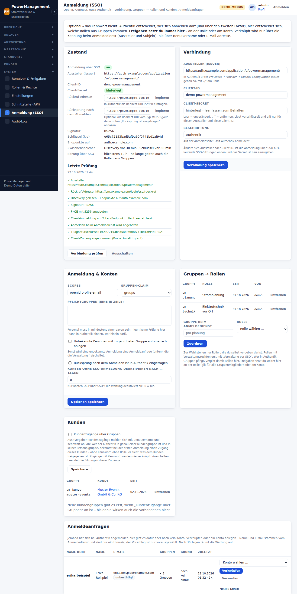

# Anmeldung über SSO (OpenID Connect, etwa Authentik)

PowerManagement kann die Anmeldung einem eigenen Anmeldedienst überlassen –
gebaut und geprüft für **Authentik**, mit jedem Anbieter, der OpenID Connect
nach dem Standard spricht (Keycloak, Entra ID …). Das ist **optional**:
Ohne Einrichtung bleibt alles, wie es ist, und auch mit SSO bleibt die
Anmeldung mit Benutzername und Kennwort möglich, bis jemand das ausdrücklich
anders will („nur SSO“, siehe unten).

Die Aufgaben sind klar verteilt:

| Wer | entscheidet |
|---|---|
| **Authentik** | wer sich überhaupt anmelden darf (Bindungen an die Anwendung), mit welchem zweiten Faktor, und in welchen Gruppen jemand ist |
| **PowerManagement** | welches Konto zu welcher Anmeldung gehört, welche **Rollen** aus welchen Gruppen kommen, welche **Freigaben** jemand hat (immer hier, nie aus Gruppen), welcher **Kunde** zu einer Kundengruppe gehört |


- [Einrichtung in Authentik](#einrichtung-in-authentik)
- [Einrichtung hier](#einrichtung-hier)
- [Konten verbinden](#konten-verbinden)
- [Gruppen → Rollen](#gruppen--rollen)
- [Kunden über Authentik](#kunden-über-authentik)
- [Verwaltung per SSO, zweiter Faktor, nur SSO, Notzugang](#verwaltung-per-sso-zweiter-faktor-nur-sso-notzugang)
- [Abmelden](#abmelden)
- [Bestätigen über Authentik](#bestätigen-über-authentik)
- [Kommandozeile](#kommandozeile)
- [Fehlersuche](#fehlersuche)
- [Technik und Datenschutz](#technik-und-datenschutz)

## Einrichtung in Authentik

Bezeichnungen wie in der englischen Oberfläche von Authentik (2025/2026).

1. **Gruppen** (*Directory → Groups → Create*), zum Beispiel:
   - `pm-personal` – wer überhaupt hinein darf,
   - `pm-planung`, `pm-technik` – daraus werden hier Rollen,
   - für Kunden `pm-kunde-<name>` (nur mit Kundenbereich, siehe unten).

   Im Claim `groups` stehen nur **direkte** Mitgliedschaften – keine
   Elterngruppen. Wer über eine Untergruppe in `pm-planung` ist, ist es für
   PowerManagement nicht.
2. **Anwendung mit Provider** (*Applications → Applications → Create with
   provider* bzw. *New Application*):
   - **Name** „PowerManagement“, **Slug** `powermanagement` (nicht
     `authorize`, `token`, `device`, `userinfo`, `introspect` oder `revoke` –
     die Pfade belegt Authentik selbst).
   - **Launch URL** `https://pm.example.com/login/sso` – die Kachel im
     Portal von Authentik meldet dann direkt an.
   - **Provider Type** *OAuth2/OpenID Provider*.
   - **Authorization flow** `default-provider-authorization-implicit-consent`
     (ohne Zustimmungsseite) oder `…-explicit-consent`.
   - **Client type** *Confidential*. *Client ID* und *Client Secret* nur in
     PowerManagement eintragen, nirgends sonst.
   - **Redirect URIs:**
     - ein Eintrag *Strict* mit `https://pm.example.com/login/sso/rueckruf`
       (die Adresse steht zum Kopieren unter *System → Anmeldung (SSO)*).
       Das Feld muss ausgefüllt sein – ohne Eintrag lehnt Authentik jede
       Anmeldung ab (`redirect_uri_no_match`).
     - optional ein zweiter vom Typ *Post Logout* mit `https://pm.example.com/login`
       für den Rücksprung nach dem Abmelden – dann hier „Rücksprung nach dem
       Abmelden ist eingetragen“ anhaken.
     - Das Feld *Logout URI* (Back-Channel) bleibt leer.
   - **Signing Key**: *authentik Self-signed Certificate* oder ein eigenes
     RSA- (ab 2048 Bit) bzw. EC-P-256-Zertifikat. **Ohne** Signing Key
     signiert Authentik mit HS256 und dem Client-Secret – das nimmt
     PowerManagement nicht an. *Encryption Key* bleibt leer.
   - **Advanced protocol settings:**
     - *Scopes* `openid`, `email`, `profile` (`profile` liefert bei Authentik
       auch `groups`); wer statt der Gruppen *Entitlements* der Anwendung
       nutzt, nimmt zusätzlich `entitlements` und stellt hier den
       Gruppen-Claim auf `entitlements`.
     - *Subject mode*: Standard *Based on the User's hashed ID* – **nicht**
       „username“ (ein Benutzername lässt sich umbenennen und neu vergeben).
     - *Include claims in id_token*: an.
     - *Issuer mode*: *Each provider has a different issuer, based on the
       application slug* (Standard).
     - *Access code validity*: 1 Minute genügt.
   - **Invalidation flow**: `default-provider-invalidation-flow` (beendet
     nur die Sitzung bei PowerManagement) oder `default-invalidation-flow`
     (meldet auch bei Authentik ganz ab – für geteilte Tablets).
3. **Wer hinein darf**: *Applications → PowerManagement → Policy / Group /
   User Bindings* – die Gruppe `pm-personal` (und Kundengruppen) binden.
   Ergänzend lassen sich hier „Pflichtgruppen“ eintragen.
4. **Zweiter Faktor** im Authentifizierungs-Flow (*Authenticator Validation
   Stage*). PowerManagement kann für Verwaltungskonten verlangen, dass
   Authentik einen zweiten Faktor meldet (`amr` = `mfa`). Eine Anmeldung nur
   mit Passkey meldet Authentik anders – sie zählt hier **nicht** als
   zweiter Faktor.
5. **Issuer kopieren**: *Applications → Providers → Provider for
   PowerManagement* (so nennt der Assistent den Provider) *→ OpenID
   Configuration Issuer*, etwa
   `https://auth.example.com/application/o/powermanagement/` – **mit** „/“ am
   Ende.
6. **Proxy vor Authentik**: Er gibt `Host` und `X-Forwarded-Proto: https`
   weiter. Authentik baut den Issuer aus der Anfrage – sonst passt `iss` im
   Token nicht zum eingetragenen Aussteller.
7. **Erreichbarkeit**: PowerManagement löst den Code **über die öffentliche
   Adresse** von Authentik ein (Hairpin-NAT oder ein interner DNS-Eintrag auf
   denselben Proxy) – ausgehendes HTTPS in der Firewall erlauben, nie die
   interne `:9000`-Adresse eintragen. Ohne Hairpin-NAT hilft
   `sso.verbinden_ueber` in `config/config.php` (siehe unten).
8. **Uhrzeit**: Ein LXC nutzt die Uhr des Proxmox-Hosts – dort chrony
   prüfen. Mehr als 60 Sekunden Abweichung lassen jede Anmeldung scheitern
   („Die Uhr … geht falsch“).

## Einrichtung hier

1. **`app.url`** in `config/config.php` setzen: `https://pm.example.com`
   (https, ohne Pfad – PowerManagement in einem Unterordner geht mit SSO
   nicht). Daraus entsteht die Rückruf-Adresse
   `https://pm.example.com/login/sso/rueckruf` – nie aus `Host` oder
   `X-Forwarded-*` der Anfrage.
2. ***System → Anmeldung (SSO)*** (Recht „Anmeldung über SSO einrichten“,
   `sso.manage`):
   - Karte **Verbindung**: Aussteller (Issuer), Client-ID, Client-Secret und
     die Beschriftung des Knopfs („Mit Authentik anmelden“). Das Secret liegt
     verschlüsselt und gilt nur für genau diesen Aussteller und diese
     Client-ID; ändern sich die, ist es neu einzugeben. Gibt es schon
     Zuordnungen von Gruppen, stellt die Verbindung auf einen anderen
     Anmeldedienst nur um, wer jede dieser Zuordnungen selbst anlegen dürfte
     (sonst vergäbe der neue Anmeldedienst über sie Rollen, die man nicht
     vergeben darf); die Kommandozeile ist davon frei.
   - **Verbindung prüfen**: holt die Discovery und die Schlüssel frisch und
     probiert den Client-Zugang mit einem erfundenen Code aus (Authentik
     antwortet dann „invalid_grant“ – das heißt: Client-ID und Secret
     stimmen). Das Ergebnis steht unter „Letzte Prüfung“.
   - **Einschalten** prüft noch einmal und schaltet nur bei Erfolg ein. Ab
     dann steht auf der Anmeldeseite „Mit Authentik anmelden“.
3. Oder auf der Kommandozeile – das Secret **nur über die Standardeingabe**,
   nie als Argument:

   ```bash
   printf '%s' "$SECRET" | bin/power sso:einrichten https://auth.example.com/application/o/powermanagement/ <client-id>
   bin/power sso:pruefen
   bin/power sso:an
   ```



**Optionen** (Karte „Anmeldung & Konten“):

| Option | Vorgabe | Bedeutung |
|---|---|---|
| Scopes | `openid profile email` | höchstens 8; `openid` muss dabei sein, `offline_access` nie |
| Gruppen-Claim | `groups` | oder `entitlements`, `roles` |
| Pflichtgruppen | leer | Personal muss in mindestens einer sein; leer = keine Prüfung hier (dann in Authentik binden, wer hinein darf) |
| Unbekannte automatisch anlegen | aus | siehe [Konten verbinden](#konten-verbinden) |
| Rücksprung nach dem Abmelden eingetragen | aus | nur anhaken, wenn die Redirect-URI vom Typ *Post Logout* in Authentik steht |
| Konten ohne SSO-Anmeldung deaktivieren nach … Tagen | 0 (nie) | die Wartung deaktiviert Konten „nur über SSO“, die sich so lange nicht angemeldet haben |

**Nur in `config/config.php`** (bestimmt, wohin das Secret geht – darum nie
aus der Oberfläche):

```php
'sso' => [
    // Ohne Hairpin-NAT: die Verbindung geht an 10.20.0.20:443, Name, SNI und
    // Zertifikatsprüfung bleiben auth.example.com (curl CONNECT_TO).
    'verbinden_ueber' => 'auth.example.com:443:10.20.0.20:443',
    // Eigene CA für Authentik (interne CA). Unter PHP-FPM nur im Programmordner (open_basedir).
    'ca_datei' => '/opt/powermanagement/config/authentik-ca.pem',
],
```

Beides braucht `php-curl`. Host und Port vorn in `verbinden_ueber` müssen
die des Ausstellers sein; was nicht taugt, nennt „Verbindung prüfen“ (und
schaltet dann nicht ein).

## Konten verbinden

Ein Konto hier gehört zu einer Anmeldung dort nur über **Aussteller und
Subjekt** (`iss` + `sub`) – laut OpenID Connect die einzigen beständigen
Angaben. **Benutzername und E-Mail-Adresse verknüpfen nie von selbst**: Wer
bei Authentik seinen Namen oder seine Adresse ändern kann (oder sie
jemandem gleich wählt), übernähme sonst ein Konto hier. Authentik setzt
`email_verified` ohnehin auf `false`.

Drei Wege:

1. **Selbst im Profil**: Wer mit Kennwort angemeldet ist, gibt unter
   *Profil → Anmeldung über Authentik* sein **Kennwort noch einmal** ein,
   tippt auf **Mit Authentik verbinden**, dann (innerhalb von fünf Minuten)
   auf **Weiter zu Authentik** und meldet sich dort einmal neu an. Danach
   geht die Anmeldung auch darüber. Das Kennwort verlangt PowerManagement,
   weil eine offene Sitzung allein nicht reicht: Wer an einem liegen
   gelassenen Tablet säße, hängte sonst seine eigene Anmeldung bei Authentik
   dauerhaft an das fremde Konto. Fünf falsche Kennwörter bremsen das
   Verbinden dieses Kontos (wie die Anmeldung, `security.lockout_*`).
2. **Anmeldeanfrage**: Meldet sich jemand an, den PowerManagement nicht
   kennt, steht dort „Für diese Anmeldung gibt es hier noch kein Konto …“,
   und unter *System → Anmeldung (SSO) → Anmeldeanfragen* erscheint eine
   Zeile mit Name, E-Mail (mit „bestätigt“, wenn Authentik es sagt),
   Gruppen und Zeitpunkt. Die Verwaltung (Recht „Benutzer verwalten“)
   **verknüpft** sie mit einem vorhandenen Konto (vorgeschlagen wird ein
   Konto gleichen Namens oder gleicher bestätigter E-Mail – nur als
   Vorauswahl), legt ein **neues Konto** an (nur Rollen, die sie selbst
   vergeben darf; das Konto meldet sich nur über SSO an) oder **verwirft**
   sie. Gespeichert sind nur die geprüften Angaben aus dem Token; die
   Werte kommen beim Freischalten aus dieser Zeile, nie aus dem Browser.
   Nach 30 Tagen räumt die Wartung eine Anfrage weg, höchstens 200 stehen da.
3. **Automatisch anlegen** (Option, Vorgabe aus): Wer über eine zugeordnete
   Gruppe eine Rolle bekäme, bekommt beim ersten Mal ein Konto – ohne
   Kennwort, „nur über SSO“, mit dem Benutzernamen von dort. Ist der Name
   hier schon vergeben (ohne Groß/Klein) oder ungültig, wird es eine
   Anfrage. Ohne zugeordnete Gruppe auch.

Lösen geht im Profil (nicht für Konten „nur über SSO“) und in der
Benutzerverwaltung bzw. unter *Verknüpfte Konten* („Lösen“, „Sitzungen
beenden“). Kundenzugänge mit Kennwort werden nie verknüpft – auch nicht
per Freischaltung.

## Gruppen → Rollen

Unter **Gruppen → Rollen** wird je Gruppe eine Rolle zugeordnet, etwa
`pm-planung` → *Stromplanung*, `pm-technik` → *Elektrotechnik vor Ort*.

- Bei jeder Anmeldung über SSO setzt PowerManagement die Rollen aus den
  Gruppen **neu**: Gruppe dazu → Rolle dazu, Gruppe weg → Rolle weg. Sie
  gelten bis zum Ende dieser Sitzung (höchstens `security.max_session`,
  ohne sie 12 Stunden) und stehen in der Benutzerverwaltung ausgegraut als
  „über Gruppe“. Eine Anmeldung **mit Kennwort** entfernt sie.
- Rollen, die jemand **von Hand** hat, bleiben unberührt.
- **Freigaben kommen nie aus Gruppen.** Wer eine Gruppe nur für bestimmte
  Standorte will, legt dafür eine eigene Rolle an und gibt *der Rolle* die
  Freigaben ([rechte.md](rechte.md#rollen-aus-authentik-gruppen)).
- Zuordnen darf nur, wer die Rolle selbst vergeben dürfte (dazu
  „Benutzer verwalten“). Rollen mit Verwaltungsrechten nur mit
  „Verwaltung per SSO“ (siehe unten).
- **Wer in Authentik Gruppen pflegt, vergibt damit Rollen hier.** Die
  Gruppen-Verwaltung in Authentik gehört deshalb in dieselben Hände wie die
  Benutzerverwaltung hier.

## Kunden über Authentik

Die **Vorgabe ist aus**: Kundenzugänge melden sich mit Benutzername und
Kennwort an ([kundenbereich.md](kundenbereich.md)). Wer Kunden in seinem
Authentik hat, kann es in der Karte **Kunden** einschalten (Recht „Kunden
pflegen“ zusätzlich zu `sso.manage`):

- Je Kunde eine **Kundengruppe**, etwa `pm-kunde-muster-events` → *Muster
  Events GmbH & Co. KG*. Wer in genau einer Kundengruppe ist, bekommt bei
  der ersten Anmeldung einen **Kundenzugang dieses Kunden** – ohne Kennwort,
  ohne Rolle, nur über SSO; danach meldet er sich darüber an und landet im
  Kundenbereich. Was er sieht, regeln wie immer die Freigaben am Kunden.
- Zuordnen und einschalten darf nur, wer die Zugänge dieses Kunden selbst
  ausgeben dürfte („Kunden pflegen“ und alles sehen, was der Kunde sieht).
- Abgelehnt werden: zwei Kundengruppen (`kunden_mehrere`), Kunden- und
  Personalgruppe zugleich (`gemischt`), ein beendeter Kunde
  (`kunde_inaktiv`), eine Kundengruppe eines anderen Kunden als beim
  ersten Mal (`kunde_abweichend` – der Kunde eines Zugangs ändert sich nie
  von selbst; die Verwaltung löscht den Zugang, die nächste Anmeldung legt
  ihn beim neuen Kunden an).
- Ein **lokaler** Kundenzugang (mit Kennwort) wird nie mit einer SSO-Anmeldung
  verknüpft, und eine Anmeldeanfrage aus einer Kundengruppe wird nie ein
  Konto des Personals.
- Ausschalten lässt die Kundengruppen stehen, beendet aber die laufenden
  SSO-Sitzungen der Kundenzugänge; sie kommen erst nach dem Wiedereinschalten
  wieder herein („Kundenzugänge über den Anmeldedienst sind hier
  ausgeschaltet“, `kunden_aus`). Eine Kundengruppe entfernen beendet die
  SSO-Sitzungen dieses Kunden sofort.

**Restrisiko**: Wer in Authentik einen Kunden in die falsche Gruppe legt,
gibt ihm hier die Sicht dieses Kunden. Darum: genau eine Gruppe je Kunde,
keine Mischung, und die Gruppen in Authentik nur von der Verwaltung pflegen.

## Verwaltung per SSO, zweiter Faktor, nur SSO, Notzugang

Diese Schalter (Karte **Schutz**) ändert nur, wer **alle Rechte** hat.

- **Verwaltung per SSO** (Vorgabe aus): Konten mit Verwaltungsrechten
  (alle Rechte, „Benutzer verwalten“, „Einstellungen“, „Anmeldung über
  SSO“, „Schnittstelle“) melden sich **nur mit Kennwort** an, und Rollen mit
  solchen Rechten lassen sich keiner Gruppe zuordnen – sonst beherrschte,
  wer Authentik beherrscht, auch PowerManagement. Ausschalten beendet ihre
  SSO-Sitzungen und entfernt solche Rollen aus Gruppen sofort.
- **Zweiter Faktor für Verwaltungskonten** (Vorgabe aus): dann nur, wenn
  Authentik `amr` mit `mfa` (oder `sc`) meldet. Aus einer SSO-Sitzung ohne
  zweiten Faktor lässt sich das nicht einschalten – die eigene Sitzung
  endete sonst sofort.
- **Nur SSO**: Verknüpfte Konten melden sich nur noch über Authentik an;
  eine laufende Kennwort-Sitzung eines verknüpften Kontos endet mit der
  nächsten Anfrage. Konten ohne Verknüpfung (Kundenzugänge mit Kennwort,
  der Notzugang) bleiben bei Benutzername und Kennwort – auf der
  Anmeldeseite liegt das Kennwortformular dann eingeklappt unter dem Knopf
  („Mit Benutzername und Kennwort (Kunden, Notzugang)“). Einzelne Konten
  lassen sich in der Benutzerverwaltung auch ohne den globalen Schalter auf
  „nur über SSO“ stellen. Einschalten geht nur:
  - aus einer Sitzung, die selbst über SSO angemeldet ist (es geht also),
  - mit „Verwaltung per SSO“ und einer erfolgreichen letzten Prüfung,
  - mit mindestens einem **Notzugang** ohne Enddatum,
  - mit eingetipptem „nur SSO“.
- **Notzugang** ist kein eigener Schalter, sondern abgeleitet: ein aktives
  Konto mit allen Rechten, das mit keiner Anmeldung verknüpft ist und nicht
  „nur über SSO“. Anlegen:

  ```bash
  bin/power user:add notfall admin
  ```

  Nie verknüpfen, das Kennwort offline verwahren. Seine Anmeldung ist
  laut: Hinweis auf jeder Seite, Weg `notzugang` im Audit, ein Eintrag im
  Fehlerprotokoll. Den **letzten** Notzugang zu verknüpfen, zu
  deaktivieren, zu löschen, ihm alle Rechte zu nehmen oder ein Enddatum zu
  geben (am Konto oder an seiner Rolle) wird abgelehnt, solange „nur SSO“
  an ist. Als „letzter“ zählt er, solange es keinen anderen Notzugang
  **ohne Enddatum** gibt – ein befristeter verschwindet an seinem Tag still.
- **Notausgang**, wenn niemand mehr hereinkommt (Authentik weg, Notzugang
  verloren):

  ```bash
  bin/power sso:aus --nur-sso     # nur „nur SSO“ aus – SSO bleibt an
  bin/power sso:aus               # SSO ganz aus
  bin/power user:password <name> <kennwort>
  ```

Fällt Authentik aus, öffnet das nie still die Kennwort-Anmeldung – dafür
gibt es Notzugang und Notausgang.

## Abmelden

- **Abmelden** beendet die Sitzung hier wie bisher. War sie über SSO – oder
  wurde in ihr über Authentik bestätigt oder verbunden (dann ist im Browser
  ebenfalls eine Sitzung bei Authentik offen) –, kommt danach eine
  Zwischenseite: „Sie sind hier abgemeldet. Bei Authentik
  sind Sie womöglich noch angemeldet“ – mit **Auch bei Authentik abmelden**
  (ein Link zum `end_session_endpoint` von Authentik, mit Rücksprung zur
  Anmeldeseite, wenn er eingetragen ist). Neu laden führt zur Anmeldeseite.
- **Geteilte Tablets**: Die nächste SSO-Anmeldung in diesem Browser
  verlangt bei Authentik eine neue Anmeldung (`prompt=login`, 12 Stunden
  lang) – so meldet ein Tipp nicht still den Vorgänger an. Für Tablets am
  Stand empfiehlt sich in Authentik der Invalidation flow
  `default-invalidation-flow`.
- **Restrisiko Kundenmodus**: Während ein Kunde am Tablet unterschreibt, ist
  im Browser womöglich eine Sitzung bei Authentik offen. Über die
  Anmeldeseite von Authentik käme er in dessen Portal. Für Kiosk-Tablets
  eine kurze Sitzungsdauer in Authentik oder einen Kiosk-Browser nutzen.
- Abmelden aus Authentik heraus (Back-Channel-Logout) gibt es noch nicht;
  eine Sitzung über SSO endet spätestens nach `security.max_session` (ohne
  sie 12 Stunden), beim Ausschalten, beim Lösen, mit „Sitzungen beenden“
  und wenn das Konto hier deaktiviert wird.

## Bestätigen über Authentik

Wo PowerManagement das Kennwort noch einmal verlangt, geht das für Konten
„nur über SSO“ über Authentik – mit neuer Anmeldung dort (`prompt=login`,
`max_age=0`), frischem Anmeldezeitpunkt und **derselben Person** wie in der
Sitzung:

- **Kundenmodus entsperren** (Übergabeberichte): „Mit Authentik entsperren“
  statt des Kennwortfelds. Meldet sich dort jemand anderes an, bleibt das
  Gerät gesperrt, und es zählt als Fehlversuch (ab fünf wird gebremst).
- **Token anzeigen** (Schnittstelle): „Mit Authentik bestätigen“, danach
  einmal „Token jetzt anzeigen“.

Eine Bestätigung gilt einmal und fünf Minuten lang, nur für diesen Zweck
und dieses Konto. Für Verwaltungskonten gilt dieselbe Schranke wie bei der
Anmeldung (nur mit „Verwaltung per SSO“, mit der MFA-Pflicht nur mit
zweitem Faktor). Fehlversuche stehen im Audit als
`auth.bestaetigung_fehlversuch` mit dem Zweck (`kundenmodus:<id>`,
`token:<id>`, `verbinden` für ein falsches Kennwort beim Verbinden). Ignoriert der Anbieter die neue Anmeldung, wird nie still
bestätigt („Der Anmeldedienst hat nicht neu angemeldet“).

## Kommandozeile

```text
bin/power sso:zustand                        Verbindung, Schlüssel, Schalter, Verknüpfungen, Anfragen, Notzugänge – ohne Secret
bin/power sso:pruefen                        Verbindung frisch prüfen; Exit 1 bei einem Fehler
bin/power sso:einrichten <aussteller> <client-id> [--name=Authentik]
                                             Secret nur von der Standardeingabe (printf '%s' "$SECRET" | …); schaltet nicht ein
bin/power sso:an                             frisch prüfen und nur bei Erfolg einschalten
bin/power sso:aus [--nur-sso]                ausschalten bzw. nur „nur SSO“ aus (Notausgang)
bin/power sso:verknuepfungen [<benutzer>]    verknüpfte Konten: Weg, Name dort, zuletzt, Subjekt gekürzt
bin/power sso:loesen <benutzer> --ja         Verknüpfung lösen (beendet dessen SSO-Sitzungen)
bin/power sso:aussteller-umstellen <neu> --ja
                                             Verknüpfungen auf einen neuen Aussteller derselben Authentik-Installation
bin/power pruefen                            mit SSO: „SSO: OK – <Issuer>, n Schlüssel, Client-Zugang angenommen“
bin/power wartung                            abgelaufene Rollen aus Gruppen und alte Anfragen weg, inaktive Konten „nur über SSO“ deaktivieren
```

**Aussteller umstellen** nur, wenn sich der Issuer **derselben**
Authentik-Installation ändert (neuer Slug, anderer Issuer-Modus): Das
Subjekt „hashed user ID“ gilt dort installationsweit. Bei einem anderen
Anmeldedienst gehörten die Konten danach womöglich fremden Personen – dort
lösen und neu verbinden. Ändert sich der Aussteller unter *Verbindung*,
nennen Seite und `sso:zustand` die Verknüpfungen, die nun nicht mehr
gelten.

Die Kommandozeile hat volles Vertrauen (wie `user:password`); im Audit steht
sie als `cli`.

## Fehlersuche

Die Meldung nennt den Grund; im Audit steht er als
`auth.sso_fehlgeschlagen` mit `grund` und `zweck`, im Log
(`storage/logs/app.log`) Schritt, Status und Dauer – nie Code, Token oder
Secret.

| Meldung (Code) | Ursache | Abhilfe |
|---|---|---|
| Der Aussteller im Token passt nicht (`iss`, `discovery`) | Proxy ohne `Host`/`X-Forwarded-Proto`, Issuer ohne „/“, interne Adresse eingetragen | Proxy-Kopfzeilen setzen, Issuer genau kopieren |
| Discovery nicht gefunden (`discovery`) | Issuer-Modus „Same identifier for all providers“, Tippfehler im Slug | Issuer-Modus auf den Standard, Issuer kopieren |
| Der Anmeldedienst leitet um (`discovery`) | Issuer mit http statt https, ohne „/“ | Issuer genau so, wie Authentik ihn nennt |
| Der Anmeldedienst ist nicht erreichbar | DNS, Firewall, kein Hairpin-NAT, interne CA | ausgehendes HTTPS erlauben, `sso.verbinden_ueber`, `sso.ca_datei` |
| Authentik signiert ohne Schlüssel (HS256) – Signing Key wählen (`discovery`, `alg`) | kein Signing Key | in Authentik ein Zertifikat wählen, „Verbindung prüfen“ |
| Client-ID oder Secret falsch (`token`, Prüfung) | Secret falsch oder in Authentik neu erzeugt | neu eintragen |
| Anmeldecode nicht angenommen (`token`) | Rückruf-Adresse nicht *Strict* eingetragen, Grant fehlt, Code zu alt | Adresse aus *System → Anmeldung (SSO)* kopieren, Grant *Authorization Code* erlauben |
| Die Uhr … geht falsch (`exp`, `iat`, `nbf`) | Zeitabweichung über 60 s | Zeitsynchronisation (chrony auf dem Host) |
| Das Anmeldetoken ist ungültig (`kid`, `signatur`) | Schlüssel in Authentik gewechselt | „Verbindung prüfen“ (lädt die Schlüssel neu) |
| Das Anmeldetoken ist ungültig (`alg`) | Signing Key in Authentik auf eine andere Art gewechselt (RSA ↔ EC) – die gespeicherte Discovery kennt das Verfahren noch nicht | geht meist von selbst: die Discovery wird dann einmal neu geholt (frühestens alle 5 Minuten); sonst „Verbindung prüfen“ |
| noch kein Konto (`kein_konto`, `name`) | unbekannt, Anlage aus oder Name hier vergeben | Anfrage freischalten |
| Für PowerManagement fehlt die Gruppe (`pflichtgruppe`) | nicht in einer Pflichtgruppe | Gruppe in Authentik |
| Verwaltungskonten melden sich mit Kennwort an (`verwaltung`) | „Verwaltung per SSO“ aus | Kennwort nutzen oder Schalter |
| … verlangt einen zweiten Faktor (`mfa`) | Anmeldung ohne zweiten Faktor (auch nur Passkey) | MFA in Authentik |
| Kundenzugänge melden sich mit Benutzername und Kennwort an (`kunde_lokal`) | ein lokaler Kundenzugang gleichen Namens | mit Kennwort anmelden |
| Kundenzugänge über den Anmeldedienst sind ausgeschaltet (`kunden_aus`) | „Kunden“ aus | einschalten oder Zugang mit Kennwort |
| Kunden- und Personalgruppen zugleich (`gemischt`) | beides in Authentik | eine der Gruppen entfernen |
| Der Anmeldedienst hat nicht neu angemeldet (`nicht_neu`) | Anbieter übergeht `prompt=login` | Flow/Version prüfen |
| andere Person (`andere_person`) | beim Bestätigen hat sich jemand anderes angemeldet | als dieselbe Person bestätigen |
| abgelaufen oder schon benutzt (`state`) | über 10 Minuten, zweiter Tab, Zurück-Knopf | neu anmelden |
| Zu viele fehlgeschlagene Anmeldungen über SSO von dieser Adresse (`gebremst`) | Bremse je Adresse | die genannten Minuten abwarten (`security.lockout_minutes`) |
| … in einem anderen Fenster jemand an- oder abgemeldet (`sitzung`) | zwei Anmeldungen gleichzeitig im selben Browser | neu anmelden |

## Technik und Datenschutz

- **Ablauf**: Authorization Code mit PKCE (S256), `state` (einmalig, 10
  Minuten), `nonce`, `response_mode=query`. Der Code wird an der
  öffentlichen Adresse eingelöst (Client-Anmeldung *client_secret_basic*,
  sonst *client_secret_post*). Während PowerManagement auf Authentik wartet,
  hält es die Sitzung nicht.
- **ID-Token** wird immer ganz geprüft: Signatur RS256 oder ES256 über die
  Schlüssel des Anbieters (`kid`, Schlüsseltyp passend zum Verfahren,
  RSA ab 2048 Bit, EC P-256 – nie HS256 oder `none`), `iss` genau gleich,
  `aud` genau diese Client-ID, `azp`, `exp`/`iat`/`nbf` mit 60 Sekunden
  Spiel, `iat` höchstens 10 Minuten alt, `nonce`, `sub`; beim Verbinden und
  Bestätigen auch `auth_time`. Alle Adressen der Discovery müssen beim
  Aussteller liegen (gleiche Herkunft), Umleitungen werden nie verfolgt,
  Antworten höchstens 64 KiB.
- **Geheimnisse**: Das Client-Secret liegt verschlüsselt (`app.key`) und
  gilt nur für Aussteller + Client-ID. Code, Access-Token und ID-Token
  stehen nie in Log, Audit oder einer Antwort; das ID-Token liegt nur in der
  Sitzung, um beim Abmelden einmal als `id_token_hint` im Link zu stehen.
- **Gespeichert** wird je Verknüpfung: Aussteller, Subjekt, Weg, der Name
  dort und die Gruppen der letzten Anmeldung (Anzeige), Zeitpunkte. Je
  Anmeldeanfrage: Name, E-Mail (mit „bestätigt“), Gruppen, Zahl und
  Zeitpunkte – höchstens 30 Tage. Beides geht mit dem Konto bzw. beim
  Freischalten/Verwerfen.
- **Bremse**: Fehlgeschlagene SSO-Anmeldungen zählen je Adresse mit den
  Grenzen der Kennwort-Bremse (`security.ip_attempts` in
  `security.lockout_minutes`), aber in einem eigenen Zähler. Gezählt wird
  erst ab einem gültigen `state` – unangemeldete Aufrufe des Rückrufs
  schreiben nichts ins Audit. Die Bremse `locked_until` eines Kontos (nach
  falschen Kennwörtern) sperrt seine SSO-Anmeldung nicht.
- **Zugriffslog**: `code` und `state` des Rückrufs stehen im Zugriffslog von
  nginx. Beide gelten genau einmal und nur mit dem PKCE-Verifier in der
  Sitzung – danach sind sie wertlos.
- **Schnittstelle**: Die API (`/api/v1`) nimmt keine OIDC-Tokens an. Ein
  Token an einem Konto „nur über SSO“ gilt, solange das Konto aktiv ist –
  für das Ausscheiden das Konto deaktivieren oder „Konten ohne
  SSO-Anmeldung deaktivieren nach … Tagen“ nutzen.
- **Prüfer-Qualifikation** (Übergabeberichte) kommt nie aus Gruppen; die
  Verwaltung trägt sie auch bei Konten aus SSO in der Benutzerverwaltung
  ein.

Nicht dabei: Back-Channel-Logout, Einrichtung über die API von Authentik,
OIDC-Tokens für `/api`, HS256/EdDSA/ES384 und verschlüsselte ID-Tokens.

## Prüfen

| Skript | prüft |
|---|---|
| `tests/sso.php` | ID-Token (RS256/ES256, `iss`/`aud`/`exp`/`iat`/`nonce`, `alg`-Verwechslung, Schlüsselwechsel), Discovery und Secret-Probe, Einstellungen, Verknüpfung nur über `iss`+`sub` (auch Groß/Klein), Anfragen, automatische Konten, Gruppen → Rollen und Kunden, Prüfkette, Sitzung (auch Änderungen während des Wartens auf Authentik), nur SSO und Notzugang (auch Enddaten), Bestätigen (mit MFA-Pflicht), Bremse, keine Geheimnisse, Kommandozeile, Wartung, `verbinden_ueber`/`ca_datei` mit echtem TLS (eigene Instanz, OIDC-Attrappe) |
| `tests/sso-web.php` | im Browser-Ablauf: Anmeldung, `state` einmalig, Login-CSRF, HEAD verbraucht nichts, neue Sitzung, Abmelden mit `end_session`, Verbinden (erst das Kennwort), Anfrage, Einstellungsseite, nur SSO, Bestätigen für Kundenmodus und Token, Kundenzugang (eigene Instanz, zwei PHP-Server) |
| `tests/sitzung.php` | Rückruf, Start, „Prüfen“ und „Einschalten“ halten die Sitzung nicht, während sie auf den Anmeldedienst warten |
