# Bedienung

Die Oberfläche ist für Smartphone und Tablet gebaut, am Schreibtisch
funktioniert sie genauso. Sie lässt sich als Web-App auf den Startbildschirm
legen (Browser-Menü → *Zum Startbildschirm*). Livewerte aktualisieren sich
alle 5 Sekunden, solange die Seite offen ist.

Die Bilder zeigen das Demo-Gelände (`php bin/power demo:seed`): ein
Festivalgelände mit Netzanschluss, Energiesäulen, Aggregat, Speicher,
Verteilern, einer Foodtruck-Meile und einem laufenden Aufbau.

## Übersicht

Kacheln für jede sichtbare Anlage: Leistung, Ströme je Phase, Auslastung
gegen den Nennstrom, Alter des letzten Messwerts. Die Farbe zeigt den
Zustand:

| Farbe | Bedeutung |
|-------|-----------|
| grün | in Ordnung |
| gelb | Auslastung über der Warnschwelle (Vorgabe 80 %) |
| rot | über der Alarmschwelle (Vorgabe 95 %) |
| grau | kein Messwert seit 2 Minuten (*stumm*) |

Oben steht die **Einspeisung gesamt**. Sie wird aus dem Verteilbaum
berechnet, also nur aus den Einspeisungen (Netz, Aggregate, Speicher) ohne
Doppelzählung der nachgelagerten Verteilungen. Schwellen:
**System → Einstellungen → Grenzwerte**.

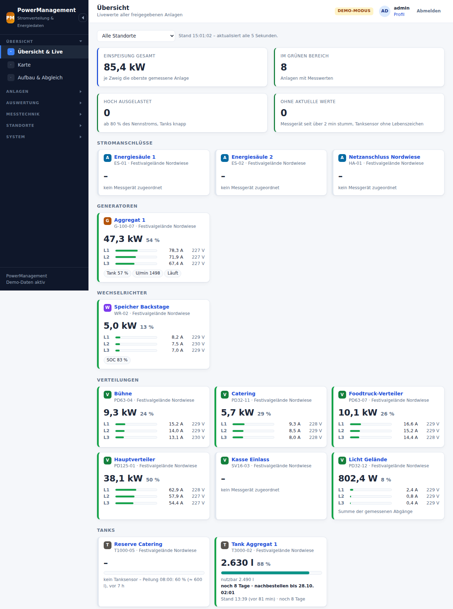

## Karte

Die Karte ist der Grundriss aus MasterAdmin: dieselben Pläne (PDF, Bild oder
SVG), dieselben Kacheln, derselbe Maßstab. Darauf liegen Anlagen, Kabel,
Kabelwege und Kabelbrücken. Ebenen lassen sich einzeln ein- und ausblenden.


Es gibt zwei Sorten von Anlagen:

- **Feststromanschlüsse** gehören zur Location und stehen bei jeder
  Veranstaltung an derselben Stelle: Hausanschluss, Energiesäulen,
  Wandverteiler, Wanddosen, Unterflurkästen, fest eingebaute
  Hallenverteilungen. Auf der Karte sind sie **eckig mit dunklem Rahmen**.
- **Mobile Anlagen** gehören zur Veranstaltung: mobile Stromverteiler,
  Aggregate, Speicher. Sie sind rund bzw. abgerundet.

Ebenso bei den Leitungen: **Fest verlegte Kabel** (Erdkabel vom
Hausanschluss zur Energiesäule) und fest verlegte Kabelwege (Kabelkanal,
Leerrohr) gehören zur Location und sind mit dunklem Rand gezeichnet.
**Mobile Kabel** werden für jede Veranstaltung neu gelegt. Kabelbrücken sind
immer mobil. Ein fest verlegtes Kabel endet nur an Feststromanschlüssen. Ein
neues Kabel zwischen zwei Feststromanschlüssen ist von Haus aus fest; im
Kabelfenster lässt sich das umstellen (*Fest verlegt*). Wird eine Anlage auf
mobil gestellt oder ein festes Kabel an eine mobile Anlage umgesteckt, wird
das Kabel mobil.

Feste und mobile Anlagen und Leitungen lassen sich gleichermaßen
verschieben und ändern. Im Anlagenfenster der Karte führt *Bearbeiten* zum
Formular.

Die Ebene *Feststromanschlüsse & feste Kabel* lässt sich getrennt von
*Mobile Anlagen*, *Mobile Kabel*, *Kabelwege* und *Kabelbrücken*
ausblenden. So sieht man vor der Planung, was auf dem Gelände fest
vorhanden ist.

| Modus | Was man tut |
|-------|-------------|
| **Ansehen** | Anlage oder Kabel antippen: Livewerte, Anschlüsse, Kabeldaten, Link zur Anlage. Den **Wert neben einer Anlage** (z. B. „25,4 kW · 34 %“) antippen: im Plan öffnet sich die Übersicht **je Phase** – Spannung, Strom, Leistung, Scheinleistung, cos φ, dazu Frequenz, Auslastung und Alter des Messwerts, alle 5 Sekunden aktualisiert. |
| **Verschieben** | Anlagen ziehen – feste wie mobile, angeschlossene Kabel folgen. Ein Kabel, einen Kabelweg oder eine Kabelbrücke antippen: Punkte ziehen, mit **⊕** zwischen zwei Punkten einen neuen herausziehen, mit Doppeltipp (oder langem Drücken) einen Punkt entfernen, mit **✥** die ganze Linie verschieben. Ein **Kabelende auf eine andere Anlage ziehen** steckt es dort an (den Anschluss danach im Kabelfenster wählen); ins Leere gezogen wird es gelöst. |
| **+ Anlage** | auswählen, was gesetzt wird, dann in den Plan tippen. Zur Wahl stehen ein **Feststromanschluss**, ein fester Katalog-Typ (z. B. *Energiesäule*), eine fest eingebaute Verteilung, ein **mobiler Standard-Verteiler** aus dem Katalog (mit Anschlüssen und Sicherungen) oder eine leere mobile Anlage. Eine vorhandene, noch nicht platzierte Anlage lässt sich ebenfalls setzen. |
| **Kabel** | Anlage A antippen (Abgang wählen), Zwischenpunkte setzen, Anlage B antippen (Eingang wählen). Kabeltyp, Querschnitt, Adern, Länge. Die Länge wird mit Maßstab aus dem Verlauf vorgeschlagen. |
| **Kabelweg** | Trasse ohne feste Enden (Kabelkanal, Traverse, Erdverlegung). Doppeltippen beendet. |
| **Kabelbrücke** | zwei Punkte über einen Weg. Modell und Anzahl der Elemente. |
| **Maßstab** | zwei Punkte mit bekanntem Abstand setzen. Danach stimmen Längen und Spannungsfall. |
| **Georeferenz** | zwei gut erkennbare Punkte weit auseinander antippen (Gebäudeecke, Tor, Mast, eine Energiesäule) und zu jedem Breite und Länge eintragen – siehe [Georeferenz](#georeferenz-und-gps). |
| **Hier bin ich** | (nur mit Georeferenz) zeigt die eigene GPS-Position als blauen Punkt im Plan, mit Genauigkeitskreis. Noch einmal tippen schaltet sie ab. |

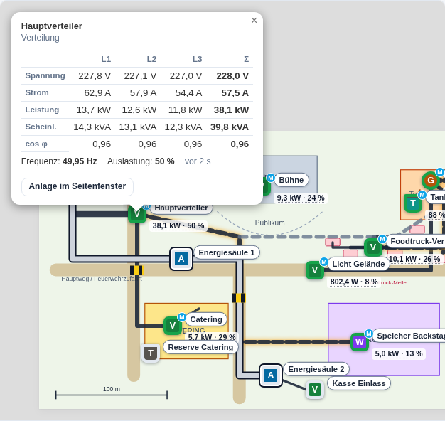

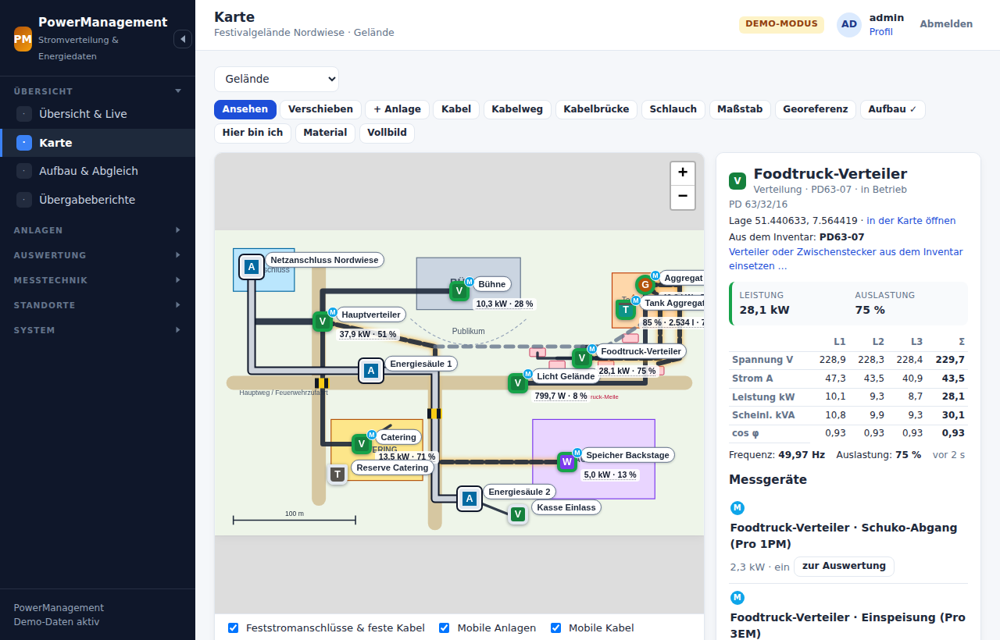

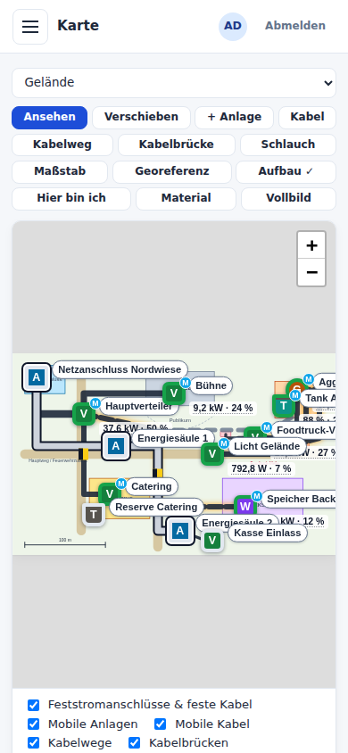

**Material** (oben in der Werkzeugleiste) öffnet die Materialliste der
ganzen Etage zum Drucken – siehe [Materialliste](#materialliste).

Beim Zeichnen (Kabel, Kabelweg, Kabelbrücke, Maßstab, Georeferenz) setzt
ein Tipp auf eine vorhandene Linie einen Punkt – so lässt sich ein Kabel
entlang eines Kabelwegs legen. Ein Tipp auf eine Anlage setzt den Punkt
genau auf sie.

### Georeferenz und GPS

Ein **referenzierter** Plan hat einen Maßstab; ein **georeferenzierter**
Plan weiß zusätzlich, wo er auf der Erde liegt und wie er gedreht ist. Dazu
braucht es zwei Passpunkte: je ein Punkt im Plan und seine Koordinaten.

1. *Georeferenz* in der Werkzeugleiste, Punkt 1 im Plan antippen, dann
   Punkt 2 – möglichst weit auseinander.
2. Zu jedem Punkt Breite und Länge eintragen. Die Koordinaten kommen aus
   OpenStreetMap oder Google Maps (Rechtsklick auf die Stelle → Koordinaten
   kopieren) oder vor Ort: an der Stelle stehen und **Meine Position**
   tippen. Lesbar sind „51.23456, 7.12345“, „51,23456; 7,12345“,
   Grad/Minuten/Sekunden (51°14'04.2"N 7°07'24.2"E) und Links aus
   OpenStreetMap oder Google Maps.
3. *Übernehmen*. Hat der Plan schon einen Maßstab und passt er nicht zur
   Georeferenz (über 3 % Abweichung), kommt ein Hinweis – dann stimmt ein
   Passpunkt oder der Maßstab nicht.

Was damit geht:

- **Längen ohne Maßstab**: Fehlt ein Maßstab, rechnen Kabellängen,
  Spannungsfall und Materialliste mit der Georeferenz. Ein gesetzter
  Maßstab hat Vorrang.
- **Lage jeder Anlage**: Das Anlagenfenster zeigt ihre Koordinaten und
  öffnet die Stelle in OpenStreetMap – zum Hinfinden beim Aufbau.
- **Hier bin ich**: die eigene GPS-Position im Plan. Das Handy braucht dafür
  eine HTTPS-Verbindung und die Standortfreigabe.
- **GeoJSON**: unter der Karte (*georeferenziert · GeoJSON*) alle
  sichtbaren Anlagen als Punkte und Kabel, Kabelwege und Kabelbrücken als
  Linien – für QGIS, Google Earth oder die Geländeplanung.

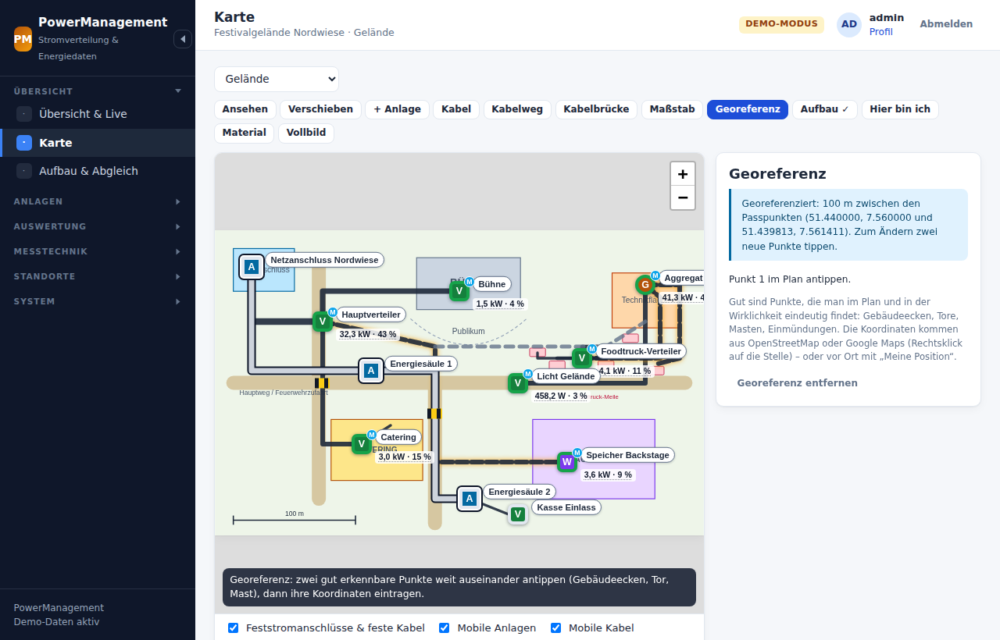


Die Georeferenz gehört zur Location und geht mit dem Location-Abgleich mit
(in `strom.json`, damit `location.json` das Format von MasterAdmin behält).
Setzen darf sie, wer Grundrisse verwalten darf.

Zu jedem Kabel prüft PowerManagement:

- **Belastbarkeit** des Querschnitts gegen den Stecker bzw. die Absicherung
  (Richtwerte H07RN-F nach VDE 0298-4),
- **passende Stecker** an beiden Enden,
- **Spannungsfall** ΔU aus Länge, Querschnitt und Nennstrom. Für Drehstrom
  gilt √3 · I · L · cos φ / (κ · A), für Wechselstrom 2 · I · L · cos φ /
  (κ · A), jeweils bezogen auf 400 V bzw. 230 V. Warnung über der Grenze
  aus den Einstellungen (Vorgabe 3 %).

Auffällige Kabel werden gestrichelt und leuchtend gezeichnet. Der Hinweis
steht im Kabelfenster.

## Anlagen

**Anlagen** listet Netzanschlüsse, Aggregate, Speicher/Wechselrichter,
Verteilungen, Unterverteilungen und Verbraucher. Filter nach Art, *fest
oder mobil*, Standort und Suchbegriff. **Anlagen → Feststromanschlüsse**
zeigt nur die fest installierten.

Ob eine Anlage fest installiert ist, steht an der Anlage
(*Bearbeiten → Fest installiert*). Stromanschlüsse sind von Haus aus fest,
alle anderen Arten mobil. Eine fest eingebaute Hallenverteilung oder ein
Baustromkasten, der nur für eine Veranstaltung steht, lässt sich
entsprechend umstellen. Auch die **Art** lässt sich nachträglich ändern
(etwa Verteilung → Generator). Anschlüsse, Sicherungen, Kabel und
Messgeräte bleiben dabei, nur die Angaben der alten Art fallen weg.

Je Anlage gibt es diese Reiter:

| Reiter | Inhalt |
|--------|--------|
| **Übersicht** | Daten, Livewerte, Verlauf der letzten 24 h, **Verteilerplan**, Schaltknöpfe, *Gespeist von* |
| **Anschlüsse** | Anzahl je Steckertyp (Powerlock, CEE 125/63/32/16 A, Schuko und eigene). Darunter jeder Anschluss mit Nummer, Bezeichnung, Phase (bei Schuko und 1~) und **Sicherung/RCD**. |
| **Sicherungen & RCDs** | Hauptschalter, RCD, RCBO, LS, NH mit Nennstrom, Charakteristik, Fehlerstrom und RCD-Typ. Jedes Schutzorgan hat ein **vorgeschaltetes** Schutzorgan, so entsteht der Baum HS → RCD → LS. **„Vorschlag“** legt eine übliche Bestückung an (je Abgang ein LS, bis 32 A je vier an einem RCD 40 A/30 mA Typ A, ab 63 A ein eigener RCD 300 mA). |
| **Messgeräte** | welches Gerät (Shelly-Kanal, Victron-Kanal, ComAp …) was misst: die **Einspeisung**, einen **Abgang** oder **einen bestimmten Anschluss**. |
| **Kabel** | alle Kabel an dieser Anlage mit Hinweisen |

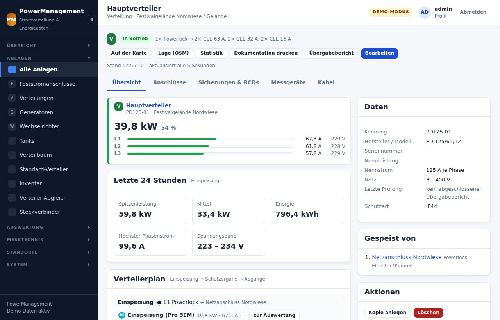

**Anschlüsse** lassen sich nicht wegnehmen, solange ein Kabel daran
steckt. Die Anzahl sinkt dann nur bis zum belegten Anschluss.

**Drucken** (`/anlagen/<id>/druck`) liefert ein Blatt für die Tür der
Verteilung: Einspeisung, Schutzorgane, Abgänge mit Stecker, Schutz, Phase
und angeschlossenem Kabel sowie die Messgeräte.

### Der Verteilerplan

Der Reiter *Übersicht* zeigt die Verteilung als Schaltbild: Einspeisung,
Hauptschalter, RCDs, Sicherungen und darunter die Abgänge mit Stecker.
Eingezeichnete **Messgeräte sind anklickbar** und zeigen Livewerte. Mit
**„zur Auswertung“** kommt das Messgerät in die Auswertung (Zähler oben in
der Navigation, höchstens 12 gleichzeitig).

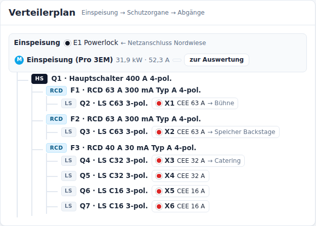

### Standard-Verteiler

**Anlagen → Standard-Verteiler** ist der Katalog: Verteiler und Aggregate
mit fester Bestückung (im Demo z. B. *PD 125*: Powerlock-Eingang,
2 × CEE 63, 2 × CEE 32, 2 × CEE 16 mit HS, RCDs und LS). Ein
Standard-Verteiler wird wie eine Anlage gepflegt. Auf der Karte
(*+ Anlage* → Standard-Verteiler) oder beim Anlegen einer Anlage
(*„Anschlüsse und Sicherungen übernehmen von“*) entsteht eine Kopie mit
allen Anschlüssen und Schutzorganen. Die Kopie ist danach unabhängig vom
Katalog.

Im Katalog stehen auch **Feststromanschluss-Typen** (*„+
Feststromanschluss-Typ“*), etwa die Energiesäulen eines Geländes, die
überall gleich bestückt sind. Was daraus entsteht, ist fest installiert.

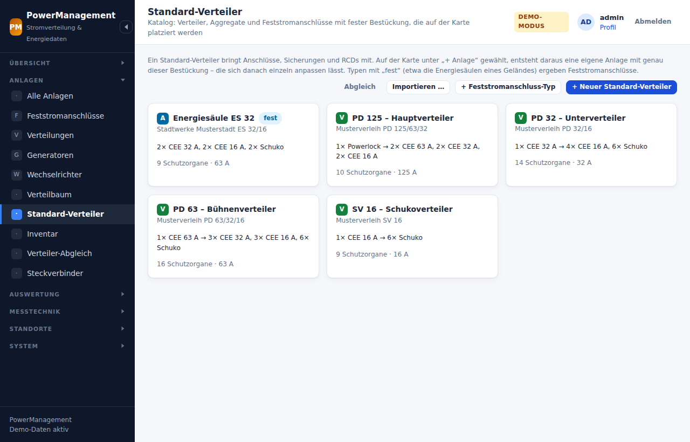

### Katalog importieren

Viele Standard-Verteiler und Aggregate auf einmal – etwa alle
Stromverteiler und Generatoren eines Verleihkatalogs wie der
BSS-Strombibel – kommen über **Standard-Verteiler → Importieren …** in den
Katalog. Das darf, wer Anlagen ändern darf und alle Standorte sieht; neue
Steckertypen legt der Import nur an, wenn man auch den
Steckverbinder-Katalog pflegen darf.

**Format.** Ein Katalog-Paket ist eine JSON-Datei (höchstens 5 MB,
höchstens 500 Typen):

```json
{ "format": 1, "art": "verteiler-typen", "quelle": "BSS Strombibel (Stand 18.03.2025)",
  "typen": [
    { "format": 1, "art": "verteiler-typ", "schluessel": "pd-63-32",
      "typ": { "art": "verteilung", "name": "PD 63/32", "hersteller": "…", "modell": "…",
               "nennstrom_a": 63, "spannung_v": 400, "phasen": 3,
               "eigenschaften": { "artikelnummer": "…", "gehaeuse": "…", "gewicht_kg": 38.5, "zuleitung": "2,0 m 5G16" },
               "schutzorgane": [ { "ref": "s1", "art": "hauptschalter", "nennstrom_a": 63, "pole": 3 },
                                 { "ref": "s2", "art": "rcd", "fehlerstrom_ma": 30, "rcd_typ": "A", "vor": "s1" } ],
               "anschluesse": [ { "richtung": "eingang", "stecker": "cee63", "nr": 1 },
                                { "richtung": "abgang", "stecker": "cee32", "nr": 1, "schutz": "s2" } ] },
      "steckertypen": [ { "schluessel": "cee63", "name": "CEE 63 A", "strom_a": 63, "phasen": 3, "spannung_v": 400 } ] } ] }
```

Jeder Typ ist eine Datei im Format des [Verteiler-Abgleichs](#verteiler-abgleich)
(`verteiler-typ`) – eine solche Datei allein lässt sich ebenfalls
importieren. Der `schluessel` ist eindeutig im Paket (a–z, 0–9,
Bindestriche); an ihm erkennt ein späterer Import den Typ wieder. Jeden
Stecker aus `anschluesse` gibt es hier schon, oder er ist unter
`steckertypen` beschrieben – ein neuer vollständig mit `name`, `strom_a`,
`phasen` (1 oder 3) und `spannung_v`, denn mit diesen Werten rechnen Kabel,
Schutzorgane und Auslastung. Zu den Eigenschaften gehören bei Verteilungen Artikelnummer,
Gehäuse, Schutzart, Zuleitung und Gewicht, bei Generatoren Artikelnummer,
Gewicht leer und Abmessungen (L × B × H in mm) neben Kraftstoff (Diesel,
HVO, Gas oder Benzin – Groß- und Kleinschreibung egal), Tank und Verbrauch.
`spannung_v` ist eine Zahl oder fehlt ganz (dann 400 V). Messpunkte gehören
nicht zu einem Katalog-Typ und bleiben weg.

**Mitgelieferte Kataloge** liegen unter `resources/kataloge/*.json` und
stehen auf der Import-Seite zur Auswahl – mit Quelle und Anzahl der Typen.
Eigene Pakete werden hochgeladen.

**Vorschau.** Nichts wird sofort übernommen. Die Vorschau zeigt je Typ
Name, Art, Bestückung und Zustand:

| Zustand | Bedeutung | vorausgewählt |
|---------|-----------|---------------|
| **neu** | gibt es hier noch nicht | ja |
| **schon da** | steht hier genauso | – |
| **hier anders** | steht hier anders als in der Datei – meist, weil jemand einen Fehler korrigiert hat; aufklappbar, was genau anders ist | nein („überschreiben“) |
| **Fehler** | die Datei taugt für diesen Typ nicht (Grund steht dabei: unbekannte Art, Stecker ohne Beschreibung, neuer Stecker ohne Nennstrom, Kraftstoff, den die Auswahl nicht kennt, Abgang an einem Schutzorgan, das es nicht gibt …) | – |

Darüber stehen die Steckertypen, die neu angelegt würden, mit Nennstrom,
Phasen, Spannung und den Typen, die sie brauchen. Wer den
Steckverbinder-Katalog nicht pflegen darf, sieht diese Typen ohne Haken und
mit dem Hinweis, welcher Stecker fehlt. *alle neuen* und
*keine* setzen die Haken; **Ausgewählte übernehmen** legt an bzw. ersetzt –
alles in einem Zug: geht ein Typ schief, wird nichts übernommen. Die
Meldung im Katalog nennt die Typen, die neuen und überschriebenen Einträge
sind dort einmal markiert. Eine Vorschau liegt eine Stunde bereit.

**Ein Import überschreibt nie still eine Korrektur.** Was hier anders
steht, bleibt, wie es ist – auch beim nächsten Import desselben Pakets –,
solange niemand ausdrücklich *überschreiben* anhakt. Der Haken gilt für den
Stand, den die Vorschau gezeigt hat: korrigiert jemand den Typ, während die
Vorschau offen ist, bleibt seine Korrektur stehen. Wird so nichts
übernommen, bleibt die Vorschau offen und zeigt den Stand von jetzt.

**Danach** sind die Typen gewöhnliche Standard-Verteiler: Name,
Nennwerte, Eigenschaften, Anschlüsse und Sicherungen lassen sich bearbeiten,
der Typ lässt sich kopieren und löschen. Fehlerhafte Einträge aus der
Vorlage korrigiert man also einfach im Katalog. Ein gelöschter Typ ist beim
nächsten Import wieder *neu*.

Auf der Kommandozeile:

```bash
php bin/power katalog:import resources/kataloge/bss-strombibel.json --pruefen   # nur ansehen
php bin/power katalog:import resources/kataloge/bss-strombibel.json             # neue anlegen
php bin/power katalog:import paket.json --ueberschreiben                        # auch „hier anders“ ersetzen
```

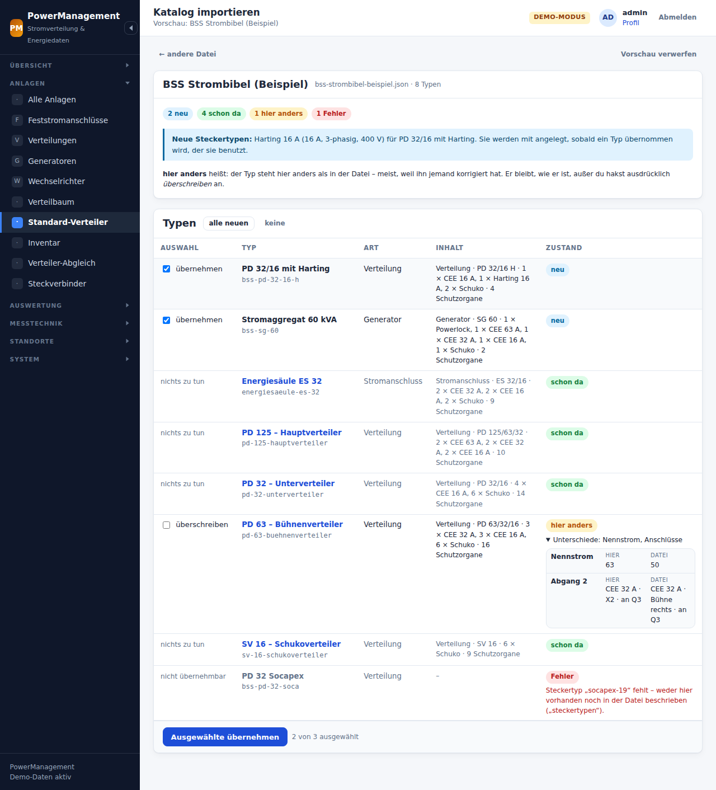

### Verteilbaum und Steckverbinder

- **Verteilbaum**: wer speist wen, aus den eingezeichneten Kabeln
  abgeleitet. Mit Livewerten je Anlage.
- **Steckverbinder**: der Katalog der Steckertypen. Powerlock 400 A,
  CEE 125/63/32/16 A und Schuko sind von Anfang an da, eigene kommen dazu
  (z. B. CEE 16 A 1~ blau, Harting). Nennstrom und Polzahl zählen für die
  Kabelprüfung.

## Aufbau und Abgleich

Der **Aufbau-Modus** ist der Übergang von der Planung zum echten Aufbau:

1. **Starten** (*Übersicht → Aufbau & Abgleich*): Standort wählen, die
   Veranstaltung benennen. Der Plan wird festgehalten – alle mobilen
   Anlagen, mobilen Kabel und Kabelbrücken samt Materialliste.
2. **Vor Ort bestätigen**: In der Karte *Aufbau ✓* (oder über *In der Karte
   bestätigen*). Offenes ist grau gestrichelt. Anlage oder Kabel antippen:
   - **✓ Wie geplant** – grün;
   - **Geändert …** – orange; kurz notieren, was anders ist, beim Kabel die
     echte Länge. Steht eine Anlage woanders, im Modus *Verschieben* an die
     echte Stelle ziehen;
   - **Entfällt** – rot, durchgestrichen;
   - **↺ zurücknehmen** macht die Position wieder offen.

   Im selben Fenster wird gewählt, welcher Verteiler oder Zwischenstecker
   aus dem [Inventar](#inventar) dort steht. Was beim Aufbau neu gezeichnet
   wird, zählt als **zusätzlich** (blau). Dieselben Knöpfe gibt es auch in
   der Liste des Aufbaus, mit Filtern nach offen, geändert, entfallen und
   zusätzlich.
3. **Aufbau fertig** hält den Ist-Stand fest; ab jetzt läuft der Betrieb.
4. **Veranstaltung beenden**, auf Wunsch mit Abbau aller Inventar-Stücke
   des Standorts – ihre Shellys messen dann nicht mehr dort.

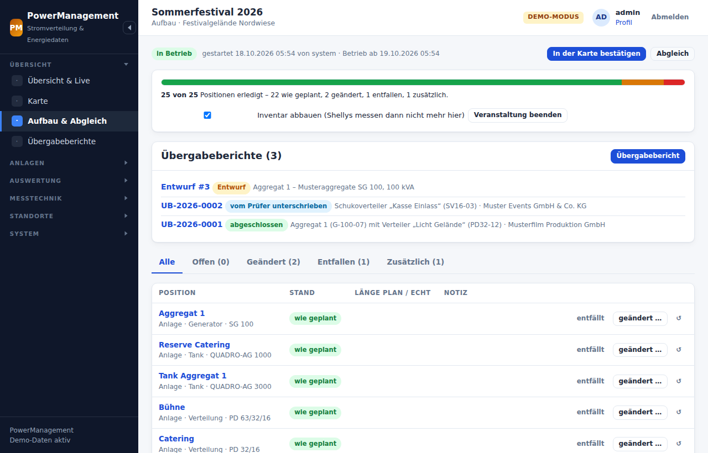


Der **Abgleich** (jederzeit, auch zum Drucken) zeigt, was anders kam, und
was das für die nächste Planung heißt:

- **Anlagen**: wie geplant, geändert (mit Versatz in Metern aus Maßstab oder
  Georeferenz und Typwechsel, etwa PD 32 → PD 63), entfallen, zusätzlich.
- **Kabel**: Länge im Plan gegen die echte, mit Differenz. Waren die Kabel
  insgesamt länger als die eingestellte Reserve, steht dort eine
  Empfehlung für die Kabelreserve.
- **Material**: Stücke je Kabelsorte – geplant gegen gebraucht.
- **Last im Betrieb**: je Anlage die Spitze und der höchste Phasenstrom
  gegen den Nennstrom, mit Hinweis: *überlastet*, *am Limit*, *passt* oder
  *überdimensioniert* (bei Verteilern mit dem kleineren Katalog-Typ, der
  gereicht hätte). Dazu die Bereiche mit ihrer höchsten gleichzeitigen Last
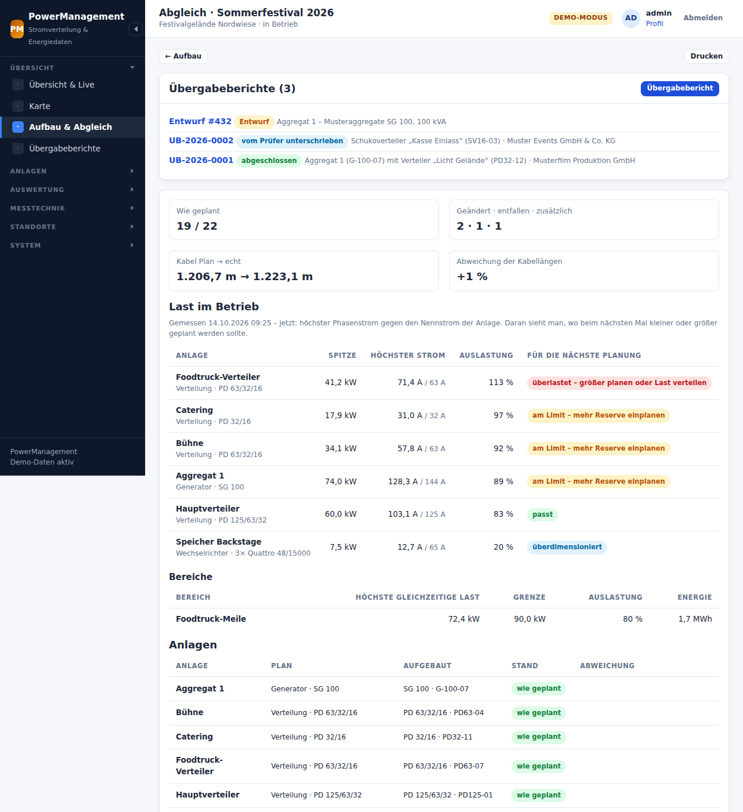

  gegen ihre Grenze.

## Übergabeberichte

Nach dem Aufbau prüft die Elektrofachkraft die Anlage und übergibt sie mit
einem **Übergabebericht** – Prüfprotokoll nach DIN VDE 0100-600 und
Errichterbestätigung nach DGUV Vorschrift 3 in einem (*Übersicht →
Übergabeberichte*, im Aufbau oder an der Anlage *Übergabebericht*):

1. Anlagen wählen – Abgänge, Sicherungen, RCDs und Kabel kommen aus dem
   Plan, **Messwerte nie**.
2. Am Tablet oder Telefon ausfüllen; das Formular speichert selbst, auch
   bei schwacher Verbindung. Die Bewertung je Stromkreis kommt vom Server.
3. *Prüfen*, dann **als Prüfer unterschreiben** – der Bericht ist
   eingefroren und hat seine Nummer.
4. **An Kunden übergeben**: Das Gerät zeigt nur noch diesen Bericht, der
   Kunde bestätigt den Erhalt und unterschreibt. Zurück mit dem Kennwort des
   Prüfers.
5. Das PDF ist gespeichert – ansehen, herunterladen, teilen.


Alles Weitere – Felder, Grenzwerte, Kundenmodus, Korrektur, Integrität,
Datenschutz, Aufbewahrung – steht in [berichte.md](berichte.md);
Kundendaten aus Eventworx in [eventworx.md](eventworx.md).

## Inventar

Im **Inventar** (*Anlagen → Inventar*) stehen die Geräte aus dem Lager, in
denen Shellys eingebaut sind – jedes mit seinem Aufkleber:

- **Verteiler** (PD63-07): ein Standard-Verteiler aus dem Katalog als Typ,
  dazu seine Shellys – an der **Einspeisung** (misst den ganzen Verteiler),
  an einzelnen **Abgängen** (misst, was dort hängt) oder beides.
- **Zwischenstecker** (ZS-63-02): ein Messadapter bis 125 A mit einem
  Shelly im **Durchgang**. Er misst, wo er gesteckt wird – an einem Abgang
  oder an der Einspeisung einer Anlage.

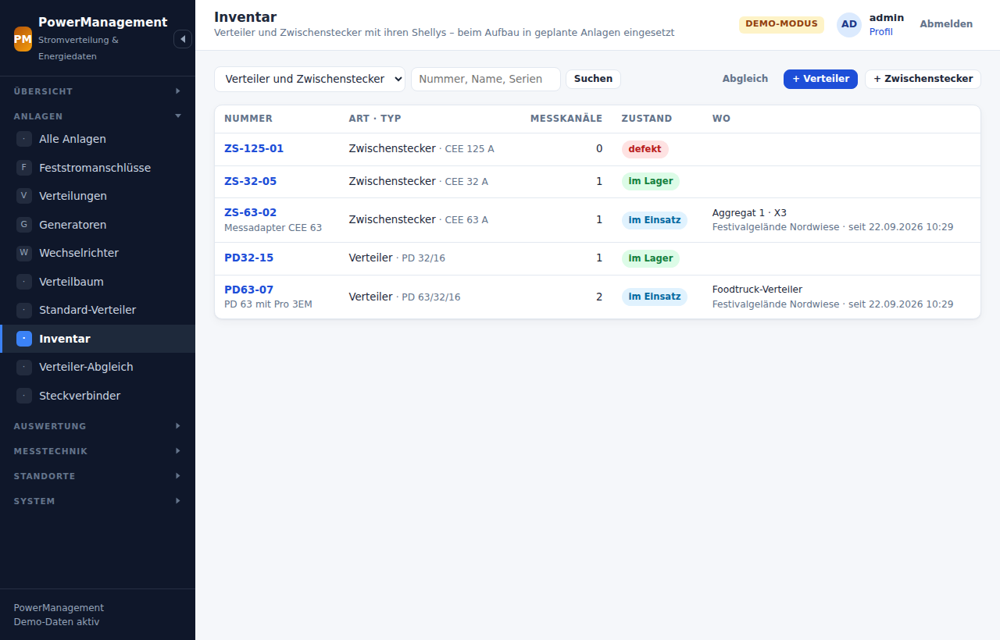

Angelegt wird im Vorfeld: *+ Verteiler* bzw. *+ Zwischenstecker*,
Inventarnummer, Typ bzw. Steckverbinder, dann je Shelly Gerät, Kanal und wo
er sitzt. Gerät und Kanal schlägt das Formular aus den Geräten vor, die schon
gesendet haben.

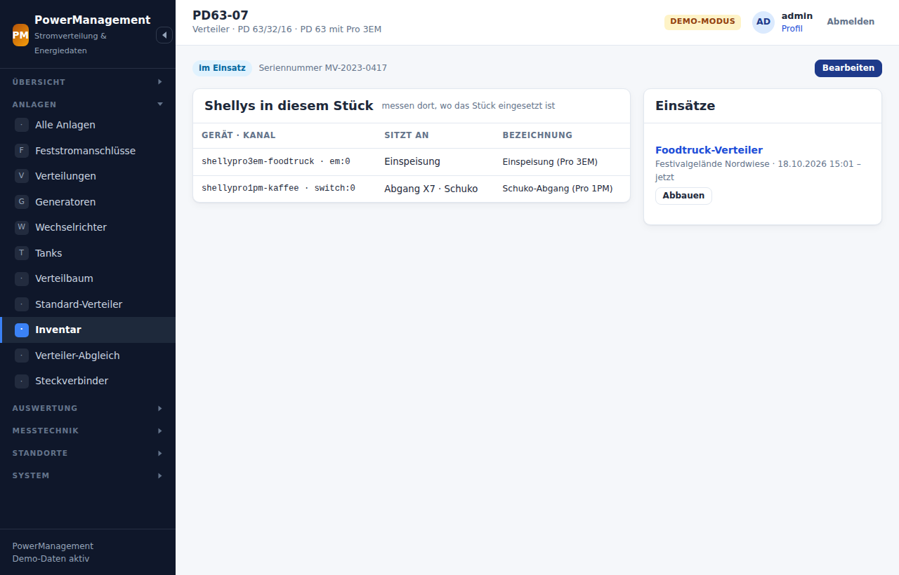

**Beim Aufbau** wird ausgewählt, welches Stück wo steht: an der geplanten
Anlage im Reiter *Messgeräte* unter *Aus dem Inventar* das Stück wählen
(beim Zwischenstecker auch, woran er steckt) und *Einsetzen*. Ab diesem
Moment messen seine Shellys dort – die Werte gehören zur Anlage, ihren
Bereichen und ihrer Statistik. Das Kartenfenster der Anlage zeigt, was aus
dem Inventar dort steckt.

- Passt der Typ nicht (geplant war ein PD 32, aufgebaut ist ein PD 63),
  wird die Anlage umgestellt: Anschlüsse und Sicherungen kommen aus dem
  Katalog, Kabel und Messgeräte bleiben an ihrem Anschluss.
- Steckt das Stück noch woanders, wird es dort abgezogen. Was vorher an
  derselben Stelle steckte, ist damit ersetzt.
- *Abbauen* beendet den Einsatz. Die Shellys messen dann nicht mehr dort;
  das Stück ist wieder im Lager.

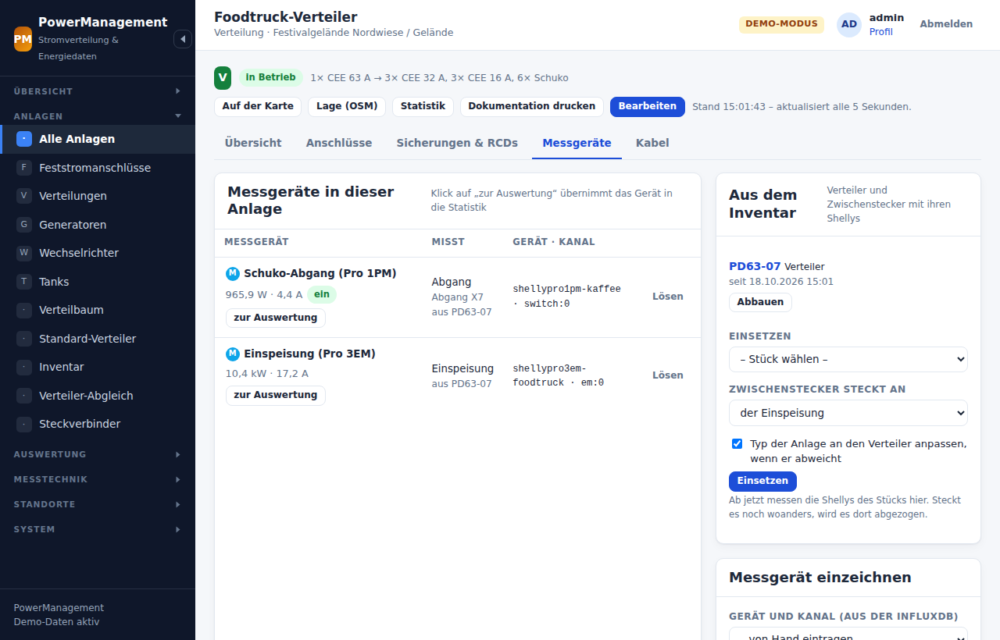

Die Zuordnung hat eine Zeit: Ein Messgerät aus dem Inventar zählt für die
Anlage **nur, solange es dort steckt**. Die Statistik der Anlage zeigt es
danach als früheres Messgerät („bis 14.07.2026 18:00“) mit genau den Werten
aus dieser Zeit – auch wenn der Verteiler längst woanders steht. Ein Bereich
mit einem gemessenen Abgang rechnet über die Zeit mit dem Gerät, das jeweils
dort steckte. Schalten lässt sich ein Shelly nur dort, wo er jetzt steckt.

Pflegen darf das Inventar, wer das Recht *Inventar pflegen* hat (Rolle
Stromplanung); ansehen, wer Datenquellen sehen darf. Einsetzen und Abbauen
darf, wer die Anlage bearbeiten darf.

## Auswertung (Statistik)

- **Zeitraum**: 1 h, 6 h, heute, 24 h, 7 Tage, 30 Tage oder frei.
- **Messgeräte**: alle sichtbaren Messpunkte, gruppiert nach Anlage. Per
  Klick in die Auswertung aufnehmen oder entfernen. Die Auswahl bleibt für
  die Sitzung erhalten, auch wenn man zwischendurch zur Karte wechselt.
- Je Messgerät: **Leistung, Strom und Spannung je Phase**, Kennzahlen
  (Spitzen- und mittlere Leistung, Energie im Zeitraum, höchster
  Phasenstrom, kleinste und größte Spannung) und **Energie je Tag** (aus dem Zählerstand oder, falls es keinen gibt,
  aus dem Leistungsintegral).
- **Vergleich**: die Wirkleistung aller ausgewählten Geräte in einem
  Diagramm.
- **CSV-Export** (Semikolon, UTF-8 mit BOM, öffnet sich direkt in Excel).

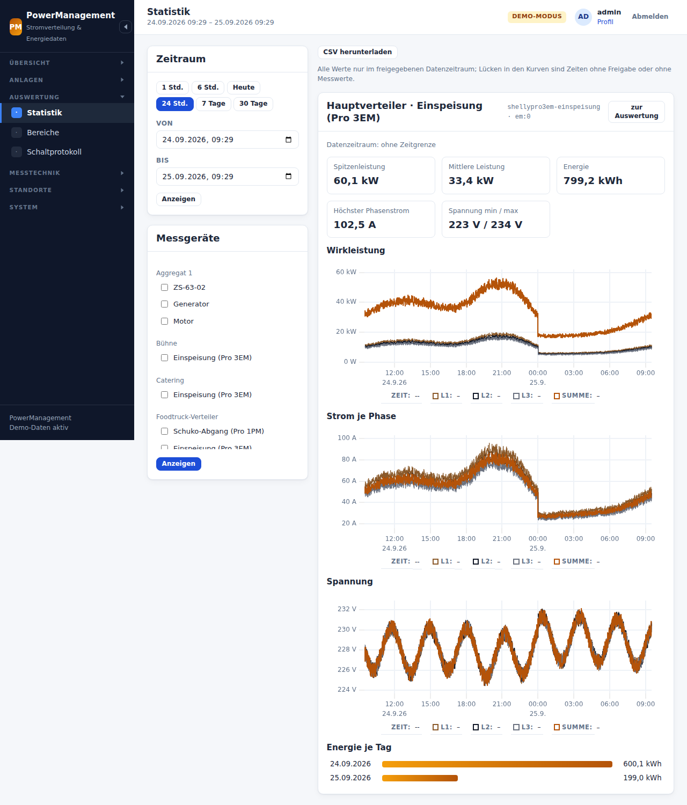

Alles davon ist auf die Datenfenster der Freigaben beschnitten. Ein Kunde
sieht nur den freigegebenen Zeitraum ([rechte.md](rechte.md)).

## Bereiche

Ein Bereich rechnet zusammen, was in einem Teil des Geländes verbraucht
wird – etwa eine **Foodtruck-Meile**, die an drei Aggregaten und mehreren
Verteilungen hängt. Die Aggregate einfach zu addieren wäre falsch, wenn an
ihnen auch Bühne oder Licht hängen. Deshalb besteht ein Bereich aus
Mitgliedern:

- **ganze Anlagen** – eine Verteilung zählt mit ihrem Messgerät an der
  Einspeisung (oder, wenn es keines gibt, mit der Summe ihrer gemessenen
  Abgänge);
- **einzelne gemessene Abgänge** – der Shelly am CEE-Abgang eines
  Aggregats, an dem nur ein Truck hängt.

*Auswertung → Bereiche → + Neuer Bereich*: Standort, Name, optional eine
**Grenze** in kW und/oder A je Phase (etwa die zugesagte Anschlussleistung)
und eine Farbe. Rechts die Anlagen des Standorts zum Ankreuzen, darunter
jeweils ihre gemessenen Abgänge.

**Nichts zählt doppelt.** Was hinter einem anderen Mitglied hängt, steckt in
dessen Messwert schon drin: eine Unterverteilung hinter einer
Mitglieds-Verteilung, ein Abgang einer Mitglieds-Verteilung, die Verteilung
hinter einem gemessenen Aggregat-Abgang. Das ergibt sich aus den Kabeln im
Plan. Solche Mitglieder stehen grau in der Liste („steckt in …“) und zählen
nicht mit. Mitglieder ohne Messgerät, ohne aktuelle Werte oder ohne
Freigabe werden als Hinweis genannt.

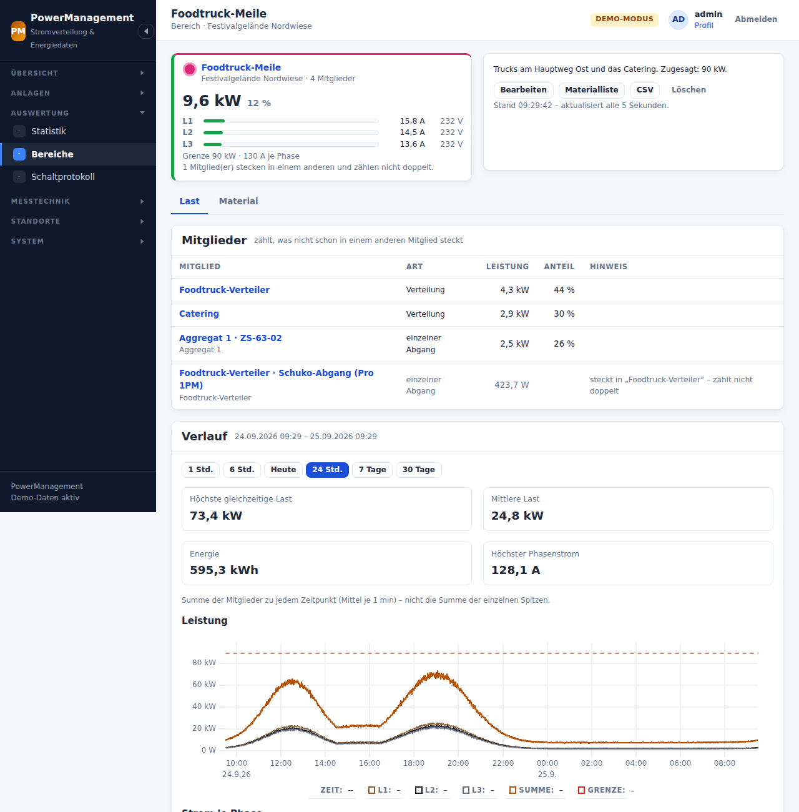


Die Bereichsseite zeigt:

- die **Kachel** mit Summe, Strom je Phase und Auslastung gegen die Grenze,
  alle 5 Sekunden aktualisiert;
- die **Mitglieder** mit Leistung und Anteil an der Summe;
- den **Verlauf** von Leistung und Strom je Phase als zeitgleiche Summe,
  mit der Grenze als rote gestrichelte Linie. Die Kennzahl *höchste
  gleichzeitige Last* ist die Spitze dieser Summe – nicht die Summe der
  einzelnen Spitzen, die viel höher läge;
- **Energie je Tag** und **CSV-Export**;
- den Reiter **Material**.

Einphasige Messgeräte an einem Abgang zählen auf der Phase, die beim
Anschluss eingetragen ist. Sehen darf einen Bereich, wer den Standort sieht;
in die Summe kommt nur, was er sehen darf, und nur im Datenfenster seiner
Freigabe.

## Materialliste

Wenn ein Bereich (oder eine ganze Etage) fertig geplant ist, zeigt die
Materialliste, was zum Aufbau mitgebracht werden muss:

- **Anlagen** nach Typ gezählt (2 × PD 63/32/16, 1 × SG 100 …) mit den
  Namen aus dem Plan;
- **Kabel** nach Stecker, Typ und Querschnitt, in **Stücken üblicher
  Länge**: 5, 10, 20, 25 und 50 m. Grundlage ist die eingetragene Länge oder
  die Länge im Plan (mit Maßstab oder Georeferenz), plus Reserve für Durchhang und den Weg
  zur Dose (*System → Einstellungen*, Vorgabe 10 %). Gewählt wird die
  Kombination mit möglichst wenigen Stücken – jede Kupplung ist eine
  Fehlerquelle – ohne viel Überlänge (15 m Überlänge wiegen ein Stück auf);
- **75 und 100 m** nur bei **63 A, 125 A und Powerlock** und nur, wo sie
  mindestens zwei Stücke sparen – praktisch erst ab rund 175 m. Sie sind in
  der Liste gelb markiert;
- **Powerlock-Einleiter** zählen je Leiter (fünf Stücke je Strang),
  parallel gelegte Kabel mehrfach;
- **Kupplungen** je Kabelsorte und die **Stückelung je Kabel** zum
  Aufklappen;
- **Kabelbrücken** nach Modell;
- **vor Ort vorhanden**: Feststromanschlüsse und fest verlegte Kabel –
  die werden nicht mitgebracht.

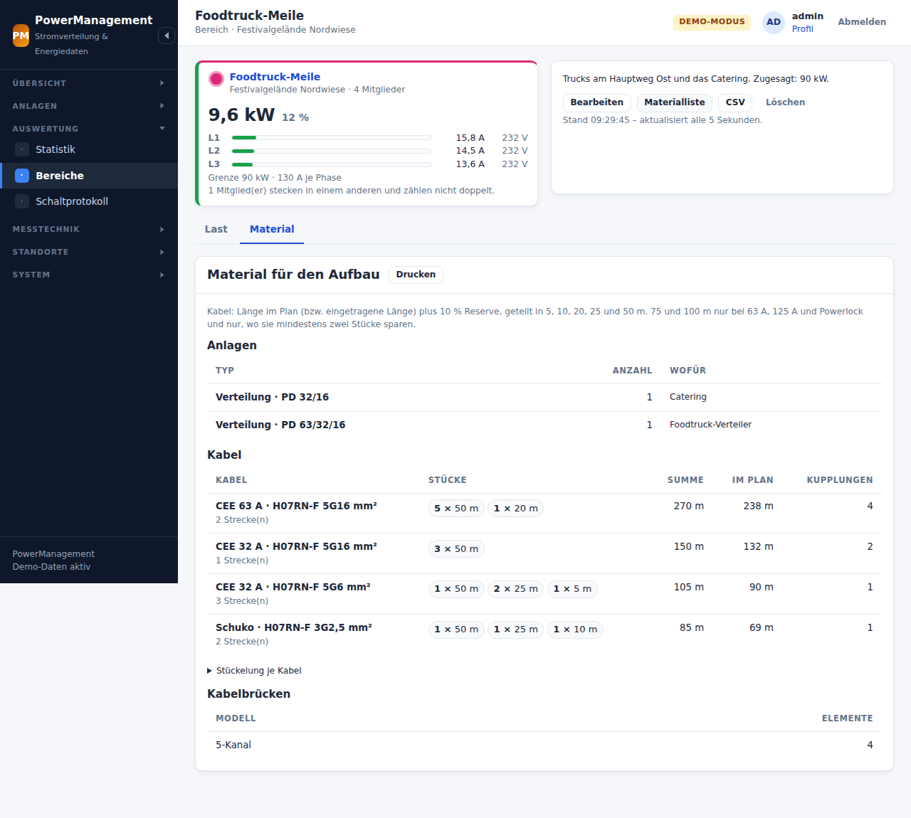

Zu einem Bereich gehören seine Anlagen, alle Kabel an ihnen (auch die
Zuleitung vom Aggregat), die Kabel an seinen gemessenen Abgängen und die
Kabelbrücken über diesen Kabeln. Kabel ohne Länge (kein Maßstab, nichts
eingetragen) stehen als Warnung darunter. *Drucken* öffnet die Liste als
Blatt für die Kiste.

## Schalten

Wo ein Gerät schaltbar ist und die Freigabe es erlaubt, erscheinen
Schaltknöpfe: in der Übersicht, an der Anlage und auf der Karte. Jeder
Befehl wird vorher bestätigt. Die Antwort des Geräts erscheint als Meldung.
Das **Schaltprotokoll** (*Auswertung → Schaltprotokoll*) zeigt jeden
Versuch mit Ergebnis.

Aggregate und alles, was nie aus der Ferne geschaltet werden darf: an der
Anlage unter *Bearbeiten* **„Steuerung sperren“**. Die Sperre gilt für jeden, auch für
Administratoren.

## MQTT-Zugänge der Shellys

*Messtechnik → MQTT-Zugänge*. Alle Shellys melden sich zunächst mit dem
**gemeinsamen Zugang** `shelly` am Broker an – so wie bei der Installation
eingerichtet. Das bleibt so, bis jedes Gerät umgestellt ist: der laufende
Betrieb ändert sich nicht. Wer das gemeinsame Kennwort aber aus einem
einzigen Gerät ausliest, kann damit jedes andere schalten und mitlesen.
Deshalb lassen sich die Geräte **eines nach dem anderen** auf einen
**eigenen Zugang** umstellen, der nur den Themenbaum seines Geräts darf.

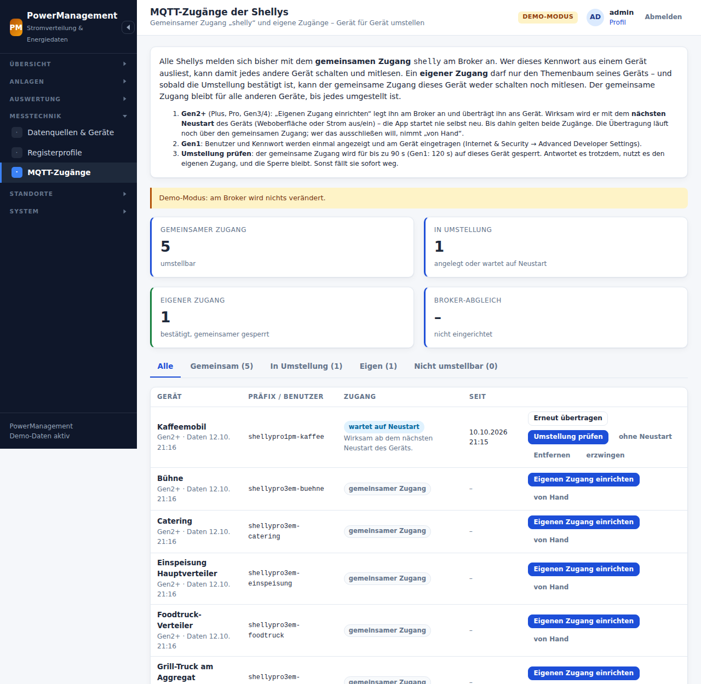

Die Liste zeigt jeden bekannten Shelly – aus den Messdaten (das Präfix
meldet Node-RED) und den schaltbaren Datenquellen – mit seinem Zugang:

| Zugang | heißt | nächster Schritt |
|--------|-------|------------------|
| gemeinsamer Zugang | wie bisher | *Eigenen Zugang einrichten* |
| angelegt | Zugang am Broker; Gen2: noch nicht übertragen, Gen1: Kennwort angezeigt | Gen2 *Übertragen*, Gen1 am Gerät eintragen, dann *Umstellung prüfen* |
| wartet auf Neustart | Gen2: Zugang steht im Gerät, gilt ab dem nächsten Neustart; bis dahin gelten beide | Gerät neu starten, dann *Umstellung prüfen* |
| eigener Zugang | bestätigt: das Gerät nutzt ihn, der gemeinsame Zugang kann es weder schalten noch mitlesen | – |

**Gen2+** (Plus, Pro, Gen3/4): *Eigenen Zugang einrichten* fragt das Gerät
erst (antwortet es, stimmt das Präfix, wartet es nicht schon auf einen
Neustart), legt dann den Zugang am Broker an, meldet sich zur Probe damit an
und überträgt Benutzer und Kennwort mit `MQTT.SetConfig` ans Gerät. **Die
App startet kein Gerät neu** – je nach Modell kann ein Neustart die Ausgänge
schalten. Der neue Zugang gilt also ab dem nächsten Neustart: über die
Weboberfläche des Shelly oder beim nächsten Ausschalten des Verteilers.
*Übertragen* fragt vorher das Gerät: hat es den Zugang schon gespeichert und
ist seitdem neu gestartet, lehnt es ab – ein neues Kennwort am Broker würde
das Gerät sonst abhängen.

*von Hand* (Gen2): legt den Zugang an, ohne ihn per MQTT zu übertragen.
Benutzer und Kennwort werden einmal angezeigt und in der Weboberfläche des
Shelly unter *Einstellungen → MQTT* eingetragen (nur Username und
Password), dann neu starten.

**Gen1**: Gen1 nimmt Einstellungen nicht über MQTT an. Benutzer (die
Geräte-ID) und Kennwort werden **einmal** angezeigt – mit Knopf zum
Kopieren – und in der Weboberfläche des Shelly unter *Internet & Security →
Advanced Developer Settings* eingetragen (nur Username und Password; beim
Speichern startet er neu). Geht das Kennwort verloren: *Neues Kennwort*.

**Umstellung prüfen** sperrt den gemeinsamen Zugang kurz (Gen2 höchstens
90 s, Gen1 120 s) auf dieses Gerät und fragt es: Gen2 per RPC, Gen1 mit
„update“. Antwortet es trotzdem, nutzt es den eigenen Zugang – die Sperre
bleibt dann dauerhaft. Antwortet es nicht, fällt die Sperre sofort weg und
nichts ist verändert. Gen2 ohne Neustart seit der Übertragung wird gar nicht
erst gesperrt (*ohne Neustart* prüft trotzdem). Bei einem bestätigten Gerät
sieht *Prüfen* zusätzlich nach, ob die Sperre am Broker wirkt; fehlt sie,
steht das Gerät als **nicht gesperrt** in der Liste.

**Neues Kennwort** wird immer einmal angezeigt und am Gerät eingetragen –
nie per MQTT übertragen: wer das bisherige Gerätekennwort kennt, dürfte den
Themenbaum des Geräts lesen und sähe ein übertragenes neues ebenso. Der
Broker nimmt sofort nur noch das neue an; bis es am Gerät steht, ist das
Gerät getrennt. So wird auch ein Gerät ersetzt (gleiches Präfix): *Neues
Kennwort* und am neuen Gerät eintragen.

**Entfernen** löscht den Zugang und hebt die Sperre auf. Nutzt das Gerät
ihn noch, ist es getrennt, bis dort wieder der gemeinsame Zugang steht. Bei
Gen2, solange die Umstellung nicht bestätigt ist, wird vorher das Gerät
gefragt: hat es den Zugang schon gespeichert, nutzt es ihn ab dem nächsten
Neustart – dann geht Entfernen nur mit *erzwingen* (vorher am Gerät wieder
den gemeinsamen Zugang eintragen).

**Doppelgänger**: Melden sich unter demselben Gerätenamen mehrere Präfixe
(etwa `kuehlhaus` und `shelly/kuehlhaus`), ist nicht klar, welches das echte
Gerät ist – dann lässt sich keines umstellen, bis das geklärt ist.

**Grenzen**, offen gesagt:

- Die Übertragung bei Gen2 läuft noch über den Themenbaum, den der
  gemeinsame Zugang lesen darf. Wer das gemeinsame Kennwort kennt und genau
  dann mitliest, sieht das neue. Wer das ausschließen will, nimmt *von Hand*.
- Wer das gemeinsame Kennwort kennt, kann ein umgestelltes Gerät vom Broker
  werfen, indem er sich mit dessen Client-ID anmeldet (Mosquitto bindet
  Client-IDs nicht an Benutzer). Schalten oder mitlesen kann er es nicht.
- Den Gen1-Rundruf `shellies/command` darf der gemeinsame Zugang weiter
  schreiben (announce, update, update_fw – nur offizielle Firmware).

In der Datenquellen-Liste steht an jedem schaltbaren Shelly, welchen Zugang
er nutzt. Was dazu am Broker passiert, steht in
[installation-debian-lxc.md](installation-debian-lxc.md).

## Standorte und Location-Abgleich

**Standorte** verwaltet Standorte, Etagen und Grundrisse. Pläne kommen als
PDF (wird serverseitig gerastert und gekachelt), PNG/JPG oder SVG.

**Location-Abgleich** arbeitet mit demselben Git-Repository wie MasterAdmin
(`locations/<schlüssel>/location.json` und `plaene/`):

- **Holen**: Locations aus MasterAdmin übernehmen, mit Etagen, Grundrissen,
  Maßstab und den Dosen und Racks aus MasterAdmin als graue Orientierung
  auf der Karte. Dazu kommen die Feststromanschlüsse aus `strom.json`.
- **Hochladen**: PowerManagement legt daneben `strom.json` ab. Darin stehen
  **nur die Feststromanschlüsse** der Location mit ihren Anschlüssen,
  Sicherungen und Messgeräten und die **fest verlegten Kabel und
  Kabelwege** dazwischen. An `location.json` ergänzt es nur, was dort fehlt
  (neue Etagen, Grundriss), und überschreibt nichts, was MasterAdmin gehört.
- **Nicht übertragen** werden mobile Anlagen, mobile Kabel, mobile
  Kabelwege und Kabelbrücken. Sie gehören zur Veranstaltung. Beim
  Übernehmen bleiben sie unangetastet, und ein mobiles Kabel, das hier an
  einem Abgang eines Feststromanschlusses steckt, steckt danach am selben
  Abgang.
- Eine zweite PowerManagement-Installation bekommt so die feste
  Infrastruktur einer Location und plant ihre Veranstaltung darauf.

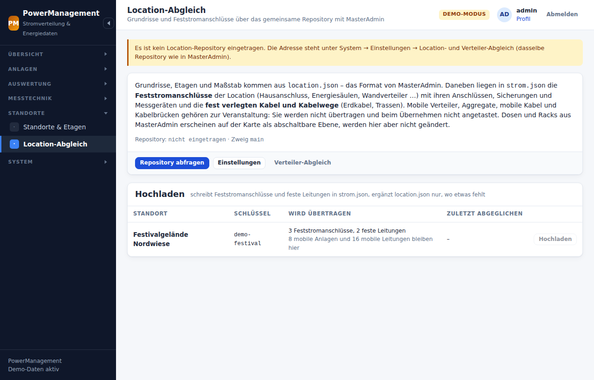

Adresse und Token des Repositorys stehen unter **System → Einstellungen →
Location- und Verteiler-Abgleich**.

## Andere Instanzen (Schnittstelle)

Ohne gemeinsames Repository geht dasselbe direkt von Installation zu
Installation – auch mit MasterAdmin. Die Instanz, die einen Standort teilt
(A), gibt unter **System → Schnittstelle (API)** einen Zugang aus: ein Token
mit Befugnissen und den Standorten, die es sehen bzw. bearbeiten darf.

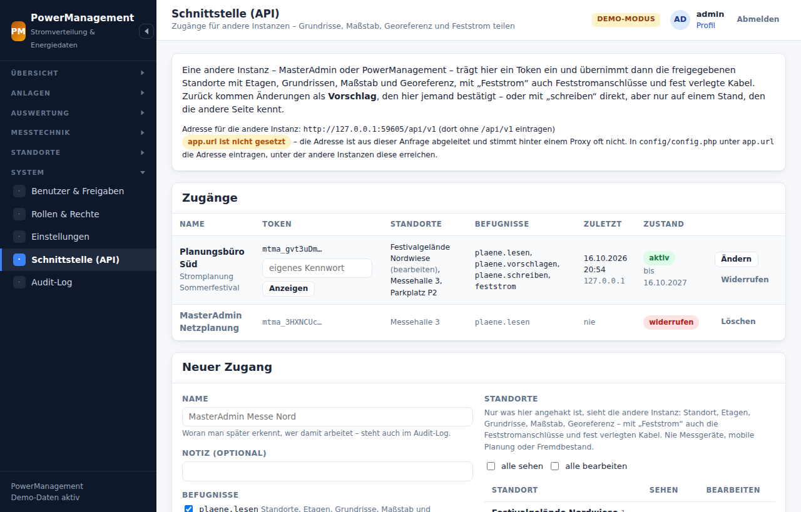

Die Instanz, die übernimmt (B), trägt A unter **Standorte → Andere
Instanzen** mit Adresse und Token ein. Ihre Seite zeigt je Location von A
die Etagen, welche Etage hier dazugehört, und wie es steht – *noch nicht
hier*, *passt zu …*, *aktuell*, *dort geändert*, *hier geändert*, *beide
geändert*:

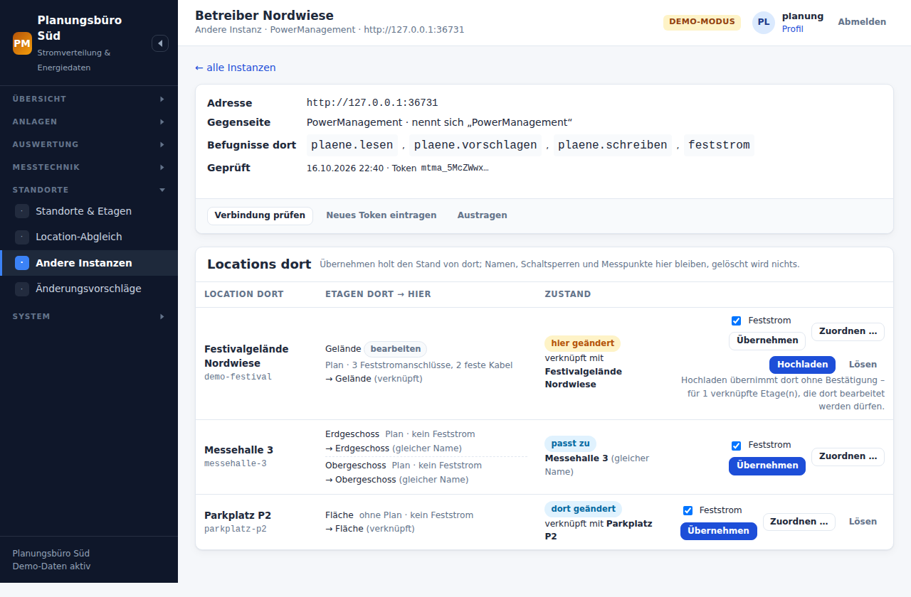

- **Übernehmen** holt Grundrisse, Maßstab und Georeferenz, zwischen zwei
  PowerManagement-Instanzen mit dem Kästchen *Feststrom* daneben (in der
  Liste und beim Zuordnen, vorgewählt) auch die Feststromanschlüsse und
  festen Kabel. Namen, Schaltsperren und Messpunkte hier bleiben, gelöscht
  wird nichts; die mobile Planung der Veranstaltung bleibt unberührt.
- **Zuordnen …** wählt Standort und Etagen hier einzeln; **Nur
  verknüpfen** merkt sich die Zuordnung, ohne etwas zu holen; **Lösen**
  nimmt sie wieder weg.
- Zurück geht es je nach Befugnis bei A: **Hochladen** (A übernimmt gleich,
  aber nur, wenn sich dort seit dem letzten Übernehmen nichts geändert hat)
  oder **Als Vorschlag schicken** (bei A bestätigt es jemand).

Vorschläge prüft A unter **Standorte → Änderungsvorschläge**: je Etage, was
sich ändern würde, dann **Annehmen** (gewählte Etagen und Teile) oder
**Ablehnen**.

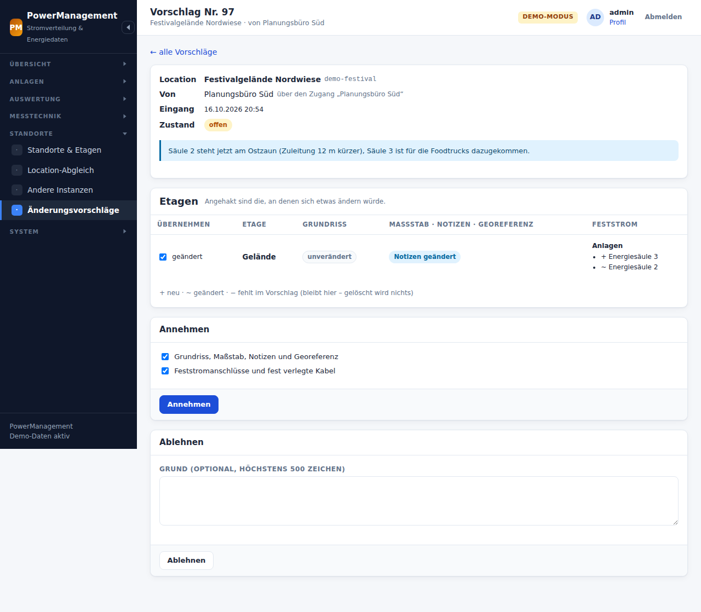

Alles Weitere – Befugnisse, Zustände, Zusammenspiel mit MasterAdmin,
Endpunkte für Skripte – steht in [schnittstelle.md](schnittstelle.md).

## Verteiler-Abgleich

Was an Verteilern angelegt ist, gleicht **Verteiler-Abgleich** (*Anlagen →
Verteiler-Abgleich*) über dasselbe Repository ab wie die Locations. So
kennen alle Installationen dieselben Typen und dasselbe Lager:

- **Standard-Verteiler** aus dem Katalog mit Nennwerten, Anschlüssen und
  Sicherungen – je Typ eine Datei `verteiler/typen/<schlüssel>.json`.
- **Inventar**: Verteiler und Zwischenstecker mit ihren Shellys – je Stück
  eine Datei `verteiler/inventar/<schlüssel>.json`. Der Schlüssel kommt aus
  der Inventarnummer (PD63-07 → `pd63-07`), ein Stück verweist über den
  Schlüssel auf seinen Typ.

**Nicht übertragen** wird, wo ein Stück gerade eingesetzt ist, und welche
Anlagen aus einem Typ entstanden sind. Das gehört zur Veranstaltung und
bleibt in der Installation, die den Aufbau führt.

*Repository abfragen* zeigt je Verteiler, wie er hier und dort steht –
verglichen mit dem Stand beim letzten Abgleich:

| Stand | heißt | Knopf |
|-------|-------|-------|
| aktuell | hier und dort gleich | – |
| nur im Repository | eine andere Installation hat ihn angelegt | Übernehmen |
| nur hier | noch nie hochgeladen | Hochladen |
| dort neuer | dort geändert, hier nicht (dazu: was anders ist, wann, von wem) | Übernehmen |
| hier geändert | hier geändert, dort nicht | Hochladen |
| hier und dort geändert | beide Seiten haben geändert | Übernehmen *oder* Hochladen – der gewählte Stand gilt |
| dort entfernt | wurde aus dem Repository genommen | Hochladen (wieder hinein) |

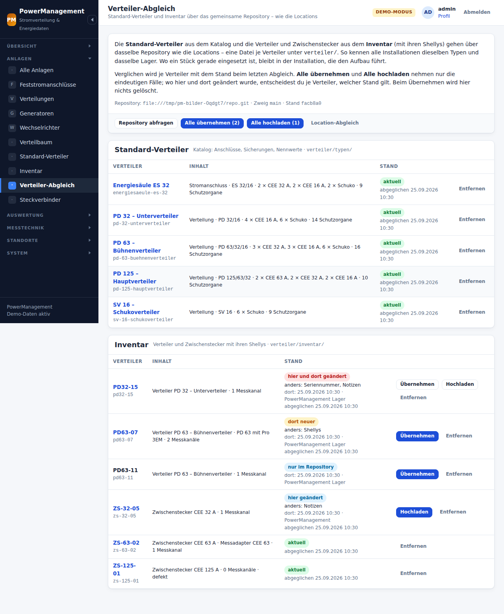

**Alle übernehmen** und **Alle hochladen** nehmen nur die eindeutigen Fälle
und überschreiben nie eine Änderung der anderen Seite. Ein Stück, dessen Typ
es hier noch nicht gibt, bringt ihn beim Übernehmen mit; beim Hochladen geht
der Typ mit, wenn er dort noch fehlt. Tauscht das Lager einen Shelly an
einem Stück, das hier gerade eingesetzt ist, misst nach dem Übernehmen der
neue Shelly an der Anlage; der alte bleibt als früheres Messgerät in der
Statistik. Steckt ein Shelly aus der Datei hier schon in einem anderen
Stück, wird das Stück nicht übernommen und die Meldung sagt, wo.

Beim Übernehmen wird hier nichts gelöscht. Ein ausgemustertes Stück nimmt
**Entfernen** aus dem Repository; hier bleibt es stehen, bis es jemand
löscht. Die anderen Installationen sehen es danach als „dort entfernt“.

Übernehmen darf, wer *Locations und Verteiler übernehmen* hat **und** den
Katalog bzw. das Inventar pflegen darf. Hochladen und Entfernen braucht
*… ins Repository hochladen*. Von der Kommandozeile:
`bin/power verteiler:liste`, `bin/power verteiler:uebernehmen --alle`,
`bin/power verteiler:hochladen --alle`.

## Benutzer

**System → Benutzer & Freigaben**: Konten mit Gültigkeitszeitraum, Rollen
je Konto mit eigenem Zeitraum, **Freigaben** je Benutzer. Details und
Beispiele stehen in [rechte.md](rechte.md). Das **Audit-Log** (*System →
Audit-Log*) zeichnet Anmeldungen, Änderungen und Schaltvorgänge auf.

**Anmeldung und Sitzung**

- Nach fünf falschen Kennwörtern ist ein Konto 15 Minuten gesperrt
  (`security.lockout_attempts`, `security.lockout_minutes`). Die Meldungen
  verraten nicht, ob es ein Konto gibt – auch ein unbekannter Name ist nach
  fünf Versuchen „gesperrt“. Von einer Adresse aus sind im selben Zeitraum
  höchstens 20 Fehlversuche möglich (`security.ip_attempts`), gleich für
  welche Konten.
- Wird ein Kennwort geändert – selbst im Profil oder von der Verwaltung –,
  enden alle anderen Sitzungen dieses Kontos. Eine Sitzung endet außerdem
  nach einer Stunde ohne Aktivität (`security.idle_timeout`) und spätestens
  nach zwölf Stunden (`security.max_session`).
- Ein Konto mit vorläufigem Kennwort kommt erst nach dem eigenen Kennwort
  weiter als bis zum Profil.
- Steht ein TLS-Proxy davor, der kein `X-Forwarded-Proto` schickt, erzwingt
  `security.cookie_secure => true` das Sitzungs-Cookie nur über HTTPS.
