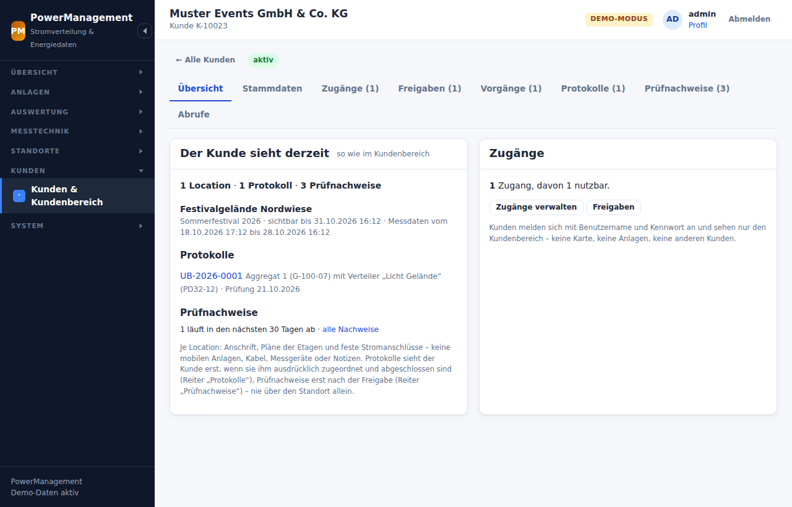
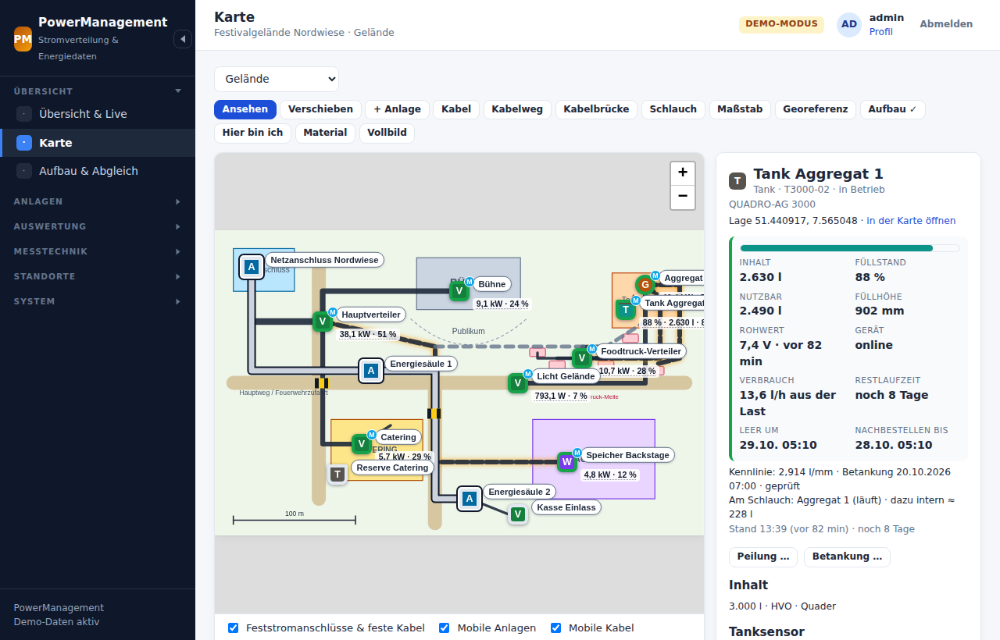
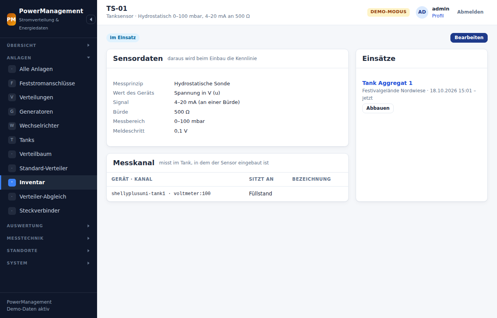
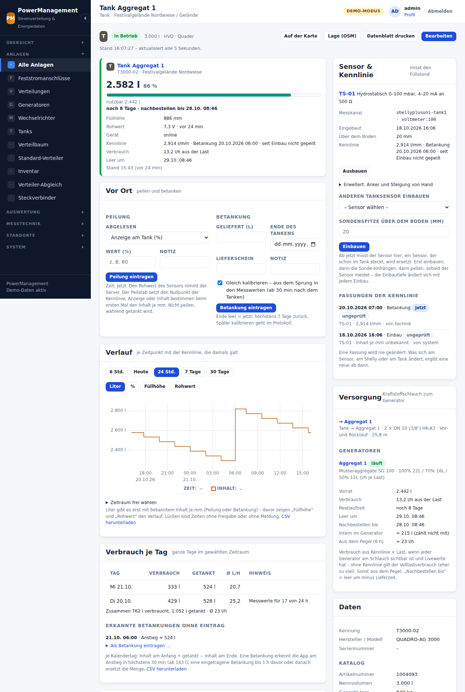
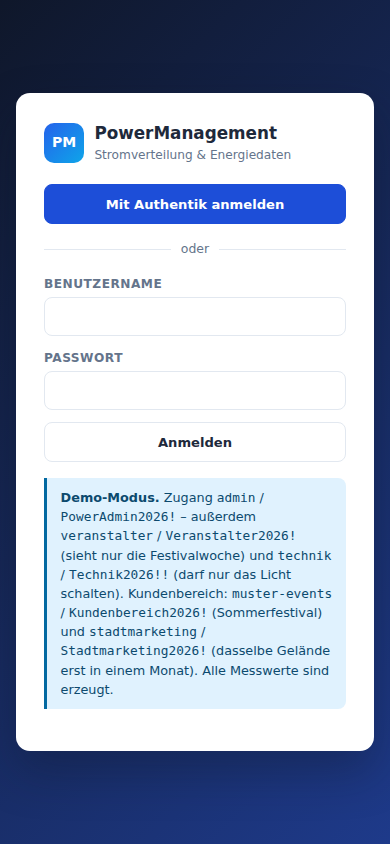
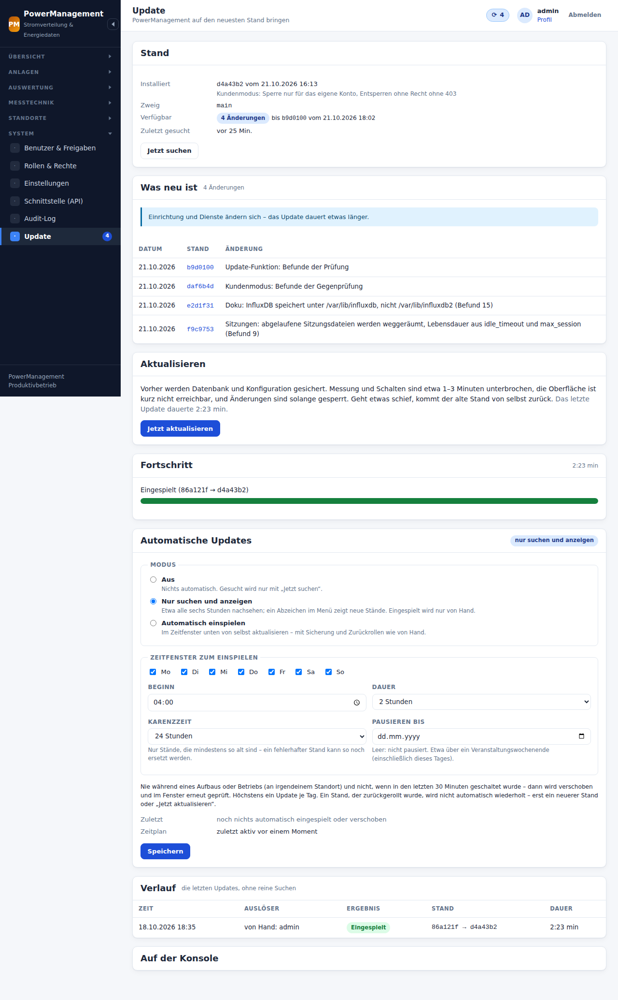

# Bedienung

Die Oberfläche ist für Smartphone und Tablet gebaut, am Schreibtisch
funktioniert sie genauso. Sie lässt sich als Web-App auf den Startbildschirm
legen (Browser-Menü → *Zum Startbildschirm*). Livewerte aktualisieren sich
alle 5 Sekunden, solange die Seite offen ist.

Die Bilder zeigen das Demo-Gelände (`php bin/power demo:seed`): ein
Festivalgelände mit Netzanschluss, Energiesäulen, Aggregat mit Tank,
Speicher, Verteilern, einer Foodtruck-Meile, einem laufenden Aufbau und
zwei Veranstaltern mit eigenem Kundenbereich.

## Übersicht

Kacheln für jede sichtbare Anlage: Leistung, Ströme je Phase, Auslastung
gegen den Nennstrom, Alter des letzten Messwerts. Die Farbe zeigt den
Zustand:

| Farbe | Bedeutung |
|-------|-----------|
| grün | in Ordnung |
| gelb | Auslastung über der Warnschwelle (Vorgabe 80 %) |
| rot | über der Alarmschwelle (Vorgabe 95 %) |
| grau | kein Messwert seit 2 Minuten (*stumm*) |

Oben steht die **Einspeisung gesamt**. Sie wird aus dem Verteilbaum
berechnet, also nur aus den Einspeisungen (Netz, Aggregate, Speicher) ohne
Doppelzählung der nachgelagerten Verteilungen. Schwellen:
**System → Einstellungen → Grenzwerte**.

**Tanks** haben einen eigenen Abschnitt: Balken für den Füllstand, Liter und
%, Restlaufzeit und das Alter des Werts – die Farbe nach den Stufen der
[Tanks](#stufen). Die Zähler oben zählen sie mit.


## Karte

Die Karte ist der Grundriss aus MasterAdmin: dieselben Pläne (PDF, Bild oder
SVG), dieselben Kacheln, derselbe Maßstab. Darauf liegen Anlagen, Kabel,
Kabelwege und Kabelbrücken. Ebenen lassen sich einzeln ein- und ausblenden.


Es gibt zwei Sorten von Anlagen:

- **Feststromanschlüsse** gehören zur Location und stehen bei jeder
  Veranstaltung an derselben Stelle: Hausanschluss, Energiesäulen,
  Wandverteiler, Wanddosen, Unterflurkästen, fest eingebaute
  Hallenverteilungen. Auf der Karte sind sie **eckig mit dunklem Rahmen**.
- **Mobile Anlagen** gehören zur Veranstaltung: mobile Stromverteiler,
  Aggregate, Speicher. Sie sind rund bzw. abgerundet.

Ebenso bei den Leitungen: **Fest verlegte Kabel** (Erdkabel vom
Hausanschluss zur Energiesäule) und fest verlegte Kabelwege (Kabelkanal,
Leerrohr) gehören zur Location und sind mit dunklem Rand gezeichnet.
**Mobile Kabel** werden für jede Veranstaltung neu gelegt. Kabelbrücken sind
immer mobil. Ein fest verlegtes Kabel endet nur an Feststromanschlüssen. Ein
neues Kabel zwischen zwei Feststromanschlüssen ist von Haus aus fest; im
Kabelfenster lässt sich das umstellen (*Fest verlegt*). Wird eine Anlage auf
mobil gestellt oder ein festes Kabel an eine mobile Anlage umgesteckt, wird
das Kabel mobil.

Feste und mobile Anlagen und Leitungen lassen sich gleichermaßen
verschieben und ändern. Im Anlagenfenster der Karte führt *Bearbeiten* zum
Formular.

Die Ebene *Feststromanschlüsse & feste Kabel* lässt sich getrennt von
*Mobile Anlagen*, *Mobile Kabel*, *Kabelwege* und *Kabelbrücken*
ausblenden. So sieht man vor der Planung, was auf dem Gelände fest
vorhanden ist.

| Modus | Was man tut |
|-------|-------------|
| **Ansehen** | Anlage oder Kabel antippen: Livewerte, Anschlüsse, Kabeldaten, Link zur Anlage. Den **Wert neben einer Anlage** (z. B. „25,4 kW · 34 %“) antippen: im Plan öffnet sich die Übersicht **je Phase** – Spannung, Strom, Leistung, Scheinleistung, cos φ, dazu Frequenz, Auslastung und Alter des Messwerts, alle 5 Sekunden aktualisiert. |
| **Verschieben** | Anlagen ziehen – feste wie mobile, angeschlossene Kabel folgen. Ein Kabel, einen Kabelweg oder eine Kabelbrücke antippen: Punkte ziehen, mit **⊕** zwischen zwei Punkten einen neuen herausziehen, mit Doppeltipp (oder langem Drücken) einen Punkt entfernen, mit **✥** die ganze Linie verschieben. Ein **Kabelende auf eine andere Anlage ziehen** steckt es dort an (den Anschluss danach im Kabelfenster wählen); ins Leere gezogen wird es gelöst. |
| **+ Anlage** | auswählen, was gesetzt wird, dann in den Plan tippen. Zur Wahl stehen ein **Feststromanschluss**, ein fester Katalog-Typ (z. B. *Energiesäule*), eine fest eingebaute Verteilung, ein **mobiler Standard-Verteiler** aus dem Katalog (mit Anschlüssen und Sicherungen) oder eine leere mobile Anlage. Eine vorhandene, noch nicht platzierte Anlage lässt sich ebenfalls setzen. |
| **Kabel** | Anlage A antippen (Abgang wählen), Zwischenpunkte setzen, Anlage B antippen (Eingang wählen). Kabeltyp, Querschnitt, Adern, Länge. Die Länge wird mit Maßstab aus dem Verlauf vorgeschlagen. |
| **Kabelweg** | Trasse ohne feste Enden (Kabelkanal, Traverse, Erdverlegung). Doppeltippen beendet. |
| **Kabelbrücke** | zwei Punkte über einen Weg. Modell und Anzahl der Elemente. |
| **Schlauch** | Kraftstoffschlauch: Tank antippen, Zwischenpunkte, Generator antippen (oder umgekehrt). Schlauchtyp, Kupplung, Vor- und Rücklauf – siehe [Tanks](#schlauch-verbrauch-und-restlaufzeit). Ein Kabel endet nie an einem Tank. |
| **Maßstab** | zwei Punkte mit bekanntem Abstand setzen. Danach stimmen Längen und Spannungsfall. |
| **Georeferenz** | zwei gut erkennbare Punkte weit auseinander antippen (Gebäudeecke, Tor, Mast, eine Energiesäule) und zu jedem Breite und Länge eintragen – siehe [Georeferenz](#georeferenz-und-gps). |
| **Hier bin ich** | (nur mit Georeferenz) zeigt die eigene GPS-Position als blauen Punkt im Plan, mit Genauigkeitskreis. Noch einmal tippen schaltet sie ab. |


**Material** (oben in der Werkzeugleiste) öffnet die Materialliste der
ganzen Etage zum Drucken – siehe [Materialliste](#materialliste).

Beim Zeichnen (Kabel, Kabelweg, Kabelbrücke, Maßstab, Georeferenz) setzt
ein Tipp auf eine vorhandene Linie einen Punkt – so lässt sich ein Kabel
entlang eines Kabelwegs legen. Ein Tipp auf eine Anlage setzt den Punkt
genau auf sie.

### Georeferenz und GPS

Ein **referenzierter** Plan hat einen Maßstab; ein **georeferenzierter**
Plan weiß zusätzlich, wo er auf der Erde liegt und wie er gedreht ist. Dazu
braucht es zwei Passpunkte: je ein Punkt im Plan und seine Koordinaten.

1. *Georeferenz* in der Werkzeugleiste, Punkt 1 im Plan antippen, dann
   Punkt 2 – möglichst weit auseinander.
2. Zu jedem Punkt Breite und Länge eintragen. Die Koordinaten kommen aus
   OpenStreetMap oder Google Maps (Rechtsklick auf die Stelle → Koordinaten
   kopieren) oder vor Ort: an der Stelle stehen und **Meine Position**
   tippen. Lesbar sind „51.23456, 7.12345“, „51,23456; 7,12345“,
   Grad/Minuten/Sekunden (51°14'04.2"N 7°07'24.2"E) und Links aus
   OpenStreetMap oder Google Maps.
3. *Übernehmen*. Hat der Plan schon einen Maßstab und passt er nicht zur
   Georeferenz (über 3 % Abweichung), kommt ein Hinweis – dann stimmt ein
   Passpunkt oder der Maßstab nicht.

Was damit geht:

- **Längen ohne Maßstab**: Fehlt ein Maßstab, rechnen Kabellängen,
  Spannungsfall und Materialliste mit der Georeferenz. Ein gesetzter
  Maßstab hat Vorrang.
- **Lage jeder Anlage**: Das Anlagenfenster zeigt ihre Koordinaten und
  öffnet die Stelle in OpenStreetMap – zum Hinfinden beim Aufbau.
- **Hier bin ich**: die eigene GPS-Position im Plan. Das Handy braucht dafür
  eine HTTPS-Verbindung und die Standortfreigabe.
- **GeoJSON**: unter der Karte (*georeferenziert · GeoJSON*) alle
  sichtbaren Anlagen als Punkte und Kabel, Kabelwege und Kabelbrücken als
  Linien – für QGIS, Google Earth oder die Geländeplanung.


Die Georeferenz gehört zur Location und geht mit dem Location-Abgleich mit
(in `strom.json`, damit `location.json` das Format von MasterAdmin behält).
Setzen darf sie, wer Grundrisse verwalten darf.

Zu jedem Kabel prüft PowerManagement:

- **Belastbarkeit** des Querschnitts gegen den Stecker bzw. die Absicherung
  (Richtwerte H07RN-F nach VDE 0298-4),
- **passende Stecker** an beiden Enden,
- **Spannungsfall** ΔU aus Länge, Querschnitt und Nennstrom. Für Drehstrom
  gilt √3 · I · L · cos φ / (κ · A), für Wechselstrom 2 · I · L · cos φ /
  (κ · A), jeweils bezogen auf 400 V bzw. 230 V. Warnung über der Grenze
  aus den Einstellungen (Vorgabe 3 %).

Auffällige Kabel werden gestrichelt und leuchtend gezeichnet. Der Hinweis
steht im Kabelfenster.

## Anlagen

**Anlagen** listet Netzanschlüsse, Aggregate, Speicher/Wechselrichter,
Verteilungen, Unterverteilungen, Verbraucher und Tanks. Filter nach Art, *fest
oder mobil*, Standort und Suchbegriff. **Anlagen → Feststromanschlüsse**
zeigt nur die fest installierten.

Ob eine Anlage fest installiert ist, steht an der Anlage
(*Bearbeiten → Fest installiert*). Stromanschlüsse sind von Haus aus fest,
alle anderen Arten mobil. Eine fest eingebaute Hallenverteilung oder ein
Baustromkasten, der nur für eine Veranstaltung steht, lässt sich
entsprechend umstellen. Auch die **Art** lässt sich nachträglich ändern
(etwa Verteilung → Generator). Anschlüsse, Sicherungen, Kabel und
Messgeräte bleiben dabei, nur die Angaben der alten Art fallen weg. Nur
zwischen einem [Tank](#tanks-und-kraftstoff) und einer elektrischen Anlage
gibt es keinen Wechsel.

Je Anlage gibt es diese Reiter:

| Reiter | Inhalt |
|--------|--------|
| **Übersicht** | Daten, Livewerte, Verlauf der letzten 24 h, **Verteilerplan**, Schaltknöpfe, *Gespeist von* |
| **Anschlüsse** | Anzahl je Steckertyp (Powerlock, CEE 125/63/32/16 A, Schuko und eigene). Darunter jeder Anschluss mit Nummer, Bezeichnung, Phase (bei Schuko und 1~) und **Sicherung/RCD**. |
| **Sicherungen & RCDs** | Hauptschalter, RCD, RCBO, LS, NH mit Nennstrom, Charakteristik, Fehlerstrom und RCD-Typ. Jedes Schutzorgan hat ein **vorgeschaltetes** Schutzorgan, so entsteht der Baum HS → RCD → LS. **„Vorschlag“** legt eine übliche Bestückung an (je Abgang ein LS, bis 32 A je vier an einem RCD 40 A/30 mA Typ A, ab 63 A ein eigener RCD 300 mA). |
| **Messgeräte** | welches Gerät (Shelly-Kanal, Victron-Kanal, ComAp …) was misst: die **Einspeisung**, einen **Abgang** oder **einen bestimmten Anschluss**. |
| **Kabel** | alle Kabel an dieser Anlage mit Hinweisen |


**Anschlüsse** lassen sich nicht wegnehmen, solange ein Kabel daran
steckt. Die Anzahl sinkt dann nur bis zum belegten Anschluss.

**Drucken** (`/anlagen/<id>/druck`) liefert ein Blatt für die Tür der
Verteilung: Einspeisung, Schutzorgane, Abgänge mit Stecker, Schutz, Phase
und angeschlossenem Kabel sowie die Messgeräte.

### Der Verteilerplan

Der Reiter *Übersicht* zeigt die Verteilung als Schaltbild: Einspeisung,
Hauptschalter, RCDs, Sicherungen und darunter die Abgänge mit Stecker.
Eingezeichnete **Messgeräte sind anklickbar** und zeigen Livewerte. Mit
**„zur Auswertung“** kommt das Messgerät in die Auswertung (Zähler oben in
der Navigation, höchstens 12 gleichzeitig).


### Standard-Verteiler

**Anlagen → Standard-Verteiler** ist der Katalog: Verteiler und Aggregate
mit fester Bestückung (im Demo z. B. *PD 125*: Powerlock-Eingang,
2 × CEE 63, 2 × CEE 32, 2 × CEE 16 mit HS, RCDs und LS). Ein
Standard-Verteiler wird wie eine Anlage gepflegt. Auf der Karte
(*+ Anlage* → Standard-Verteiler) oder beim Anlegen einer Anlage
(*„Anschlüsse und Sicherungen übernehmen von“*) entsteht eine Kopie mit
allen Anschlüssen und Schutzorganen. Die Kopie ist danach unabhängig vom
Katalog.

Im Katalog stehen auch **Feststromanschluss-Typen** (*„+
Feststromanschluss-Typ“*), etwa die Energiesäulen eines Geländes, die
überall gleich bestückt sind. Was daraus entsteht, ist fest installiert.
**Tank-Typen** (*„+ Tank-Typ“*) haben nur Eigenschaften – Nennvolumen,
Maße, Gewicht, Zulassung, Tankanschluss.


### Katalog importieren

Viele Standard-Verteiler und Aggregate auf einmal – etwa alle
Stromverteiler und Generatoren eines Verleihkatalogs wie der
BSS-Strombibel – kommen über **Standard-Verteiler → Importieren …** in den
Katalog. Das darf, wer Anlagen ändern darf und alle Standorte sieht; neue
Steckertypen legt der Import nur an, wenn man auch den
Steckverbinder-Katalog pflegen darf.

**Format.** Ein Katalog-Paket ist eine JSON-Datei (höchstens 5 MB,
höchstens 500 Typen):

```json
{ "format": 1, "art": "verteiler-typen", "quelle": "BSS Strombibel (Stand 18.03.2025)",
  "typen": [
    { "format": 1, "art": "verteiler-typ", "schluessel": "pd-63-32",
      "typ": { "art": "verteilung", "name": "PD 63/32", "hersteller": "…", "modell": "…",
               "nennstrom_a": 63, "spannung_v": 400, "phasen": 3,
               "eigenschaften": { "artikelnummer": "…", "gehaeuse": "…", "gewicht_kg": 38.5, "zuleitung": "2,0 m 5G16" },
               "schutzorgane": [ { "ref": "s1", "art": "hauptschalter", "nennstrom_a": 63, "pole": 3 },
                                 { "ref": "s2", "art": "rcd", "fehlerstrom_ma": 30, "rcd_typ": "A", "vor": "s1" } ],
               "anschluesse": [ { "richtung": "eingang", "stecker": "cee63", "nr": 1 },
                                { "richtung": "abgang", "stecker": "cee32", "nr": 1, "schutz": "s2" } ] },
      "steckertypen": [ { "schluessel": "cee63", "name": "CEE 63 A", "strom_a": 63, "phasen": 3, "spannung_v": 400 } ] } ] }
```

Jeder Typ ist eine Datei im Format des [Verteiler-Abgleichs](#verteiler-abgleich)
(`verteiler-typ`) – eine solche Datei allein lässt sich ebenfalls
importieren. Der `schluessel` ist eindeutig im Paket (a–z, 0–9,
Bindestriche); an ihm erkennt ein späterer Import den Typ wieder. Jeden
Stecker aus `anschluesse` gibt es hier schon, oder er ist unter
`steckertypen` beschrieben – ein neuer vollständig mit `name`, `strom_a`,
`phasen` (1 oder 3) und `spannung_v`, denn mit diesen Werten rechnen Kabel,
Schutzorgane und Auslastung. Zu den Eigenschaften gehören bei Verteilungen Artikelnummer,
Gehäuse, Schutzart, Zuleitung und Gewicht, bei Generatoren Artikelnummer,
Gewicht leer und Abmessungen (L × B × H in mm) neben Kraftstoff (Diesel,
HVO, Gas oder Benzin – Groß- und Kleinschreibung egal), Tank, Verbrauch bei
Volllast und Verbrauch je Last (`verbrauch_kennlinie`, wörtlich wie in der
Strombibel: „100% 22L / 70% 16L / 50% 12L“). Ein **Tank** (`"art": "tank"`)
hat nur Eigenschaften – Nennvolumen, Abmessungen, Gewicht leer und voll,
Zulassung, Tankanschluss –, keine Anschlüsse und keine Schutzorgane (stehen
welche in der Datei, ist das ein Fehler); Nennstrom, Leistung und Steuerung
gibt es bei ihm nicht. Den Inhalt je mm, den ein Tank hier gelernt hat,
überschreibt ein späterer Import nicht still – er steht dann „hier anders“.
`spannung_v` ist eine Zahl oder fehlt ganz (dann 400 V). Messpunkte gehören
nicht zu einem Katalog-Typ und bleiben weg.

**Mitgelieferte Kataloge** liegen unter `resources/kataloge/*.json` und
stehen auf der Import-Seite zur Auswahl – mit Quelle und Anzahl der Typen.
Eigene Pakete werden hochgeladen.

**Vorschau.** Nichts wird sofort übernommen. Die Vorschau zeigt je Typ
Name, Art, Bestückung und Zustand:

| Zustand | Bedeutung | vorausgewählt |
|---------|-----------|---------------|
| **neu** | gibt es hier noch nicht | ja |
| **schon da** | steht hier genauso | – |
| **hier anders** | steht hier anders als in der Datei – meist, weil jemand einen Fehler korrigiert hat; aufklappbar, was genau anders ist | nein („überschreiben“) |
| **Fehler** | die Datei taugt für diesen Typ nicht (Grund steht dabei: unbekannte Art, Stecker ohne Beschreibung, neuer Stecker ohne Nennstrom, Kraftstoff, den die Auswahl nicht kennt, Abgang an einem Schutzorgan, das es nicht gibt, Anschlüsse an einem Tank …) | – |

Darüber stehen die Steckertypen, die neu angelegt würden, mit Nennstrom,
Phasen, Spannung und den Typen, die sie brauchen. Wer den
Steckverbinder-Katalog nicht pflegen darf, sieht diese Typen ohne Haken und
mit dem Hinweis, welcher Stecker fehlt. *alle neuen* und
*keine* setzen die Haken; **Ausgewählte übernehmen** legt an bzw. ersetzt –
alles in einem Zug: geht ein Typ schief, wird nichts übernommen. Die
Meldung im Katalog nennt die Typen, die neuen und überschriebenen Einträge
sind dort einmal markiert. Eine Vorschau liegt eine Stunde bereit.

**Ein Import überschreibt nie still eine Korrektur.** Was hier anders
steht, bleibt, wie es ist – auch beim nächsten Import desselben Pakets –,
solange niemand ausdrücklich *überschreiben* anhakt. Der Haken gilt für den
Stand, den die Vorschau gezeigt hat: korrigiert jemand den Typ, während die
Vorschau offen ist, bleibt seine Korrektur stehen. Wird so nichts
übernommen, bleibt die Vorschau offen und zeigt den Stand von jetzt.

**Danach** sind die Typen gewöhnliche Standard-Verteiler: Name,
Nennwerte, Eigenschaften, Anschlüsse und Sicherungen lassen sich bearbeiten,
der Typ lässt sich kopieren und löschen. Fehlerhafte Einträge aus der
Vorlage korrigiert man also einfach im Katalog. Ein gelöschter Typ ist beim
nächsten Import wieder *neu*.

Auf der Kommandozeile (auf einer Installation als Anwendungsbenutzer,
`runuser -u www-data -- php bin/power …` – als root bricht `bin/power` ab):

```bash
php bin/power katalog:import resources/kataloge/bss-strombibel.json --pruefen   # nur ansehen
php bin/power katalog:import resources/kataloge/bss-strombibel.json             # neue anlegen
php bin/power katalog:import paket.json --ueberschreiben                        # auch „hier anders“ ersetzen
```


### Verteilbaum und Steckverbinder

- **Verteilbaum**: wer speist wen, aus den eingezeichneten Kabeln
  abgeleitet. Mit Livewerten je Anlage.
- **Steckverbinder**: der Katalog der Steckertypen. Powerlock 400 A,
  CEE 125/63/32/16 A und Schuko sind von Anfang an da, eigene kommen dazu
  (z. B. CEE 16 A 1~ blau, Harting). Nennstrom und Polzahl zählen für die
  Kabelprüfung.

## Aufbau und Abgleich

Der **Aufbau-Modus** ist der Übergang von der Planung zum echten Aufbau:

1. **Starten** (*Übersicht → Aufbau & Abgleich*): Standort wählen, die
   Veranstaltung benennen. Der Plan wird festgehalten – alle mobilen
   Anlagen, mobilen Kabel und Kabelbrücken samt Materialliste.
2. **Vor Ort bestätigen**: In der Karte *Aufbau ✓* (oder über *In der Karte
   bestätigen*). Offenes ist grau gestrichelt. Anlage oder Kabel antippen:
   - **✓ Wie geplant** – grün;
   - **Geändert …** – orange; kurz notieren, was anders ist, beim Kabel die
     echte Länge. Steht eine Anlage woanders, im Modus *Verschieben* an die
     echte Stelle ziehen;
   - **Entfällt** – rot, durchgestrichen;
   - **↺ zurücknehmen** macht die Position wieder offen.

   Im selben Fenster wird gewählt, welcher Verteiler oder Zwischenstecker
   aus dem [Inventar](#inventar) dort steht. Was beim Aufbau neu gezeichnet
   wird, zählt als **zusätzlich** (blau). Dieselben Knöpfe gibt es auch in
   der Liste des Aufbaus, mit Filtern nach offen, geändert, entfallen und
   zusätzlich.
3. **Aufbau fertig** hält den Ist-Stand fest; ab jetzt läuft der Betrieb.
4. **Veranstaltung beenden**, auf Wunsch mit Abbau aller Inventar-Stücke
   des Standorts – ihre Shellys messen dann nicht mehr dort.


Der **Abgleich** (jederzeit, auch zum Drucken) zeigt, was anders kam, und
was das für die nächste Planung heißt:

- **Anlagen**: wie geplant, geändert (mit Versatz in Metern aus Maßstab oder
  Georeferenz und Typwechsel, etwa PD 32 → PD 63), entfallen, zusätzlich.
- **Kabel**: Länge im Plan gegen die echte, mit Differenz. Waren die Kabel
  insgesamt länger als die eingestellte Reserve, steht dort eine
  Empfehlung für die Kabelreserve.
- **Material**: Stücke je Kabelsorte – geplant gegen gebraucht.
- **Last im Betrieb**: je Anlage die Spitze und der höchste Phasenstrom
  gegen den Nennstrom, mit Hinweis: *überlastet*, *am Limit*, *passt* oder
  *überdimensioniert* (bei Verteilern mit dem kleineren Katalog-Typ, der
  gereicht hätte). Dazu die Bereiche mit ihrer höchsten gleichzeitigen Last


  gegen ihre Grenze.

## Übergabeberichte

Nach dem Aufbau prüft die Elektrofachkraft die Anlage und übergibt sie mit
einem **Übergabebericht** – Prüfprotokoll nach DIN VDE 0100-600 und
Errichterbestätigung nach DGUV Vorschrift 3 in einem (*Übersicht →
Übergabeberichte*, im Aufbau oder an der Anlage *Übergabebericht*):

1. Anlagen wählen – Abgänge, Sicherungen, RCDs und Kabel kommen aus dem
   Plan, **Messwerte nie**.
2. Am Tablet oder Telefon ausfüllen; das Formular speichert selbst, auch
   bei schwacher Verbindung. Die Bewertung je Stromkreis kommt vom Server.
3. *Prüfen*, dann **als Prüfer unterschreiben** – der Bericht ist
   eingefroren und hat seine Nummer.
4. **An Kunden übergeben**: Das Gerät zeigt nur noch diesen Bericht, der
   Kunde bestätigt den Erhalt und unterschreibt. Zurück mit dem Kennwort des
   Prüfers.
5. Das PDF ist gespeichert – ansehen, herunterladen, teilen.


Alles Weitere – Felder, Grenzwerte, Kundenmodus, Korrektur, Integrität,
Datenschutz, Aufbewahrung – steht in [berichte.md](berichte.md);
Kundendaten aus Eventworx in [eventworx.md](eventworx.md).

## Kunden und Kundenbereich

Kunden bekommen einen eigenen Zugang zum **Kundenbereich**: ihre Locations
im Zeitraum ihrer Veranstaltung (Pläne, feste Stromanschlüsse), ihre
Protokolle (abgeschlossene Übergabeberichte als PDF) und ihre
**Prüfnachweise** nach DGUV V3 – nur lesend, am Telefon wie am Rechner.
Gepflegt wird das unter *Kunden → Kunden & Kundenbereich*:

1. Kunde anlegen, einen **Zugang** einrichten – per Einrichtungslink oder
   vorläufigem Kennwort, beides genau einmal angezeigt.
2. Den Standort **freigeben**, mit Ende und Datenzeitraum.
3. Übergabeberichte am Bericht **zuordnen** (Karte *Kundenbereich*).
4. **Prüfnachweise** als PDF hinterlegen oder aus einem verknüpften
   Eventworx-Auftrag übernehmen und freigeben.
5. Unter *Übersicht* steht, was der Kunde jetzt sieht.




Alles Weitere – Sichtbarkeit, mehrere Veranstalter auf einem Gelände,
Prüfnachweise, Abrufe, Datenschutz – steht in
[kundenbereich.md](kundenbereich.md).

## Inventar

Im **Inventar** (*Anlagen → Inventar*) stehen die Geräte aus dem Lager, in
denen Shellys eingebaut sind – jedes mit seinem Aufkleber (Tanksensoren
siehe [Tanks](#tanksensor)):

- **Verteiler** (PD63-07): ein Standard-Verteiler aus dem Katalog als Typ,
  dazu seine Shellys – an der **Einspeisung** (misst den ganzen Verteiler),
  an einzelnen **Abgängen** (misst, was dort hängt) oder beides.
- **Zwischenstecker** (ZS-63-02): ein Messadapter bis 125 A mit einem
  Shelly im **Durchgang**. Er misst, wo er gesteckt wird – an einem Abgang
  oder an der Einspeisung einer Anlage.


Angelegt wird im Vorfeld: *+ Verteiler* bzw. *+ Zwischenstecker*,
Inventarnummer, Typ bzw. Steckverbinder, dann je Shelly Gerät, Kanal und wo
er sitzt. Gerät und Kanal schlägt das Formular aus den Geräten vor, die schon
gesendet haben.


**Beim Aufbau** wird ausgewählt, welches Stück wo steht: an der geplanten
Anlage im Reiter *Messgeräte* unter *Aus dem Inventar* das Stück wählen
(beim Zwischenstecker auch, woran er steckt) und *Einsetzen*. Ab diesem
Moment messen seine Shellys dort – die Werte gehören zur Anlage, ihren
Bereichen und ihrer Statistik. Das Kartenfenster der Anlage zeigt, was aus
dem Inventar dort steckt.

- Passt der Typ nicht (geplant war ein PD 32, aufgebaut ist ein PD 63),
  wird die Anlage umgestellt: Anschlüsse und Sicherungen kommen aus dem
  Katalog, Kabel und Messgeräte bleiben an ihrem Anschluss.
- Steckt das Stück noch woanders, wird es dort abgezogen. Was vorher an
  derselben Stelle steckte, ist damit ersetzt.
- *Abbauen* beendet den Einsatz. Die Shellys messen dann nicht mehr dort;
  das Stück ist wieder im Lager.


Die Zuordnung hat eine Zeit: Ein Messgerät aus dem Inventar zählt für die
Anlage **nur, solange es dort steckt**. Die Statistik der Anlage zeigt es
danach als früheres Messgerät („bis 14.07.2026 18:00“) mit genau den Werten
aus dieser Zeit – auch wenn der Verteiler längst woanders steht. Ein Bereich
mit einem gemessenen Abgang rechnet über die Zeit mit dem Gerät, das jeweils
dort steckte. Schalten lässt sich ein Shelly nur dort, wo er jetzt steckt.

Pflegen darf das Inventar, wer das Recht *Inventar pflegen* hat (Rolle
Stromplanung); ansehen, wer Datenquellen sehen darf. Einsetzen und Abbauen
darf, wer die Anlage bearbeiten darf.

## Tanks und Kraftstoff

Ein **Tank** steht im Plan wie jede Anlage (*Anlagen → Tanks*), hat aber
keinen Strom: keine Anschlüsse, keine Sicherungen, kein Kabel endet an ihm,
nichts wird geschaltet. Im Verteilbaum, in den Bereichen und in der Last des
Aufbaus fehlt er. Ein Tank wird keine elektrische Anlage und umgekehrt –
dafür eine neue Anlage anlegen.

**Setzen.** Auf der Karte *+ Anlage* → *Tanks aus dem Katalog* (die
QUADRO-AG 1000, 2000 und 3000 aus der Strombibel) oder → *Neue mobile
Anlage: Tank*. Im Formular stehen die Angaben in Gruppen:

| Gruppe | Angaben |
|--------|---------|
| **Katalog** | Artikelnummer, Nennvolumen, Gewicht leer und voll, Zulassung, Tankanschluss, Tankheizung |
| **Maße** | Abmessungen, Bauform (Quader, Zylinder stehend oder liegend), Innendurchmesser und -länge |
| **Kennlinie** | Kraftstoff (Diesel 0,835, HVO 0,78, Heizöl EL 0,845 kg/l), Dichte, Inhalt je mm Füllhöhe, Füllgrenze (Vorgabe 95 %), nicht entnehmbarer Rest (Vorgabe 5 % des Nennvolumens) |
| **Grenzen** | Warnung und Alarm in % – leer gelten die Einstellungen |

Den **Inhalt je mm** rechnet die App nicht aus den Außenmaßen – die
Innenmaße stehen in keinem Katalog. Er kommt aus der ersten Peilung oder
Betankung (siehe unten) und bleibt am Tank, auch für den nächsten Sensor.
Bis dahin zeigt der Tank die Füllhöhe und „Inhalt unbekannt – peilen“.

Auf der Karte zeigt das Zeichen des Tanks den Füllstand als Balken, der Rand
die Stufe; daneben steht etwa „88 % · 2.630 l · 7 Tage“.



### Tanksensor

Ein Tanksensor ist ein Stück im Inventar (*Inventar → + Tanksensor*): eine
Sonde mit ihrem Shelly, genau ein Messkanal (etwa `voltmeter:100` eines
Plus Uni) und die Sensordaten:

- **Sensor**: hydrostatische Sonde, Ultraschall von oben, Schwimmer oder ein
  Gerät, das den Füllstand schon liefert.
- **Wert des Geräts**: welches Feld der Messung den Rohwert trägt (`u` beim
  Voltmeter, `eingang` beim Analog-Eingang).
- **Signal**: 4–20 mA an einer Bürde, 4–20 mA über einen Spannungswandler
  (Vorgabe: 2,0 V bei 4 mA, 10,0 V bei 20 mA) oder 0–10 V. Die Spannungen
  so eintragen, wie der Shelly sie meldet.
- **Messbereich** laut Sonde (etwa 0–2 m Wassersäule) – ohne Vorgabe, er
  steht auf der Sonde.
- **Meldeschritt** (`report_thr` am Gerät) und, bei Ultraschall, die
  Totzone.

Wie die Sonde an den Shelly kommt und was am Gerät einzustellen ist, steht
in [datenquellen.md](datenquellen.md#tanksensoren-rohwerte-statt-liter).



**Einbauen** auf der Tankseite (*Sensor & Kennlinie*) oder im Tankfenster
der Karte (*Tanksensor einsetzen …*), im Aufbau-Modus ebenso: Sensor wählen,
**Sondenspitze über dem Boden** (Vorgabe 20 mm) bzw. bei Ultraschall die
**Höhe der Sensorfläche** eintragen. In einen Tank kommt nur ein Tanksensor
und ein Tanksensor nur in einen Tank; ein neuer ersetzt den alten. Aus
Sensordaten, Einbaumaß und Tank entsteht die **Kennlinie** Rohwert →
Füllhöhe → Liter. Nach jedem Einbau steht „seit Einbau nicht gepeilt“ da, bis
gepeilt ist – die Einbautiefe ist jedes Mal etwas anders.

Die Reihenfolge vor Ort: **erst einbauen, dann die Sonde einhängen, dann
peilen**, sobald der Sensor meldet. Rohwerte zählen erst ab dem Einbau, und
ein Shelly meldet erst nach einer Änderung – eine Peilung davor steht nur im
Protokoll.

Nutzt die Sonde weniger als 40 % ihres Messbereichs (eine 0–5-mWS-Sonde im
1,55 m hohen Tank nutzt etwa 26 %), sagt das die Meldung beim Einbau, sofern
die Tankhöhe bekannt ist: Die Genauigkeit in % vom Messbereich wirkt dann
entsprechend stärker. Steht ein Wandler auf „4–20 mA → 0–10 V“ (4 mA = 0 V),
warnen Formular und Tankseite: Ein Leitungsbruch sähe aus wie ein leerer
Tank.

**Ausbauen** beendet den Einsatz; Protokoll und Kennlinien bleiben am Tank.

### Die Tankseite



| Abschnitt | Inhalt |
|-----------|--------|
| **Jetzt** | Balken, Liter, %, nutzbarer Inhalt, Füllhöhe, Rohwert mit Alter, Restlaufzeit |
| **Vor Ort** | Peilung und Betankung eintragen (nur mit *bearbeiten*) |
| **Verlauf** | Liter, %, Füllhöhe oder Rohwert; jeder Punkt mit der Kennlinie, die damals galt |
| **Verbrauch je Tag** | Tage mit Verbrauch, Getanktem und Mittel; erkannte Betankungen ohne Eintrag |
| **Protokoll** | Peilungen und Betankungen mit Zeit, Wert, Rohwert und wer; *Kalibrieren aus dieser Betankung*, *Löschen*, CSV |
| **Sensor & Kennlinie** | der eingebaute Sensor, die jetzige Kennlinie im Klartext („2,91 l/mm · Betankung … · geprüft“), ihre Fassungen, *Erweitert*, frühere Sensoren |
| **Versorgung** | Schläuche und Generatoren mit ihrer Kennlinie, Gegenprüfung Pegel ↔ Last |
| **Daten** | Eigenschaften, *Bearbeiten* |

### Peilen und betanken

**Peilung** (*Vor Ort* oder im Tankfenster *Peilung …*): eine Angabe –
Anzeige am Tank (%), Inhalt (l) oder Peilstab (mm). Die Zeit ist jetzt, den
Rohwert des Sensors nimmt der Server.

- Der **Peilstab** setzt den Nullpunkt der Kennlinie. Die Steigung bleibt.
- **Anzeige oder Inhalt** bestimmen beim ersten Mal den Inhalt je mm, später
  setzen sie den Nullpunkt.
- Zwei Peilungen mit dem Peilstab im selben Einbau, mindestens 300 mm
  auseinander (etwa vor und nach dem Betanken): Das Protokoll bietet an, die
  **Steigung aus beiden Peilungen** zu setzen – nur mit Haken. Weicht sie um
  mehr als 15 % von den Sensordaten ab, kommt die Warnung „Messbereich,
  Dichte oder Wandler prüfen“.
- Nicht peilen, während getankt wird. Meldet der Sensor gerade einen Fehler
  oder nichts, steht die Peilung nur im Protokoll.
- Ohne Sensor zeigt der Tank die letzte Peilung mit ihrem Alter.

**Betankung**: geliefert in Litern laut Lieferschein, Ende des Tankens (leer
= jetzt, höchstens 7 Tage zurück), Nummer des Lieferscheins. Mit *Gleich
kalibrieren* (ab 30 min nach dem Tanken) sucht die App den Sprung in den
Rohwerten – auch ein langsames Tanken über mehr als eine Stunde zählt ganz –
und lernt daraus den **Inhalt je mm des Tanks**. Was der Generator
am Schlauch währenddessen verbraucht hat, wird abgezogen. Ein Sprung unter
zehn Meldeschritten taugt nicht; weicht das Ergebnis um mehr als 25 % vom
bisherigen ab, nur mit *trotzdem*. Später kalibrieren geht im Protokoll.

**Fassungen.** Jede Kalibrierung, jeder Einbau, ein Shelly-Tausch und jede
Änderung an Sensordaten oder Tank ergibt eine neue Fassung der Kennlinie ab
jetzt. Ältere bleiben, wie sie sind: Jeder Messwert wird mit der Fassung
gerechnet, die damals galt. Ändert man am Tanksensor nur den Hinweis, bleibt
alles, wie es ist; nur den Meldeschritt – dann rechnet die Kennlinie mit ihm
weiter, Nullpunkt und Steigung bleiben. *Geprüft* heißt: mit einer Peilung
bestätigt. Eine Betankung lernt den Inhalt je mm, nicht die Einbautiefe – bis
zur ersten Peilung bleibt es bei „seit Einbau nicht gepeilt“. Im Verbrauch je
Tag zählt der Sprung einer neuen Fassung weder als Verbrauch noch als
Betankung.

**Löschen** im Protokoll: Eine Peilung oder Betankung, die kalibriert hat,
lässt sich nur zurücknehmen, solange danach nichts neu kalibriert wurde – die
Kennlinie und der Inhalt je mm gehen auf den Stand davor.

**Erweitert**: Nullpunkt und Steigung von Hand. *Rückwirkend für diesen
Einbau* gibt es nur für Konten ohne Datengrenze; es steht im Audit.

### Schlauch, Verbrauch und Restlaufzeit

Das Werkzeug **Schlauch** auf der Karte zieht einen Kraftstoffschlauch vom
Tank zum Generator (verkehrt herum gezogen wird getauscht). Im Fenster:
Schlauchtyp, Kupplung (aus dem Tankanschluss, sonst HK-A3), **Anzahl** 2 =
Vor- und Rücklauf, fest oder mobil. Hinweise: „Nur Vorlauf – Rücklauf
fehlt?“ und „Rücklauf muss in denselben Tank“. Die Materialliste zählt
Schläuche und Kupplungen im Abschnitt *Kraftstoff*; im Aufbau ist der
Schlauch ein Posten mit Länge.

Daraus rechnet der Tank:

- **Verbrauch** aus der Kennlinie des Generators (Strombibel: „100% 22L /
  70% 16L / 50% 12L“) und seiner Last. Ohne Kennlinie gilt der
  Volllastverbrauch (geschätzt, eher zu hoch). Ohne Livewert des Generators
  kommt der Verbrauch aus dem Pegel – erst ab der letzten Betankung und erst,
  wenn er in 6 h um drei Meldeschritte gefallen ist.
- **Vorrat**: der nutzbare Inhalt aller Tanks, die über Schläuche dieselben
  Generatoren versorgen.
- **Restlaufzeit**, **leer um** und **nachbestellen bis** (leer um minus
  Lieferzeit, Vorgabe 24 h).

Einen Generator ohne Freigabe nennt der Tank nicht – weder Name noch
Leistung.

### Stufen

| Stufe | wann |
|-------|------|
| rot | Sensorfehler (nie „leer“), höchstens 10 % oder höchstens 4 h Restlaufzeit, nichts mehr entnehmbar |
| gelb | höchstens 25 %, höchstens 12 h Restlaufzeit, nachbestellen fällig, über der Füllgrenze, „meldet nicht, obwohl … läuft“ |
| grau (stumm) | Gerät offline, 24 h ohne Lebenszeichen oder noch kein Wert seit dem Einbau |
| ohne Farbe | kein Sensor – die letzte Peilung steht dabei |

Die Grenzen stehen unter **System → Einstellungen → Tanks**, Warnung und
Alarm auch je Tank. Benachrichtigungen verschickt die App nicht; dafür gibt
es `bin/power tank:liste --warnungen` (unten).

### Verbrauch je Tag

Auf der Tankseite und in der Statistik des Sensors: je Kalendertag (Ortszeit,
auch über die Zeitumstellung) **Anfang + getankt − Ende**.

- Eine Betankung wird am Anstieg erkannt: innerhalb von 30 min mindestens
  50 l, 3 % des Nennvolumens und drei Meldeschritte. Eine eingetragene
  Betankung bis 1 h davor oder danach ersetzt die erkannte Menge.
- Erkannte Betankungen ohne Eintrag stehen darunter; *Als Betankung
  eintragen …* hat Zeit und Menge vorbelegt.
- Ein Shelly meldet nur bei Änderung – lange Stille ist keine Lücke. Geteilt
  wird ein Tag nur, wo es keine gültigen Werte gibt (keine Freigabe, keine
  Kennlinie, Sensorfehler); dann steht „Messwerte für N von 24 h“ dabei.
- Ein negativer Verbrauch (Wärme) wird 0, mit Hinweis.
- CSV mit Tag, Verbrauch, Getanktem, Mittel, Anfang, Ende, Stunden mit
  Messwerten und Betankungen.

### Grenzen der Messung

- **Auflösung**: Meldeschritt × Füllhöhe je Schritt × Inhalt je mm. Eine
  Sonde 0–100 mbar an 500 Ω mit 0,1 V Meldeschritt im QUADRO-AG 3000
  (≈ 2,8 l/mm) sieht etwa 42 l je Schritt. Messbereich und `report_thr`
  passend wählen.
- Die **Dichte** zählt: Mit HVO statt Diesel gerechnet läge die Füllhöhe
  rund 7 % daneben. Ein anderer Kraftstoff am Tank ergibt eine neue Fassung.
- Wärme dehnt den Kraftstoff (≈ 36 l bei 15 K im AG 3000), Schwappen und
  Schieflage verschieben den Wert – Verläufe nehmen den Median.
- **Die App warnt nur.** Sie schaltet nie, ersetzt keine Überfüllsicherung;
  Grenzwertgeber und Leckanzeiger bleiben Pflicht.

### Sonde annehmen und einbauen

Kurz für vor Ort – Verdrahtung in [datenquellen.md](datenquellen.md#420-ma-sonde-am-plus-uni).

**Annehmen**
- An der Luft 4,00 ± 0,08 mA. Eine Sonde mit 3 mA an der Luft meldet bei
  leerem Tank „Sensorfehler“ – zurückgeben.
- Steigung im senkrechten, wassergefüllten Rohr (1–1,5 m) bei zwei bis drei
  Tiefen prüfen, jeweils nach 10 min – nicht im Eimer.
- Gehäuse ↔ Adern über 20 MΩ.
- Kabel- und Dichtungswerkstoff sind bei billigen Sonden unbekannt: vorher
  1–2 Wochen zur Probe in Diesel.

**Öffnung**
- Eine freie Muffe G 2 (die Sonde misst etwa 28 × 108 mm, G ¾ ist zu klein).
  Nicht Füll-, Entnahme- oder Lüftungsstutzen, nicht Grenzwertgeber,
  Leckanzeiger oder Peilöffnung.
- Stopfen G 2 mit Kabelverschraubung (NBR); die Sonde hängt an einer
  Zugentlastung, nicht an der Verschraubung. Freigabe beim Tankhersteller
  erfragen. **Nie anbohren.**

**Kabel und Dose**
- Sonde, belüftetes Kabel und Dose sind eine Einheit; die Tiefe am Kabel
  markieren. Das Röhrchen im Kabel nicht knicken oder quetschen.
- Die Dose für das Kabelende **druckoffen** (Druckausgleich mit
  PTFE-Membran und Trockenmittel), nie hermetisch – sonst misst die Sonde
  gegen den Druck in der Dose (10 K ≈ 420 mm Diesel). Feuchte in der Dose
  lässt den Tank voller erscheinen.
- Die Dose **oberhalb des höchsten Füllstands** am Tankrahmen, mit
  Tropfschlaufen. Uni, Netzteil und Bürde gehören in diese Dose – keine
  lange Analogleitung über das Gelände.

**Im Betrieb**
- Tank waagerecht ausrichten, Sonde möglichst mittig, nahe der Sonde peilen.
  Die Entlüftung des Tanks prüfen (1 mbar im Gasraum ≈ 12 mm Diesel); beim
  Befüllen nicht peilen.
- Wasser am Boden zählt 1,2-fach – Wasserfindpaste beim Peilen. „0“ heißt
  nicht leer: Unter der Sonde bleibt ein Rest (≈ 55 l bei AG 2000/3000).
- Nur Diesel, HVO und Heizöl, nie Benzin. Bei Diesel und HVO ist nach
  TRGS 721 keine Ex-Zone zu erwarten; die Sonde ist nicht Ex-zugelassen.
  Abstand zum Grenzwertgeber halten.
- Messbereich: Ein voller QUADRO-AG steht nach den Außenmaßen nur etwa
  1,1 m hoch (≈ 0,9 mWS). 0–2 m ist die sichere Wahl, 0–1 m nur, wenn die
  gemessene volle Füllhöhe unter 1,15 m liegt.

**Transport**: Der Tank ist zugleich Gefahrgut-Großpackmittel (D/BAM) –
**vor jedem Transport die Sonde raus und den Originalverschluss rein**, die
Schutzkappe dabei spülen. Nach dem Wiedereinbau neu peilen.

### Auf der Kommandozeile

```bash
php bin/power tank:liste --als=technik                 # alle Tanks, die dieses Konto sieht
php bin/power tank:liste --als=technik --warnungen     # nur gelb, rot, stumm – Rückgabewert 1, wenn es welche gibt
php bin/power tank:rechnen 15 7,5                       # Rechnung der jetzigen Kennlinie von Messpunkt 15
```

`tank:liste` braucht ein Konto: Tankwerte sieht nur, wer sie in der
Oberfläche auch sähe (Freigaben, Datenfenster). Eine Zeile je Tank, etwa
`ok  Tank Aggregat 1 (Festivalgelände Nordwiese)  2.630 l  88 %  noch 7 Tage  nachbestellen bis 27.10. 21:39`.
Bei einem Fehler (kein `--als`, Konto gesperrt) ist der Rückgabewert 2 – so
lässt sich der Befehl in ein Monitoring hängen. `tank:rechnen` liest nur
die Kennlinie: `7,5 V → 918,8 mm → 2.677,3 l → 89,2 % (Fassung 2, betankung,
ab 20.10. 07:00)`. Beide ändern nichts.

## Auswertung (Statistik)

- **Zeitraum**: 1 h, 6 h, heute, 24 h, 7 Tage, 30 Tage oder frei.
- **Messgeräte**: alle sichtbaren Messpunkte, gruppiert nach Anlage. Per
  Klick in die Auswertung aufnehmen oder entfernen. Die Auswahl bleibt für
  die Sitzung erhalten, auch wenn man zwischendurch zur Karte wechselt.
- Je Messgerät: **Leistung, Strom und Spannung je Phase**, Kennzahlen
  (Spitzen- und mittlere Leistung, Energie im Zeitraum, höchster
  Phasenstrom, kleinste und größte Spannung) und **Energie je Tag** (aus dem Zählerstand oder, falls es keinen gibt,
  aus dem Leistungsintegral).
- **Vergleich**: die Wirkleistung aller ausgewählten Geräte in einem
  Diagramm.
- **CSV-Export** (Semikolon, UTF-8 mit BOM, öffnet sich direkt in Excel).
- Ein **Tanksensor** erscheint mit dem Inhalt in Litern, dem Verbrauch je Tag,
  einer eigenen CSV und einem Link zur Tankseite (dort auch %, Füllhöhe und
  Rohwert). *CSV herunterladen* oben gilt nur für die Strom-Messgeräte.


Alles davon ist auf die Datenfenster der Freigaben beschnitten. Ein Kunde
sieht nur den freigegebenen Zeitraum ([rechte.md](rechte.md)).

## Bereiche

Ein Bereich rechnet zusammen, was in einem Teil des Geländes verbraucht
wird – etwa eine **Foodtruck-Meile**, die an drei Aggregaten und mehreren
Verteilungen hängt. Die Aggregate einfach zu addieren wäre falsch, wenn an
ihnen auch Bühne oder Licht hängen. Deshalb besteht ein Bereich aus
Mitgliedern:

- **ganze Anlagen** – eine Verteilung zählt mit ihrem Messgerät an der
  Einspeisung (oder, wenn es keines gibt, mit der Summe ihrer gemessenen
  Abgänge);
- **einzelne gemessene Abgänge** – der Shelly am CEE-Abgang eines
  Aggregats, an dem nur ein Truck hängt.

*Auswertung → Bereiche → + Neuer Bereich*: Standort, Name, optional eine
**Grenze** in kW und/oder A je Phase (etwa die zugesagte Anschlussleistung)
und eine Farbe. Rechts die Anlagen des Standorts zum Ankreuzen, darunter
jeweils ihre gemessenen Abgänge.

**Nichts zählt doppelt.** Was hinter einem anderen Mitglied hängt, steckt in
dessen Messwert schon drin: eine Unterverteilung hinter einer
Mitglieds-Verteilung, ein Abgang einer Mitglieds-Verteilung, die Verteilung
hinter einem gemessenen Aggregat-Abgang. Das ergibt sich aus den Kabeln im
Plan. Solche Mitglieder stehen grau in der Liste („steckt in …“) und zählen
nicht mit. Mitglieder ohne Messgerät, ohne aktuelle Werte oder ohne
Freigabe werden als Hinweis genannt.


Die Bereichsseite zeigt:

- die **Kachel** mit Summe, Strom je Phase und Auslastung gegen die Grenze,
  alle 5 Sekunden aktualisiert;
- die **Mitglieder** mit Leistung und Anteil an der Summe;
- den **Verlauf** von Leistung und Strom je Phase als zeitgleiche Summe,
  mit der Grenze als rote gestrichelte Linie. Die Kennzahl *höchste
  gleichzeitige Last* ist die Spitze dieser Summe – nicht die Summe der
  einzelnen Spitzen, die viel höher läge;
- **Energie je Tag** und **CSV-Export**;
- den Reiter **Material**.

Einphasige Messgeräte an einem Abgang zählen auf der Phase, die beim
Anschluss eingetragen ist. Sehen darf einen Bereich, wer den Standort sieht;
in die Summe kommt nur, was er sehen darf, und nur im Datenfenster seiner
Freigabe.

## Materialliste

Wenn ein Bereich (oder eine ganze Etage) fertig geplant ist, zeigt die
Materialliste, was zum Aufbau mitgebracht werden muss:

- **Anlagen** nach Typ gezählt (2 × PD 63/32/16, 1 × SG 100 …) mit den
  Namen aus dem Plan;
- **Kabel** nach Stecker, Typ und Querschnitt, in **Stücken üblicher
  Länge**: 5, 10, 20, 25 und 50 m. Grundlage ist die eingetragene Länge oder
  die Länge im Plan (mit Maßstab oder Georeferenz), plus Reserve für Durchhang und den Weg
  zur Dose (*System → Einstellungen*, Vorgabe 10 %). Gewählt wird die
  Kombination mit möglichst wenigen Stücken – jede Kupplung ist eine
  Fehlerquelle – ohne viel Überlänge (15 m Überlänge wiegen ein Stück auf);
- **75 und 100 m** nur bei **63 A, 125 A und Powerlock** und nur, wo sie
  mindestens zwei Stücke sparen – praktisch erst ab rund 175 m. Sie sind in
  der Liste gelb markiert;
- **Powerlock-Einleiter** zählen je Leiter (fünf Stücke je Strang),
  parallel gelegte Kabel mehrfach;
- **Kupplungen** je Kabelsorte und die **Stückelung je Kabel** zum
  Aufklappen;
- **Kabelbrücken** nach Modell;
- **Kraftstoff**: Schläuche nach Typ (Länge × Anzahl) und Kupplungen – in
  der Liste der Etage und eines Bereichs, zu dem der Generator gehört;
- **vor Ort vorhanden**: Feststromanschlüsse und fest verlegte Kabel –
  die werden nicht mitgebracht.


Zu einem Bereich gehören seine Anlagen, alle Kabel an ihnen (auch die
Zuleitung vom Aggregat), die Kabel an seinen gemessenen Abgängen und die
Kabelbrücken über diesen Kabeln. Kabel ohne Länge (kein Maßstab, nichts
eingetragen) stehen als Warnung darunter. *Drucken* öffnet die Liste als
Blatt für die Kiste.

## Schalten

Wo ein Gerät schaltbar ist und die Freigabe es erlaubt, erscheinen
Schaltknöpfe: in der Übersicht, an der Anlage und auf der Karte. Jeder
Befehl wird vorher bestätigt. Die Antwort des Geräts erscheint als Meldung.
Das **Schaltprotokoll** (*Auswertung → Schaltprotokoll*) zeigt jeden
Versuch mit Ergebnis.

Aggregate und alles, was nie aus der Ferne geschaltet werden darf: an der
Anlage unter *Bearbeiten* **„Steuerung sperren“**. Die Sperre gilt für jeden, auch für
Administratoren.

## MQTT-Zugänge der Shellys

*Messtechnik → MQTT-Zugänge*. Alle Shellys melden sich zunächst mit dem
**gemeinsamen Zugang** `shelly` am Broker an – so wie bei der Installation
eingerichtet. Das bleibt so, bis jedes Gerät umgestellt ist: der laufende
Betrieb ändert sich nicht. Wer das gemeinsame Kennwort aber aus einem
einzigen Gerät ausliest, kann damit jedes andere schalten und mitlesen.
Deshalb lassen sich die Geräte **eines nach dem anderen** auf einen
**eigenen Zugang** umstellen, der nur den Themenbaum seines Geräts darf.


Die Liste zeigt jeden bekannten Shelly – aus den Messdaten (das Präfix
meldet Node-RED) und den schaltbaren Datenquellen – mit seinem Zugang:

| Zugang | heißt | nächster Schritt |
|--------|-------|------------------|
| gemeinsamer Zugang | wie bisher | *Eigenen Zugang einrichten* |
| angelegt | Zugang am Broker; Gen2: noch nicht übertragen, Gen1: Kennwort angezeigt | Gen2 *Übertragen*, Gen1 am Gerät eintragen, dann *Umstellung prüfen* |
| wartet auf Neustart | Gen2: Zugang steht im Gerät, gilt ab dem nächsten Neustart; bis dahin gelten beide | Gerät neu starten, dann *Umstellung prüfen* |
| eigener Zugang | bestätigt: das Gerät nutzt ihn, der gemeinsame Zugang kann es weder schalten noch mitlesen | – |

**Gen2+** (Plus, Pro, Gen3/4): *Eigenen Zugang einrichten* fragt das Gerät
erst (antwortet es, stimmt das Präfix, wartet es nicht schon auf einen
Neustart), legt dann den Zugang am Broker an, meldet sich zur Probe damit an
und überträgt Benutzer und Kennwort mit `MQTT.SetConfig` ans Gerät. **Die
App startet kein Gerät neu** – je nach Modell kann ein Neustart die Ausgänge
schalten. Der neue Zugang gilt also ab dem nächsten Neustart: über die
Weboberfläche des Shelly oder beim nächsten Ausschalten des Verteilers.
*Übertragen* fragt vorher das Gerät: hat es den Zugang schon gespeichert und
ist seitdem neu gestartet, lehnt es ab – ein neues Kennwort am Broker würde
das Gerät sonst abhängen.

*von Hand* (Gen2): legt den Zugang an, ohne ihn per MQTT zu übertragen.
Benutzer und Kennwort werden einmal angezeigt und in der Weboberfläche des
Shelly unter *Einstellungen → MQTT* eingetragen (nur Username und
Password), dann neu starten.

**Gen1**: Gen1 nimmt Einstellungen nicht über MQTT an. Benutzer (die
Geräte-ID) und Kennwort werden **einmal** angezeigt – mit Knopf zum
Kopieren – und in der Weboberfläche des Shelly unter *Internet & Security →
Advanced Developer Settings* eingetragen (nur Username und Password; beim
Speichern startet er neu). Geht das Kennwort verloren: *Neues Kennwort*.

**Umstellung prüfen** sperrt den gemeinsamen Zugang kurz (Gen2 höchstens
90 s, Gen1 120 s) auf dieses Gerät und fragt es: Gen2 per RPC, Gen1 mit
„update“. Antwortet es trotzdem, nutzt es den eigenen Zugang – die Sperre
bleibt dann dauerhaft. Antwortet es nicht, fällt die Sperre sofort weg und
nichts ist verändert. Gen2 ohne Neustart seit der Übertragung wird gar nicht
erst gesperrt (*ohne Neustart* prüft trotzdem). Bei einem bestätigten Gerät
sieht *Prüfen* zusätzlich nach, ob die Sperre am Broker wirkt; fehlt sie,
steht das Gerät als **nicht gesperrt** in der Liste.

**Neues Kennwort** wird immer einmal angezeigt und am Gerät eingetragen –
nie per MQTT übertragen: wer das bisherige Gerätekennwort kennt, dürfte den
Themenbaum des Geräts lesen und sähe ein übertragenes neues ebenso. Der
Broker nimmt sofort nur noch das neue an; bis es am Gerät steht, ist das
Gerät getrennt. So wird auch ein Gerät ersetzt (gleiches Präfix): *Neues
Kennwort* und am neuen Gerät eintragen.

**Entfernen** löscht den Zugang und hebt die Sperre auf. Nutzt das Gerät
ihn noch, ist es getrennt, bis dort wieder der gemeinsame Zugang steht. Bei
Gen2, solange die Umstellung nicht bestätigt ist, wird vorher das Gerät
gefragt: hat es den Zugang schon gespeichert, nutzt es ihn ab dem nächsten
Neustart – dann geht Entfernen nur mit *erzwingen* (vorher am Gerät wieder
den gemeinsamen Zugang eintragen).

**Doppelgänger**: Melden sich unter demselben Gerätenamen mehrere Präfixe
(etwa `kuehlhaus` und `shelly/kuehlhaus`), ist nicht klar, welches das echte
Gerät ist – dann lässt sich keines umstellen, bis das geklärt ist.

**Grenzen**, offen gesagt:

- Die Übertragung bei Gen2 läuft noch über den Themenbaum, den der
  gemeinsame Zugang lesen darf. Wer das gemeinsame Kennwort kennt und genau
  dann mitliest, sieht das neue. Wer das ausschließen will, nimmt *von Hand*.
- Wer das gemeinsame Kennwort kennt, kann ein umgestelltes Gerät vom Broker
  werfen, indem er sich mit dessen Client-ID anmeldet (Mosquitto bindet
  Client-IDs nicht an Benutzer). Schalten oder mitlesen kann er es nicht.
- Den Gen1-Rundruf `shellies/command` darf der gemeinsame Zugang weiter
  schreiben (announce, update, update_fw – nur offizielle Firmware).

In der Datenquellen-Liste steht an jedem schaltbaren Shelly, welchen Zugang
er nutzt. Was dazu am Broker passiert, steht in
[installation-debian-lxc.md](installation-debian-lxc.md).

## Standorte und Location-Abgleich

**Standorte** verwaltet Standorte, Etagen und Grundrisse. Pläne kommen als
PDF (wird serverseitig gerastert und gekachelt), PNG/JPG oder SVG – **bis
100 MB** je Datei. Das Formular nennt die Grenze, und der Browser meldet
eine zu große Datei schon beim Auswählen, bevor sie über die Leitung geht.
Größere PDFs werden meist deutlich kleiner, wenn eingebettete Bilder mit
geringerer Auflösung exportiert werden.

- **Aufbereiten:** Der Server rechnet jeden Plan einmal in Kacheln (höchstens
  50 Megapixel, also etwa 7 000 × 7 000 Pixel). Ein gewöhnlicher Plan ist
  beim Hochladen gleich fertig. Bei großen Plänen antwortet der Upload nach
  rund einer halben Minute und rechnet im Hintergrund weiter – gemessen
  ein bis vier Minuten für eine Seite mit 100 MB, länger für viele Seiten.
  Bis dahin zeichnet der Browser den Plan selbst (langsamer, weniger
  scharf); danach die Karte neu laden. Pläne aus dem Location-Abgleich oder
  von einer anderen Instanz rechnet immer der Hintergrund; mehrere große
  Pläne kommen nacheinander dran.
- **Ersetzen:** Ein neuer Plan auf einer Etage ersetzt den alten; wird der
  alte von keiner Etage mehr genutzt, löscht der Server ihn samt Kacheln.
- **Große Bilder:** PNG und JPEG über 50 Megapixel rechnet der Server mit
  poppler herunter, ohne sie ganz in den Speicher zu laden. Dafür muss ein
  JPEG *nicht progressiv* und in RGB oder Graustufen gespeichert sein, ein
  PNG ohne Transparenz und ohne Zeilensprung (interlaced); über 400
  Megapixel nimmt der Upload kein Bild an. Was nicht passt, lehnt der Upload
  mit dem Grund ab – anders speichern, verkleinern oder als PDF hochladen.

**Location-Abgleich** arbeitet mit demselben Git-Repository wie MasterAdmin
(`locations/<schlüssel>/location.json` und `plaene/`):

- **Holen**: Locations aus MasterAdmin übernehmen, mit Etagen, Grundrissen,
  Maßstab und den Dosen und Racks aus MasterAdmin als graue Orientierung
  auf der Karte. Dazu kommen die Feststromanschlüsse aus `strom.json`.
- **Hochladen**: PowerManagement legt daneben `strom.json` ab. Darin stehen
  **nur die Feststromanschlüsse** der Location mit ihren Anschlüssen,
  Sicherungen und Messgeräten und die **fest verlegten Kabel und
  Kabelwege** dazwischen. An `location.json` ergänzt es nur, was dort fehlt
  (neue Etagen, Grundriss), und überschreibt nichts, was MasterAdmin gehört.
- **Nicht übertragen** werden mobile Anlagen, mobile Kabel, mobile
  Kabelwege und Kabelbrücken. Sie gehören zur Veranstaltung. Beim
  Übernehmen bleiben sie unangetastet, und ein mobiles Kabel, das hier an
  einem Abgang eines Feststromanschlusses steckt, steckt danach am selben
  Abgang.
- Eine zweite PowerManagement-Installation bekommt so die feste
  Infrastruktur einer Location und plant ihre Veranstaltung darauf.
- Ein **fester Tank** (Bodentank der Location) geht mit seinen
  Eigenschaften mit, Kraftstoffschläuche nicht; Kennlinien, Peilungen und
  Betankungen bleiben in der Installation. Eine ältere Installation ohne
  Tanks übergeht ihn still – erst alle Installationen aktualisieren.


Adresse und Token des Repositorys stehen unter **System → Einstellungen →
Location- und Verteiler-Abgleich**.

Grundrisse wandern beim Hochladen mit ins Repository. Über **50 MB** gibt es
dazu einen Hinweis: GitHub warnt ab dieser Größe, und jede Fassung bleibt
für immer in der Geschichte des Repositorys, die jede Installation beim
Holen mitnimmt. Über **100 MB** nimmt GitHub keine Datei an – dann lädt
PowerManagement gar nicht erst hoch und sagt, welcher Plan zu groß ist.

## Andere Instanzen (Schnittstelle)

Ohne gemeinsames Repository geht dasselbe direkt von Installation zu
Installation – auch mit MasterAdmin. Die Instanz, die einen Standort teilt
(A), gibt unter **System → Schnittstelle (API)** einen Zugang aus: ein Token
mit Befugnissen und den Standorten, die es sehen bzw. bearbeiten darf.


Die Instanz, die übernimmt (B), trägt A unter **Standorte → Andere
Instanzen** mit Adresse und Token ein. Ihre Seite zeigt je Location von A
die Etagen, welche Etage hier dazugehört, und wie es steht – *noch nicht
hier*, *passt zu …*, *aktuell*, *dort geändert*, *hier geändert*, *beide
geändert*:


- **Übernehmen** holt Grundrisse, Maßstab und Georeferenz, zwischen zwei
  PowerManagement-Instanzen mit dem Kästchen *Feststrom* daneben (in der
  Liste und beim Zuordnen, vorgewählt) auch die Feststromanschlüsse und
  festen Kabel, dazu feste Tanks (ohne Kraftstoffschläuche). Namen,
  Schaltsperren, Messpunkte und der hier gelernte Inhalt je mm eines Tanks
  bleiben, gelöscht wird nichts; die mobile Planung der Veranstaltung bleibt
  unberührt.
- **Zuordnen …** wählt Standort und Etagen hier einzeln; **Nur
  verknüpfen** merkt sich die Zuordnung, ohne etwas zu holen; **Lösen**
  nimmt sie wieder weg.
- Zurück geht es je nach Befugnis bei A: **Hochladen** (A übernimmt gleich,
  aber nur, wenn sich dort seit dem letzten Übernehmen nichts geändert hat)
  oder **Als Vorschlag schicken** (bei A bestätigt es jemand).
- Die Schnittstelle nimmt wie MasterAdmin **höchstens 30 MB je Plan** an
  (zusammen rund 33 MB je Sendung). Ein größerer Grundriss geht beim
  Zurückschicken nicht mit: Der Rest wird geschickt, dort bleibt der
  bisherige Plan samt seinem Maßstab und seiner Georeferenz (die hier sind
  am neuen Plan gemessen), und die Meldung nennt ihn. Hier gilt der
  Standort danach weiter als *hier geändert* – **Übernehmen** fragt also
  nach, bevor es den alten Plan von dort zurückholt. Übernehmen geht dagegen bis
  100 MB – Pläne holt B als Datei, nicht im Körper einer Sendung.

Vorschläge prüft A unter **Standorte → Änderungsvorschläge**: je Etage, was
sich ändern würde, dann **Annehmen** (gewählte Etagen und Teile) oder
**Ablehnen**.


Alles Weitere – Befugnisse, Zustände, Zusammenspiel mit MasterAdmin,
Endpunkte für Skripte – steht in [schnittstelle.md](schnittstelle.md).

## Verteiler-Abgleich

Was an Verteilern angelegt ist, gleicht **Verteiler-Abgleich** (*Anlagen →
Verteiler-Abgleich*) über dasselbe Repository ab wie die Locations. So
kennen alle Installationen dieselben Typen und dasselbe Lager:

- **Standard-Verteiler** aus dem Katalog mit Nennwerten, Anschlüssen und
  Sicherungen – je Typ eine Datei `verteiler/typen/<schlüssel>.json`.
- **Inventar**: Verteiler, Zwischenstecker und Tanksensoren mit ihren
  Shellys (ein Tanksensor auch mit seinen Sensordaten) – je Stück eine Datei
  `verteiler/inventar/<schlüssel>.json`. Der Schlüssel kommt aus der
  Inventarnummer (PD63-07 → `pd63-07`), ein Stück verweist über den
  Schlüssel auf seinen Typ. Tank-Typen gehen wie Standard-Verteiler mit.

Eine ältere Installation ohne Tanks lehnt Tank-Typen und Tanksensoren mit
Meldung ab – erst alle Installationen aktualisieren, dann hochladen.

**Nicht übertragen** wird, wo ein Stück gerade eingesetzt ist, welche
Anlagen aus einem Typ entstanden sind und was ein Tanksensor dort gemessen
und kalibriert hat (Kennlinien, Peilungen, Betankungen). Das gehört zur Veranstaltung und
bleibt in der Installation, die den Aufbau führt.

*Repository abfragen* zeigt je Verteiler, wie er hier und dort steht –
verglichen mit dem Stand beim letzten Abgleich:

| Stand | heißt | Knopf |
|-------|-------|-------|
| aktuell | hier und dort gleich | – |
| nur im Repository | eine andere Installation hat ihn angelegt | Übernehmen |
| nur hier | noch nie hochgeladen | Hochladen |
| dort neuer | dort geändert, hier nicht (dazu: was anders ist, wann, von wem) | Übernehmen |
| hier geändert | hier geändert, dort nicht | Hochladen |
| hier und dort geändert | beide Seiten haben geändert | Übernehmen *oder* Hochladen – der gewählte Stand gilt |
| dort entfernt | wurde aus dem Repository genommen | Hochladen (wieder hinein) |


**Alle übernehmen** und **Alle hochladen** nehmen nur die eindeutigen Fälle
und überschreiben nie eine Änderung der anderen Seite. Ein Stück, dessen Typ
es hier noch nicht gibt, bringt ihn beim Übernehmen mit; beim Hochladen geht
der Typ mit, wenn er dort noch fehlt. Tauscht das Lager einen Shelly an
einem Stück, das hier gerade eingesetzt ist, misst nach dem Übernehmen der
neue Shelly an der Anlage; der alte bleibt als früheres Messgerät in der
Statistik. Steckt ein Shelly aus der Datei hier schon in einem anderen
Stück, wird das Stück nicht übernommen und die Meldung sagt, wo.

Beim Übernehmen wird hier nichts gelöscht. Ein ausgemustertes Stück nimmt
**Entfernen** aus dem Repository; hier bleibt es stehen, bis es jemand
löscht. Die anderen Installationen sehen es danach als „dort entfernt“.

Übernehmen darf, wer *Locations und Verteiler übernehmen* hat **und** den
Katalog bzw. das Inventar pflegen darf. Hochladen und Entfernen braucht
*… ins Repository hochladen*. Von der Kommandozeile:
`bin/power verteiler:liste`, `bin/power verteiler:uebernehmen --alle`,
`bin/power verteiler:hochladen --alle`.

## Benutzer

**System → Benutzer & Freigaben**: Konten mit Gültigkeitszeitraum, Rollen
je Konto mit eigenem Zeitraum, **Freigaben** je Benutzer. Details und
Beispiele stehen in [rechte.md](rechte.md). Kundenzugänge stehen dort
nicht – sie gehören zu ihrem Kunden ([Kunden und
Kundenbereich](#kunden-und-kundenbereich)). Das **Audit-Log** (*System →
Audit-Log*) zeichnet Anmeldungen, Änderungen und Schaltvorgänge auf.

**Anmeldung und Sitzung**

- Nach fünf falschen Kennwörtern ist ein Konto 15 Minuten gesperrt
  (`security.lockout_attempts`, `security.lockout_minutes`). Die Meldungen
  verraten nicht, ob es ein Konto gibt – auch ein unbekannter Name ist nach
  fünf Versuchen „gesperrt“. Von einer Adresse aus sind im selben Zeitraum
  höchstens 20 Fehlversuche möglich (`security.ip_attempts`), gleich für
  welche Konten.
- Wird ein Kennwort geändert – selbst im Profil oder von der Verwaltung –,
  enden alle anderen Sitzungen dieses Kontos. Eine Sitzung endet außerdem
  nach einer Stunde ohne Aktivität (`security.idle_timeout`) und spätestens
  nach zwölf Stunden (`security.max_session`).
- Meldet sich nach einer so beendeten Sitzung im selben Browser ein anderes
  Konto an – ein Kundenzugang etwa –, beginnt es mit einer leeren Sitzung:
  keine Eingaben, Eventworx-Treffer oder Meldungen des vorigen Kontos.
  Meldungen, die noch auf ihre Seite warteten, verfallen schon mit der
  Sitzung; dasselbe Konto findet seine übrigen Eingaben wieder vor.
- Ein Konto mit vorläufigem Kennwort kommt erst nach dem eigenen Kennwort
  weiter als bis zum Profil.
- Steht ein TLS-Proxy davor, der kein `X-Forwarded-Proto` schickt, erzwingt
  `security.cookie_secure => true` das Sitzungs-Cookie nur über HTTPS.

**Anmeldung über SSO (Authentik)**

Ist die Anmeldung über einen Anmeldedienst eingerichtet
([anmeldung-sso.md](anmeldung-sso.md)), steht auf der Anmeldeseite oben
**Mit Authentik anmelden**, darunter weiter die Anmeldung mit Benutzername
und Kennwort – mit „nur SSO“ eingeklappt („Mit Benutzername und Kennwort
(Kunden, Notzugang)“).



- Im **Profil** verbindet *Mit Authentik verbinden* das eigene Konto: erst
  das Kennwort noch einmal, dann *Weiter zu Authentik* und dort einmal neu
  anmelden; danach geht die Anmeldung auch darüber. Lösen geht dort auch –
  außer bei Konten „nur über SSO“.
- Rollen aus Gruppen stehen im Profil und in der Benutzerverwaltung als
  „über Gruppe“ – sie gelten bis zum Ende der Sitzung über SSO. Was sichtbar
  ist, regeln weiter die Freigaben hier.
- Nach dem **Abmelden** einer Sitzung über SSO – oder einer Sitzung, in der
  über Authentik bestätigt oder verbunden wurde – bietet eine Zwischenseite
  *Auch bei Authentik abmelden* an – auf geteilten Tablets wichtig.
- Wer unbekannt ist, landet als **Anmeldeanfrage** unter *System →
  Anmeldung (SSO)*; die Verwaltung verknüpft sie mit einem Konto oder legt
  eines an.
- In der **Benutzerverwaltung** zeigt die Spalte *Anmeldung*, ob ein Konto
  verknüpft ist (und unter welchem Namen dort); wann es zuletzt über SSO
  kam, steht im Formular des Kontos. Dort lässt es sich lösen, seine
  SSO-Sitzungen beenden und auf „nur über SSO“ stellen.

## Update

**System → Update** bringt PowerManagement auf den neuesten Stand – ohne
Konsole. Die Seite braucht das Recht *PowerManagement aktualisieren*, das
von sich aus nur die Administration hat ([rechte.md](rechte.md#update)).
Gibt es Neues, steht am Menüeintrag *Update* eine Zahl; ein gelbes oder
rotes **!** meldet eine Störung (Update gescheitert, Update-Dienst still,
Auftrag hängt). Auf dem Handy, wo die Seitenleiste zu ist, steht dasselbe
Zeichen oben in der Kopfleiste.



| Karte | zeigt |
|-------|-------|
| **Stand** | installierter Stand (Datum, Kurz-Hash, Betreff, Zweig), verfügbar: *Aktuell*, *n Änderungen*, *Suche fehlgeschlagen*, *Lokale Änderungen*, *Verlauf nicht linear*; wann zuletzt gesucht wurde. **Jetzt suchen** fragt das Repository. |
| **Was neu ist** | die neuen Stände mit Datum und Betreff (verlinkt, wenn das Repository auf GitHub liegt), dazu Kennzeichen: Datenbank wird erweitert, Einrichtung ändert sich, Node-RED-Flows ändern sich, und Hinweise zu diesem Update (aus den Commits, Zeile `Update-Hinweis:`) |
| **Aktualisieren** | was passiert, wie lange das letzte Update dauerte, und **Jetzt aktualisieren** – genau auf den angezeigten Stand |
| **Fortschritt** | Schritt *n von 12* mit Namen, Laufzeit und die letzten Zeilen des Protokolls; danach das Ergebnis mit Grund und das ganze Protokoll. Solange etwas läuft oder bis eine Stunde danach steht die Karte oben. |
| **Automatische Updates** | Modus, Zeitfenster, Karenzzeit, *Pausieren bis*, nächstes Fenster, was zuletzt automatisch geschah |
| **Verlauf** | die letzten Updates: Zeit, Auslöser (von Hand mit Namen, automatisch, Konsole, Update-Dienst), Ergebnis, Stand vorher → nachher, Dauer |
| **Auf der Konsole** | die Befehle für ein Update auf der Konsole, mit den Pfaden dieser Installation |

**Aktualisieren.** Vorher werden Datenbank und Konfiguration gesichert.
Messung und Schalten sind etwa 1–3 Minuten unterbrochen, die Shellys kurz
getrennt, die Oberfläche ist einen Moment nicht erreichbar (die Seite
meldet „Dienste starten neu …“ und macht von selbst weiter). Solange das
Update läuft, nimmt die Oberfläche keine Änderungen an: Speichern meldet
„Gerade läuft ein Update – Änderungen sind in etwa einer Minute wieder
möglich“. Übergabeberichte speichern danach von selbst noch einmal, die
Eingaben bleiben solange auf dem Gerät. Eine Peilung oder Betankung, die
beim Start des Updates schon auf den Rohwert des Sensors wartete, trägt
das Update noch ein, bevor es sichert; im Kartenpanel bleibt eine
abgewiesene Eingabe stehen und lässt sich nach einer Minute noch einmal
abschicken. „Prüfnachweise aus Eventworx übernehmen“, das beim Start noch
auf Eventworx wartete, übernimmt nichts mehr und zeigt die Liste mit
Auswahl und Angaben wieder – nach dem Update genügt ein Klick. Kunden im
Kundenbereich lesen weiter; ein neues Kennwort speichern sie erst danach
(sie sehen dazu einen eigenen Hinweis, nie etwas vom Update selbst).
Anmelden über Authentik geht in dieser Zeit nicht – die Anmeldeseite sagt
„in etwa einer Minute wieder möglich“ –, mit Kennwort schon; wer angemeldet
ist, bleibt es ([anmeldung-sso.md](anmeldung-sso.md#während-eines-updates)).
Andere Instanzen bekommen über die
Schnittstelle dieselbe Antwort (HTTP 503) – wer dort sendet, schickt es nach
einer Minute noch einmal. Geht etwas schief, kommt der alte Stand von selbst zurück –
Code, Datenbank und Einrichtung. Läuft gerade ein Aufbau oder wurde in den
letzten 30 Minuten geschaltet, nennt die Seite das und verlangt das
Kästchen **Trotzdem jetzt aktualisieren**. Ist der Knopf gesperrt, steht
der Grund darunter (lokale Änderungen im Code, Verlauf nicht linear, ein
Update läuft schon …) – solche Fälle gehen nur über die Konsole.

**Automatische Updates.** Drei Modi:

- *Aus* – gesucht wird nur auf Knopfdruck.
- *Nur suchen und anzeigen* (Vorgabe) – etwa alle sechs Stunden nachsehen;
  neue Stände zeigt das Abzeichen, eingespielt wird nur von Hand.
- *Automatisch einspielen* – dazu im **Zeitfenster** von selbst
  aktualisieren: an den gewählten Wochentagen ab *Beginn* für die gewählte
  *Dauer* (Vorgabe 04:00, zwei Stunden), höchstens einmal am Tag.

Die **Karenzzeit** (Vorgabe 24 Stunden) lässt nur Stände zu, die schon so
lange veröffentlicht sind – ein fehlerhafter Stand kann bis dahin noch
ersetzt werden. Nie während eines Aufbaus oder Betriebs an irgendeinem
Standort und nicht, wenn in den letzten 30 Minuten geschaltet wurde: Dann
wird verschoben und im Fenster erneut geprüft – ebenso, solange der Server
Kacheln für einen großen Grundriss rechnet (meist Minuten). **Pausieren bis** hält die
Automatik bis einschließlich des gewählten Tages an, etwa über ein
Veranstaltungswochenende. Ein Stand, der zurückgerollt werden musste, wird
nicht automatisch wiederholt – erst ein neuerer oder *Jetzt aktualisieren*.
Wird 14 Tage lang nur verschoben, meldet die Seite das (oft ein Aufbau, der
nie beendet wurde).

Auf der Konsole geht dasselbe mit
`runuser -u www-data -- php bin/power update:starten --warten`; Einzelheiten,
Abschalten und Notfälle stehen in der
[Installationsanleitung, Abschnitt 10](installation-debian-lxc.md#10--update).
