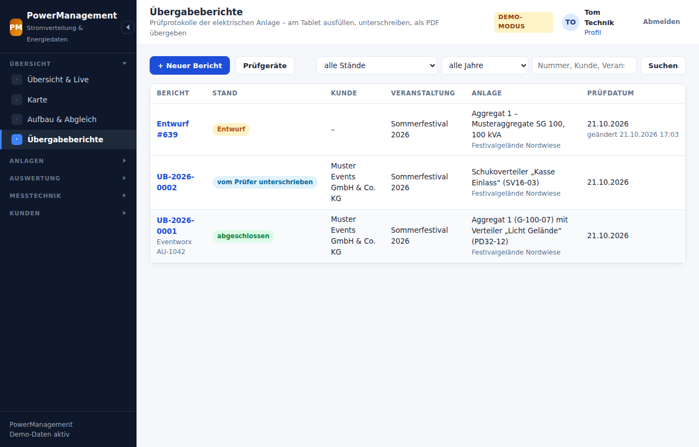
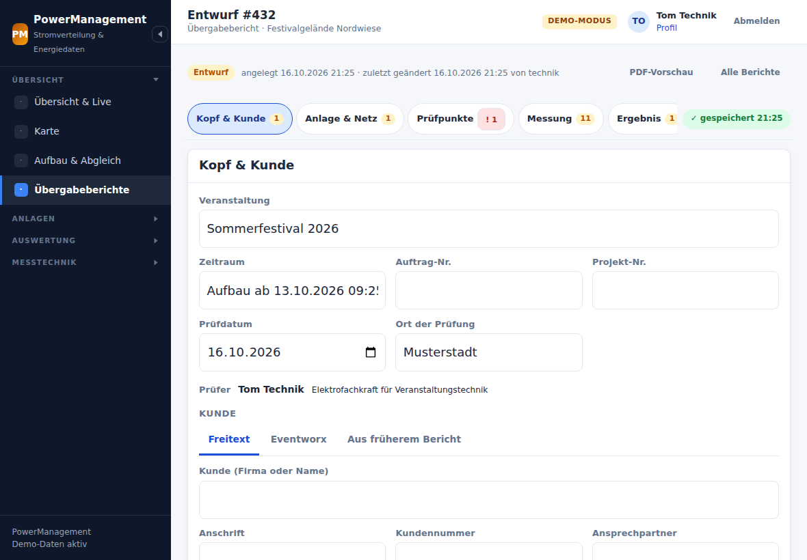
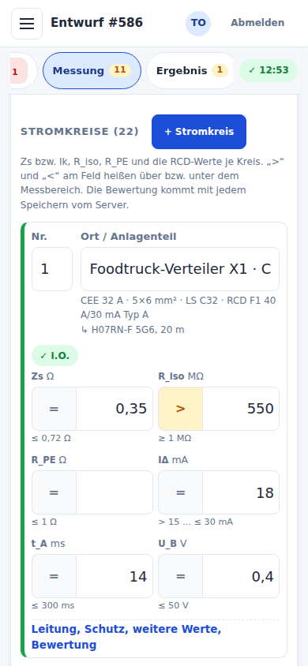
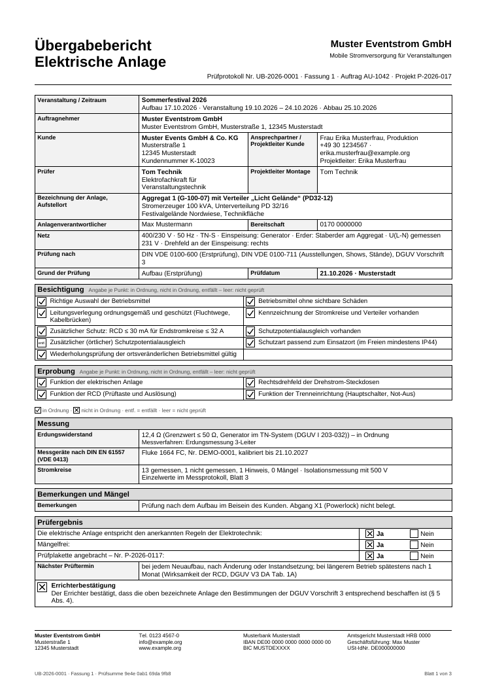
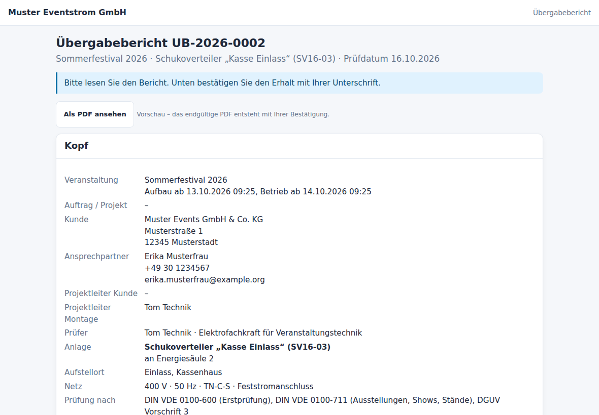

# Übergabeberichte „Elektrische Anlage“

Nach dem Aufbau prüft die Elektrofachkraft die Anlage – besichtigen,
erproben, messen – und übergibt sie dem Kunden. PowerManagement macht daraus
einen **Übergabebericht**: am Tablet oder Telefon ausgefüllt, vom Prüfer und
vom Kunden am Gerät unterschrieben, als PDF für den Kunden. Der Bericht ist
zugleich das Prüfprotokoll nach DIN VDE 0100-600 und die
Errichterbestätigung nach DGUV Vorschrift 3 § 5 Abs. 4.



Was die App vorschlägt, kommt aus dem Plan: Anlagen, Abgänge, Sicherungen
und RCDs, Kabel, Inventar. **Messwerte trägt immer der Prüfer ein** – die
App belegt nie einen Messwert vor, auch nicht aus einem früheren Bericht.
Bewertet wird auf dem Server, nicht im Browser.

> Diese Seite beschreibt, was die Software tut, und nennt die Grundlagen,
> auf denen sie aufbaut. Sie ist **keine Rechtsberatung**. Texte für Kunde,
> Einweisung und Errichterbestätigung, die Aufbewahrungsfrist und die
> Grenzwerte sollte die verantwortliche Elektrofachkraft bzw. die Firma
> prüfen und in den Einstellungen anpassen.

## Ablauf vor Ort

1. **Anlegen.** *Übersicht → Übergabeberichte → + Neuer Bericht*, im Aufbau
   (Karte „Übergabeberichte“) oder an einer Anlage (*Übergabebericht*). Auf
   der Seite „Neuer Bericht“ wird der Standort gewählt und dann, **welche
   Anlagen der Bericht prüft**: Generatoren, Feststromanschlüsse,
   Wechselrichter, Verteiler. Aus einem Aufbau sind dessen mobile Anlagen
   vorausgewählt. Ein **leerer Bericht** ohne Standort geht auch – dann ist
   alles Freitext.
2. **Kopf und Kunde.** Veranstaltung, Zeitraum, Prüfdatum und Ort sind
   vorbelegt. Die Kundendaten kommen auf einem von drei Wegen:
   **Freitext** (der Normalfall), **Eventworx** (nur lesend, siehe
   [eventworx.md](eventworx.md)) oder **aus einem früheren Bericht**.
3. **Anlage, Netz, Prüfgrundlage.** Die Netzform hat bewusst keine Vorgabe;
   gibt es einen früheren Bericht für dieselbe Anlage, bietet die App
   „wie letzter Bericht dieser Anlage: TN-S“ an. Normen als Chips, Grund der
   Prüfung (bei einem Aufbau vorbelegt: *Aufbau (Erstprüfung)*).
4. **Besichtigung und Erprobung.** Je Punkt **i.O. / n.i.O. / entf.**; ein
   zweiter Tipp auf denselben Knopf setzt zurück auf „nicht geprüft“.
   *Übrige Kurzliste auf i.O.* setzt nur noch leere Punkte der Kurzliste.
   Was die App weiß (etwa „Kreis 7: kein RCD ≤ 30 mA“, ein als defekt
   markiertes Inventarstück, offene Positionen im Aufbau), steht als Hinweis
   am Punkt – gesetzt wird damit nichts.
5. **Messung.** Prüfgeräte, Erdungswiderstand, Messspannung für R_iso, dann
   je Stromkreis die Werte. Nach jedem Speichern kommt die Bewertung vom
   Server zurück und steht an der Zeile.
6. **Ergebnis.** Der Vorschlag lautet „Nein“, sobald eine Zeile einen Mangel
   hat oder ein Punkt n.i.O. ist. *Aus den Befunden füllen* übernimmt die
   Mängel in die Liste. Gespeichert wird das Ergebnis erst nach einem Tipp.
7. **Prüfen und unterschreiben.** *Prüfen* listet, was fehlt, mit Sprung zum
   Feld, und die Warnungen zum Abhaken. Dann **Als Prüfer unterschreiben**
   im Vollbild. Ab jetzt ist der Bericht **eingefroren** und hat seine
   Nummer, etwa `UB-2026-0042`.
8. **An Kunden übergeben.** Das Gerät geht an den Kunden (Kundenmodus,
   siehe unten). Er liest, setzt seine Häkchen und unterschreibt. Dann ist
   der Bericht **abgeschlossen** und das PDF gespeichert.
9. **PDF.** Ansehen, herunterladen oder teilen (unter HTTPS über das
   Teilen-Menü des Geräts). Ist ein Eventworx-Vorgang verknüpft, öffnet
   *In Eventworx öffnen* ihn – dort hängt man das PDF von Hand an.



### Speichern ohne Knopf

Das Formular speichert selbst: anderthalb Sekunden nach der letzten
Eingabe, spätestens alle 20 Sekunden und beim Verlassen der Seite. Rechts in
der Leiste steht „gespeichert 14:32“. Zusätzlich liegt eine Kopie im
Browser des Geräts. Bricht das Netz weg, geht nichts verloren: Beim
nächsten Öffnen wird sie gesendet, wenn sie auf dem aktuellen Stand
aufsetzt, sonst fragt die Seite *Übernehmen / Verwerfen*. Solange diese
Frage offen ist, sichert die Seite den laufenden Stand getrennt davon; „auf
dem Gerät gesichert“ steht nur da, wenn das Sichern geklappt hat – sonst
eine Warnung, die Seite offen zu lassen.

Jede Anfrage hat eine **Zeitgrenze** (Speichern 15 s, Unterschrift 30 s);
eine hängende Verbindung blockiert also nichts, und *Abbrechen* im
Unterschriftsdialog geht immer. Kam ein Speichern an, nur die Antwort
nicht, geht dieselbe Eingabe beim nächsten Mal noch einmal hinaus – der
Server erkennt sie (gleicher Inhalt, gleiches Konto) und antwortet
„gespeichert“ statt mit einem Konflikt.

Haben zwei Geräte denselben Bericht offen, überschreibt keines still das
andere: Das zweite meldet „Auf einem anderen Gerät geändert – bitte neu
laden“ und bietet die eigenen Eingaben danach wieder an. Nach dem Abmelden
löscht der Browser die lokalen Kopien – auch Eingaben der letzten
Sekunden werden danach nicht mehr zurückgeschrieben (sie gehen vorher
noch zum Server).

## Felder

| Abschnitt | Inhalt |
|---|---|
| Kopf | Veranstaltung, Zeitraum, Auftrags- und Projektnummer, Prüfdatum, Ort, Prüfer (Qualifikation aus dem Konto; der Name in Druckbuchstaben muss zum vollen Namen des angemeldeten Kontos passen – das PDF nennt das Konto dazu), Kunde, Ansprechpartner, Projektleiter Kunde und Montage, Anlagenverantwortlicher, Bereitschaft |
| Anlage | Bezeichnung, Einzelheiten (Kennungen, Seriennummern), Aufstellort |
| Netz | Einspeisung (Generator, Feststromanschluss, Speicher, Hybrid), Spannung, Frequenz, Netzform, Erder, gemessene Spannung L-N, Drehfeld an der Einspeisung |
| Prüfgrundlage | Normen (DIN VDE 0100-600, -711, -740, -551, 0105-100, DIN EN 60204-1, DGUV Vorschrift 3), Grund der Prüfung |
| Besichtigung | Kurzliste: Auswahl der Betriebsmittel, ohne sichtbare Schäden, Leitungsverlegung (Fluchtwege, Kabelbrücken), Kennzeichnung, 30-mA-RCD für Endstromkreise bis 32 A, Schutzpotentialausgleich, zusätzlicher Potentialausgleich, Schutzart, Wiederholungsprüfung der ortsveränderlichen Betriebsmittel. Unter *Weitere Prüfpunkte* der Rest. |
| Erprobung | Kurzliste: Funktion der Anlage, Rechtsdrehfeld, RCD (Prüftaste und Auslösung), Trenneinrichtung (Hauptschalter, Not-Aus). Weitere: Schutzeinrichtungen, Durchgängigkeit, Motoren, Busleitungen, Isolationsüberwachung (IT). |
| Messung | Prüfgeräte, Erdungswiderstand mit Methode und Bezug, Isolationswiderstand der Busleitung (selten), Messspannung R_iso, Stromkreise |
| Stromkreis | Nr., Ort/Anlagenteil, Kabel, Leitung (Art, Leiter, Querschnitt), Überstromschutz (Art, Charakteristik, In), RCD (Bezeichnung, In, Typ, IΔn, selektiv), Messwerte Zs oder Ik, R_PE, R_iso (mit eigener Messspannung), IΔ, t_A, U_B, Drehfeld, Bewertung, Bemerkung |
| Ergebnis | Mängel (Text, Stromkreis, Frist, behoben am), Bemerkungen, entspricht den Regeln (ja/nein), mängelfrei, Frist zur Instandsetzung, Prüfplakette mit Nummer, nächster Prüftermin (Vorgabe: bei jedem Neuaufbau, nach Änderung oder Instandsetzung; bei längerem Betrieb spätestens nach einem Monat – Wirksamkeit der RCD, DGUV Vorschrift 3, DA Tab. 1A), Errichterbestätigung |

Ein Messwert hat einen **Operator**: `=`, `>` (über dem Messbereich, etwa
„> 550 MΩ“) oder `<`. Geräte zeigen oft nur „> 550“; das ist ein gültiger
Wert, kein Tippfehler.

Wurden die RCD-Werte an einem anderen Kreis desselben RCD gemessen, steht
in der Zeile „RCD-Werte gemessen an Kreis …“ statt einer Kopie der Werte –
in der Leseansicht wie im PDF (dort als Fußnote). Derselbe RCD heißt:
gleiche Bezeichnung, gleiches IΔn (und Typ, Nennstrom, selektiv), dieselbe
Anlage. Zeigt der Bezug auf einen anderen RCD, gelten seine Werte nicht
(„Wert fehlt“ – jeder RCD wird gemessen, DIN VDE 0100-600 6.4.3.7); fehlt die
Bezeichnung an einem der beiden Kreise, gibt es einen Hinweis. Die Auswahl
bietet nur Kreise mit derselben Bezeichnung an, sobald eine eingetragen ist.

Ein Kreis, der nicht gemessen wurde (etwa ein nicht belegter Abgang), wird
auf **nicht gemessen** gestellt, mit Grund. Dann fehlt nichts.



## Was die App vorbelegt – und was nie

| vorbelegt aus | Felder |
|---|---|
| Aufbau | Veranstaltung, Zeitraum (Aufbau und Betrieb), Grund *Aufbau (Erstprüfung)* |
| Standort | Ort (aus der Anschrift, sonst aus den Einstellungen), Aufstellort |
| Anlagen | Bezeichnung (die speisende Anlage mit Modell und Leistung), Einzelheiten mit Kennung und Seriennummer, Einspeisung und Spannung |
| Konto | Prüfer, Qualifikation, Projektleiter Montage |
| Einstellungen | Normen, Messspannung R_iso, Bereitschaft |
| eigener letzter Bericht | Prüfgeräte (nur aktive mit gültiger Kalibrierung) |
| Abgänge | je Abgang ein Stromkreis: Ort, Steckverbinder als Leitungsart, Leiterzahl (Schuko 3, CEE/Powerlock 5 – als *abgeleitet* markiert), Sicherung und RCD aus dem Verteilerplan, gestecktes Kabel |
| letzter Bericht am selben Inventarstück | Querschnitt des Abgangs (der Abgang selbst ändert sich nicht) |

**Nie vorbelegt:** Messwerte (auch nicht aus einem früheren Bericht), die
Netzform, das Ergebnis. Abgeleitete Angaben sind markiert, bis der Prüfer
sie anfasst.

*Zeilen ergänzen* holt Abgänge einer weiteren Anlage nach; doppelte Zeilen
entstehen dabei nicht.

## Grenzwerte und Bewertung

Bewertet wird nur auf dem Server (`App\Berichte\Grenzwerte`). Je Zeile gibt
es **i.O.**, **Hinweis**, **selbst bewerten**, **Wert fehlt** oder
**Mangel**; die schlechteste Stufe zählt. Verglichen wird mit dem
ungerundeten Wert, angezeigt mit zwei Nachkommastellen.

| Prüfung | in Ordnung, wenn | Quelle |
|---|---|---|
| Schleifenimpedanz (TN) | Zs ≤ f · U0 / (k · In); k: B 5, C 10, D 20, K 14, Z 3 – C16 also ≤ 1,44 Ω | DIN VDE 0100-410:2018-10, 0100-600:2017-06 |
| … mit RCD | liegt Zs über dem Wert des LS, schützt aber ein RCD (Zs · IΔn ≤ U0): **Hinweis** „Abschaltung durch RCD“, kein Mangel – bei Generatoren der Regelfall | DGUV Information 203-032 |
| Ik statt Zs | Ik ≥ k · In / f | wie oben |
| NH/gG, Charakteristik ohne k | nur mit eingetragener Grenze, sonst bewertet der Prüfer selbst | – |
| TT | Erdung R_A · IΔn ≤ U_L; Zs entfällt **nur bei Schutz durch RCD** – ohne RCD gilt Zs · Ia ≤ U0 wie im TN-System | DIN VDE 0100-410 411.5 |
| IT | Isolationsüberwachung bei der Erprobung erwartet; ohne RCD bewertet der Prüfer die Abschaltung im Zweitfehlerfall selbst | DIN VDE 0100-410 411.6 |
| TN-C | ein RCD ist dort unwirksam: er zählt weder als Abschaltung noch als Zusatzschutz (Mangel), dazu der Hinweis, die Netzform zu prüfen (meist TN-C-S) | DIN VDE 0100-410 411.4.5 |
| RCD-Pflicht | Endstromkreis bis 32 A mit RCD ≤ 30 mA (übersteuerbar mit Begründung) | DIN VDE 0100-711:2020-06 |
| Auslösestrom IΔ | 0,5 · IΔn < IΔ ≤ 1,0 · IΔn (sinusförmiger Prüfstrom) | DIN EN 61008/61009 |
| Auslösezeit t_A | ≤ 300 ms; selektiv (S): 130–500 ms | DIN EN 61008/61009 |
| Berührungsspannung U_B | ≤ U_L (50 V, einstellbar 25 V) | DIN VDE 0100-410 |
| Isolationswiderstand | 500 V: ≥ 1,0 MΩ · 1000 V: ≥ 1,0 MΩ · reduziert auf 250 V (nicht abtrennbare Überspannungsschutzgeräte): ≥ 1,0 MΩ; 0,5 MΩ gilt nur für SELV/PELV – solche Kreise bewertet der Prüfer selbst; ohne Messspannung „Wert fehlt“ | DIN VDE 0100-600:2017-06, Tab. 6.1 und 6.4.3.3 |
| Schutzleiter R_PE | ≤ 1 Ω, sonst Hinweis (einstellbar) | Praxiswert |
| Querschnitt | Belastbarkeit ≥ In, sonst Hinweis | Belastbarkeit wie bei den Kabeln in der Karte |
| Drehfeld | nicht links | DIN VDE 0100-600 |
| Netzspannung | 230 V ± 10 %, sonst Hinweis | DIN EN 50160 |
| Erdung | Generator im TN-System ≤ 50 Ω (einstellbar); TT ≤ U_L / IΔn; IT ohne Bewertung (Vorgabe); eigener Grenzwert; „keine Bewertung“. Ohne berechenbaren Grenzwert (etwa TT ohne RCD im Bericht) muss der Prüfer einen Bezug wählen | DGUV Information 203-032 |

Ein Bericht hält die Fassung der Grenzwerte fest, mit der er angelegt
wurde: Fassung 1 bewertete R_iso bei 250 V noch gegen 0,5 MΩ, ab Fassung 2
gilt 1,0 MΩ. Ältere Berichte rechnen weiter mit ihrer Fassung.

**Einstellbar** unter *System → Einstellungen → Firma & Übergabeberichte*:
der Faktor f für Zs (1,0; 0,8; 0,67 für die Messung im kalten Zustand),
U_L (50 oder 25 V), die Erdungsgrenze für Generatoren und der Hinweiswert
für R_PE. Ein Bericht hält beim **Anlegen** fest, mit welchen Werten er
rechnet; spätere Änderungen der Einstellungen ändern keinen vorhandenen
Bericht.

**Warum nicht die Werte der Innungsvorlage von 2011?** Viele Betriebe
nutzen noch eine Vorlage, deren Werte überholt sind: R_iso 0,25/0,5 MΩ
(heute 0,5/1,0 MΩ nach DIN VDE 0100-600:2017-06), Charakteristik K mit
12 · In (nicht auf der sicheren Seite; obere Grenze des Auslösebereichs ist
14 · In) und „BGV A3“ (heute DGUV Vorschrift 3). Die App übernimmt die
Gliederung solcher Vorlagen, nicht ihre Grenzwerte.

**Abweichend bewerten.** Der Prüfer kann je Zeile *i.O.* oder *n.i.O.*
setzen. Wer einen automatischen Mangel oder einen nicht berechenbaren Wert
für i.O. erklärt, muss das begründen; im PDF steht dann „abweichend
bewertet: …“.

## Prüfen, Unterschrift und Beweiswert

*Prüfen* zeigt **Fehler** (verhindern die Unterschrift) und **Warnungen**
(abhaken, dann geht es weiter):

- Fehler: Kunde, Anlage, Aufstellort, Prüfdatum, Ort, Netzform, Spannung,
  Prüfgrundlage oder Grund fehlen; Prüfdatum unplausibel (Jahr vor 2000 oder
  nach dem nächsten Jahr); Firmendaten nicht eingetragen; ein Kreis ohne
  Werte oder mit fehlendem Pflichtwert; Messwerte ohne Prüfgerät;
  Erdungswiderstand ohne berechenbaren Grenzwert; „entspricht: ja“, solange
  ein Kreis, die Erdung oder ein Prüfpunkt einen Mangel zeigt – auch wenn in
  der Mängelliste etwas als behoben steht (nach der Behebung wird neu
  gemessen bzw. neu bewertet, DIN VDE 0100-600 6.4.3.1); „ja“ mit
  unbeantworteten Punkten der Kurzliste (i.O., n.i.O. oder entf.);
  „mängelfrei: ja“ trotz Mängeln, offener Einträge, Frist oder „nein“; „nein“
  ohne Frist und ohne Mängel; Errichterbestätigung ohne „ja“; abweichende
  Bewertung ohne Begründung; Konto ohne Prüfer-Qualifikation.
- Warnungen: Kalibrierung eines Prüfgeräts abgelaufen, Erdungswiderstand
  fehlt bei Generator oder TT, Kreise mit Hinweis, gemessene Kreise ohne
  Querschnitt, im Aufbau noch offene Positionen, Prüfdatum in der Zukunft
  oder mehr als 30 Tage zurück, bei „nein“ unbeantwortete Punkte der
  Kurzliste.

Die **Unterschrift** wird im Vollbild gezeichnet (am Telefon quer halten),
mit *Letzten Strich zurück* und *Löschen*. Gespeichert wird **nur der
Linienzug** – Punkte als ganze Zahlen auf einer Fläche 3:1, ohne Zeit, ohne
Druck, ohne Geschwindigkeit. Dazu der Name in Druckbuchstaben, beim Kunden
Funktion/Firma und Ort, und die Zeit des Servers. Der Name des Prüfers muss
zum vollen Namen des angemeldeten Kontos passen (Groß- und Kleinschreibung,
Leerzeichen und ä/ae egal) – wer am Gerät eines anderen unterschriebe,
schriebe sich sonst dessen Qualifikation zu. Eine Unterschrift, die
schon an einem anderen Bericht steht, wird abgelehnt („bitte neu
unterschreiben“). Wird nach einem Netzaussetzer erneut gesendet, entsteht
keine zweite Unterschrift.

Mit der Prüfer-Unterschrift wird der Bericht **eingefroren**:

- Er bekommt seine Nummer `<Kürzel>-<Jahr>-<laufende Nummer>`. Das Kürzel
  ist einstellbar (Vorgabe `UB`), die Nummer zählt je Jahr des Prüfdatums.
  Eine vergebene Nummer kommt nie wieder – auch nicht, nachdem ein Bericht
  nach Ablauf der Frist gelöscht wurde (Zähler `bericht_nummern`).
- Der Inhalt wird mit allem, was später anders sein könnte, festgehalten:
  Firmendaten, Abbild der Prüfgeräte, Texte der Prüfpunkte, Kunden- und
  Einweisungstexte, die Bewertung. Ein alter Bericht sieht auch nach einem
  Update genauso aus.
- Über den Inhalt wird eine Prüfsumme gebildet (SHA-256 über die kanonische
  Schreibweise). Jede Unterschrift kettet daran, die des Kunden zusätzlich
  an die des Prüfers. Ein **Siegel** (HMAC mit einem aus `app.key`
  abgeleiteten Schlüssel) bindet Inhalt, Unterschrift, Name, Zeit und Konto.
- Beim Abschluss entsteht das **PDF** und wird mit seiner Prüfsumme in der
  Datenbank gespeichert, dazu ein **Siegel** über Bericht, Nummer, Fassung,
  die Kette der Kundenzeile, Prüfsumme und Erzeuger. Der Kunde bekommt genau
  diese Datei; ein Austausch in der Datenbank fällt auf, und zweimal erzeugt
  ergibt sie dieselben Bytes. Im Kasten *Prüfnachweis* steht je Unterschrift
  das Konto, mit dem unterschrieben wurde.

Rechtlich ist die gezeichnete Unterschrift eine **einfache elektronische
Signatur** (eIDAS Art. 3 Nr. 10, Art. 25 Abs. 1). Sie ersetzt nicht die
Schriftform nach § 126 BGB – die braucht ein Übergabe- oder Prüfprotokoll
in der Regel auch nicht. Vor Gericht gilt die freie Beweiswürdigung
(§ 286 ZPO). Den Beweiswert tragen weniger die Striche als das Einfrieren,
die Kette, das Siegel, der Lebenslauf des Berichts und vor allem das PDF,
das der Kunde sofort bekommt und mit der Prüfsumme auf der Berichtsseite
vergleichen kann.



## Kundenbestätigung und Kundenmodus

Der Kunde bestätigt **das Dokument, nicht den prüftechnischen Inhalt**
(„Abnahme-/Dokumentbestätigung“) – Messwerte kann ein Laie nicht
beurteilen. Er setzt bis zu drei Häkchen:

- **Bericht erhalten** (Pflicht),
- **Einweisung erhalten**: Hauptschalter/Not-Aus, RCD-Prüftaste
  arbeitstäglich, Verhalten bei Auslösung, keine Eingriffe durch Laien,
  Bereitschaft (Telefon aus den Einstellungen),
- **Anlage übernommen** für den Zeitraum.

Der Text über den Häkchen (Vorgabe: „… Mit der Unterschrift bestätigt der
Kunde den Erhalt des Berichts; Einweisung und Übernahme ergeben sich aus
den angekreuzten Feldern.“) bestätigt nur, was sicher belegt ist: den
Erhalt. Wer die Vorgabe früher übernommen und gespeichert hat, behält den
alten Text (er bestätigte auch die Übernahme) – bitte in den Einstellungen
prüfen. Eingefrorene Berichte behalten ihre Kopie.

Dazu kommt ein freies Feld **Vorbehalte/Mängel aus Sicht des Kunden** –
wer in Kenntnis eines Mangels ohne Vorbehalt abnimmt, verliert Rechte
(§ 640 Abs. 3 BGB). Bei vermieteten Anlagen passt „Übergabe/Übernahme“
besser als „Abnahme“; die Texte stehen in den Einstellungen.

**Kundenmodus.** *An Kunden übergeben* sperrt die Sitzung: Der Kunde sieht
nur diesen Bericht (mit PDF-Vorschau), die Häkchen, den Datenschutzhinweis
und die Unterschriftsfläche – keine Navigation, kein Schalten, kein
anderes Formular, auch keine Fehlerseite und **kein Abmelden**: jede
andere Adresse führt zurück zur Kundenseite. Andere Tabs desselben
Browsers leeren sich und gehen ebenfalls zur Kundenseite. Nach der
Unterschrift steht da „Vielen Dank – bitte geben Sie das Gerät an …
zurück“ – an den, der den Kundenmodus gestartet hat; entsperrt wird mit
**dessen Kennwort**. Ist der Bericht einem Kunden mit eigenem Zugang
zugeordnet ([kundenbereich.md](kundenbereich.md)), steht dort außerdem
„Der Bericht steht ab sofort in Ihrem Kundenbereich bereit.“ Ab fünf falschen Versuchen wird das Entsperren
gebremst (eine Minute, dann jeweils doppelt so lange, höchstens 15
Minuten); abgemeldet wird nicht, und das Konto selbst wird nicht gesperrt.
Das Kennwortfeld füllt der Browser nicht von selbst aus – sonst entsperrte
ein Tipp des Kunden das Gerät.

Die Sperre hängt zusätzlich **am Gerät** (ein Cookie, nur sein Hash steht in
der Datenbank): Endet die Sitzung (Inaktivität, Höchstdauer) und meldet
sich jemand in diesem Browser wieder mit dem Konto an – etwa mit dem dort
gespeicherten Kennwort –, ist das Gerät gleich wieder gesperrt. Auf einem
anderen Gerät gilt die Sperre nicht.



Ist der Kunde nicht da oder verweigert er die Unterschrift, schließt der
Prüfer **ohne Unterschrift des Kunden** ab – mit Grund, der im PDF an der
Stelle der Unterschrift steht.

## Zurückziehen, Korrektur, Verwerfen

| Fall | Was geht |
|---|---|
| Prüfer hat unterschrieben, der Kunde hat den Bericht noch nicht gesehen | **Unterschrift zurückziehen** (mit Grund): wieder ein Entwurf, die Nummer bleibt. Nach dem Kundenmodus oder dem Öffnen der PDF-Vorschau geht das nicht mehr. |
| Abgeschlossen, später fällt ein Fehler auf | **Korrektur anlegen** (mit Grund): eine neue Fassung `UB-2026-0042-K1` mit demselben Inhalt als Entwurf. Prüfer und Kunde unterschreiben neu; erst dann heißt die alte Fassung *ersetzt*. Ihr PDF bleibt unverändert und abrufbar. |
| Entwurf ohne Nummer | **Löschen** |
| Entwurf mit Nummer (nach dem Zurückziehen) | **Verwerfen** (mit Grund) – die Lücke in der Nummernfolge ist so erklärt |

Jeder Schritt steht im **Verlauf** des Berichts (angelegt, unterschrieben,
an den Kunden übergeben, PDF abgerufen, zurückgezogen …) – ohne
Kundendaten und ohne IP-Adressen. Anders als das Audit-Log räumt die
Wartung den Verlauf nicht nach 400 Tagen auf; er geht erst mit dem Bericht.

## Integrität prüfen

Die Berichtsseite zeigt unter **Prüfnachweis**, ob alles noch stimmt. Auf
dem Server rechnet die Kommandozeile alle eingefrorenen Berichte nach:

```bash
sudo -u www-data php /opt/powermanagement/bin/power berichte:pruefen
sudo -u www-data php /opt/powermanagement/bin/power berichte:pruefen UB-2026-0042 --fassung=2 --pdf
sudo -u www-data php /opt/powermanagement/bin/power berichte:pdf UB-2026-0042 /root/UB-2026-0042.pdf
```

`berichte:pruefen` meldet je Bericht *OK* oder die Befunde: Inhalt
verändert, Striche verändert, Kette unterbrochen, Siegel ungültig, PDF
verändert, ausgetauscht (Siegel des PDF, Prüfsumme im Lebenslauf) oder
fehlend, Status passt nicht zu den Daten, Korrektur ohne Vorgänger.
Eingefroren ist ein Bericht nach den Daten (Unterschrift, Prüfsumme, PDF),
nicht nach der Spalte `status` – wer sie per SQL auf „Entwurf“ setzt, macht
den Bericht nicht wieder änderbar, sondern bekommt einen Befund.

`--pdf` erzeugt das PDF zusätzlich neu und vergleicht Byte für Byte. Stammt
das gespeicherte vom selben Erzeuger (`BerichtPdf::ERZEUGER`), ist eine
Abweichung ein **Befund**; bei einem älteren Erzeuger (Layout seither
geändert) nur ein **Hinweis** – maßgeblich ist dann das gespeicherte, wenn
sein Siegel stimmt. Deshalb zählt jede Änderung am Layout `ERZEUGER` hoch.
Nach einem Wechsel von `app.key` heißt es „Siegel mit anderem Schlüssel,
nicht prüfbar“, nicht „verfälscht“. Exitcode 1 bei einem Befund; die Ausgabe
enthält keine Kundendaten.

`berichte:pdf` schreibt die gespeicherten Bytes eines abgeschlossenen
Berichts heraus (nie über eine vorhandene Datei) und nennt die Prüfsumme.

## Datenschutz

- **Rechtsgrundlagen:** Vertragsdurchführung (Art. 6 Abs. 1 lit. b DSGVO),
  Prüf- und Dokumentationspflichten (lit. c: DGUV Vorschrift 3,
  BetrSichV), bei Ansprechpartnern von Firmenkunden berechtigtes Interesse
  an der Dokumentation (lit. f).
- **Informationspflicht (Art. 13):** Über der Unterschriftsfläche des
  Kunden steht ein kurzer Hinweis (`berichte.datenschutz` in den
  Einstellungen) – dort die eigene Datenschutzerklärung nennen.
- **Nur Geometrie:** Gespeichert wird die Unterschrift als Linienzug, ohne
  Zeit- und Druckwerte. Schreibdynamik wäre ein biometrisches Merkmal
  (Art. 9); die App erfasst sie gar nicht erst.
- **Datensparsam:** aus Eventworx nur, was der Bericht braucht, keine
  Beträge und keine Notizen. Kundendaten stehen nicht im Audit-Log und nicht
  im Verlauf, Unterschriften und PDF liegen in der Datenbank, nie unter
  einem öffentlichen Pfad.
- **Verzeichnis der Verarbeitungstätigkeiten (Art. 30):** „Übergabeberichte
  elektrischer Anlagen“ mit Kunden- und Ansprechpartnerdaten, Unterschriften,
  Aufbewahrungsfrist; Eventworx als Quelle (mit AV-Vertrag).
- **Sehen:** Im **Kundenbereich** sieht ein Kunde nur Berichte, die ihm
  ausdrücklich zugeordnet sind, und erst abgeschlossen – mit dem
  gespeicherten PDF; jeder Download wird festgehalten
  ([kundenbereich.md](kundenbereich.md#protokolle-zuordnen)). Ein Konto mit
  Rolle sieht abgeschlossene Berichte nur mit dem Recht
  „Übergabeberichte ansehen“ und einer Freigabe für den Standort; hat sie
  einen Datenzeitraum, nur Berichte mit Prüfdatum darin
  ([rechte.md](rechte.md#übergabeberichte)).

## Aufbewahrung

Ein abgeschlossener, ersetzter oder verworfener Bericht wird bis zum
**31.12. des Jahres „+ 10 Jahre“** aufbewahrt (einstellbar 1–30 Jahre) –
gerechnet ab dem späteren von Prüfdatum und Abschluss (bzw. Verwerfen):
die Fristen beginnen mit Übergabe oder Absendung, und ein altes oder
vertipptes Prüfdatum macht einen frischen Bericht so nicht gleich
löschfällig. Gelöscht wird immer eine **ganze Nummer** mit allen Fassungen
– nur, wenn keine davon mehr offen ist (Entwurf oder vom Prüfer
unterschrieben) und alle ihre Frist überschritten haben; sonst zeigte eine
Korrektur ins Leere. Zehn Jahre decken die üblichen Fristen ab: BetrSichV (bis zur
nächsten Prüfung), Handelsbriefe (6 Jahre), Verjährung von Mängelansprüchen
(2 bzw. 5 Jahre) und die Höchstfrist für Sachschäden und
Produkthaftung (10 Jahre). Für Personenschäden gelten bis zu 30 Jahre –
ob man Berichte so lange behält, entscheidet die Firma.

Gelöscht wird **nie automatisch**. Die tägliche Wartung meldet nur, wie
viele Berichte über der Frist sind und wie viele Entwürfe seit 180 Tagen
liegen. Löschen (Bericht, Unterschriften, PDF, Verlauf; im Audit-Log bleibt
die Nummer):

```bash
sudo -u www-data php /opt/powermanagement/bin/power berichte:aufbewahrung              # zeigen
sudo -u www-data php /opt/powermanagement/bin/power berichte:aufbewahrung --ausfuehren # löschen
```

## Einrichten

1. **Firmendaten** (*System → Einstellungen → Firma & Übergabeberichte*):
   Name ist Pflicht vor der ersten Prüfer-Unterschrift; Anschrift, Kontakt,
   Bank und Register stehen im Fuß jeder Seite (auf Geschäftsbriefen einer
   GmbH verlangt § 35a GmbHG Rechtsform, Sitz, Registergericht und alle
   Geschäftsführer). Das Repository bringt keine Firmendaten mit.
2. **Texte und Werte** in derselben Karte: Kürzel der Nummer, Normen,
   Messspannung, Grenzwerte, Bereitschaft, Kunden-, Einweisungs- und
   Errichtertext, Datenschutzhinweis, Aufbewahrung.
3. **Prüfgeräte** (*Übergabeberichte → Prüfgeräte*): Fabrikat, Typ,
   Seriennummer, kalibriert bis. Ein abgelaufenes Gerät gibt eine Warnung,
   die der Prüfer abhaken muss. Geräte werden nicht gelöscht, nur
   stillgelegt.
4. **Prüfer-Qualifikation** im Benutzerkonto (*System → Benutzer &
   Freigaben*), etwa „Elektrofachkraft für Veranstaltungstechnik“. Ohne sie
   keine Prüfer-Unterschrift.
5. **Rechte** – siehe [rechte.md](rechte.md#übergabeberichte). Eventworx ist
   optional: [eventworx.md](eventworx.md).

## Demo

`php bin/power demo:seed` legt im Demo-Gelände drei Berichte zum Aufbau
„Sommerfestival 2026“ an, alle mit erfundenen Namen und Unterschriften:

- **UB-…-0001, abgeschlossen** – Aggregat 1 und „Licht Gelände“, mit
  Messwerten, einer Zeile „Abschaltung durch RCD“ und gespeichertem PDF;
  Kundendaten aus dem Eventworx-Demo-Auftrag `AU-1042`, dem Demo-Kunden
  „Muster Events GmbH & Co. KG“ zugeordnet (im Kundenbereich als
  `muster-events` zu sehen);
- **UB-…-0002, vom Prüfer unterschrieben** – „Kasse Einlass“, wartet auf
  den Kunden (*An Kunden übergeben* zum Ausprobieren, entsperren mit dem
  eigenen Kennwort); ebenfalls Muster Events zugeordnet, im Kundenbereich
  erst nach der Unterschrift;
- **Entwurf** – Foodtruck-Verteiler und Catering, halb ausgefüllt, ohne
  Kunde (Eventworx-Suche nach `AU-1042` zum Ausprobieren).

Dazu die Firma „Muster Eventstrom GmbH“ (nur, wenn noch keine Firmendaten
eingetragen sind), zwei Prüfgeräte (eines mit abgelaufener Kalibrierung) und
das Konto `technik` mit Prüfer-Qualifikation.

## Prüfen

| Skript | prüft |
|---|---|
| `tests/berichte.php` | Vorbelegung, Grenzwerte, Speichern, Abschluss-Prüfung, Unterschrift, Einfrieren, Kunde, Integrität, Korrektur, Sichtbarkeit, Löschen, Aufbewahrung, Kommandozeile, Datenschutz |
| `tests/bericht-pdf.php` | PDF-Schreiber und Layout (mit poppler-utils) |
| `tests/web.php` | Seiten, Autosave, Kundenmodus, Rechte |
| `tests/eventworx.php` | Eventworx nur lesend |
| `tests/kundenbereich.php` | Protokolle im Kundenbereich: nur über die Zuordnung, gleiche 404 für Fremdes, PDF und Abrufe |
