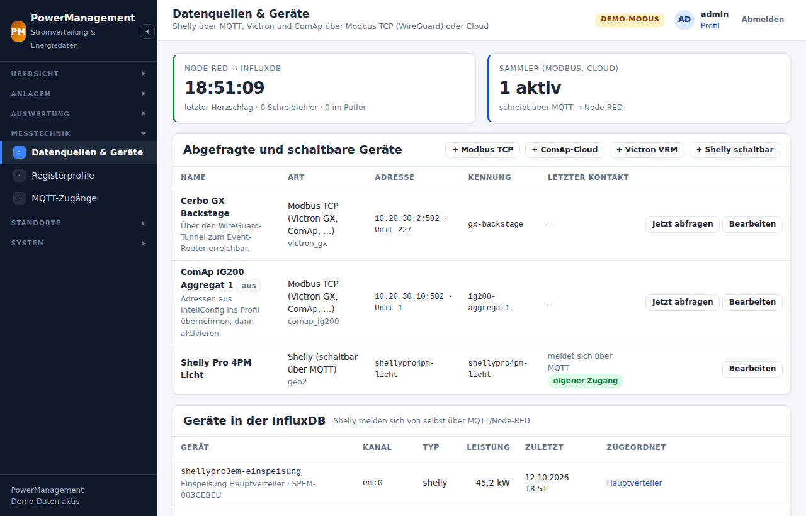

# Messdaten: Shelly, Victron, ComAp

```
 Shelly (Gen1/Gen2+) ──MQTT──►  Mosquitto  ◄──MQTT── Sammler (bin/power sammler)
                                    │                   ▲   Modbus TCP ── Victron GX, ComAp (über WireGuard)
                                    ▼                   │   HTTPS ─────── ComAp WebSupervisor, Victron VRM
                                 Node-RED               │
                     (übersetzt, bündelt, puffert)      │
                                    │                   │
                                    ▼                   │
                                 InfluxDB ◄─────────────┘ (optional direkt: sammler.ziel = influx)
                                    │
                                    ▼
                           PowerManagement (InfluxQL über /query)
                   Übersicht · Karte · Anlagen · Auswertung · CSV
```

Die Auswertung, die bisher in Grafana lief, übernimmt PowerManagement
selbst: Livewerte in Übersicht, Karte und Verteilerplan, Verläufe je Phase,
Energie je Tag, Spitzenwerte und CSV-Export. Überall gelten die
Datenfenster der Freigaben ([rechte.md](rechte.md)).



## Ein Format für alle

Was auch immer misst: Am Ende steht ein **normalisierter Messwert** auf dem
Thema

```
pm/messwert/<gerät>/<kanal>
```

```json
{
  "ts": 1727200000000,
  "typ": "victron",
  "phasen": {
    "L1":  { "u": 230.1, "i": 5.2, "p": 1200, "q": 80, "s": 1210, "pf": 0.99, "f": 50.0 },
    "L2":  { "p": 1100 },
    "L3":  { "p": 900 },
    "sum": { "p": 3200, "e": 1834500, "e_rueck": 0 }
  },
  "zustand": { "soc": 87, "zustand_text": "Wechselrichten", "an": true }
}
```

| Feld | Einheit |
|------|---------|
| `u` Spannung, `i` Strom, `p` Wirkleistung, `q` Blindleistung, `s` Scheinleistung | V, A, W, var, VA |
| `pf` Leistungsfaktor, `f` Frequenz | –, Hz |
| `e` Energie (Zählerstand, bezogen), `e_rueck` (eingespeist) | Wh |
| `ts` | Millisekunden seit 1970 (UTC) |

`zustand` nimmt alles auf, was keine Phasengröße ist: Ladezustand,
Betriebsart, Schalterstellung, Temperaturen, Texte. **Zahlen müssen
JSON-Zahlen sein.** Ein `"87"` würde ein Textfeld anlegen und später jeden
Zahlenwert desselben Feldes blockieren.

Wer eigene Geräte anbinden will (etwa über ein Skript auf einem Router), muss
nur dieses Format auf `pm/messwert/…` veröffentlichen. Den Rest erledigt
Node-RED. Tankgeber liefern Rohwerte in den Feldern aus dem Abschnitt
[Tanksensoren](#tanksensoren-rohwerte-statt-liter).

## InfluxDB-Schema

| Messung | Tags | Felder |
|---------|------|--------|
| `strom` | `geraet`, `kanal`, `phase` (L1/L2/L3/N/sum), `typ` | `u i p q s pf f e e_rueck` |
| `zustand` | `geraet`, `kanal`, `typ` | frei (`soc`, `temperatur`, `schalter`, `…_text`; Rohwerte der Tanksensoren `u`, `eingang`, `x`, `sensorfehler` …, siehe [unten](#tanksensoren-rohwerte-statt-liter)) |
| `geraet` | `geraet`, `typ` | `modell`, `produkt`, `name`, `firmware`, `generation`, `mac`, `praefix`, `ip` |
| `pipeline` | `quelle` | Herzschlag von Node-RED: `geschrieben`, `fehler`, `puffer`, `verworfen` |

Alle Zahlen werden als **Float** geschrieben, auch `1` oder `true`. Sonst
lehnt InfluxDB beim ersten Typwechsel ganze Shards ab.

PowerManagement fragt mit **InfluxQL** über `/query` ab. Das verstehen
InfluxDB 1.8, 2.x (über die DBRP-Zuordnung, richtet das Installationsskript
ein) und 3.x. Geschrieben wird über `/write?precision=ms`.

## Shelly

Shellys brauchen **keine Datenquelle**. Sie melden sich über MQTT und
erscheinen unter **Messtechnik → Datenquellen → Geräte in der InfluxDB**.
Dort ordnet man sie einer Anlage zu, als **Messpunkt** (Einspeisung, Abgang
oder einzelner Anschluss).

| Generation | Themen | Node-RED macht daraus |
|------------|--------|-----------------------|
| Gen2+ (Plus, Pro, Gen3, Gen4) | `<präfix>/status/em:0`, `…/switch:0`, `…/emdata:0`, `…/online` | Messwerte je Kanal; Geräteinfo per RPC `Shelly.GetDeviceInfo` (alle 6 h) |
| Gen2+ Plus Uni, Plus Add-on (Analogeingang) | `<präfix>/status/voltmeter:N`, `…/input:N` (Typ *analog*) | Rohwerte `u` (V) bzw. `eingang` (%), dazu `x` und bei jeder Meldung `sensorfehler` 0/1 ([Tanksensoren](#tanksensoren-rohwerte-statt-liter)) |
| Gen1 | `shellies/<id>/emeter/N/…`, `…/relay/N/power`, `…/announce` | Messwerte; Wattminuten → Wh; 3EM-Summe |
| Gen1 Uni | `shellies/<id>/adc/N` | Kanal `adc:N` mit `u` (V) |

Einrichtung am Gerät (MQTT-Server, Benutzer `shelly`, *Generic status
update over MQTT* bei Gen2+): siehe
[Installationsanleitung, Abschnitt 5](installation-debian-lxc.md#5--shelly-geräte-anbinden).

**Eigener Zugang je Gerät:** Statt des gemeinsamen Zugangs `shelly` kann
jeder Shelly einen eigenen Broker-Benutzer bekommen (*Messtechnik →
MQTT-Zugänge*). Der Benutzer ist bei Gen2+ das Präfix (`<id>` oder
`shelly/<name>`), bei Gen1 die Geräte-ID ohne `shellies/`. Er darf nur im
Baum des Geräts lesen und schreiben (`<präfix>/#` bzw. `shellies/<id>/#`)
und `shellies/command` lesen. Sobald bestätigt ist, dass das Gerät über
den eigenen Zugang verbunden ist, sperrt der Broker diesen Baum für den
gemeinsamen Zugang `shelly`. Gen1-Geräte mit eigenem Zugang dürfen
`shellies/announce` nicht schreiben; Modell und Firmware kommen dann aus
`shellies/<id>/announce`.

**Schutz vor Doppelgängern:** Node-RED bildet den Gerätenamen aus dem
Präfix (letztes Segment, klein). `kuehlhaus/…` ergibt also denselben Namen
wie `shelly/kuehlhaus/…`, `shellies/SHELLY1-b929cc` denselben wie
`shellies/shelly1-B929CC` – und unter einem solchen Präfix dürfte der
gemeinsame Zugang weiter schreiben. Deshalb veröffentlicht PowerManagement
die Geräte mit bestätigtem eigenem Zugang (Gerätename → genaues Präfix)
retained auf `pm/status/mqtt-zugaenge`, wo der gemeinsame Zugang nicht
schreiben darf. Für diese Geräte nimmt Node-RED Messwerte, `online`,
Geräteinfo und `announce` nur unter dem genauen Präfix an; alles andere –
auch `shellies/announce` und RPC-Antworten auf `pm-nodered/rpc` – verwirft
es. Eine ungültige Nachricht auf dem Thema ändert nichts, eine leere Liste
hebt den Schutz auf. Jede angenommene Liste quittiert Node-RED retained auf
`pm/status/nodered-schutz` mit `{"ts": …, "anzahl": …, "zeit": …}` (`ts`
der Liste oder `null`, Zahl der geschützten Geräte, Zeitpunkt der Annahme
in ms) – fehlt die Quittung oder bleibt sie bei einem älteren `ts` stehen,
wirkt der Schutz in Node-RED nicht, etwa bei alten, von Hand geänderten
Flows.

**RPC-Antworten (Gen2+):** Ein Shelly antwortet an `<src>/rpc`. Damit
ein eigener Zugang dorthin schreiben darf – und der gemeinsame nicht –,
liegt der Absender im Baum des Geräts:

| Anfrage | Absender (`src`) | Antwort auf |
|---------|------------------|-------------|
| Schalten (`Switch.Set`), Gerät mit eigenem Zugang (in jedem Zustand) | `<präfix>/pm-steuerung-<8 hex>` | `<präfix>/pm-steuerung-<8 hex>/rpc` |
| Schalten, Gerät ohne eigenen Zugang | `pm-steuerung-<8 hex>` | `pm-steuerung-<8 hex>/rpc` |
| MQTT-Zugänge (Prüfen, Kennwort übertragen) | `<präfix>/pm-konto-<8 hex>` | `<präfix>/pm-konto-<8 hex>/rpc` |
| Node-RED `Shelly.GetDeviceInfo` | `<präfix>/pm-nodered` | `<präfix>/pm-nodered/rpc` |
| Node-RED, nach 60 s ohne Antwort einmal | `pm-nodered` | `pm-nodered/rpc` |

Eine Antwort gilt nur, wenn Thema, `id` und `dst` zur Anfrage passen und
sie kein `method` enthält. Nach einem Neustart von Node-RED fehlt die
Anfrage; dann ordnet Node-RED eine Antwort im Baum eines Geräts über das
Präfix im Thema zu, eine Antwort auf `pm-nodered/rpc` gar nicht. Themen im
Baum eines Geräts, deren nächster Teil mit `pm-` beginnt, sind keine
Meldungen des Geräts – Node-RED übergeht sie.

**Schalten:** Einen Shelly mit Schaltausgang macht man unter
*Geräte in der InfluxDB* mit **„schaltbar machen“** zur Datenquelle. Das
MQTT-Präfix und die Generation übernimmt PowerManagement aus der InfluxDB.

- Gen2+ bekommt `Switch.Set` per JSON-RPC auf `<präfix>/rpc`. Die Antwort
  des Geräts wird ausgewertet: Die Oberfläche meldet „ausgeschaltet“ erst,
  wenn der Shelly es bestätigt.
- Gen1 bekommt `on`/`off` auf `shellies/<id>/relay/N/command`. Eine
  Bestätigung gibt es dort nicht, der neue Zustand erscheint mit dem
  nächsten Messwert.

## Tanksensoren: Rohwerte statt Liter

Ein Tanksensor – etwa eine hydrostatische 4–20-mA-Sonde an einem Shelly
Plus Uni – meldet keinen Füllstand, sondern eine Spannung oder einen
Prozentwert. In die InfluxDB kommen nur diese **Rohwerte**; Node-RED rechnet
nichts um. Füllhöhe, Liter und Prozent rechnet PowerManagement beim Lesen,
mit der Kennlinie des Einbaus (Sonde, Messbereich, Einbaumaß, Tank).

Warum nicht gleich Liter:

- **Kalibriert wird je Einbau.** Derselbe Sensor misst in einem anderen Tank
  oder nach einer Peilung anders. Die Kennlinie gehört zum Einbau, nicht zum
  Gerät.
- **Korrigierbar.** Eine Peilung oder Betankung ergibt eine neue Fassung
  der Kennlinie. Die gespeicherten Messwerte bleiben, wie sie gemessen
  wurden.
- **Rechte vor der Rechnung.** Die App liest Rohwerte nur im Datenfenster
  der Freigaben und rechnet erst danach.
- **Kein Gerät schreibt Messwerte.** Weder der gemeinsame Zugang `shelly`
  (`topic deny pm/#`) noch ein eigener Zugang (`%u/#`) darf auf
  `pm/messwert/…` schreiben. Ein Shelly kann also keine fertigen Liter
  einspeisen; was er in seinem Baum meldet, übersetzt Node-RED.

| Feld in `zustand` | Einheit | Quelle |
|-------------------|---------|--------|
| `u` | V | Gen2+ `voltmeter:N` (`voltage`), Gen1 Uni `adc/N` |
| `eingang` | % (analog) bzw. 0/1 (digital) | Gen2+ `input:N` (`percent` bzw. `state`) |
| `x` | nur am Gerät bekannt | `xvoltage` bzw. `xpercent`, wenn am Gerät ein Ausdruck gesetzt ist |
| `sensorfehler` | 0/1 | bei **jeder** Meldung von `voltmeter:N` und analogem `input:N` |
| `i_ma`, `abstand_mm`, `fuellhoehe_mm` | mA, mm, mm | Fremdgeräte (Modbus-Analogmodul, ESPHome) über `pm/messwert/…` |
| `tank_prozent`, `tank_liter` | %, l | Quellen, die schon kalibriert sind (ComAp, Victron GX Tank) |

Die Einheit steckt im Feldnamen. Zahlen bleiben JSON-Zahlen und gehen als
Float in die InfluxDB.

**`sensorfehler`:** Meldet der Shelly `errors` (etwa `out_of_range`) oder
`voltage` bzw. `percent` als `null`, schreibt Node-RED nur
`sensorfehler=1` – ohne Wert, nie eine Schein-0. Jede gute Meldung trägt
`sensorfehler=0`; die nächste gute Meldung hebt einen Fehler also wieder
auf. Digitaleingänge (`state`), Taster und Zähler (`counts`) bekommen kein
`sensorfehler`, Taster und Zähler auch keinen Wert. Der ADC des Gen1 Uni
meldet keine Fehler; dort gibt es nur `u`.

Beispiele (Line Protocol):

```
zustand,geraet=shellyplusuni-a0b1c2,kanal=voltmeter:100,typ=shelly u=7.5,x=12.34,sensorfehler=0 1760612400000
zustand,geraet=shellyplus1-a0b1c2,kanal=input:100,typ=shelly eingang=64.2,sensorfehler=0 1760612400000
zustand,geraet=shellyplusuni-a0b1c2,kanal=voltmeter:100,typ=shelly sensorfehler=1 1760612460000
zustand,geraet=shellyuni-a1b2c3,kanal=adc:0,typ=shelly u=6.42 1760612400000
```

### Einrichtung am Gerät

Die App stellt am Shelly nichts ein. Sie kennt weder `Voltmeter.SetConfig`
noch das Anlegen von Peripherie und startet nie ein Gerät neu. Deshalb von
Hand in der Shelly-App oder der Weboberfläche des Geräts:

- **Peripherie:** Analogeingang am Plus Uni bzw. Add-on als *Voltmeter*
  einrichten (Kanal `voltmeter:100`). Als *Analog-Eingang* meldet er
  Prozent (`input:100`). Beim Gen1 Uni heißt der Kanal `adc:0`.
- **MQTT:** *Generic status update over MQTT* einschalten (Gen2+).
- **Meldeschwelle** `report_thr` so klein, wie das Gerät erlaubt:
  Voltmeter 0,02–0,05 V, Analog-Eingang 1 %.
- **ECO-Modus aus**, sonst springt der Wert.

**Melderhythmus:** Ein Gen2+-Shelly meldet nur, wenn sich der Wert um mehr
als `report_thr` ändert – einen festen Takt gibt es nicht. Ein ruhender
Tank schweigt deshalb oft Stunden. Die App zeigt den Stand mit seinem
Alter; „stumm“ gilt erst ohne Lebenszeichen des Geräts (`online`).

### 4–20-mA-Sonde am Plus Uni

- **Versorgung:** ein eigenes 24-V-SELV-Netzteil, fest auf 24,0 V – nie die
  Starterbatterie oder das Bordnetz des Generators. Der Plus Uni verträgt
  9–28 V DC (8–24 V AC, 5 V stabilisiert; die 12–36 V gelten für den
  alten Gen1 Uni). Bei DC: + an VAC1, − an **GND** (Masse der Sensoren),
  VAC2 frei. Bürde bzw. Masse des Wandlers an dieselbe GND-Klemme. Die
  Sonde liegt in Reihe in der Stromschleife.
- **Mit Bürde (der einfachere Weg):** 499 Ω (oder 2 × 1 kΩ parallel),
  Metallschicht ≤ 25 ppm/K, vom Analogeingang nach GND: 4 mA ≈ 2,0 V,
  20 mA ≈ 10 V. Für einen Kurzschluss der Sondenleitung auslegen
  (24 V / 499 Ω = 48 mA, 1,15 W – also ≥ 2 W) oder die Schleife begrenzen.
  In der App: Signal „4–20 mA (an einer Bürde)“, Bürde 499 Ω. Am Plus
  Add-on (0–10 V) 470 Ω.
- **Mit Wandler „0/4–20 mA → 0–10 V“:** auf **0–20 mA → 0–10 V**
  abgleichen – ZERO bei 4,00 mA auf 2,00 V, SPAN bei 20,00 mA auf 10,00 V.
  Dafür braucht es eine Stromquelle, die Sonde liefert 20 mA nie.
  Steckbrücken nach dem Aufdruck der eigenen Platine setzen, danach prüfen:
  0 mA unter 1,8 V, 21 mA ≈ 10,5 V. Trimmer sichern und nach jedem
  Transport den Wert bei 4 mA prüfen; das Modul braucht 7–36 V. Im Modus
  „4–20 mA → 0–10 V“ (4 mA = 0 V) ergäbe ein Leitungsbruch ebenfalls 0 V:
  **Leitungsbruch wird so nicht erkannt – der Tank zeigt dann leer.** In
  der App: Signal „4–20 mA über Spannungswandler“, Vorgabe 2,0 V bei 4 mA
  und 10,0 V bei 20 mA (bei 3,3 V bzw. 5 V Endwert 0,66 / 1,0 V).
- **Spannung bei 4 und 20 mA** so eintragen, wie der Shelly sie meldet –
  nicht ausrechnen. Der Eingang des Shelly ist vermutlich ungenauer als
  die Sonde: Voltmeter im Messbereich 0 (0–15 V) lassen und nie
  umschalten, den Uni in den Schatten (Umgebung höchstens 40 °C).
- **Kalibrieren:** Eine Peilung mit dem Peilstab setzt nur den Anker, die
  Steigung bleibt. Zwei Peilungen im selben Einbau mit mindestens 300 mm
  Höhenunterschied (etwa vor und nach dem Betanken) können auch die
  Steigung setzen; weicht sie um mehr als 15 % von den Sensordaten ab,
  warnt die App („Messbereich, Dichte oder Wandler prüfen“).
- **Spannung an der Sonde:** Ob 24 V minus 10 V an der Bürde reichen, ist
  nicht belegt – die Klemmenspannung der Sonde bei hohem Strom messen.
- **Sonde:** Messbereich passend zur Tankhöhe. Ein voller QUADRO-AG steht
  nach den Außenmaßen nur etwa 1,1 m hoch (≈ 0,9 mWS): 0–2 mWS ist die
  sichere Wahl, 0–1 mWS (doppelt so genau) nur, wenn die gemessene volle
  Füllhöhe unter 1,15 m liegt. Nutzt eine Sonde weniger als 40 % ihres
  Messbereichs, sagt die App das – eine 0–5-mWS-Sonde im 1,55 m hohen Tank
  nutzt etwa 26 %, 0,5 % vom Messbereich sind dort ≈ 30 mm Diesel. Für
  Diesel müssen Membran und Kabelmantel dieselbeständig sein (etwa PUR-
  oder FEP-Kabel, FKM-Dichtung) – viele „Wasserstandssensoren“ haben
  PVC-Kabel, Datenblatt prüfen.

Die App warnt nur. Grenzwertgeber und Leckanzeiger am Tank bleiben Pflicht.

## Victron Energy

### Modbus TCP am GX (empfohlen, Livewerte)

Am Cerbo GX / Ekrano / Venus GX: **Einstellungen → Dienste → Modbus TCP →
aktivieren.** Datenquelle anlegen:

| Feld | Wert |
|------|------|
| Art | Modbus TCP |
| Adresse / Port | IP des GX (über WireGuard), `502` |
| Unit-ID | die **VE.Bus**-Instanz des Multi/Quattro (häufig `227`; steht am GX unter *Einstellungen → Dienste → Modbus TCP → Verfügbare Dienste*) |
| Registerprofil | *Victron GX (System + VE.Bus)* |
| Intervall | 1–5 s |

Das Profil liest die **Systemwerte auf Unit-ID 100** (Verbrauch, Netz,
Generator und PV je Phase, Batterie mit SOC, Strom, Spannung, Zustand und
Restlaufzeit, aktive Eingangsquelle). Auf der Unit-ID der Datenquelle liest
es den **VE.Bus** (Ein-/Ausgang je Phase, Frequenz, Zustand, Fehler,
Schalterstellung). Fehlt ein Dienst, fehlen nur seine Werte, der Rest kommt
trotzdem. Benachbarte Register werden in Blöcken gelesen, zwei bis drei
Anfragen je Runde.

**Schalten** (Befehle im Profil, einzeln abschaltbar): Wechselrichter/Lader
ein/aus/nur Laden/nur Wechselrichter (Register 33), GX-Relais 1 (Register
806 auf Unit 100).

> Die Registerliste entspricht der Victron-Liste *CCGX-Modbus-TCP-register-list*.
> Sie ändert sich mit Venus-OS-Fassungen selten, aber sie ändert sich.
> Nach einem größeren Update einmal **„Jetzt abfragen“** an der
> Datenquelle ausführen. Profile lassen sich unter **Registerprofile**
> anpassen. Updates legen mitgelieferte Profile nur neu an und
> überschreiben nie ein vorhandenes.

### VRM-Portal (ohne Tunnel)

Für Anlagen, zu denen kein Tunnel reicht: Datenquelle *Victron VRM*,
Installations-ID (*idSite*, steht in der VRM-Adresszeile) und ein
**Zugangstoken** (VRM → Einstellungen → Integrationen → Zugangstoken).
Übersetzt wird über `dbusServiceType` und `dbusPath` der Diagnosewerte.
VRM aktualisiert nur im Upload-Takt des GX (Vorgabe 15 min, einstellbar bis
1 min). Das reicht für Tageswerte, **nicht für Livewerte**.

## ComAp InteliGen 200 (IG200)

### Modbus TCP (empfohlen, Livewerte)

Die IG200 spricht Modbus TCP über ihr Ethernet-Modul (bzw. das
Kommunikationsmodul, je nach Ausführung). **Die Registeradressen hängen von
Firmware und Konfiguration ab.** ComAp veröffentlicht keine feste Liste.
Die Liste erzeugt man in **InteliConfig** aus der Konfiguration der
Steuerung (*Export → Modbus-Registerliste*, je nach Version unter
*Tools/Werkzeuge*).

Deshalb liefert PowerManagement das Profil **„ComAp IG200 (Vorlage)“** mit
allen sinnvollen Werten, aber **ohne Adressen**:

1. **Registerprofile → ComAp IG200 (Vorlage)** öffnen (oder mit
   **„+ Eigenes Profil“** ein eigenes je Firmwarestand anlegen).
2. Adressen, Datentypen und Faktoren aus der InteliConfig-Liste eintragen und
   speichern.
   Typische Werte sind Spannungen und Ströme je Phase, Wirkleistung,
   Blindleistung, Leistungsfaktor, Frequenz, Wirkarbeit, Drehzahl, Öldruck,
   Kühlmittel, Tank, Starterbatterie, Betriebsstunden, Starts,
   Motorzustand und Generatorschalter.
3. Datenquelle *Modbus TCP* mit diesem Profil anlegen, **„Jetzt abfragen“**.

Ein Profil ohne Adressen meldet beim Abfragen genau das und liest
keine Fantasiewerte. **Befehle** (Start, Stopp, Quittieren) sind in der
Vorlage **inaktiv**. Aktivieren sollte man sie erst, wenn Adresse und
Befehlscode aus der ComAp-Dokumentation *„Modbus-Befehle“* eingetragen und
am stehenden Aggregat geprüft sind. Für Aggregate, die nie aus der Ferne
gestoppt werden dürfen, gibt es an der Anlage die **Steuerungssperre**.

### ComAp-Cloud / WebSupervisor (ohne Tunnel)

Wenn die Steuerung über AirGate an WebSupervisor hängt, liest
PowerManagement die Werte über die **WebSupervisor-API v1.1**:

| Zugang | woher |
|--------|-------|
| `comap_key` | Abonnementschlüssel aus dem ComAp-Developer-Portal |
| `client_id`, `secret` | Anwendungszugang (ComAp Cloud Identity) |
| `login_id` | WebSupervisor-Benutzername |
| unitGuid | nach dem Speichern der Zugangsdaten mit **„Einheiten in WebSupervisor abrufen“** auswählen |

Anmeldung über `identity/application/authenticate`. Das Token wird
zwischengespeichert und bei `401` einmal erneuert. Gelesen werden die Werte
über bekannte *valueGuids* (Leistung, Spannungen, Frequenz, Netzleistung,
Drehzahl, Tank, Betriebsstunden, Starts, Motorzustand, Betriebsart, Alarme).
Einheiten wie kW werden in W umgerechnet. Befehle: Start, Stopp, Fehler
quittieren, Betriebsart AUTO/MAN/OFF.

Die Cloud aktualisiert im Takt der AirGate-Verbindung. Das ist brauchbar für
Überblick und Tageswerte. Für „möglichst live“ ist Modbus über WireGuard der
bessere Weg.

## WireGuard

Victron-GX und ComAp stehen meist im Netz eines Aggregats oder Containers
irgendwo auf dem Gelände. Zwei bewährte Wege:

- **Tunnel auf dem Router** (MikroTik o. ä.) zwischen Standort und
  Rechenzentrum. Der Container erreicht die Geräte über eine Route, und
  Modbus bleibt nur für den Container offen.
- **Tunnel im Container** mit `wg-quick`.

Beides ist Schritt für Schritt in der
[Installationsanleitung, Abschnitt 7](installation-debian-lxc.md#7--wireguard-zu-entfernten-standorten)
beschrieben. Modbus TCP hat keine Anmeldung. Port 502 gehört deshalb **nie**
ins offene Netz, nur in den Tunnel.

## Der Sammler

`bin/power sammler` läuft als Dienst (`powermanagement-sammler.service`) und
fragt alle aktiven Datenquellen außer Shelly ab:

| Art | kleinstes Intervall |
|-----|---------------------|
| Modbus TCP | 1 s |
| ComAp-Cloud, VRM | 60 s |

Scheitert eine Quelle, wartet der Sammler bei jedem weiteren Fehlschlag
doppelt so lange, höchstens 5 Minuten. So legt ein abgeschaltetes Aggregat
den Sammler nicht lahm. Letzter Kontakt und letzter Fehler stehen je Quelle
in der Oberfläche.

Ziel (**System → Einstellungen → Sammler**):

- `mqtt` (Vorgabe): veröffentlicht auf `pm/messwert/…`. Node-RED bündelt,
  puffert bei InfluxDB-Ausfall und schreibt. Messwerte des Sammlers und der
  Shellys laufen durch dieselbe Übersetzung.
- `influx`: schreibt selbst direkt in die InfluxDB, ohne Node-RED.

Einmal von Hand, mit Ausgabe:

```bash
runuser -u www-data -- php bin/power sammler --einmal --gespraechig
```

## Node-RED

Die Flows liegen in `deploy/node-red/flows.json`. Sie werden aus den
Funktionen unter `deploy/node-red/funktionen/*.js` erzeugt
(`node deploy/node-red/flows-bauen.mjs`). `tests/nodered-funktionen.mjs`
prüft die Funktionen und meldet, wenn `flows.json` nicht mehr zu den Quellen
passt.

| Tab | Aufgabe |
|-----|---------|
| PowerManagement | Eingang `pm/messwert/#`, Herzschlag auf `pm/status/nodered`, Geräte mit eigenem Zugang von `pm/status/mqtt-zugaenge` (globaler Kontext) |
| Shelly Gen2+ | `+/status/#`, `+/online`, RPC-Geräteinfo (Antworten auf `+/pm-nodered/rpc`, `shelly/+/pm-nodered/rpc`, `pm-nodered/rpc`) |
| Shelly Gen1 | `shellies/#` |
| Schreiben | bündelt im Sekundentakt (bis 5000 Zeilen je Anfrage, ab 500 wartenden sofort), puffert bei Ausfall bis 50 000 Zeilen bzw. 5 min und schreibt mit Originalzeit nach |

Das Präfix `pm` steht in den Flows fest. Eigene Flows dürfen im Editor
dazukommen. Updates ersetzen die Flows nur, wenn sie seit der letzten
Auslieferung unverändert sind.
