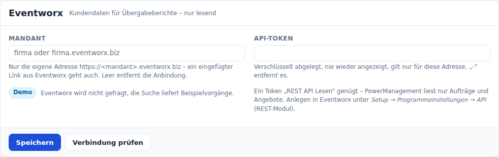
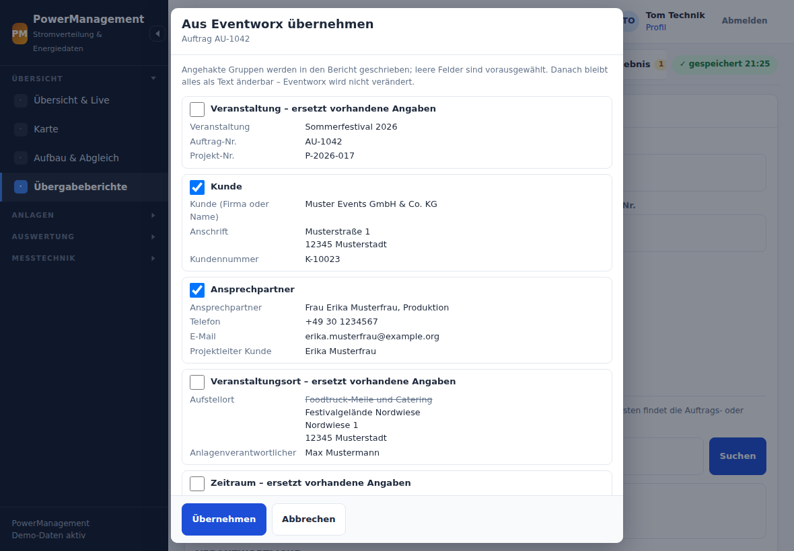
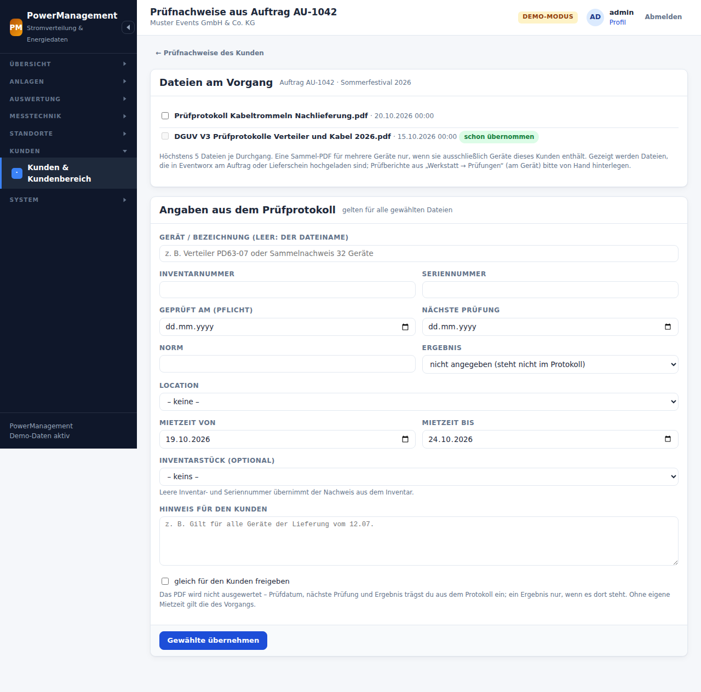

# Eventworx: Kundendaten und Prüfprotokolle, nur lesend

Ein Übergabebericht braucht Kunde, Anschrift, Ansprechpartner, Auftrags- und
Projektnummer, Veranstaltung und Ort. Das steht meist schon in **Eventworx**.
PowerManagement kann es von dort holen, statt es abzutippen. Für den
[Kundenbereich](kundenbereich.md) kommen zwei Dinge dazu: Aufträge und
Lieferscheine lassen sich mit einem Kunden **verknüpfen**, und PDFs, die in
Eventworx an einem solchen Vorgang hochgeladen sind (Prüfprotokolle nach
DGUV V3), lassen sich als **Prüfnachweise übernehmen**. Eventworx ist für
all das **nicht nötig**: Ohne Eventworx werden die Kundendaten als Freitext
eingetragen und die Prüfnachweise von Hand hochgeladen, und das ist der
Normalfall.

```
 Übergabebericht ── Suche (Nummer/Text) ──► PowerManagement ── GET /backend/job ──────► Eventworx
                 ◄── Treffer ─────────────                  ◄── Aufträge, Angebote ──
                 ── Treffer antippen ─────►                 ── GET /backend/job/<id> ─►
                 ◄── Kunde, Ort, Zeitraum ─                 ◄── ein Vorgang ──────────

 Kundenverwaltung ── PDF-Dateien ansehen ─► PowerManagement ── GET /backend/file/list ─► Eventworx
                  ◄── Liste ──────────────                  ◄── Dateien am Vorgang ──
                  ── Gewählte übernehmen ─►                 ── GET /backend/file/<id> ─►
                  ◄── Prüfnachweise ───────                 ◄── das PDF ─────────────
```

PowerManagement **liest nur**. Es schreibt nichts nach Eventworx und lädt
auch kein PDF hoch. Die übernommenen Werte werden in den Bericht
**kopiert** und bleiben dort änderbar; übernommene Dateien liegen danach als
Kopie in der eigenen Datenbank. Der Kundenbereich selbst fragt Eventworx
**nie** – jede Anfrage löst eine Person aus dem Personal aus.

## Voraussetzungen

- **REST-Modul in Eventworx.** Die REST-Schnittstelle ist ein kostenpflichtiges
  Zusatzmodul, das Eventworx freischaltet.
- **API-Token.** Angelegt wird es in Eventworx unter *Setup →
  Programmeinstellungen → API*. Ein Token **„REST API Lesen“** genügt.
  Ein Token „Schreiben/Lesen“ geht auch, ist aber unnötig: Ein Eventworx-Token
  hat weitreichende Rechte, und PowerManagement braucht davon nur das Lesen
  von Aufträgen, Angeboten und Lieferscheinen und ihrer Dateien.
- **Dateischnittstelle** (nur für Prüfnachweise aus Eventworx): Ob das
  Lese-Token `file/list` und `file/<id>` darf oder Eventworx die
  Dateischnittstelle dafür erst freischalten muss, ist am echten Mandanten
  noch nicht geprüft (siehe [Lese-Probe](#lese-probe)). Lehnt Eventworx ab,
  sagt die Seite das; die Nachweise gehen dann von Hand.
- **Netz.** Der Server von PowerManagement muss `https://<mandant>.eventworx.biz`
  erreichen (ausgehend HTTPS, Port 443).

## Einrichten

*System → Einstellungen → Eventworx* (Recht „Einstellungen ändern“):

1. **Mandant** eintragen: `firma`, `firma.eventworx.biz` oder ein aus dem
   Browser kopierter Link aus Eventworx (`https://firma.eventworx.biz/eventworx/#job/…`).
   Übrig bleibt immer nur `firma.eventworx.biz`.
2. **API-Token** einfügen und **Speichern**.
3. **Verbindung prüfen.** Erst fragt PowerManagement `check/ping`, dann
   zählt es die lesbaren Aufträge und Angebote. Erfolg sieht so aus:
   „Verbunden mit firma.eventworx.biz – 1.234 Aufträge/Angebote lesbar.“
   Dasselbe auf dem Server: `sudo -u www-data php bin/power eventworx:pruefen`
   (Exitcode 1, wenn es nicht klappt).



Für das Token gilt:

- Es wird **verschlüsselt** abgelegt (mit `app.key`) und nie wieder angezeigt.
  Das Feld zeigt nur „hinterlegt für firma.eventworx.biz – leer lassen zum
  Behalten“.
- Es gilt **nur für die Adresse, für die es eingetragen wurde.** Wer die
  Adresse ändert, ohne ein neues Token einzugeben, verliert das alte:
  „Für eine andere Eventworx-Adresse bitte das API-Token neu eingeben.“
  So kann niemand das Token durch Ändern der Adresse an einen fremden Server
  schicken.
- `-` im Tokenfeld entfernt das Token. Ein leerer Mandant entfernt die ganze
  Anbindung.
- Im Audit-Log steht nur der Host und ob das Token gesetzt, entfernt oder
  unverändert ist, nie das Token selbst.

Erlaubt ist nur `https://<mandant>.eventworx.biz` auf Port 443, ohne
Benutzerangaben in der Adresse. Ein Testserver oder eine eigene
Eventworx-Installation geht nur über `config/config.php`:

```php
'eventworx' => [
    'basis' => 'https://eventworx.intern.example',
],
```

Diese Basis gilt nur, wenn im Feld **Mandant** genau diese Adresse steht.
Das Token kommt auch dann aus der Oberfläche, nie aus der Datei.

## Im Übergabebericht

Im Bericht hat der Abschnitt Kunde drei Reiter: **Freitext | Eventworx | Aus
früherem Bericht**. Die Oberfläche sagt dazu, dass die Kundendaten aus dem
Eventworx-Vorgang kommen. Ist Eventworx nicht eingerichtet oder fehlt das
Recht, ist der Reiter grau und nennt den Grund.

1. **Suchen:** Auftrags- oder Angebotsnummer eintippen, dann Knopf oder
   Enter. Es gibt keine Live-Suche beim Tippen. Gesucht wird unter Aufträgen
   und Angeboten, die nicht gelöscht oder archiviert sind. Ein Treffer mit
   genau der eingegebenen Nummer steht oben.
2. **Treffer antippen:** PowerManagement liest den Vorgang und zeigt, was er
   eintragen würde, je Gruppe mit Häkchen: Veranstaltung, Kunde,
   Ansprechpartner, Ort und Zeitraum. Weicht ein Feld vom bisherigen Eintrag
   ab, stehen beide Werte nebeneinander.
3. **Übernehmen:** Die Felder werden gefüllt und bleiben änderbar. Der
   Bericht merkt sich nur den Verweis (Host, Kennung, Art, Nummer, Zeit).
   Daraus wird der Link „In Eventworx öffnen“, über den man das fertige PDF
   dort von Hand anhängen kann.



Die Nummer ist der sichere Weg. Ob Eventworx mit dem Suchtext auch in Titel
und Kundennamen sucht, ist am echten Mandanten noch nicht geprüft.

Eventworx gibt es nur in einem Bericht, den man ändern darf (Recht
„Kundendaten aus Eventworx suchen und übernehmen“). Eine freie Suche durch
Eventworx gibt es nicht. Das Recht zeigt alle Vorgänge des Mandanten und
gehört deshalb nicht zu Kunden-Rollen.

Beim Übernehmen merkt sich der Bericht zusätzlich die **Kennung des Kunden
in Eventworx** (`customerRefId`, nur wenn sie eine ObjectId ist). Sie steht
nicht im Bericht und nicht im PDF; sie dient nur dem Vorschlag im
Kundenbereich („dieser Bericht gehört wohl zu Kunde X“). Zugeordnet wird
trotzdem nur von Hand.

## Vorgänge mit einem Kunden verknüpfen

In der Kundenverwaltung (*Kunden → Kunde → Vorgänge*, Rechte „Kunden
pflegen“ und „Kundendaten aus Eventworx …“) wird ein Auftrag oder
Lieferschein mit einem Kunden des Kundenbereichs verknüpft:

1. **Suchen** nach Nummer oder Text – unter Aufträgen und Lieferscheinen
   (ein Angebot ist noch keine Lieferung). Die Treffer stehen nur in der
   Antwort; die Sitzung merkt sich nur Kennung, Nummer und Art.
2. **Verknüpfen** nimmt nur einen Treffer aus der eigenen Suche und liest
   den Vorgang frisch. Dann entscheidet die Kunden-Kennung aus Eventworx:

   | Kunde hier | Vorgang in Eventworx | Ergebnis |
   |---|---|---|
   | ohne Kennung | mit Kennung | Rückfrage mit dem Namen aus Eventworx; bestätigt, bekommt der Kunde die Kennung – alle weiteren Vorgänge dieses Eventworx-Kunden gehören dann hierher, keine anderen |
   | mit Kennung | dieselbe | verknüpft |
   | mit Kennung | eine andere | abgelehnt: „Der Vorgang gehört in Eventworx zu einem anderen Kunden.“ |
   | beliebig | ohne Kennung | nur nach Rückfrage |

   Ein Vorgang und ein Eventworx-Kunde gehören höchstens einem Kunden.
   Gespeichert werden Kennung, Nummer, Art, Titel und Mietzeit – keine
   Kontakte, Preise oder Positionen.
3. **Lösen** wirkt sofort. Prüfnachweise aus dem Vorgang bleiben (mit ihrer
   Herkunft), nur ohne Verweis. Mit dem letzten Vorgang geht auch die
   Kennung des Kunden.

## Prüfnachweise aus Dateien am Vorgang

*PDF-Dateien ansehen* am verknüpften Vorgang liest dessen Dateiliste
(`file/list` mit Filter auf den Vorgang). Gezeigt werden nur PDFs, die
**Benutzer hochgeladen** haben (ohne `metaDocType`, unter
`/job/documents`) – keine erzeugten Belege wie Auftrag, Rechnung oder
Lieferschein, kein XML der E-Rechnung.

Eventworx übergeht unbekannte Filter still und liefert dann Dateien ganz
anderer Vorgänge – womöglich anderer Kunden. Deshalb prüft PowerManagement
jede Liste selbst: **Gehört auch nur eine Datei nicht zu diesem Vorgang,
wird die ganze Liste verworfen** („Eventworx hat die Dateiliste nicht auf den
Vorgang beschränkt – nichts übernommen.“).

*Gewählte übernehmen* liest Vorgang und Liste **noch einmal** und lädt nur
Dateien, die in der gezeigten **und** in der frischen Liste stehen –
höchstens fünf je Durchgang, je höchstens **10 MB** und 30 Sekunden, nur
mit `%PDF-` am Anfang. Eine Datei-ID aus dem Formular, aus der Sitzung oder
aus einer anderen Liste lädt das Programm nie. Prüfdatum, nächste Prüfung
und Ergebnis trägt eine Person aus dem Protokoll ein – das PDF wird nicht
ausgewertet. Festgehalten wird die Herkunft (Host, Vorgang, Datei-ID,
Dateiname, Zeit, wer, wann), nie der Inhalt. Eine Datei aus Eventworx gibt
es hier nur einmal, auch nie für zwei Kunden.

Ist der Vorgang inzwischen kein Auftrag oder Lieferschein mehr, gehört er
in Eventworx zu einem anderen Kunden oder ist Eventworx mit einem anderen
Mandanten verbunden, wird nichts gelesen.

Prüfberichte aus *Werkstatt → Prüfungen* (am einzelnen Gerät) findet
dieser Weg nicht. Ob die Schnittstelle sie hergibt, zeigt die Lese-Probe.



## Was gelesen wird – und was nicht

| aus dem Vorgang | im Bericht |
|---|---|
| `title`, `jobNumber` (bei Angeboten `variantNumber`), `projectNumber` | Veranstaltung, Auftrags-Nr., Projekt-Nr. |
| `customer`: Firma bzw. Vor- und Nachname bzw. Ortsname, Kundennummer | Kunde |
| `postalAddress`: Straße, Zusatz, PLZ Ort, Land (nur außerhalb Deutschlands) | Anschrift |
| `contact`: Anrede, Titel, Name, Abteilung; erste gültige Telefonnummer (`tel_business`, sonst `mobile`) und E-Mail (`email_business`) | Ansprechpartner, Vorschlag Projektleiter Kunde |
| `locationContact` und `locationAddress`, oder der Kunde selbst (`customerIsLocation`); `locationContactPerson` | Vorschlag Aufstellort und Anlagenverantwortlicher |
| `setupDate`, `startDate`/`endDate` (sonst Mietzeit), `tearDownDate` | Zeitraum in Ortszeit |

**Nie übernommen** werden Positionen, Preise und Beträge, Notizen
(`notes`, `internalNote`), die Rechnungsseite (`invoiceContact`,
`invoiceAddress`) und Bankdaten. Sie verlassen den Server nicht und kommen
auch nicht in den Browser.

Namen speichert Eventworx so, wie die Web-App sie maskiert
(`Muster &amp; Söhne`). PowerManagement dekodiert nur vollständige
Entitäten. Steuer- und Richtungszeichen werden entfernt.

Zeiten liefert Eventworx als Millisekunden oder ISO-Text. Sie werden in UTC
gespeichert und in der Zeitzone der Installation angezeigt. Ein Tag „ab
11.07.“ ist in Berlin 22:00 UTC am Vortag; angezeigt wird der 11.07.

## Was PowerManagement an Eventworx schickt

- Nur **GET**, und nur an fünf Pfade unter `/backend/`: `check/ping`, `job`,
  `job/<id>` mit `<id>` aus 8–40 Buchstaben und Ziffern, `file/list` und
  `file/<id>` mit `<id>` als ObjectId (24 Hexzeichen). Andere Pfade, etwa
  `file/delete/…` (Eventworx löscht Dateien per GET!) oder
  `file/download`, lehnt das Programm ab, bevor etwas ins Netz geht.
- Eine Datei (`file/<id>`) nur, wenn ihre ID in einer Dateiliste stand, die
  **derselbe PHP-Prozess** eben für genau diesen Vorgang gelesen hat.
- Kopfzeilen `S-API-TOKEN`, `Accept: application/json` (bei Dateien `*/*`),
  `User-Agent: PowerManagement`.
- **Keine Umleitungen.** Eine 3xx-Antwort wird nicht verfolgt, damit das
  Token nicht an ein anderes Ziel geht. Das gilt für alle HTTP-Abfragen von
  PowerManagement.
- Höchstens **zwei Anfragen je Sekunde**, über alle PHP-Prozesse zusammen.
  Wer länger als zwei Sekunden warten müsste, bekommt „gerade viele
  Anfragen – gleich noch einmal“. Abgelehnte Anfragen werden nicht wiederholt,
  auch nicht nach „zu viele Anfragen“.
- Ins Log (`storage/logs/app.log`) kommen je Anfrage nur Pfadmuster (`job`,
  `job/<id>`, `check/ping`, `file/list`, `file/<id>`), HTTP-Status,
  Fehlercode und Dauer. Suchtext, Kennungen, Dateinamen, Antwort und Token
  kommen nicht ins Log.
- Wer auf Eventworx wartet, hält die Sitzung nicht fest: andere Tabs
  derselben Anmeldung laufen weiter.

## Fehlermeldungen

| Meldung | Ursache und Abhilfe |
|---|---|
| Eventworx ist nicht eingerichtet (Systemeinstellungen). | Mandant oder Token fehlt, oder das Token gehört zu einer anderen Adresse: Token neu eintragen. |
| Eventworx nicht erreichbar – Kundendaten bitte als Freitext eintragen. | Kein Netz, DNS, Zeitüberschreitung (12 s). |
| Eventworx leitet um – stimmt die Adresse? | Antwort 3xx: falscher Mandantenname oder Adresse. |
| Eventworx lehnt den Zugriff ab – API-Token oder REST-Modul prüfen. | 401/403 oder `ACCESS_DENIED` (Eventworx meldet das auch mit HTTP 200): Token falsch oder widerrufen, REST-Modul nicht freigeschaltet. |
| Vorgang in Eventworx nicht (mehr) vorhanden. | 404, oder zweimal hintereinander „Erfolg ohne Daten“. Eventworx meldet fehlende Vorgänge so, deshalb wird nach einer halben Sekunde einmal nachgelesen. |
| Eventworx: zu viele Anfragen – bitte kurz warten. | 429 von Eventworx. |
| Eventworx: gerade viele Anfragen – bitte gleich noch einmal. | Die eigene Drossel (siehe oben). |
| Eventworx meldet einen Serverfehler (HTTP 5xx). | Störung bei Eventworx. |
| Eventworx antwortet nicht mit JSON – stimmt die Adresse? | Statt der Schnittstelle kam eine Webseite, meist die Anmeldeseite. |
| Eventworx: VALIDATION (o. ä.) | Eventworx meldet einen eigenen Fehlercode. Angezeigt wird er nur, wenn er wie ein Code aussieht (Großbuchstaben, Ziffern, `_`), sonst „Eventworx: Fehler“. |
| Eventworx: unerwartete Antwort. | Die Antwort hat nicht die erwartete Form, etwa eine fremde Vorgangskennung oder eine Rechnung statt Auftrag oder Angebot. |
| Eventworx hat die Dateiliste nicht auf den Vorgang beschränkt – nichts übernommen. | In der Dateiliste stand eine Datei eines anderen Vorgangs (oder ohne Vorgang) – der Filter wurde übergangen. Die ganze Liste ist verworfen. |
| Eventworx lehnt den Dateizugriff ab – die Dateischnittstelle muss evtl. für das Token freigeschaltet werden. | `ACCESS_DENIED`, 401 oder 403 beim Lesen einer Datei. Beim Eventworx-Support nachfragen; bis dahin von Hand hochladen. |
| Die Datei ist größer als 10 MB – bitte von Hand hochladen. | Die Übernahme bricht über 10 MB ab, statt alles zu laden. |
| Eventworx lieferte keine PDF-Datei. | Statt der Datei kam etwas anderes, meist die Anmeldeseite als HTML. |
| Die Datei gibt es in Eventworx nicht (mehr). | 404 beim Lesen der Datei. |

In keiner Meldung stehen Antwortinhalt, Umleitungsziel oder Token. Bei jeder
Meldung im Bericht bleiben die Freitextfelder nutzbar.

## Datenschutz

- Eventworx verarbeitet die Kundendaten im Auftrag des eigenen Unternehmens.
  Der **Vertrag zur Auftragsverarbeitung (AV-Vertrag)** mit dem
  Eventworx-Anbieter muss bestehen; in der Regel gibt es ihn schon. Dass
  PowerManagement auf dem eigenen Server liest, ändert daran nichts.
- Übernommen wird nur, was der Bericht braucht (Art. 5 Abs. 1 lit. c DSGVO):
  Firma, Anschrift, Ansprechpartner mit Telefon und E-Mail, Ort, Zeitraum und
  Nummern. Keine Finanzdaten.
- Die Übernahme gehört in das Verzeichnis der Verarbeitungstätigkeiten, unter
  derselben Tätigkeit wie die Übergabeberichte.
- Suchergebnisse werden nicht zwischengespeichert. Was übernommen ist, steht
  im Bericht und nirgends sonst.
- Für den Kundenbereich kommen dazu: Kennung und Name des Kunden in
  Eventworx (nur zum Vergleich), Nummer, Art, Titel und Mietzeit verknüpfter
  Vorgänge, die gewählten PDFs mit Herkunft. Kontakte (`contact/<id>`) liest
  PowerManagement nicht. Die Übernahme gehört in das Verzeichnis der
  Verarbeitungstätigkeiten des Kundenbereichs ([kundenbereich.md](kundenbereich.md#datenschutz)).

## Demo-Modus

Im Demo-Modus (`app.demo`) fragt PowerManagement Eventworx nie. Die Suche
liefert zwei erfundene Vorgänge: Auftrag `AU-1042` „Sommerfestival 2026“
(Kunde „Muster Events GmbH & Co. KG“, Ansprechpartnerin Erika Musterfrau,
Festivalgelände Nordwiese) und Angebot `AN-1050-01` („Stadtmarketing
Musterstadt e. V.“), beide mit eigener Kunden-Kennung. Am Auftrag liegen
zwei hochgeladene Prüfprotokolle als PDF (erfundene Werte) und der Beleg
des Auftrags, den die Liste nicht zeigt. `demo:seed` verknüpft den Auftrag
mit dem Demo-Kunden Muster Events und übernimmt das ältere Protokoll; das
neuere bleibt zum Ausprobieren. Die Lese-Probe läuft im Demo-Modus nicht.

## Lese-Probe

Was die Schnittstelle zu **Geräten, ihren Prüfungen** (*Werkstatt →
Prüfungen*) und zu **Dateien am Vorgang** hergibt, ist nicht dokumentiert.
Bevor ein Folge-PR darauf baut, sieht eine Probe nach – einmal, von Hand,
von einem Administrator:

```bash
sudo -u www-data php /opt/powermanagement/bin/power eventworx:sonde --job=<ObjectId eines Auftrags mit hochgeladenem PDF>
sudo -u www-data php /opt/powermanagement/bin/power eventworx:sonde --job=<…> --stock=<ObjectId eines Geräts> --serie=<Seriennummer> --json
```

(`eventworx:geraete-pruefen` ist derselbe Befehl.) Die Kennung eines
Vorgangs steht in der Adresszeile der Web-App, wenn man ihn öffnet
(`…/eventworx/#job/edit/order/<id>`); die eines Geräts zeigt der
Netzwerk-Tab (H1 unten). Ohne `--job` sucht die Probe sich einen Auftrag
oder Lieferschein selbst, ohne `--stock` nimmt sie Geräte aus der Liste.

- **Sicher, weil Eventworx per GET löscht:** eine eigene, enge Pfadliste
  (`check/ping`, `check/version`, `job`, `job/<OID>`, `stock`,
  `stock/<OID>`, `article/<OID>`, `file/list`), nur GET, **kein Download**,
  nie `…/update`, `…/create`, `…/delete`, keine geratenen Unterpfade.
  Kennungen nur aus `--job`/`--stock` oder aus Antworten desselben Laufs;
  Links in Antworten wird nie gefolgt.
- **Budget:** höchstens 25 Anfragen und 60 Sekunden, kein Neuversuch.
  Abbruch bei 401, 429, einer Umleitung oder HTML statt JSON;
  `ACCESS_DENIED` schaltet nur den jeweiligen Schritt ab.
- **Ausgabe ohne Inhalte:** je Schlüssel nur die Art des Werts (Text,
  Zahl, Zeit, ObjectId, Liste …), Klartext nur für feste Kennwerte (`status`,
  `type`, `metaDocType`, `contentType` …) und Pfade mit maskierten Nummern.
  Nie Namen, Seriennummern, Dateinamen, Beschreibungen. Schlüssel, die nach
  Prüfung oder Frist klingen, sind mit `*` markiert. Die Ausgabe darf
  deshalb in ein Ticket oder in diese Datei.

| Schritt | fragt | beantwortet |
|---|---|---|
| P1 | `check/ping`, `check/version`, ein Auftrag/Lieferschein | erreichbar, Version, Form der Kennungen |
| P2–P4 | `stock`, `stock/<OID>`, `article/<OID>` | darf das Token Geräte lesen, gibt es Felder für letzte/nächste Prüfung und Intervall |
| P5a / P5b | `file/list` für `--job` mit `{path, ownerDocumentId}` bzw. nur `{ownerDocumentId}` | liefert der Filter die Uploads in Unterordnern, wird er beachtet (Anteil fremder Dateien), Muster von `path` und `metaDocType` |
| P5c | `file/list` mit einem Gerät als Owner | liegen Prüfberichte am Gerät |
| P6 | `job/<OID>` | zeigen die Positionen auf ausgegebene Geräte |
| P7 | `stock?query=<--serie>` | findet die Suche ein Gerät über die Seriennummer (nur ja/nein) |

Ohne Code vorher (H1, H2): In der Web-App ein Gerät mit Prüfbericht und
einen Auftrag mit hochgeladenem PDF öffnen und im Netzwerk-Tab der
Entwicklerwerkzeuge Methode, Pfad, Filterform und Felder notieren – nichts
anklicken, was löscht oder speichert. In der OpenAPI-Beschreibung nach
`ArticleInventoryItem`, `File`, `DeliveryItem` und `*Inspection*` suchen.
**Frage an den Support:** „Liegen Prüfberichte (*Werkstatt → Prüfungen*) im
Dateispeicher, abrufbar mit `file/list`/`file/<id>`, und darf ein Token
‚REST API Lesen' `stock` und Dateien lesen?“

**Ergebnis der Probe** (hier eintragen, wenn sie gelaufen ist):

| | Frage | Ergebnis |
|---|---|---|
| | Datum, Version (`check/version`) | *noch nicht gelaufen* |
| V1 | Liefert `job/<id>` `customerRefId` als ObjectId – auch die Suchliste? | |
| V2 | Sind Vorgangs- und Datei-IDs ObjectIds? | |
| V3 | Liefert `file/list` mit `{path, ownerDocumentId}` auch Uploads in `/job/documents/<nr>`? Wirkt `{ownerDocumentId}` allein? | |
| V4 | Tragen Benutzer-Uploads kein `metaDocType`? Welche `path`-Muster? | |
| V5 | Darf das Lese-Token `file/list` und `file/<id>`? Kommt PDF statt HTML? | |
| V6 | Liegen die DGUV-PDFs am Auftrag/Lieferschein oder nur am Gerät? | |
| V7 | Darf das Token `stock`/`article` lesen; welche Felder für letzte/nächste Prüfung? | |
| V8 | Liegen Prüfberichte mit der Geräte-ID als Owner im Dateispeicher? | |
| V9 | Zeigt `job/<id>` die ausgegebenen Geräte je Position? | |
| V10 | Wirkt `query` auf `stock`? | |
| V11 | Findet die Suche Lieferscheine (und keinen Wareneingang)? | |

Davon hängen ab: der Filter für `file/list` (`DATEI_FILTER_MIT_PFAD` in
`src/Services/Eventworx.php`, bis dahin vorsichtig mit `path`), das
Verengen von `job/<id>` auf ObjectIds (V2) und ein Folge-PR
„Geräte-Prüfdaten aus Eventworx“ (V6–V10).

## Prüfen

`php tests/eventworx.php` prüft die Anbindung ohne Netz, mit einer
nachgestellten Gegenstelle: Adressen, Token-Bindung, Pfadliste, Form der
Anfragen, Aufbereitung, jede Fehlerantwort, Drossel, Dateiliste und
Download, Verknüpfen mit Kunden, Lese-Probe, Demo und dass Token und
Suchtext nirgends auftauchen. `tests/pruefnachweise.php` prüft die
Übernahme als Prüfnachweis, `tests/sitzung.php`, dass Suche, Verknüpfen und
Dateiliste die Sitzung nicht halten.

Diese Punkte sind gegen einen echten Mandanten noch nicht geprüft:

- ob `query` nur Nummern oder auch Titel und Kunden durchsucht;
- welche Felder die verkürzte Trefferliste trägt (Zeitraum, Projekt);
- ob es `setupDate` und `tearDownDate` in der Schnittstelle gibt;
- welche `typeName`-Werte die Kommunikationsdaten haben;
- ob `check/ping` ein Token braucht;
- ob Eventworx unbekannte Filter still übergeht.
