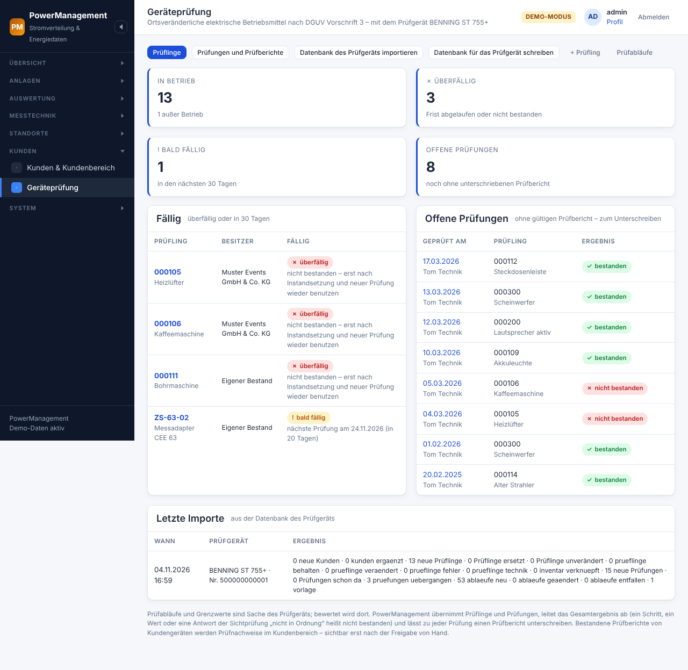
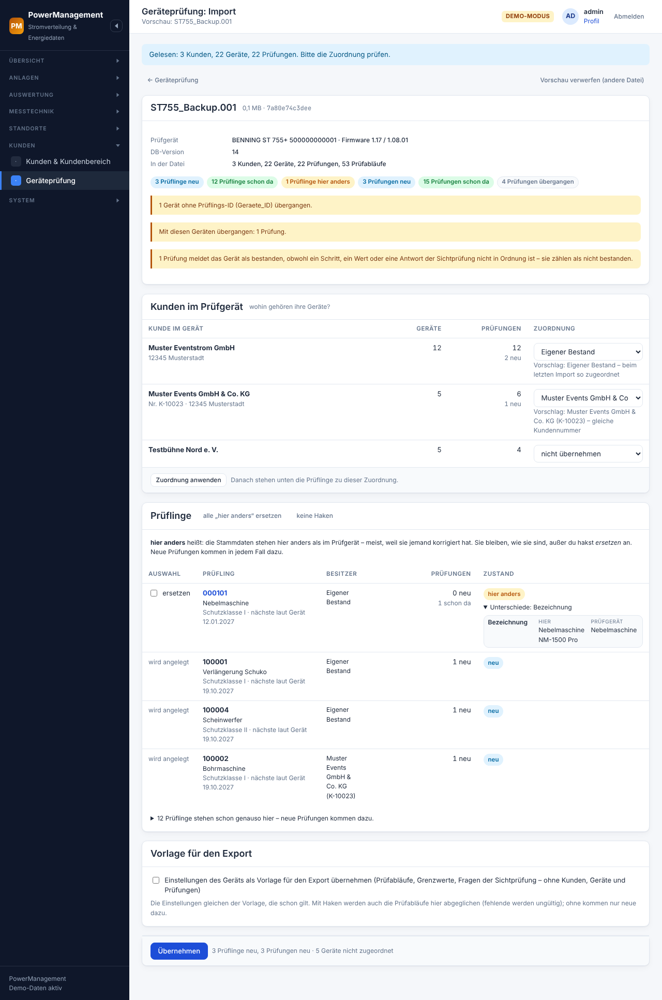
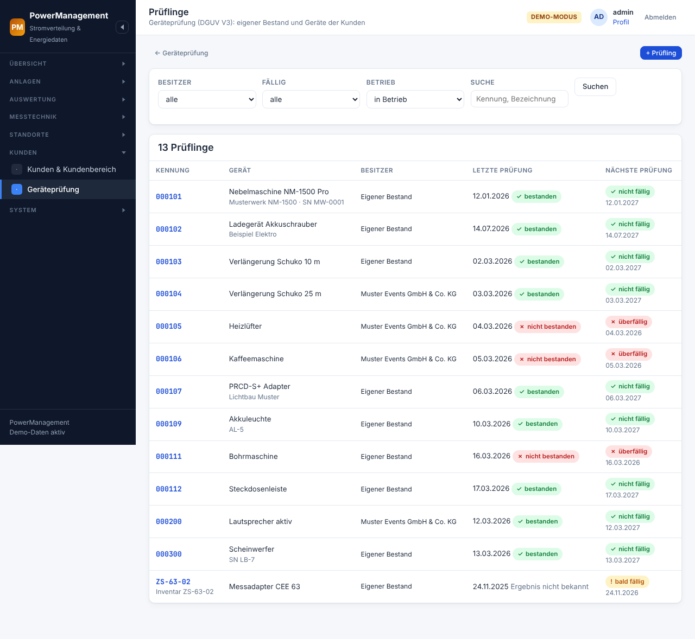
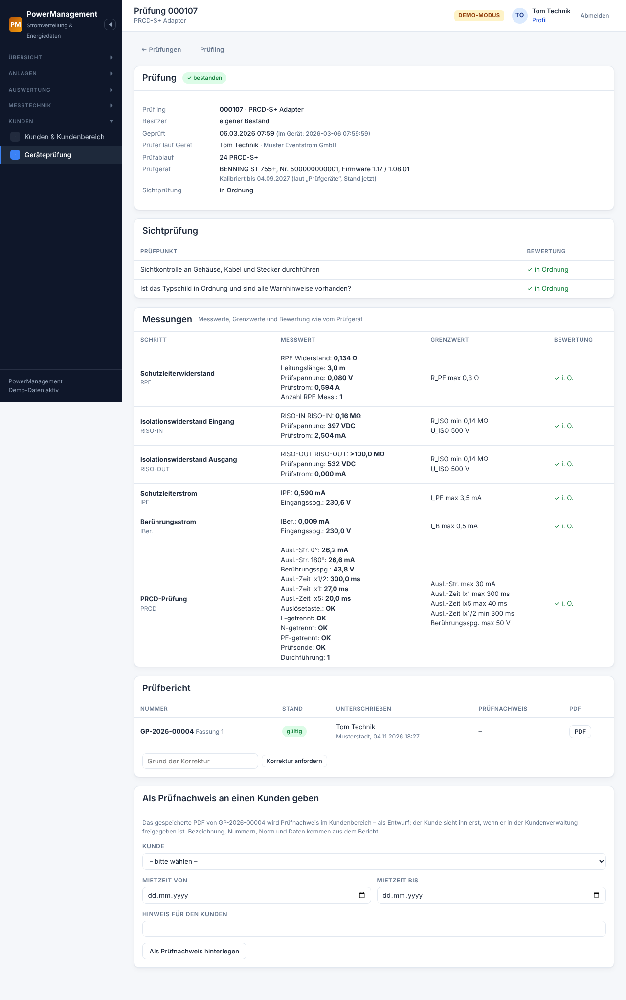
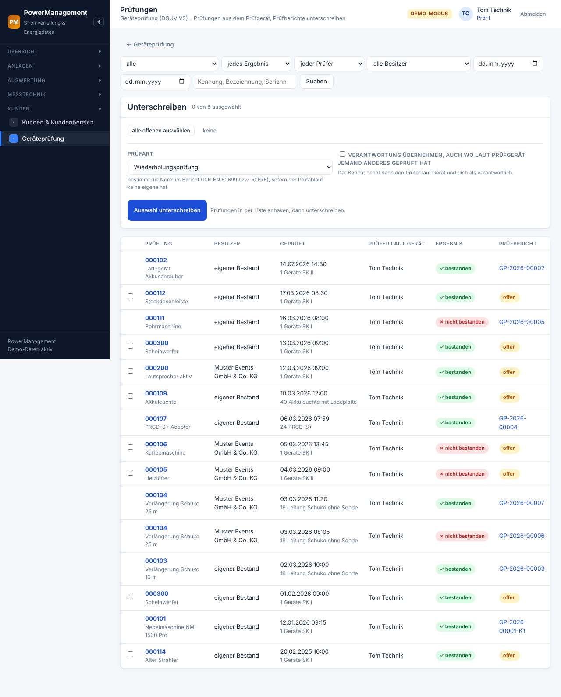
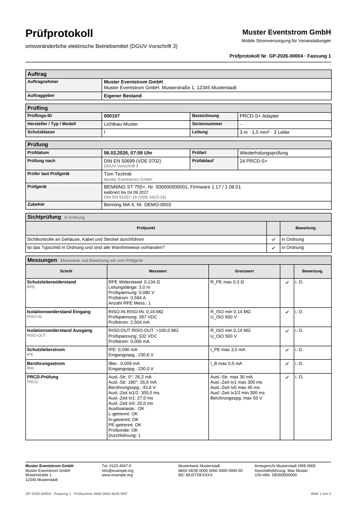

# Geräteprüfung (DGUV V3) mit dem BENNING ST 755+

Ortsveränderliche elektrische Betriebsmittel – Kabeltrommeln,
Verlängerungen, Scheinwerfer, Netzteile, PRCD-Adapter – werden nach DGUV
Vorschrift 3 wiederkehrend geprüft. Gemessen wird mit dem Gerätetester
**BENNING ST 755+**; PowerManagement liest dessen Datenbank, verwaltet die
**Prüflinge** (eigener Bestand und Geräte der Kunden), lässt zu jeder
Prüfung einen **Prüfbericht** unterschreiben und schreibt eine Datei für
das Prüfgerät zurück. Bestandene Prüfberichte von Kundengeräten werden
**Prüfnachweise** im [Kundenbereich](kundenbereich.md#prüfnachweise-dguv-v3).

Zu finden unter *Kunden → Geräteprüfung*.



> **Noch nicht mit einem echten Gerät erprobt:** Ob das ST 755+ die Datei
> lädt, die PowerManagement für es schreibt (Export), ist ohne echtes
> Gerät nicht getestet. Der Import ist am Aufbau einer echten
> Gerätedatenbank geprüft. Wie der erste Versuch mit dem Export sicher
> geht, steht unter [Die Datei aufs Gerät](#die-datei-aufs-gerät--der-erste-versuch).

> Diese Seite beschreibt, was die Software tut. Sie ist **keine
> Rechtsberatung**. Prüffristen, Normen und Grenzwerte verantwortet die
> Elektrofachkraft bzw. die Firma.

## Überblick

**Gemessen und bewertet wird am Prüfgerät.** Prüfabläufe, Grenzwerte und
die Bewertung je Schritt sind Sache des ST 755+; PowerManagement legt keine
Prüfabläufe an und rechnet keine Grenzwerte. Es übernimmt die Prüfungen
unverändert und leitet nur das Gesamtergebnis ab: Ein Schritt, ein Messwert
oder eine Antwort der Sichtprüfung, die nicht in Ordnung ist, macht die
Prüfung **nicht bestanden** – auch wenn das Gerät insgesamt „bestanden“
meldet (die Vorschau weist darauf hin).

| Begriff | Bedeutung |
|---|---|
| **Prüfling** | ein Gerät mit seiner Kennung (Prüflings-ID bzw. Barcode am Prüfgerät) – im **eigenen Bestand** (optional mit einem Inventarstück verknüpft) oder **bei einem Kunden**. Die Kennung gilt je Besitzer einmal, ohne Groß-/Kleinschreibung. |
| **Prüfung** | eine Messung aus dem Prüfgerät: Zeit, Prüfer laut Gerät, Prüfablauf, Sichtprüfung, Messschritte mit Werten und Grenzwerten, Ergebnis. Nach dem Import **unveränderlich**. |
| **Prüfbericht** | das unterschriebene, eingefrorene Protokoll einer Prüfung mit Nummer `GP-<Jahr>-<laufende Nummer>` und gespeichertem PDF. |
| **Prüfablauf** | wie das Gerät prüft (Schritte, Grenzwertsatz) – aus der Datenbank des Geräts, hier nur mit Norm und Zubehör ergänzt. |
| **Vorlage** | die Einstellungen des Geräts (Prüfabläufe, Grenzwerte, Fragen der Sichtprüfung, Systemdaten) **ohne** Kunden, Geräte und Prüfungen – Grundlage der Datei, die PowerManagement für das Gerät schreibt. |
| **offen** | eine Prüfung ohne gültigen Prüfbericht. |

## Ablauf

1. **Datenbank vom Gerät holen** – von der SD-Karte des ST 755+ bzw. dem
   USB-Stick, auf den gesichert wurde (siehe
   [unten](#die-datenbank-des-prüfgeräts)).
2. **Importieren** (*Datenbank des Prüfgeräts importieren*): Datei wählen,
   *Vorschau*.
3. **Vorschau und Zuordnung:** je Kunde im Gerät wählen, wohin seine Geräte
   gehören – eigener Bestand, ein Kunde hier, ein neuer Kunde oder gar
   nicht. Prüflinge und Prüfungen ansehen, *Übernehmen*.
4. **Prüflinge pflegen:** Stammdaten korrigieren, Prüfablauf und
   Prüfintervall setzen, neue Prüflinge anlegen.
5. **Export** (*Datenbank für das Prüfgerät schreiben*): Besitzer wählen,
   *Datei schreiben*.
6. **Datei aufs Gerät** – vorher am Gerät sichern (siehe
   [unten](#die-datei-aufs-gerät--der-erste-versuch)).
7. **Prüfen** am ST 755+ wie gewohnt.
8. **Wieder importieren:** Kunden und Prüflinge erkennt der Import an den
   Kundennummern, die der Export geschrieben hat, und an der Kennung; nur
   die neuen Prüfungen kommen dazu.
9. **Unterschreiben** (*Prüfungen und Prüfberichte*): einzeln an der
   Prüfung oder **gesammelt** – Prüfungen anhaken, *Auswahl
   unterschreiben*, einmal unterschreiben.
10. **Prüfnachweis freigeben:** Ein bestandener Prüfbericht eines
    Kundengeräts liegt danach als Entwurf beim Kunden; sichtbar wird er
    erst, wenn ihn jemand in der Kundenverwaltung freigibt.

## Die Datenbank des Prüfgeräts

Das ST 755+ führt seine Daten in einer SQLite-Datenbank. Sie liegt auf der
**SD-Karte** des Geräts bzw. auf dem **USB-Stick**, auf den gesichert
wurde: die Datenbank selbst mit der Endung `.db`, Sicherungen im Ordner
**„Backups“** als `<Name>_Backup.001` (`.002` …).

- **Welche Datei?** Die `.db` oder eine Sicherung daraus. Liest man beide
  ein, kommt jede Prüfung trotzdem nur einmal (Fingerabdruck, siehe
  [Import](#prüfungen-und-fingerabdruck)).
- **Höchstens 15 MB** – die Grenze dieser Installation (1 MB unter den 16 MB,
  die nginx annimmt). Eine Datenbank mit gut 1 200 Prüfungen hat etwa 2 MB,
  15 MB reichen für rund 10 000 Prüfungen. Eine größere Datei hält schon der
  Browser an.
- **Nur gelesen:** PowerManagement liest eine eigene Kopie, nur lesend, und
  löscht sie danach. Die Datei auf der Karte ändert es nie.
- **Abgelehnt** wird, was keine SQLite-Datenbank ist, beschädigt ist, ein
  WAL-Journal braucht (dann fehlte ein Teil der Daten), statt Tabellen
  Ansichten enthält, Pflichttabellen oder -spalten nicht hat oder mehr als
  50 000 Geräte bzw. Prüfungen enthält – mit einer Meldung, ohne etwas zu
  übernehmen. Ebenso eine Datei, die beim Prüfen rechnen würde: eine
  berechnete Spalte (in irgendeiner Tabelle), ein Ausdruck als Vorgabewert,
  eine Prüfbedingung (CHECK), ein Index über einen Ausdruck oder nur über
  einen Teil der Zeilen. Das Schema des ST 755+ enthält nichts davon; geprüft
  wird, bevor SQLite die Datei überhaupt prüft, damit eine untergeschobene
  Datei weder Speicher noch Rechenzeit verbraucht.
- Gelesen werden Kunden, Geräte, Prüfungen (in der lesbaren Form des Geräts:
  Schritte mit Messwerten, wie das Gerät sie anzeigt, etwa „>100.0 MΩ“), die
  Antworten der Sichtprüfung, Prüfabläufe und Fragen. Zeiten des Geräts
  gelten als Ortszeit der Installation (`app.timezone`, Vorgabe
  Europe/Berlin).

## Import

### Datei wählen

*Geräteprüfung → Datenbank des Prüfgeräts importieren*, Datei wählen,
**Vorschau**. Bis die Datei gelesen ist, zeigt der Knopf, dass gearbeitet
wird; ein zweiter Klick zählt nicht. Übernommen wird noch nichts – die
Vorschau liegt eine Stunde bereit, danach wird sie verworfen.

### Vorschau: Kunden im Prüfgerät zuordnen



Je Kunde im Gerät stehen Name, Kundennummer, Ort und wie viele Geräte und
Prüfungen er hat. Die Zuordnung wählt eine Person:

| Wahl | Wirkung |
|---|---|
| **Eigener Bestand** | die Geräte gehören der eigenen Firma (im Gerät meist der erste Kunde) |
| **ein Kunde hier** | die Geräte gehören diesem Kunden |
| **als neuen Kunden anlegen** | ein Kunde mit Name, Kundennummer und Anschrift aus dem Gerät (nur mit „Kunden pflegen“) |
| **nicht übernehmen** | Geräte und Prüfungen dieses Kunden bleiben draußen |

**Zugeordnet wird nie still.** Vorgeschlagen wird nur, was sicher ist:

| im Gerät | Vorschlag |
|---|---|
| Kundennummer `PM-EIGEN` | eigener Bestand (so schreibt ihn der Export) |
| Kundennummer `PM-K<id>` | dieser Kunde (so schreibt der Export einen Kunden ohne eigene Kundennummer) |
| eine Kundennummer, die genau ein Kunde hier hat | dieser Kunde („gleiche Kundennummer“) |
| ein Kunde, der beim letzten Import zugeordnet wurde | wieder dorthin („beim letzten Import so zugeordnet“) |
| sonst | **nicht übernehmen** |

Wer die Zuordnung ändert, drückt **Zuordnung anwenden** – danach stehen
unten die Prüflinge zu dieser Zuordnung. Wird übernommen, ohne dass die
Prüflinge zur gewählten Zuordnung gezeigt wurden, übernimmt die Seite
nichts und zeigt sie erst.

### Prüflinge: neu, schon da, hier anders

| Zustand | Bedeutung |
|---|---|
| **neu** | wird angelegt |
| **schon da** | steht hier genauso; neue Prüfungen kommen dazu |
| **hier anders** | die Stammdaten stehen hier anders als im Gerät – meist, weil sie jemand korrigiert hat. Sie **bleiben**, außer *ersetzen* ist angehakt; die Unterschiede stehen aufklappbar daneben. Ersetzt wird nur der Stand, den die Vorschau gezeigt hat – hat jemand den Prüfling inzwischen noch einmal geändert, bleibt er. Neue Prüfungen kommen in jedem Fall. |
| **Fehler** | lässt sich nicht übernehmen (Grund daneben) |

Dazu:

- Steht dieselbe Kennung beim selben Besitzer mehrmals im Gerät, wird es
  **ein** Prüfling mit den Stammdaten der jüngsten Prüfung (Hinweis).
- Ein Gerät ohne Kennung (leer nach dem Entfernen von Leerzeichen) wird
  übergangen (Hinweis).
- Im eigenen Bestand schlägt die Vorschau ein **Inventarstück** mit
  derselben Kennung vor (angehakt, nie ein Tanksensor; nur mit
  „Datenquellen ansehen“).
- **Am Gerät angelegte Prüfabläufe** (ID ab 1 000 000) vergibt jedes
  Prüfgerät selbst – bei einem zweiten oder einem Austauschgerät kann
  dieselbe ID einen anderen Ablauf meinen. Weichen Name oder Prüfschritte
  vom Ablauf hier ab, sagt die Vorschau das (oben und am Prüfling). Ohne
  „als Vorlage übernehmen“ bekommt ein Prüfling aus dieser Datei den Ablauf
  nicht (ein vorhandener behält seinen); mit Vorlage gilt der Ablauf der
  Datei – auch für die Prüflinge hier, die ihn schon nutzen (die Vorschau
  nennt ihre Zahl).
- Die Vorschau zeigt höchstens 300 schlichte Zeilen; Zeilen mit Haken,
  „hier anders“ und Fehlern immer.

### Prüfungen und Fingerabdruck

Jede Prüfung bekommt einen **Fingerabdruck** aus Seriennummer des
Prüfgeräts, Zeit im Gerät, Prüfablauf, Schritten mit Werten und den
Antworten der Sichtprüfung – **ohne** die Kennung des Prüflings. Dieselbe
Prüfung aus der `.db` und aus einer Sicherung ist dieselbe und kommt nur
einmal; schon da bleibt da. Wird die Kennung am Gerät geändert, bleibt eine
schon importierte Prüfung beim bisherigen Prüfling; die Vorschau sagt dazu
„Prüfung schon bei Prüfling … – Kennung am Gerät geändert?“. Prüfungen
ändern sich nach dem Import nie.

### Vorlage für den Export

Der Haken **„Einstellungen des Geräts als Vorlage für den Export
übernehmen“** ist vorausgewählt, wenn es noch keine Vorlage gibt oder die
Einstellungen der Datei von der geltenden abweichen. Die Vorlage ist eine
Kopie der Datenbank, in der Kunden, Geräte und Prüfungen gelöscht sind –
übrig bleiben Prüfabläufe, Grenzwertsätze, Fragen der Sichtprüfung,
Hersteller und Systemdaten samt dem Aufbau der Datenbank. Es gilt genau
eine Vorlage. Mit dem Haken werden auch die Prüfabläufe hier abgeglichen
(geänderte übernommen, fehlende **ungültig** – nie gelöscht, Prüflinge
verweisen darauf); ohne Haken kommen nur neue Prüfabläufe dazu.

Taugt eine Datei nicht als Vorlage (unbekannter Aufbau, fremde Trigger),
steht das in der Vorschau – Prüflinge und Prüfungen lassen sich trotzdem
übernehmen.

### Übernehmen

*Übernehmen* prüft alles noch einmal gegen den Stand jetzt und schreibt in
**einer** Transaktion: Kunden (neue mit den Angaben aus dem Gerät; bei
vorhandenen werden mit „Kunden pflegen“ nur **leere** Felder der Anschrift
ergänzt), Prüflinge, Prüfungen, die Fälligkeit der berührten Prüflinge,
Prüfabläufe, Vorlage und die gemerkte Zuordnung für den nächsten Import.
Geht etwas schief, wird nichts übernommen. Ein Doppelklick oder ein zweiter
Reiter übernimmt nicht doppelt („Gerade wird schon ein Import übernommen“).
Im Audit-Log stehen nur Zahlen.

## Prüflinge pflegen

*Geräteprüfung → Prüflinge*: Liste mit Filtern nach **Besitzer**,
**Fällig** (fällig = überfällig oder in 30 Tagen, überfällig, ohne
Termin), **Betrieb** (in Betrieb, außer Betrieb, alle) und Suche über
Kennung, Bezeichnung und Seriennummer.



| Fälligkeit | wann |
|---|---|
| ✓ nicht fällig | nächste Prüfung in mehr als 30 Tagen |
| ! bald fällig | nächste Prüfung heute oder in höchstens 30 Tagen |
| ✗ überfällig | nächste Prüfung vor heute – oder die letzte Prüfung **nicht bestanden** („erst nach Instandsetzung und neuer Prüfung wieder benutzen“) |
| ? ohne Termin | keine nächste Prüfung bekannt |
| – außer Betrieb | nicht mehr fällig |

Die nächste Prüfung rechnet PowerManagement nach jeder Prüfung neu:
bestanden – Prüftag plus Prüfintervall; nicht bestanden – am Prüftag fällig.

**Ein Prüfling** zeigt Stammdaten („so steht der Prüfling auch im
Prüfgerät“), Fälligkeit, die Prüfungen aus dem Gerät (mit Prüfer laut
Gerät, Prüfablauf, Ergebnis und Prüfbericht) und die Prüfberichte aller
Fassungen.

**Anlegen und bearbeiten** (*+ Prüfling*, *Bearbeiten*):

- **Kennung** – Pflicht, wie am Prüfgerät, je Besitzer nur einmal.
- **Besitzer** – eigener Bestand oder ein Kunde. Ändern lässt er sich nur,
  solange es keinen Prüfbericht gibt (der eingefrorene Bericht nennt ihn).
- **Inventarstück** – nur beim eigenen Bestand, jedes Stück nur mit einem
  Prüfling, nie ein Tanksensor, wählen nur mit „Datenquellen ansehen“. Am
  Inventarstück steht dann die Karte **DGUV V3** mit letzter Prüfung,
  Ergebnis und nächster Prüfung; ohne Prüfling bietet sie *Als Prüfling
  anlegen* an.
- Bezeichnung, Seriennummer, Hersteller, Typ, Modell, Abteilung, Gebäude,
  Bemerkung.
- **Schutzklasse**, **Prüfablauf** (nur ein am Gerät gültiger – ohne
  Prüfablauf geht der Prüfling nicht in die Datei für das Prüfgerät),
  **Prüfintervall** in Monaten (0 = keine Wiederholung), Leitungslänge,
  Querschnitt, Leiter, Nennleistung (Komma oder Punkt; die Zahlen stehen
  ungerundet im Feld – unverändert speichern ändert nichts). **Mit
  Prüfablauf** sind Leitungslänge, Querschnitt und Leiterzahl Pflicht
  (größer 0) und das Intervall mindestens ein Monat: Daraus rechnet das
  Prüfgerät seine Grenzwerte (etwa den Schutzleiterwiderstand).
- **Letzte und nächste Prüfung** von Hand nur, solange es hier keine
  Prüfung gibt (etwa eine Prüfung anderswo); leer = letzte plus Intervall.
  Danach rechnet sie PowerManagement aus den Prüfungen.
- **außer Betrieb** – nicht mehr fällig, in der Datei für das Prüfgerät als
  außer Betrieb.

**Löschen** geht nur ohne Prüfungen; ein geprüfter Prüfling bleibt mit
seinen Prüfberichten und wird höchstens *außer Betrieb* gesetzt. Ein
Kunde mit Prüflingen lässt sich deshalb nicht löschen (nur beenden), siehe
[kundenbereich.md](kundenbereich.md#kunde-beenden-und-löschen).

**Kunden** haben dafür freiwillig Anschrift und Kontakt (Straße, PLZ, Ort,
Telefon, Fax, E-Mail, Ansprechpartner mit Abteilung, Telefon und E-Mail) –
in der Kundenverwaltung unter *Anschrift und Kontakt (freiwillig)*. Sie
stehen im Prüfbericht als Auftraggeber und in der Datei für das
Prüfgerät, nie im Kundenbereich und nie im Audit-Log.

## Export: die Datei für das Prüfgerät

*Geräteprüfung → Datenbank für das Prüfgerät schreiben*. Ohne Vorlage geht
es nicht – erst einmal eine Datenbank des Geräts importieren und dabei die
Einstellungen als Vorlage übernehmen.

1. **Wer kommt in die Datei?** Eigener Bestand und Kunden anhaken (*alle*,
   *keine*). Je Besitzer stehen die Kundennummer, die er im Gerät bekommt,
   und die Zahl der Prüflinge – und wie viele davon ohne gültigen
   Prüfablauf oder ohne Leitungsangaben bzw. Intervall wegbleiben.
2. **Dateiname** (Vorgabe `PowerManagement-<Datum>`, endet auf `.db`).
3. **Datei schreiben** – der Browser lädt die Datei herunter.

In der Datei steht:

- die Einstellungen aus der Vorlage **Byte für Byte** (Prüfabläufe,
  Grenzwerte, Fragen, Systemdaten) – PowerManagement ändert daran nichts;
- die gewählten **Kunden**: der eigene Bestand mit dem Firmennamen aus den
  Einstellungen und der Kundennummer `PM-EIGEN`, ein Kunde mit seiner
  Kundennummer – ohne eine (oder mit einer, die mit `PM-` beginnt oder
  länger als 50 Zeichen ist) mit `PM-K<id>`;
- ihre **Prüflinge** mit Prüfablauf (sein Name genau wie in der Vorlage),
  Schutzklasse, Leitung, Intervall, letzter und nächster Prüfung und den
  Fragen der Sichtprüfung (die aus dem Gerät, sonst die der ersten Stufe);
  Texte auf die Länge gekürzt, die das Gerät speichert (Bezeichnung 50
  Zeichen);
- **keine Prüfungen** – das Gerät prüft neu.

Weg bleiben – gezählt und in der Meldung genannt –:

- ein Prüfling ohne gültigen Prüfablauf oder mit einem, den die Vorlage
  nicht kennt – im Gerät ließe er sich nicht prüfen;
- einer mit einem Prüfablauf, dessen Name oder Prüfschritte hier anders
  stehen als in der Vorlage (etwa ein am Gerät angelegter Ablauf eines
  anderen Prüfgeräts) – sonst prüfte das Gerät mit fremden Schritten; die
  Datenbank des Geräts dann noch einmal mit „als Vorlage übernehmen“
  importieren;
- einer ohne Leitungslänge, Querschnitt oder Leiterzahl (größer 0) oder mit
  Prüfintervall 0 – aus diesen Angaben rechnet das Gerät seine Grenzwerte,
  und eine 0 oder ein erfundener Wert stünde dort als Vorgabe. Beim
  Prüfling eintragen, dann noch einmal schreiben.

Vor dem Schreiben prüft der Export das Schema der Vorlage wie der Import
(nichts, was beim Einfügen rechnet), und eine Datei über 15 MB gibt er nicht
heraus – so viel läse der Import nicht wieder ein. Die Datei enthält
Kundendaten: Sie wird nie zwischengespeichert, und im Audit-Log stehen nur
Zahlen.

### Die Datei aufs Gerät – der erste Versuch

**Ob das ST 755+ die exportierte Datei lädt, ist ohne echtes Gerät nicht
getestet.** Geprüft ist, dass die Datei denselben Aufbau hat wie die
Vorlage (Schema Text für Text, Einstellungen Byte für Byte, gleiche
Seitengröße und Journal-Art) und dass PowerManagement sie wieder
importieren kann. Für den ersten Versuch:

1. **Vorher am Gerät sichern** – die vorhandene Datenbank als Sicherung auf
   SD-Karte oder USB-Stick, und diese Sicherung zusätzlich auf einen Rechner
   kopieren.
2. Zum Ausprobieren einen Export nur mit **wenigen Prüflingen** schreiben
   (etwa einen Kunden mit zwei, drei Geräten).
3. Die Datei auf eine **leere SD-Karte** kopieren – oder neben die
   vorhandene Datenbank, **ohne sie zu überschreiben**.
4. Am Gerät die Datenbank öffnen bzw. laden (wie, steht in der
   Bedienungsanleitung des ST 755+) und nachsehen: Erscheinen Kunden,
   Prüflinge und Prüfabläufe? Lässt sich ein Prüfling prüfen?
5. Die Datenbank danach wieder importieren – die Prüfung des Versuchs
   kommt dazu, Kunden und Prüflinge werden wiedererkannt.
6. Klappt etwas nicht: die gesicherte Datenbank zurück aufs Gerät.

**Bitte zurückmelden**, wie es ausging – mit Firmware und DB-Version (sie
stehen in der Import-Vorschau) und dem, was das Gerät meldet oder anzeigt.
**Keine Datenbank mit Kundendaten** mitschicken.

## Prüfabläufe und Zubehör

*Geräteprüfung → Prüfabläufe* zeigt die Prüfabläufe aus der Vorlage mit
Schutzklasse, Norm, Zubehör und der Zahl der Prüflinge – *ab Werk*,
*individuell* (Einzelablauf eines Geräts) oder *ungültig* (am Gerät
ungültig oder nicht mehr in der Vorlage). Angelegt und geändert werden
Prüfabläufe **nur am Gerät**; ein neuer Import mit „als Vorlage
übernehmen“ gleicht sie ab. Hier gepflegt werden (mit „Geräteprüfung
pflegen“, *bearbeiten*) nur:

- **Norm** – leer heißt abgeleitet: Abläufe für medizinische Geräte
  DIN EN 62353 (VDE 0751-1), für Schweißgeräte DIN EN IEC 60974-4
  (VDE 0544-4), sonst nach der Prüfart beim Unterschreiben
  DIN EN 50699 (VDE 0702) für die Wiederholungsprüfung bzw.
  DIN EN 50678 (VDE 0701) nach Instandsetzung.
- **Zubehör** – Prüfgeräte, die zu diesem Ablauf gehören und im
  Prüfbericht stehen sollen, etwa ein **Messadapter wie der BENNING MA 4**.
  Dafür den Adapter erst unter *Übergabeberichte → Prüfgeräte* eintragen
  (Fabrikat, Typ, Seriennummer, ggf. kalibriert bis – pflegen darf dort,
  wer „Übergabeberichte anlegen …“ hat; die Seite *Prüfabläufe* verlinkt
  sie nur dann, sonst nennt sie, wer es darf), dann beim Prüfablauf
  anhaken. Das Zubehör steht in jedem Bericht, der danach mit diesem Ablauf
  unterschrieben wird.

Steht das **Prüfgerät selbst** unter *Prüfgeräte* mit derselben
Seriennummer wie in seiner Datenbank, nennt der Prüfbericht seine
Kalibrierung; sonst steht dort ein Hinweis. Die Seite einer Prüfung zeigt
das schon vor dem Unterschreiben (etwa „am Prüftag abgelaufen“).

*Prüfgeräte* führt nur den Stand **jetzt**, keine Geschichte. Kalibrierung
und Zubehör stehen deshalb im Bericht mit ihrer Quelle: **„laut Verwaltung,
Stand <Datum der Unterschrift>“**. Wurde das Prüfgerät oder ein Zubehör
nach dem Prüftag geändert (etwa nachkalibriert), steht ein Hinweis im
Bericht, dass der Stand am Prüftag damit nicht belegt ist – und schon
vorher auf der Seite der Prüfung.

## Prüfungen und Prüfberichte

*Geräteprüfung → Prüfungen und Prüfberichte*: alle Prüfungen mit Filtern
(offen/unterschrieben, Ergebnis, Prüfer laut Gerät, Besitzer, Zeitraum,
Suche) – je Zeile Prüfling, Besitzer, Zeit und Prüfablauf, Prüfer laut
Gerät, Ergebnis und Prüfbericht (oder *offen*). Die Seite einer
**Prüfung** zeigt Eckdaten, Sichtprüfung, alle Messschritte mit Messwerten,
Grenzwerten und Bewertung wie vom Prüfgerät und die Prüfberichte aller
Fassungen mit PDF.



### Unterschreiben – einzeln oder gesammelt

Unterschreiben darf, wer „Prüfberichte unterschreiben“ hat **und** im
Konto einen **vollen Namen** und eine **Prüfer-Qualifikation**
(Benutzerverwaltung, wie beim Übergabebericht). Ohne vollen Namen geht es
nicht: Der Bericht nennt den Namen des Kontos, und ein frei eingetippter
Name wie der des Prüfers laut Gerät übersprünge „Verantwortung
übernehmen“.

- **Einzeln:** an der Prüfung *Prüfbericht unterschreiben*.
- **Gesammelt:** in der Liste Prüfungen anhaken (*alle offenen auswählen*),
  *Auswahl unterschreiben*. Eine Unterschrift deckt den ganzen Durchgang;
  große Auswahlen schickt der Browser in Teilen zu 25 mit derselben
  Unterschrift und derselben Kennung – ein Neuversuch nach einem Netzfehler
  legt nichts doppelt an.



Vor dem Unterschreiben gelten für den ganzen Durchgang:

- **Prüfart** – Wiederholungsprüfung oder Prüfung nach Instandsetzung;
  bestimmt die Norm im Bericht, sofern der Prüfablauf keine eigene hat.
- **Verantwortung übernehmen** – nötig, wo laut Prüfgerät jemand anderes
  geprüft hat (oder dort kein Prüfer steht). Der Bericht nennt dann den
  Prüfer laut Gerät und den Unterzeichner als verantwortlich. Ohne Haken
  wird eine solche Prüfung nicht unterschrieben (sie steht mit Grund in der
  Fehlerliste).

Im Vollbild-Dialog stehen **Name in Druckbuchstaben** (muss zum vollen
Namen des angemeldeten Kontos passen) und **Ort**, dann *Unterschreiben
und einfrieren*. Gespeichert wird nur der **Linienzug** – keine Zeit, kein
Druck (wie beim [Übergabebericht](berichte.md#prüfen-unterschrift-und-beweiswert));
eine Unterschrift, die schon an einem anderen Bericht steht – auch an einem
Übergabebericht, und umgekehrt –, wird abgelehnt. Läuft gerade ein Update, wartet der Dialog und schickt denselben
Teil nach einer halben Minute noch einmal.

### Was im Prüfbericht steht

Mit der Unterschrift entsteht der Bericht in einem Schritt: Nummer, Inhalt,
Prüfsumme, Siegel und das **PDF**, Byte für Byte in der Datenbank. Der
Inhalt hält alles fest, was sich später ändern könnte:

| Teil | Inhalt |
|---|---|
| Kopf | „Prüfprotokoll – ortsveränderliche elektrische Betriebsmittel (DGUV Vorschrift 3)“, Firma, Nummer und Fassung |
| Auftrag | Auftragnehmer (Firmendaten aus *System → Einstellungen → Firma & Übergabeberichte*), Auftraggeber (eigener Bestand oder der Kunde mit Kundennummer und Anschrift) |
| Prüfling | Kennung, Bezeichnung, Hersteller/Typ/Modell, Seriennummer, Schutzklasse, Leitung, Inventarnummer |
| Prüfung | Prüfdatum und Uhrzeit, Prüfart, Norm, Prüfablauf, Prüfer laut Prüfgerät, Prüfgerät mit Seriennummer, Firmware und Kalibrierung, Zubehör (Kalibrierung und Zubehör „laut Verwaltung, Stand …“), Auftrag, Ort, Bemerkung |
| Sichtprüfung | jede Frage mit Bewertung |
| Messungen | je Schritt Messwerte, Grenzwerte und Bewertung wie vom Gerät |
| Ergebnis | **bestanden** oder **nicht bestanden**, groß mit Symbol und Wort |
| nächste Prüfung | bestanden: Prüftag plus Prüfintervall; sonst „vor Wiederinbetriebnahme“ |
| Unterschrift | Linienzug, Name, Qualifikation, Ort, Datum |

Im Fuß jeder Seite: Firmendaten, Nummer, Kurz-Prüfsumme, „Blatt x von y“.
Beginnt die Anschrift der Firma mit ihrem Namen, steht er nur einmal da.



### Nummern und Korrektur

Nummern lauten `GP-<Jahr>-<laufende Nummer, fünfstellig>`, etwa
`GP-2026-00042`; das Jahr kommt aus dem Prüfdatum (Ortszeit), jede Nummer
gibt es nur einmal.

Nach der Unterschrift ist der Bericht **eingefroren**. Fällt später ein
Fehler auf (etwa in den Stammdaten des Prüflings): an der Prüfung
**Korrektur anfordern** mit Grund. Die Prüfung ist dann wieder offen; bis
zur nächsten Unterschrift gilt die bisherige Fassung (Stand „Korrektur
angefordert“, ihr PDF bleibt). Die nächste Unterschrift erzeugt
**Fassung 2** mit Nummer `…-K1`, dem jetzigen Stand von Prüfling und Kunde
und dem Grund; die alte heißt dann *ersetzt*. **Messwerte ändern sich
nie** – sie kommen unverändert aus der Prüfung. Eine angeforderte
Korrektur lässt sich nicht zurücknehmen; die Prüfung bleibt offen, bis
jemand unterschreibt. Die Anforderung ist **gesiegelt** (Grund, Konto,
Zeit): Eine per Datenbank gesetzte „Korrektur angefordert“ meldet die
Integritätsprüfung, und ihr Grund kommt nie in eine Fassung. Ein Neuversuch
eines älteren Durchgangs (nach einem Netzfehler) unterschreibt keine
Fassung, die erst danach zur Korrektur ging – sie steht mit „bitte neu
unterschreiben“ in der Fehlerliste.

### Integrität prüfen

Auf dem Server rechnet die Kommandozeile die Prüfberichte nach – Inhalt,
Unterschrift, Kette, Siegel und das gespeicherte PDF:

```bash
runuser -u www-data -- php /opt/powermanagement/bin/power geraetepruefung:pruefen
runuser -u www-data -- php /opt/powermanagement/bin/power geraetepruefung:pruefen GP-2026-00042 --fassung=2 --pdf
runuser -u www-data -- php /opt/powermanagement/bin/power geraetepruefung:pdf GP-2026-00042 /root/GP-2026-00042.pdf
```

`geraetepruefung:pruefen` meldet je Bericht *OK* oder die Befunde: Inhalt
verändert, Striche verändert, Kette unterbrochen, Siegel ungültig, PDF
verändert, ausgetauscht oder fehlend, Status passt nicht zu den Daten,
Korrektur nicht gesiegelt, Vorgänger fehlt. `--pdf` erzeugt das PDF neu und vergleicht Byte für Byte –
beim selben Erzeuger ist eine Abweichung ein Befund, bei einem älteren nur
ein Hinweis. Nach einem Wechsel von `app.key` heißt es „Siegel mit anderem
Schlüssel, nicht prüfbar“. Exitcode 1 bei einem Befund; die Ausgabe enthält
keine Kundendaten. `geraetepruefung:pdf` schreibt die gespeicherten Bytes
heraus (nie über eine vorhandene Datei) und nennt die Prüfsumme.

Rechtlich gilt dasselbe wie beim Übergabebericht: Die gezeichnete
Unterschrift ist eine einfache elektronische Signatur; den Beweiswert
tragen das Einfrieren, die Prüfsumme, das Siegel und das gespeicherte PDF
([berichte.md](berichte.md#prüfen-unterschrift-und-beweiswert)).

## Prüfnachweise für Kunden

- **Kundengerät, bestanden:** Beim Unterschreiben entsteht beim Kunden ein
  **Prüfnachweis im Entwurf** – mit dem gespeicherten PDF und den Angaben
  aus dem Bericht (Bezeichnung, Kennung als Inventarnummer, Seriennummer,
  Norm, Prüfdatum, nächste Prüfung), Quelle „aus Geräteprüfung“. Der Kunde
  sieht ihn erst, wenn ihn jemand im Reiter *Prüfnachweise* des Kunden
  **freigibt**. Angelegt wird er nur, wenn der Unterzeichner
  „Prüfnachweise (DGUV V3) …“ hat – sonst steht ein Hinweis da, und wer das
  Recht hat, holt ihn auf der Seite der Prüfung nach.
- **Nicht bestanden:** nie ein Prüfnachweis.
- **Eigener Bestand** (etwa ein vermietetes Gerät): an der Prüfung *Als
  Prüfnachweis an einen Kunden geben* – Kunde wählen, Mietzeit und Hinweis
  freiwillig, immer als Entwurf. Dasselbe Feld erscheint bei einem
  Kundengerät, wenn sein Nachweis beim Unterschreiben nicht angelegt werden
  konnte – dann nur für seinen Kunden.
- Die Angaben aus dem Bericht lassen sich am Nachweis **nicht ändern**, nur
  Location, Vorgang, Mietzeit und Hinweis. Ein Bericht wird höchstens
  einmal Nachweis.
- **Korrektur:** Ein noch nicht freigegebener Nachweis der alten Fassung
  wird zurückgezogen; ein freigegebener bleibt (Hinweis beim Unterschreiben
  – bitte zurückziehen, sobald der neue freigegeben ist). Der Nachweis eines
  nicht mehr gültigen Berichts lässt sich nicht freigeben.

## Rechte

| Recht | erlaubt | ab Werk |
|---|---|---|
| „Geräteprüfung (DGUV V3): … ansehen und als PDF laden“ (`geraetepruefung.view`) | Übersicht, Prüflinge, Prüfungen, Prüfabläufe, PDFs der Prüfberichte; die Karte „DGUV V3“ am Inventar | Stromplanung, Elektrotechnik |
| „Prüflinge pflegen, Datenbank des Prüfgeräts importieren und exportieren …“ (`geraetepruefung.manage`) | Prüflinge anlegen, ändern, löschen; Import, Vorlage, Export; Norm und Zubehör der Prüfabläufe | Stromplanung, Elektrotechnik |
| „Prüfberichte der Geräteprüfung als Prüfer unterschreiben …“ (`geraetepruefung.unterschreiben`) | unterschreiben (einzeln und gesammelt), Korrektur anfordern – nur mit **vollem Namen** und **Prüfer-Qualifikation** im Konto | Elektrotechnik |

Dazu: Neue Kunden aus dem Gerät anlegen und leere Kontaktfelder ergänzen
braucht „Kunden pflegen“, ein Inventarstück wählen „Datenquellen ansehen“,
einen Bericht als Prüfnachweis an einen Kunden geben „Prüfnachweise
(DGUV V3) …“ – auch der Entwurf, den das Unterschreiben anlegt. Prüflinge hängen an keinem Standort: Wer „ansehen“ hat, sieht
alle – eigene wie die der Kunden. **Kundenzugänge** erreichen die Seiten
nie (Tor im Router); sie sehen nur freigegebene Prüfnachweise im
Kundenbereich. Rechte vergibt nur, wer sie selbst hat
([rechte.md](rechte.md#geräteprüfung)).

## Während eines Updates

Während der Schreibsperre eines Updates (*System → Update*) nimmt der
Server keine Änderungen an: Import, Export, Speichern und Unterschreiben
werden abgewiesen. Der Import fragt unmittelbar vor dem Schreiben noch
einmal und übernimmt dann nichts – die Vorschau bleibt stehen. Der
Unterschreiben-Dialog wartet und schickt denselben Teil noch einmal.
Lesen, Listen und PDFs gehen weiter.

## Datenschutz

- **Kundendaten aus dem Gerät:** Die Datenbank des Prüfgeräts enthält
  Namen, Anschriften und Ansprechpartner der Kunden und die Namen der
  Prüfer. Die hochgeladene Datei wird nur gelesen und gleich gelöscht; die
  Vorschau liegt höchstens eine Stunde unter `storage/cache`
  (`bin/power wartung` räumt Liegengebliebenes weg). Übernommen wird nur,
  was eine Person in der Vorschau zuordnet.
- **Anschrift und Kontakt am Kunden sind freiwillig** – nur für den
  Auftraggeber im Prüfbericht und die Datei für das Prüfgerät; leeren geht
  jederzeit (der eingefrorene Bericht behält seine Kopie). Nie im
  Kundenbereich, nie im Audit-Log; aus Eventworx kommen sie nicht.
- **Prüfernamen** stehen in Prüfungen und Berichten als Pflichtangabe.
- **Die Datei für das Prüfgerät** enthält Kundendaten und bleibt beim
  Betreiber (Download von Hand, nie zwischengespeichert).
- **Audit-Log** nur mit IDs, Nummern und Zahlen.
- **Aufbewahrung:** Prüfungen und Prüfberichte werden nicht automatisch
  gelöscht; ein Kunde mit geprüften Prüflingen bleibt (beendet) erhalten.
  Siehe [kundenbereich.md](kundenbereich.md#datenschutz) (Verzeichnis nach
  Art. 30).
- **Echte Gerätedatenbanken gehören nie ins Repository** – Prüfskripte und
  Demo nutzen nur eine erfundene Datenbank im selben Aufbau.

## Demo

`php bin/power demo:seed` importiert eine **erfundene** Datenbank eines
ST 755+ (alle Namen und Werte erfunden) wie in der Oberfläche: Kunde 1 im
Gerät (die eigene Firma) → eigener Bestand, Kunde 2 (Kundennummer
`K-10023`) → **Muster Events GmbH & Co. KG**, Kunde 3 → nicht übernommen;
die Einstellungen als Vorlage. Dazu:

- unter *Prüfgeräte* das ST 755+ (mit Kalibrierung) und ein Messadapter
  BENNING MA 4 als Zubehör der Abläufe „24 PRCD-S+“ und „21 CEE
  Verlängerungsadapter“;
- der Zwischenstecker **ZS-63-02** aus dem Inventar als Prüfling von Hand
  (bald fällig, Karte „DGUV V3“ am Inventarstück);
- als Prüfer `technik` eine Sammelunterschrift über sieben Prüfungen
  (bestandene und nicht bestandene) – die bestandene Nachprüfung eines
  Geräts von Muster Events liegt dort als Prüfnachweis im Entwurf – und
  eine Korrektur: `GP-…-00001-K1` mit ergänzter Bezeichnung. Im Gerät steht
  dieser Prüfling seitdem „hier anders“.

Die übrigen Prüfungen sind offen – zum Ausprobieren von *Auswahl
unterschreiben* als `technik` / `Technik2026!!`.

## Prüfen

| Skript | prüft |
|---|---|
| `tests/geraetepruefung-fundament.php` | Migration, Rechte, Messarten, die erfundene Gerätedatenbank (`BenningMuster`), Prüfungen und Prüflinge im Kern |
| `tests/geraetepruefung-import.php` | Lesen, Ablehnen (auch Schemata, die beim Prüfen rechnen), Vorlage, Import mit Zuordnung und „hier anders“, abweichende Prüfabläufe eines zweiten Geräts, umbenannte Prüflinge, Export (übergangen ohne Leitungsangaben oder passenden Ablauf) und Re-Import, die Seiten |
| `tests/geraetepruefung-prueflinge.php` | Prüflinge pflegen, Fälligkeit, Löschen, Inventar, Kundenfelder, die Seiten |
| `tests/geraetepruefung-berichte.php` | Unterschreiben (einzeln, gesammelt, idempotent, voller Name), Kalibrierung „laut Verwaltung“, Korrektur (gesiegelt, kein alter Neuversuch), Prüfnachweis, Integrität, Kommandozeile, die Seiten |
| `tests/geraetepruefung-pdf.php` | PDF der Prüfberichte (mit poppler-utils) |
| `tests/web.php`, `tests/sicherheit.php`, `tests/grundrisse.php` | alle Seiten ohne PHP-Meldung, Rechte vergeben, Ansichten ohne Inline-JS, Upload-Grenze |
