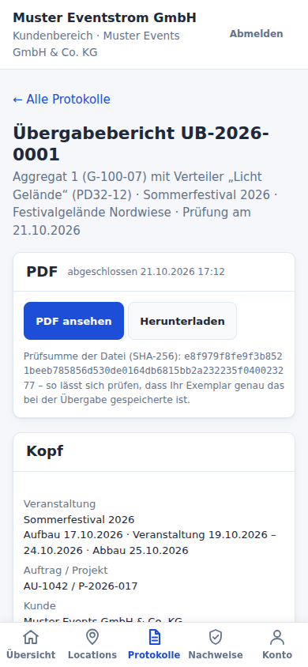
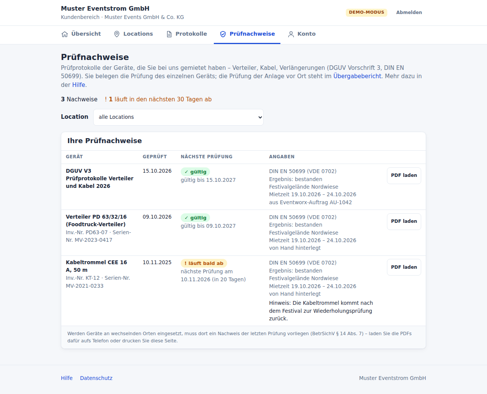

# Kundenbereich: Locations, Protokolle und Prüfnachweise für Kunden

Kunden – Veranstalter, Mieter eines Geländes, Auftraggeber – bekommen einen
eigenen Zugang und sehen darin nur, was ihnen gehört:

- ihre **Locations** im Zeitraum ihrer Veranstaltung: Anschrift, Pläne der
  Etagen und die festen Stromanschlüsse,
- ihre **Protokolle**: abgeschlossene Übergabeberichte mit Messprotokoll
  ([berichte.md](berichte.md)), als PDF so, wie sie bei der Übergabe
  gespeichert wurden,
- ihre **Prüfnachweise** (DGUV Vorschrift 3) für gemietete Verteiler, Kabel
  und Verlängerungen – von Hand hinterlegt oder aus einem
  Eventworx-Auftrag übernommen.

Der Kundenbereich ist **nur zum Lesen**. Kunden planen nichts, schalten
nichts und sehen keine Karte, keine Statistik und keine anderen Kunden.

 

Drei Dinge heißen ähnlich und sind verschieden:

| | was | wer, wo |
|---|---|---|
| **Kundenbereich** | eigener Zugang des Kunden, nur `/kundenbereich` | der Kunde, an seinem eigenen Gerät |
| **Kundenmodus** | das Gerät des Prüfers ist gesperrt, bis der Kunde den Übergabebericht unterschrieben hat ([berichte.md](berichte.md#kundenbestätigung-und-kundenmodus)) | der Kunde, am Tablet des Prüfers |
| Rolle **„Kunde / Veranstalter“** | ein gewöhnliches Konto mit Freigaben – der ältere Weg, siehe [Übergang](#übergang-konten-mit-der-rolle-kunde--veranstalter) | wie das Personal, mit eingeschränkten Rechten |

## Begriffe

| Begriff | Bedeutung |
|---|---|
| **Kunde** | Firma oder Verein, für den gearbeitet wird: Name, Kundennummer, aktiv, „Zugänge enden am“, Notizen (nur für das Personal). Keine Anschrift, kein Telefon – das steht im Bericht oder in Eventworx. |
| **Kundenzugang** | ein Konto mit Benutzername und Kennwort, das zu genau einem Kunden gehört. Ein Kunde kann mehrere haben (Produktionsleitung, Technik). Kundenzugänge haben **keine Rolle und keine Rechte** und stehen nicht in der Benutzerverwaltung. |
| **Freigabe am Kunden** | „dieser Kunde sieht diesen Standort von … bis …, mit Messdaten von … bis …“. Gilt für alle Zugänge des Kunden; ein Widerruf genügt. Nur Standorte, nie „bearbeiten“ oder „schalten“. |
| **Protokoll** | ein Übergabebericht, den das Personal dem Kunden ausdrücklich **zugeordnet** hat. |
| **Prüfnachweis** | das Prüfprotokoll eines Geräts nach DGUV V3 / DIN EN 50699, als PDF mit Angaben (geprüft am, nächste Prüfung, Ergebnis). Ein Übergabebericht prüft die **Anlage vor Ort**, ein Prüfnachweis das **einzelne Gerät** – das eine ersetzt das andere nicht. |

## Was Kunden sehen – und was nie

Für einen angemeldeten Kundenzugang eines Kunden K:

| Was | sichtbar genau dann, wenn | unabhängig von |
|---|---|---|
| der Zugang selbst | Zugang aktiv und in seinem Zeitraum, K aktiv und nicht über „Zugänge enden am“ | – |
| eine **Location** | K hat eine Freigabe für den Standort, und *jetzt* liegt in ihrem Gültigkeitszeitraum | Freigaben am Konto oder an Rollen, Freigaben für einzelne Anlagen |
| eine kommende Location | wie oben, aber die Freigabe beginnt erst – dann nur Name und „ab …“ | – |
| Etage und Plan | Location sichtbar, die Etage gehört zum Standort und hat einen Plan | – |
| ein fester Stromanschluss | Location sichtbar, Anlage dort mit Merkmal „Feststromanschluss“ | mobile Anlagen |
| ein **Protokoll** | der Bericht ist K zugeordnet und abgeschlossen (oder durch eine Korrektur ersetzt) | Standort, Freigaben, Prüfdatum |
| das Protokoll-PDF | Protokoll sichtbar und sein PDF beim Abschluss gespeichert – nie eine Vorschau | – |
| ein **Prüfnachweis** | er gehört K, ist freigegeben, und seine Datei ist unversehrt | Freigaben |
| **nie** | Notizen an Standort, Etage, Anlage und Kunde, Fremdbestand, Netzbetreiber, mobile Anlagen, Kabel, Messgeräte, Katalog, Aufbauten, Einsätze, Audit-Log, andere Zugänge und andere Kunden | – |

Was ein Kunde nicht sieht, gibt es für ihn nicht: Ein fremdes, nicht
freigegebenes oder nicht vorhandenes Protokoll, eine fremde Location oder ein
fremder Nachweis geben **dieselbe Fehlerseite 404**. Andere Seiten der App
erreicht ein Kundenzugang gar nicht – jede Adresse außerhalb von
`/kundenbereich` führt zurück zur Übersicht.

Protokolle und Prüfnachweise **überdauern die Location-Freigabe**: Ist die
Veranstaltung vorbei und die Location verschwunden, bleiben die Dokumente
im Kundenbereich – bis der Kunde beendet wird oder ihre Aufbewahrung endet.

## Einrichten

1. **`app.url`** in `config/config.php` auf die Adresse setzen, unter der
   Kunden die Oberfläche erreichen (etwa `https://strom.example.de`). Nur
   daraus entstehen Einrichtungslinks – nie aus der Anfrage. Ohne `app.url`
   gibt es nur vorläufige Kennwörter. Die Karte *System → Einstellungen →
   Kundenbereich* zeigt, ob die Adresse fehlt, ungültig oder
   unverschlüsselt (`http://` außerhalb von `localhost`) ist. Für einen
   Zugang von außen siehe [installation-debian-lxc.md](installation-debian-lxc.md#9--von-außen-erreichbar-machen-optional).
2. **Einstellungen** (*System → Einstellungen → Kundenbereich*, Recht
   „Einstellungen ändern“):

   | Feld | Vorgabe | Wozu |
   |---|---|---|
   | Datenschutzhinweis | Mustertext nach Art. 13 DSGVO mit `{firma.name}` und `{firma.anschrift}` | steht auf der Einrichtungsseite, im Konto und im Fuß jeder Seite. Der Mustertext ist **keine Rechtsberatung** – vor dem Einsatz prüfen. |
   | Ansprechpartner | leer – dann die Bereitschaft aus den Übergabeberichten | Telefon oder Name für Kunden; eine Telefonnummer wird zum Anruf-Knopf |
   | Einrichtungslinks gültig | 72 Stunden (1–168) | wie lange ein Link eingelöst werden kann |
   | Aufbewahrung der Prüfnachweise | 3 Jahre (1–30) | bis 31.12. des Prüfjahres plus so viele Jahre |

3. **Rechte** an die Personen verteilen, die Kunden pflegen
   ([rechte.md](rechte.md#kunden--kundenbereich)): Stromplanung hat ab Werk
   alles, Elektrotechnik darf Kunden ansehen und Prüfnachweise hinterlegen.

Es gibt **keinen Mailversand**. Einrichtungslinks und vorläufige Kennwörter
gibt das Personal selbst weiter – am Telefon, per eigener Mail, ausgedruckt.

## Einen Kunden einrichten

*Kunden → Kunden & Kundenbereich → Neuer Kunde* (Recht „Kunden pflegen“):

1. **Stammdaten**: Name, Kundennummer (nicht doppelt), aktiv, optional
   „Zugänge enden am“. Die Notizen sieht der Kunde nie.
2. **Zugang** anlegen (Reiter *Zugänge*): Benutzername (2–64 Zeichen,
   Groß- und Kleinschreibung zählt nicht: „Muster“ gibt es nicht neben
   „muster“), Name, E-Mail-Adresse. Dann einer von zwei Wegen:
   - **Einrichtungslink** (Vorgabe): ein Link, mit dem der Kunde sein
     Kennwort selbst festlegt – einmal, höchstens 72 Stunden. Danach meldet
     er sich ganz normal unter `/login` an.
   - **Vorläufiges Kennwort**: 16 Zeichen; bei der ersten Anmeldung muss der
     Kunde ein eigenes festlegen und kommt vorher nirgendwohin.

   Link bzw. Kennwort stehen **genau einmal** auf der Seite nach dem
   Anlegen – sie werden nirgends gespeichert (vom Link nur ein HMAC) und
   stehen in keinem Log und keinem Audit-Eintrag. Wer sie verliert, erzeugt
   einen neuen Link bzw. ein neues Kennwort; der alte Link gilt dann nicht
   mehr. Jeder Zugang zeigt seinen Zustand: *aktiv*, *Erstanmeldung*,
   *Einrichtungslink offen*, *Einrichtungslink abgelaufen*, *gesperrt*
   (nach fünf falschen Kennwörtern, *Entsperren*), *abgelaufen*,
   *deaktiviert*.
3. **Location freigeben** (Reiter *Freigaben*): Standort, *gültig ab/bis*,
   *Daten ab/bis* (oder „wie die Gültigkeit“) und die Veranstaltung als
   Notiz. Ende und Datenzeitraum sind **Pflicht** – ein Gelände hat viele
   Veranstalter. Freigeben darf nur, wer selbst alle Standorte sieht.
4. **Protokolle zuordnen** und **Prüfnachweise hinterlegen** – siehe unten.
5. Unter *Übersicht* prüfen, was der Kunde jetzt sieht: **„Der Kunde sieht
   derzeit …“** rechnet mit denselben Regeln wie der Kundenbereich selbst.


Ohne Oberfläche geht ein Zugang auch auf der Kommandozeile:
`bin/power kunden:zugang <kunde-id> <benutzer> [--kennwort] [--name=…] [--email=…]`
gibt Link bzw. Kennwort einmal aus.

Der Kunde ändert sein Kennwort selbst unter *Konto*. Ein vergessenes
Kennwort setzt das Personal zurück (neuer Link oder neues vorläufiges
Kennwort); eine Selbstbedienung ohne Mail gibt es nicht.

## Mehrere Veranstalter auf einem Gelände

Auf einer Festwiese folgt ein Veranstalter dem nächsten. Deshalb:

- Eine Freigabe am Kunden hat immer ein **Ende** und einen
  **Datenzeitraum**. Fehlt ein Datenende (etwa per SQL gesetzt), ist der
  Datenzeitraum leer – nie „ohne Grenze“.
- Schneidet sich der Datenzeitraum mit dem eines **anderen Kunden** am
  selben Standort, speichert die Kundenverwaltung erst nach einem bewussten
  Häkchen; das Audit hält das fest. Abgelaufene Freigaben zählen mit (ihre
  Messdaten gehören weiter dem anderen Kunden), bloßes Berühren nicht
  (endet die eine um 12:00 und beginnt die andere um 12:00, sieht keiner
  Daten des anderen).
- **Protokolle** kommen nie über den Standort in den Kundenbereich, nur
  über die ausdrückliche Zuordnung – sonst sähe der nächste Veranstalter den
  Bericht des vorigen, sobald dessen Prüfdatum in seinen Zeitraum fällt.
  Prüfnachweise gehören ebenso einem Kunden, nie einem Standort.
- Kunden sehen **feste** Stromanschlüsse, keine mobile Planung: Der jetzige
  Planungsstand kann schon der des nächsten Veranstalters sein.

## Protokolle zuordnen

Am Übergabebericht (*Übergabeberichte → Bericht*) steht für Personen mit
„Kunden ansehen“ die Karte **Kundenbereich**: wem er zugeordnet ist, ob der
Kunde ihn sieht und wann er ihn zuletzt geladen hat. Mit „Kunden pflegen“:

- **Zuordnen** an einen Kunden aus der Liste. Steht im Bericht ein anderer
  Kundenname, fragt die Seite einmal nach („Im Bericht steht …, zugeordnet
  werden soll … – derselbe Kunde?“). Rechtsformen, „e. V.“ und Satzzeichen
  zählen dabei nicht.
- **Vorschläge** kommen nur aus Eventworx: ist der Eventworx-Vorgang des
  Berichts mit dem Kunden verknüpft oder nennt Eventworx denselben Kunden,
  schlägt die Karte (und der Reiter *Protokolle* am Kunden) ihn vor.
  Zugeordnet wird **nie automatisch**.
- Die Zuordnung gilt für **alle Fassungen** einer Nummer; eine Korrektur
  übernimmt sie. Sie liegt außerhalb des eingefrorenen Inhalts – Inhalt,
  Siegel und PDF ändern sich nicht.
- Der Kunde sieht den Bericht erst, wenn er **abgeschlossen** ist. Wird ein
  zugeordneter Bericht im Kundenmodus unterschrieben, steht danach auf dem
  Tablet: „Der Bericht steht ab sofort in Ihrem Kundenbereich bereit.“
- **Herausnehmen** wirkt sofort.

Im Kundenbereich gibt es die Leseansicht des Berichts (ohne Verlauf, ohne
interne Links) und das gespeicherte PDF mit seiner Prüfsumme (SHA-256) –
so kann der Kunde prüfen, dass sein Exemplar das bei der Übergabe
gespeicherte ist. Eine PDF-Vorschau eines unfertigen Berichts bekommt er
nie.

## Prüfnachweise (DGUV V3)

Prüfnachweise hinterlegt, wer „Prüfnachweise hochladen …“ hat, im Reiter
*Prüfnachweise* des Kunden. Der Kunde sieht einen Nachweis erst, wenn eine
Person ihn **freigibt** – und nur mit unversehrter Datei.



### Von Hand

- **Nur PDF** (beginnt mit `%PDF-`), höchstens **10 MB**. Gleiche Bytes
  liegen nur einmal in der Datenbank. Was größer ist als die Grenze des
  Servers (`post_max_size`, im Container 66 MB), verwirft PHP ganz – dann
  steht da „Sicherheitstoken ungültig“ statt einer Größenmeldung.
- **Angaben aus dem Protokoll** trägt eine Person ein – das PDF wird nicht
  ausgewertet: Gerät/Bezeichnung (Pflicht), Inventar- und Seriennummer,
  **geprüft am** (Pflicht, nicht in der Zukunft), **nächste Prüfung**,
  Norm, **Ergebnis** (nur, wenn es im Protokoll steht), Location (nur eine
  aus den Freigaben dieses Kunden), Eventworx-Vorgang des Kunden,
  Mietzeit (ohne eigene die des Vorgangs), Inventarstück (füllt leere
  Nummern) und ein Hinweis für den Kunden.
- Eine **Sammel-PDF** für mehrere Geräte nur, wenn sie **ausschließlich
  Geräte dieses Kunden** enthält – sonst liest ein Kunde die Geräte eines
  anderen mit.
- Status: *Entwurf* → *freigegeben* ↔ *zurückgezogen*. Löschen nimmt die
  Abrufe mit und die Datei, wenn sie sonst niemand nutzt.

Der Kunde bekommt die Datei als Download unter neutralem Namen
(`Pruefnachweis-<Nr>-<Datum>.pdf`), nie unter dem hochgeladenen.

### Gültigkeit

| Stufe | wann |
|---|---|
| ✓ gültig | nächste Prüfung in mehr als 30 Tagen |
| ! läuft bald ab | nächste Prüfung heute oder in höchstens 30 Tagen |
| ✗ abgelaufen | nächste Prüfung vor heute |
| ? unbekannt | keine nächste Prüfung eingetragen |

Gerechnet wird mit dem Tag in der Zeitzone der Installation. Dazu
Hinweise zur Mietzeit: „Die Prüffrist endet in der Mietzeit“, „… war schon
vor Beginn der Mietzeit abgelaufen“, „Nach der Übergabe geprüft“. Wer
Geräte an wechselnden Einsatzorten nutzt, muss dort einen Nachweis der
letzten Prüfung vorhalten (BetrSichV § 14 Abs. 7) – der Kundenbereich
sagt das, ist aber **keine Rechtsberatung**.

### Aus Eventworx

Liegen die Prüfprotokolle in Eventworx **am Auftrag oder Lieferschein**,
lassen sie sich übernehmen statt erneut hochzuladen
([eventworx.md](eventworx.md#prüfnachweise-aus-dateien-am-vorgang)):

1. Reiter *Vorgänge*: einen Auftrag oder Lieferschein suchen und mit dem
   Kunden **verknüpfen** (Recht „Kunden pflegen“ und „Kundendaten aus
   Eventworx …“). Beim ersten Vorgang nennt die Seite den Kunden, den
   Eventworx dazu kennt, und fragt einmal nach; danach gehören alle weiteren
   Vorgänge dieses Eventworx-Kunden hierher – und keine anderen. Ein
   Vorgang und ein Eventworx-Kunde gehören höchstens einem Kunden.
2. *PDF-Dateien ansehen*: die PDFs, die Benutzer in Eventworx an diesem
   Vorgang hochgeladen haben. Erzeugte Belege (Auftrag, Rechnung,
   Lieferschein) erscheinen nicht.
3. Dateien wählen, die **Angaben aus dem Protokoll** eintragen,
   *Gewählte übernehmen* – höchstens fünf je Durchgang. Eine Datei aus
   Eventworx gibt es hier nur einmal, auch nie für zwei Kunden.


Prüfberichte aus *Werkstatt → Prüfungen* (am einzelnen Gerät) sind über
die Schnittstelle von Eventworx noch nicht nachgewiesen – sie bitte von Hand
hinterlegen. Ob es dafür einen Weg gibt, zeigt die Lese-Probe
`bin/power eventworx:sonde` ([eventworx.md](eventworx.md#lese-probe)).

**Der Kundenbereich selbst fragt Eventworx nie.** Was der Kunde lädt, liegt
schon in der Datenbank; ein später in Eventworx gelöschtes Dokument bleibt
hier mit seiner Herkunft, bis das Personal es löscht.

### Aufbewahrung

Ein Nachweis bleibt bis zum 31.12. des Prüfjahres plus
`kundenbereich.nachweise_jahre` (Vorgabe 3). Gelöscht wird **nie
automatisch**: Die tägliche Wartung meldet nur, wie viele über der Frist
sind.

```bash
sudo -u www-data php /opt/powermanagement/bin/power kunden:aufbewahrung              # zeigen
sudo -u www-data php /opt/powermanagement/bin/power kunden:aufbewahrung --ausfuehren # löschen
sudo -u www-data php /opt/powermanagement/bin/power kunden:nachweise-pruefen         # Prüfsummen nachrechnen (Exit 1 bei Befund)
```

## Der Kundenbereich aus Sicht des Kunden

Am Telefon liegt die Navigation als Leiste unten, am Rechner als Reiter oben:

| Seite | Inhalt |
|---|---|
| **Übersicht** | Locations, die letzten Protokolle, Prüfnachweise (was bald abläuft), „Demnächst“, Ansprechpartner mit Anruf-Knopf, Hilfe |
| **Locations** | je Location die Veranstaltung mit Zeitraum, die Pläne der Etagen (Bild im Browser, PDF als Datei), die festen Stromanschlüsse mit Anschlüssen und Vorsicherung, die eigenen Protokolle und Nachweise dort |
| **Protokolle** | gültige Fassung je Nummer, frühere darunter; Leseansicht und PDF |
| **Prüfnachweise** | mit Gültigkeit, Mietzeit und Quelle, Filter je Location; PDF als Datei |
| **Konto** | Benutzername, Name, Kennwort ändern, Datenschutzhinweis |
| **Hilfe** | Unterschied Übergabebericht und Prüfnachweis, was die Angaben bedeuten, was vor Ort zu tun ist (RCD-Prüftaste arbeitstäglich, Nachweis am Einsatzort) |

Alle Seiten werden nicht zwischengespeichert (`Cache-Control: private,
no-store`), senden keinen Referer und kommen ohne Skript im Seitentext aus.

## Abrufe

Jeder **Download** eines Dokuments im Kundenbereich wird festgehalten –
damit sich nach einer Fehlzuordnung sagen lässt, ob der falsche Kunde das
Dokument wirklich hatte:

| Spur | was | wie lange |
|---|---|---|
| `kunden_abrufe` (Reiter *Abrufe* am Kunden) | Kunde, Zugang, Dokument, Prüfsumme, Zeit – ohne IP | mit dem Dokument bzw. dem Kunden |
| Audit-Log `kundenbereich.abruf` | Art und Kennung des Dokuments, mit IP | 400 Tage |
| Verlauf des Berichts `pdf_kunde` | Zeit, ohne Namen | so lange wie der Bericht |

Seitenaufrufe werden nicht festgehalten. Am Bericht und am Nachweis steht
„zuletzt geladen“; hat ein **anderer** Kunde den Bericht geladen, warnt die
Karte.

## Kunde beenden und löschen

- **Beenden**: *aktiv* ausschalten (oder „Zugänge enden am“). Alle Zugänge
  sind sofort zu, auch laufende Sitzungen enden bei der nächsten Anfrage;
  der Kunde sieht nichts mehr, seine Daten bleiben.
- **Löschen** geht nur bei einem beendeten Kunden und nur mit seinem Namen
  als Bestätigung. Weg sind dann seine Zugänge, Freigaben, Vorgänge,
  Prüfnachweise (mit den Dateien, die sonst niemand nutzt) und Abrufe.
  **Übergabeberichte bleiben** (Aufbewahrung), nur ohne Zuordnung.
- Wird ein **Standort** gelöscht, gehen die Freigaben der Kunden darauf
  mit; Vorgänge und Nachweise bleiben, nur ohne Standort.

## Datenschutz

Der Betreiber ist Verantwortlicher; Eventworx und das Hosting sind
Auftragsverarbeiter (der AV-Vertrag mit Eventworx muss den Abruf über die
Schnittstelle abdecken). Was folgt, ist eine Arbeitshilfe, **keine
Rechtsberatung**.

| Thema | Umsetzung |
|---|---|
| Rechtsgrundlage | Vertrag und Nachweispflichten (Art. 6 Abs. 1 lit. b und c DSGVO; BetrSichV, DGUV V3). Prüfernamen in den PDFs sind Pflichtangaben. |
| Datenschutz durch Technik (Art. 25) | Standard „nichts sichtbar“; Locations nur ausdrücklich, mit Ende und Datenzeitraum; Dokumente nur nach Zuordnung bzw. Freigabe durch eine Person; Kunden geben nie fremde Kennungen ein; Eventworx nie vom Kunden ausgelöst. |
| Datenminimierung (Art. 5 c) | Kunden ohne Anschrift und Telefon; aus Eventworx nur Kennungen, Nummer, Titel, Mietzeit, Kunden-Kennung und -Name zur Kontrolle und die gewählten Dateien – keine Preise, Positionen, Kontakte. |
| Sicherheit (Art. 32) | Tor im Router, gleiche 404 für Fremdes, `no-store`, Anmelde-Bremse, Einrichtungslink nur als HMAC, Geheimnisse nie in Log, Audit oder Antwort, Prüfskripte gegen das Durchprobieren von Kennungen. |
| Transparenz (Art. 13) | Datenschutzhinweis auf Einrichtungsseite, Konto und im Fuß. |
| Cookies (§ 25 TDDDG) | nur Sitzung und CSRF-Schutz. |

**Speicherbegrenzung (Art. 5 e):**

| Daten | bleiben bis |
|---|---|
| Kunde, Zugänge | Löschung durch das Personal; ein beendeter Kunde hat keinen Zugang |
| Freigaben am Kunden | mit Kunde oder Standort; abgelaufene bleiben als Verlauf, wirken aber nicht |
| Übergabeberichte | ihre Aufbewahrung ([berichte.md](berichte.md#aufbewahrung)); beim Löschen des Kunden nur ohne Zuordnung |
| Prüfnachweise und Dateien | `aufbewahren_bis` oder Löschen des Kunden; eine Datei, sobald sie niemand mehr nutzt |
| Abrufe | mit dem Dokument bzw. dem Kunden |
| Audit-Log | 400 Tage (`wartung`) |
| Einrichtungslinks | Einlösen; abgelaufene macht `wartung` unbrauchbar |

**Fehlzuordnung (Art. 33/34).** Hat ein Kunde ein fremdes Protokoll oder
einen fremden Nachweis bekommen:

1. Sofort **herausnehmen** (Karte am Bericht) bzw. **zurückziehen**
   (Nachweis) – wirkt bei der nächsten Anfrage.
2. Unter *Abrufe* am Kunden bzw. „zuletzt geladen“ nachsehen, ob er das
   Dokument **geladen** hat. Nur angezeigt oder gar nicht geöffnet ist
   anders zu bewerten als heruntergeladen.
3. Bewerten und, wenn nötig, binnen **72 Stunden** der Aufsichtsbehörde
   melden; den betroffenen Kunden informieren.

**Vorlage für das Verzeichnis der Verarbeitungstätigkeiten (Art. 30):**

| Feld | Eintrag |
|---|---|
| Bezeichnung | Kundenbereich (Bereitstellung von Prüfprotokollen und Prüfnachweisen) |
| Zweck | Kunden ihre Übergabeberichte, Prüfnachweise und Locations bereitstellen |
| Rechtsgrundlage | Art. 6 Abs. 1 lit. b und c DSGVO |
| Betroffene | Ansprechpartner der Kunden (Zugänge), Prüfer (in den Dokumenten) |
| Daten | Benutzername, Name, E-Mail, letzte Anmeldung, Abrufe mit Zeit; Inhalte der Dokumente |
| Empfänger | der jeweilige Kunde; Auftragsverarbeiter Hosting und Eventworx |
| Löschfristen | siehe Tabelle oben |
| Technische Maßnahmen | siehe „Sicherheit“ oben und [rechte.md](rechte.md) |

## Grenzen

- Keine Zwei-Faktor-Anmeldung, kein Mailversand, keine Selbstbedienung
  beim Kennwort.
- Keine Karte, keine Statistik, keine Messwerte, keine mobile Planung, kein
  Aufbau – auch wenn ein Datenzeitraum freigegeben ist.
- Kundenzugänge melden sich nie über SSO an.
- Keine ZIP aller Nachweise und keine Übernahme von Prüfdaten aus einer
  Prüfsoftware oder aus *Werkstatt → Prüfungen* in Eventworx.
- Das Personal sieht den Kundenbereich nicht „als Kunde“; „Der Kunde sieht
  derzeit …“ rechnet aber mit denselben Regeln.

## Übergang: Konten mit der Rolle „Kunde / Veranstalter“

Konten mit der Rolle *Kunde / Veranstalter* und Freigaben am Konto laufen
**unverändert weiter**. Sie sehen Übersicht, Anlagen, Karte und Statistik
des freigegebenen Standorts – also auch den **jetzigen Planungsstand** mit
mobilen Anlagen, der schon der des nächsten Veranstalters sein kann, und
mit einer Freigabe ohne Datenzeitraum die ganze Messgeschichte. Freigaben
an der Rolle oder am Konto gelten für Kundenzugänge nie.

Umstellen je Kunde:

1. Kunde anlegen, Zugang einrichten.
2. Für jeden Standort des alten Kontos eine Freigabe am Kunden mit
   denselben Zeiträumen anlegen (Ende und Datenzeitraum sind jetzt Pflicht).
3. Seine Übergabeberichte zuordnen.
4. Das alte Konto deaktivieren und später löschen.

## Kommandozeile

```text
bin/power kunden:liste                       Kunden: ID, Name, aktiv, Zugänge, aktive Locations, Nachweise
bin/power kunden:zugang <kunde-id> <benutzer> [--kennwort] [--name=…] [--email=…]
bin/power kunden:aufbewahrung [--ausfuehren] Prüfnachweise über der Aufbewahrungsfrist
bin/power kunden:nachweise-pruefen           Dateien der Prüfnachweise nachrechnen
bin/power eventworx:sonde [--job=OID] …      Lese-Probe (eventworx.md)
bin/power wartung                            macht abgelaufene Einrichtungslinks unbrauchbar, meldet fällige Nachweise
```

## Demo

`php bin/power demo:seed` legt auf dem Demo-Gelände zwei Veranstalter an
(alle Namen und Werte erfunden):

| Zugang | Kennwort | zeigt |
|---|---|---|
| `muster-events` | `Kundenbereich2026!` | **Muster Events GmbH & Co. KG**: das Festivalgelände während des Sommerfestivals (Messdaten nur der Festivalwoche), das abgeschlossene Protokoll UB-…-0001, drei freigegebene Prüfnachweise (einer läuft in 20 Tagen ab, einer stammt aus dem Eventworx-Auftrag AU-1042). Ebenfalls beim Kunden, aber für ihn noch unsichtbar: UB-…-0002 (wartet auf die Unterschrift des Kunden) und ein Nachweis im Entwurf. |
| `stadtmarketing` | `Stadtmarketing2026!` | **Stadtmarketing Musterstadt e. V.**: dasselbe Gelände erst für den Herbstmarkt in einem Monat – bis dahin nur unter „Demnächst“, und nichts von Muster Events. |

Am Auftrag AU-1042 liegt in der Demo ein zweites Prüfprotokoll, das noch
nicht übernommen ist – zum Ausprobieren. Eventworx wird im Demo-Modus nie
gefragt.

## Prüfen

| Skript | prüft |
|---|---|
| `tests/kundenbereich.php` | Kundenzugänge ohne Rechte, Tor über alle Routen, Freigaben nur am Kunden, mehrere Veranstalter je Gelände, Locations und Pläne, Protokolle nur über die Zuordnung, gleiche 404 für Fremdes, PDF-Kopfzeilen und Abrufe, Einrichtungslink, Kunde beendet, Benutzer- und Kundenverwaltung |
| `tests/pruefnachweise.php` | Upload nur PDF, Dubletten, Angaben, Sichtbarkeit, Gültigkeit in der Mietzeit, Aufbewahrung, Integrität, Übernahme aus Eventworx |
| `tests/eventworx.php` | Dateien am Vorgang, Verknüpfen, Lese-Probe |
| `tests/sitzung.php` | Suche, Verknüpfen und Dateiliste halten die Sitzung nicht |
| `tests/web.php`, `tests/sicherheit.php`, `tests/berichte.php`, `tests/zeitfenster.php`, `tests/schnittstelle.php` | Seiten der Kundenverwaltung, Rechte, Zuordnung am Bericht, Freigaben am Kunden, keine Tokens für Kundenzugänge |
