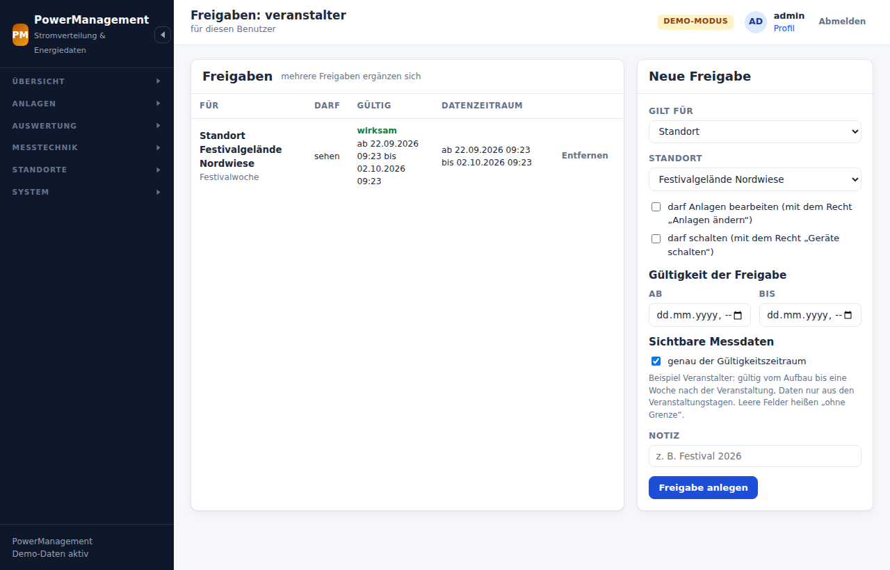

# Rechte, Freigaben und Zeitfenster

PowerManagement trennt zwei Fragen:

1. **Was darf jemand tun?** – über **Rollen** mit **Rechten** (Anlagen
   ansehen, Karte bearbeiten, Statistik exportieren, schalten …).
2. **Worauf und wann?** – über **Freigaben**: für alles, einen Standort,
   eine Anlage oder ein einzelnes Gerät, jeweils mit Gültigkeitszeitraum und
   eigenem Datenzeitraum.

Ein Recht allein zeigt noch nichts an. Wer „Statistik ansehen“ darf, aber
keine Freigabe hat, sieht eine leere Auswertung. Das Recht
`anlagen.scope.all` („alle Standorte“) ersetzt die Freigaben. Administration
und Stromplanung haben es.

## Rollen

| Rolle | gedacht für | Rechte (Auszug) |
|-------|-------------|-----------------|
| **Administration** | Betreiber | alles (`*`), auch die Schnittstelle zu anderen Instanzen |
| **Stromplanung** | Planer im Büro | Anlagen, Stecker, Karte, Grundrisse, Kabel, Statistik und Export, Datenquellen ansehen, Inventar pflegen, Locations holen, Übergabeberichte anlegen und ausfüllen (mit Eventworx), Kunden und ihren Kundenbereich pflegen, Prüfnachweise hinterlegen. Sieht alle Standorte, **schaltet nicht**, **unterschreibt nicht als Prüfer**. |
| **Elektrotechnik vor Ort** | Elektriker auf dem Gelände | Anlagen und Kabel dokumentieren, Statistik, Datenquellen ansehen, **schalten** und Schaltprotokoll, Übergabeberichte ausfüllen und **als Prüfer unterschreiben** – nur auf freigegebenen Standorten. Kunden ansehen und Prüfnachweise hinterlegen. |
| **Kunde / Veranstalter** | Auftraggeber | Übersicht, Anlagen, Karte, Statistik und CSV-Export – nur Freigegebenes im freigegebenen Zeitraum. Keine Übergabeberichte (siehe unten). Der neuere Weg für Kunden ist der [Kundenbereich](#kunden--kundenbereich) – ohne Rolle. |

Rollen und ihre Rechte lassen sich unter **System → Rollen & Rechte** anpassen oder
neu anlegen. Die Rolle *Administration* behält immer alle Rechte.

**Rechte vergibt nur, wer sie selbst hat.** Wer „Benutzer verwalten“ darf,
aber nicht die Administration hat, kann:

- keine Rolle mit Rechten anlegen oder ändern, die er selbst nicht hat (und
  nie „alle Rechte“),
- keine solche Rolle zuweisen – auch nicht sich selbst,
- kein Konto ändern, sperren, entsperren, löschen oder mit neuem Kennwort
  versehen, das Rechte hat, die ihm fehlen (etwa einen Administrator),
- Freigaben nur vergeben, wenn er selbst alle Standorte sieht, und keine auf
  „alles“ oder mit „schalten“ – die vergibt nur die Administration.

Sonst wäre „Benutzer verwalten“ eine Hintertür zu allem.

Das Rechte-Verzeichnis steht in `src/Auth/Permissions.php`.

## Zeit an drei Stellen

| Wo | Wirkung |
|----|---------|
| **Benutzerkonto** *gültig ab/bis* | Außerhalb des Zeitraums ist keine Anmeldung möglich. Eine laufende Sitzung endet mit der nächsten Anfrage. |
| **Rollenzuweisung** *ab/bis* | Die Rolle – und damit ihre Rechte und die Freigaben der Rolle – gilt nur in diesem Zeitraum. |
| **Freigabe** *gültig ab/bis* | Die Freigabe wirkt nur in diesem Zeitraum. |
| **Freigabe** *Daten ab/bis* | Welche **Messdaten** sichtbar sind. Unabhängig davon, wann man hinschaut. |

Für **Kundenzugänge** (Kundenbereich) sind es ebenfalls drei Stellen: der
Zugang (*aktiv*, *gültig bis*), der **Kunde** (*aktiv*, „Zugänge enden
am“ – gilt für alle seine Zugänge) und die **Freigabe am Kunden** (*gültig
ab/bis* und *Daten ab/bis*, beide Pflicht). Rollen haben Kundenzugänge nicht.

Die Zeitpunkte gelten in der Zeitzone der Installation (Vorgabe
Europe/Berlin). Gespeichert wird UTC.

### Beispiel: „User A sieht die Statistik vom 1. bis 7. Juli, danach nicht mehr“

1. Benutzer anlegen, Rolle **Kunde / Veranstalter**.
2. **Freigaben** → *Gilt für: Standort* „Festivalgelände“,
   *gültig* 01.07. 00:00 – 07.07. 23:59, Haken **„Daten: genau der
   Gültigkeitszeitraum“**.

Ergebnis: Vom 1. bis 7. Juli sieht A den Standort und die Messwerte dieser
Tage. Ab dem 8. Juli ist die Freigabe abgelaufen, und A sieht nichts mehr,
auch nicht die Juli-Daten.

Soll A die Festivalwoche **auch danach** noch einsehen dürfen (etwa für die
Abrechnung), dann *gültig* bis Ende August und *Daten* 01.07. – 07.07.
setzen. A sieht dann bis Ende August genau diese Woche und keine Messwerte
davor oder danach.

Sicherheitshalber lässt sich zusätzlich das **Konto** befristen
(*gültig bis*). Dann ist nach Ablauf auch keine Anmeldung mehr möglich.

### Wie das Datenfenster durchgesetzt wird

Die Einschränkung geschieht **vor** der Abfrage. `Zugriff::begrenzen()`
schneidet den gewünschten Zeitraum auf die freigegebenen Intervalle zu. An
die InfluxDB gehen nur Abfragen innerhalb dieser Intervalle. Mehrere
Freigaben werden vereinigt, Lücken dazwischen bleiben leer. Das gilt für
Diagramme, Kennzahlen, Energie je Tag, CSV-Export und Livewerte. Livewerte
gibt es nur, wenn *jetzt* im Datenfenster liegt.

## Freigaben

**System → Benutzer & Freigaben** (je Benutzer) oder **System → Rollen &
Rechte → Freigaben** (gilt für alle mit dieser Rolle, solange die Zuweisung gilt).

| Feld | Bedeutung |
|------|-----------|
| *Gilt für* | **alles**, ein **Standort** (mit allen Anlagen darauf), eine **Anlage** oder ein **Gerät** (Datenquelle) |
| *nur Kanal* | nur bei Geräten: z. B. `switch:2`. Leer bedeutet alle Kanäle. |
| *darf Anlagen bearbeiten* | wirkt nur zusammen mit dem Recht „Anlagen ändern“ (bzw. „Kabel zeichnen“, „Grundrisse pflegen“). Beschränkt das Bearbeiten auf den freigegebenen Bereich. |
| *darf schalten* | wirkt nur zusammen mit dem Recht „Geräte schalten“ (`steuern`) |
| *gültig ab/bis* | wann die Freigabe wirkt |
| *Daten ab/bis* | welche Messdaten sichtbar sind (siehe oben) |

**Sehen ist nicht ändern.** Was sich an einem Standort ändern lässt, braucht
eine Freigabe mit *bearbeiten* – nicht nur eine, die ihn sichtbar macht:

| Was | braucht |
|-----|---------|
| Anlage anlegen, verlegen (auch über die Etage), ins Inventar einsetzen | „Anlagen ändern“ + *bearbeiten* für den Standort (bzw. für die Anlage) |
| Kabel, Kabelweg, Kabelbrücke zeichnen, ändern, löschen | „Kabel zeichnen“ + *bearbeiten* für den Standort **oder** für eine Anlage an einem Kabelende; ein neues Kabelende steht auf der Etage des Kabels |
| Etagen, Grundriss, Maßstab, Georeferenz | „Grundrisse pflegen“ + *bearbeiten* für den Standort |
| Grundriss neu rechnen (Karte, Standorte) | „Grundrisse pflegen“ + *bearbeiten* für jeden Standort, dessen Etagen den Plan nutzen; den Zustand sieht jeder, der die Karte sieht |
| ein Messgerät einer Anlage zuordnen | es darf gerade an keiner Anlage messen, die man nicht bearbeiten darf; ohne „alle Standorte“ bzw. „Datenquellen verwalten“ zählen seine Messwerte erst ab der Zuordnung |
| ein Inventarstück einsetzen, das gerade woanders steckt | *bearbeiten* auch dort, wo es herauskommt |

Eine Anlage oder ein Kabel, das man nicht sieht, erscheint auch in Listen
und Fenstern nur als „nicht freigegeben“ – etwa als Ende eines Kabels oder
als Einsatzort eines Inventarstücks.

## Schalten – je Gerät einzeln

Ein Schaltbefehl (Shelly ein/aus, Victron Modus, ComAp Start/Stopp …) wird
nur ausgeführt, wenn **alle drei** Bedingungen erfüllt sind:

1. Der Benutzer hat das Recht **`steuern`** („Geräte schalten“).
2. An der Anlage ist die Steuerung **nicht gesperrt**. Die Sperre setzt man
   an der Anlage selbst, z. B. für das Aggregat, das nie aus der Ferne
   gestoppt werden darf. Sie gilt auch für Administratoren.
3. Es gibt eine **wirksame Freigabe mit „darf schalten“**, die das Gerät
   abdeckt. Das kann eine Freigabe für alles, für den Standort, für die
   Anlage oder **genau für dieses Gerät** sein, optional nur für einen
   **Kanal**. Ausnahme: `anlagen.scope.all` ersetzt diese Bedingung.
   Eine Freigabe für einen Kanal gilt nur für genau diesen – nicht für
   andere und nicht für Befehle ohne Kanal (etwa den Betriebsmodus eines
   Victron, wenn nur sein Relais freigegeben ist). Bei Modbus und ComAp
   zählt der Kanal, den der Befehl im Registerprofil hat.

So bekommt die Elektrikerin auf dem Gelände eine Schalt-Freigabe nur für den
Shelly der Geländebeleuchtung (oder nur dessen `switch:0`). Alles andere
sieht sie, kann es aber nicht schalten.

Jeder Versuch landet im **Schaltprotokoll** (*Auswertung → Schaltprotokoll*):
Benutzer, Gerät, Kanal, Befehl, Ergebnis. Abgelehnte Versuche werden
ebenfalls protokolliert. Schaltknöpfe erscheinen in der Oberfläche nur, wo
alle Bedingungen erfüllt sind. Die Prüfung läuft trotzdem serverseitig bei
jedem Befehl (`Steuerung::ausfuehren()` → `Zugriff::darfSteuern()`).

## Aufbau

Einen Aufbau und seinen Abgleich sieht, wer den Standort sieht; die Last
im Abgleich ist auf die Freigaben beschnitten wie überall. Starten, fertig
melden und beenden darf, wer auf dem Standort Anlagen anlegen darf. Eine
Anlage bestätigen darf, wer sie bearbeiten darf; ein Kabel, wer Kabel
zeichnen darf.

## Inventar

Das Inventar (Verteiler, Zwischenstecker und Tanksensoren mit Shellys)
gehört keinem Standort. Ansehen darf es, wer „Datenquellen ansehen“ hat (Planung,
Technik), pflegen, wer „Inventar pflegen“ hat. Ein Stück **einsetzen** oder
**abbauen** ist eine Änderung an der Anlage: dafür braucht es „Anlagen
ändern“ und eine Freigabe mit „bearbeiten“ für diese Anlage. Messgeräte aus
einem Einsatz zählen für Datenfenster und Schalt-Freigaben nur, solange sie
dort stecken.

## Verteiler-Abgleich

Den Verteiler-Abgleich sieht, wer „Locations und Verteiler übernehmen“ hat.
Übernehmen ändert den Katalog bzw. das Inventar hier – dafür braucht es
zusätzlich dasselbe Recht wie beim Bearbeiten von Hand: für Standard-Verteiler
„Steckverbinder-Katalog pflegen“ (oder „Anlagen ändern“ mit allen
Standorten), für das Inventar „Inventar pflegen“. Was jemand nicht pflegen
darf, wird übergangen und in der Meldung genannt. Hochladen und aus dem
Repository entfernen braucht „… ins Repository hochladen“.

## Schnittstelle (API)

Drei Rechte, ab Werk nur in der Rolle *Administration*. Was eine andere
Instanz mit einem Token sieht und darf, regeln **nicht** die Freigaben eines
Benutzers, sondern die Befugnisse und Standorte des Tokens – Einzelheiten in
[schnittstelle.md](schnittstelle.md).

| Recht | erlaubt | zusätzlich geprüft |
|-------|---------|--------------------|
| „Zugänge (Tokens) für andere Instanzen …“ (`api.manage`) | *System → Schnittstelle (API)*: Zugänge ansehen und widerrufen | Anlegen, Ändern, Anzeigen und Löschen nur mit „Alle Standorte, Anlagen und Messdaten“. Eine Befugnis vergibt nur, wer die Rechte dahinter hat: `plaene.lesen` „Karte ansehen“, `plaene.vorschlagen` und `plaene.schreiben` dazu „Grundrisse pflegen“, `feststrom` „Anlagen ansehen“, `plaene.schreiben` mit `feststrom` dazu „Anlagen ändern“ und „Kabel zeichnen“. Binden nur an das eigene Konto oder eines, das man verwalten darf; eine Bindung lösen oder umbinden nur, wer den bisher gebundenen Benutzer verwalten darf. Anzeigen nur mit dem eigenen Kennwort und nur, wer das Token mit allen Befugnissen und seiner Bindung selbst anlegen dürfte. Ohne „Alle Standorte …“ zeigt die Liste nur die Namen der eigenen Standorte, die übrigen als Anzahl. |
| „Andere Instanzen eintragen …“ (`api.partner`) | *Standorte → Andere Instanzen*: eintragen, prüfen, austragen, die Locations dort ansehen | Übernehmen, Zuordnen, Verknüpfen, Hochladen und Zurückschicken nur mit „Grundrisse pflegen“ und *bearbeiten* am Standort hier (ein neuer Standort: nur „Grundrisse pflegen“); Lösen mit *bearbeiten*, Austragen mit *bearbeiten* an allen verknüpften Standorten. Feststrom dazu „Anlagen ändern“, „Kabel zeichnen“ und Anlegen auf dem Standort, fehlende Steckertypen „Steckverbinder-Katalog pflegen“ – sonst wird gar nichts übernommen. Jede gewählte Etage muss zum Standort gehören. |
| „Änderungsvorschläge anderer Instanzen …“ (`api.vorschlaege`) | *Standorte → Änderungsvorschläge*: Vorschläge zu Standorten, die man **ganz** sieht (eine Freigabe für eine einzelne Anlage genügt nicht) | Annehmen: „Grundrisse pflegen“ und *bearbeiten* am Standort, für Feststrom dazu „Anlagen ändern“, „Kabel zeichnen“ und Anlegen auf dem Standort, für neue Steckertypen „Steckverbinder-Katalog pflegen“. Ablehnen: *bearbeiten* am Standort (ist er gelöscht: alle Standorte). |

Wer `api.partner` hat, lässt den Server Adressen abrufen, die er selbst
einträgt – auch im eigenen Netz. Das Recht nur vergeben, wo man das will.

Ein Token mit `plaene.schreiben` ändert hier ohne Bestätigung – aber nur auf
Standorten, die ihm *zum Bearbeiten* freigegeben sind, nur auf dem Stand,
den die andere Seite zuletzt abgerufen hat (oder ausdrücklich darüber
hinweg), und mit denselben Schutzregeln wie beim Annehmen: Namen,
Schaltsperre, Messpunkte und der gelernte Inhalt je mm eines Tanks bleiben; ein Maßstab oder eine Georeferenz hier
wird nie gelöscht (fehlt er in der Sendung, bleibt der hiesige); gelöscht
wird nichts, Steckertypen legt es nie an. Im Audit-Log steht das als
`api.schreiben` mit dem Akteur `api:<Name des Zugangs>`.

## Katalog importieren

Einen Katalog importieren (*Standard-Verteiler → Importieren …*) darf, wer
„Anlagen ändern“ **und** „Alle Standorte, Anlagen und Messdaten“ hat – der
Katalog gilt für alle Standorte. Benutzt ein ausgewählter Typ einen
Steckertyp, den es hier noch nicht gibt, braucht es dazu
„Steckverbinder-Katalog pflegen“ – sonst wird nichts übernommen, und die
Meldung nennt die Steckertypen und die Typen, die sie brauchen. Ohne dieses
Recht stehen solche Typen in der Vorschau ohne Haken da; Typen ohne neue
Stecker lassen sich trotzdem übernehmen. Danach gelten für die Typen
dieselben Rechte wie für jeden Standard-Verteiler.

## MQTT-Zugänge

Die Liste *Messtechnik → MQTT-Zugänge* sieht, wer „Datenquellen ansehen“
hat. Einrichten, prüfen, ein neues Kennwort vergeben und entfernen braucht
„Eigene MQTT-Zugänge der Shellys“ **und** „Alle Standorte, Anlagen und
Messdaten“: ein Zugang am Broker gilt für das ganze Gerät, und die
Umstellung sperrt den gemeinsamen Zugang darauf – das lässt sich nicht auf
einen Standort begrenzen. Kennwörter werden nie gespeichert und nie
protokolliert; das Audit-Log nennt nur Gerät und Schritt.

## Bereiche

Einen Bereich sieht, wer seinen Standort sieht. In die Summe kommen aber nur
Mitglieder, deren Anlage er sehen darf, und nur Messwerte aus dem
Datenfenster seiner Freigabe; fehlt etwas, steht das als Hinweis an der
Kachel („… nicht freigegeben – die Summe ist unvollständig“). Anlegen,
ändern und löschen darf, wer das Recht „Anlagen ändern“ hat und auf dem
Standort Anlagen anlegen darf. Verlauf und CSV brauchen wie sonst
„Statistik“ bzw. „Export“.

## Tanks

Ein Tank ist eine Anlage wie jede andere: Sehen darf ihn, wer ihn über eine
Freigabe sieht, ändern, wer „Anlagen ändern“ und eine Freigabe mit
„bearbeiten“ für ihn hat.

- **Füllstand, Verlauf, Verbrauch je Tag**: wie alle Messdaten nur im
  Datenfenster der Freigabe; live nur, solange die Freigabe jetzt gilt (sonst
  „gesperrt“). Peilungen, Betankungen und Fassungen der Kennlinie außerhalb
  des Datenfensters sieht niemand. Verlauf und Tage brauchen „Statistik
  ansehen“, die CSV „Statistik exportieren“ (im Audit).
- **Peilen, betanken, kalibrieren, löschen, Tanksensor ein- und ausbauen**:
  „Anlagen ändern“ und *bearbeiten* am Tank. Wer das nicht hat (etwa die
  Rolle *Kunde / Veranstalter*), sieht die Knöpfe nicht. Ein eigenes Recht „nur betanken“ gibt es
  nicht.
- **Eintragen nur im eigenen Datenfenster**: Peilen, betanken, kalibrieren,
  löschen und einen Tanksensor einbauen geht nur, solange das Datenfenster
  der Freigabe jetzt gilt; eine Betankung nur mit einem Ende darin. Sonst
  änderte man Werte, die man selbst nicht sehen darf.
- **Den Messpunkt eines Tanksensors** löscht niemand – er endet mit dem
  Ausbau, Verlauf und Kennlinie bleiben.
- **Rückwirkend** kalibrieren (*Erweitert*) nur mit unbegrenztem
  Datenfenster – sonst änderte man Werte, die man selbst nicht sehen darf.
  Es steht im Audit.
- **Tanksensor anlegen**: „Inventar pflegen“; den Shelly-Kanal nur, wer das
  Gerät zuordnen darf.
- **Kraftstoffschlauch**: „Kabel zeichnen“ und *bearbeiten* an beiden Enden
  (oder für den Standort) – er ändert Vorrat und Restlaufzeit aller Tanks am
  Generator. Beide Enden stehen auf der Etage des Schlauchs.
- **Restlaufzeit**: Es zählen nur Generatoren, die der Betrachter sieht und
  live sehen darf. Ein fremder Generator verrät weder Namen noch Leistung –
  dann kommt der Verbrauch aus dem Pegel.
- **Nie schalten**: Aus Tankwerten wird nie geschaltet, und einen Shelly, der
  an einem Tank misst, schaltet niemand – auch nicht die Administration.
- **Kundenmodus** (Übergabeberichte): Tankseite, Verlauf, Verbrauch je Tag,
  CSV, Peilung und Betankung sind gesperrt wie alles andere – auch eine CSV,
  die schon auf die InfluxDB wartete, als der Kundenmodus begann.
- **Kommandozeile**: `bin/power tank:liste` braucht `--als=<benutzer>` und
  zeigt genau, was dieses Konto sähe; ein gesperrtes oder abgelaufenes Konto
  wird abgelehnt. `tank:rechnen` zeigt nur die Kennlinie, keine Messwerte.
- **Kundenzugänge** (Kundenbereich) sehen keinen Tank – auch keinen festen
  auf ihrer Location, keinen Schlauch, keinen Sensor und keinen Wert daraus.
  Für sie deckt keine Freigabe am Kunden einen Tank (`Zugriff`), dazu Tor
  und fehlende Rechte; Begründung in
  [kundenbereich.md](kundenbereich.md#tanks).

## Übergabeberichte

| Recht | erlaubt |
|-------|---------|
| „Übergabeberichte ansehen“ (`berichte.view`) | Liste, Bericht und PDF. Ohne „ausfüllen“ nur **abgeschlossene** Berichte, nur mit Freigabe für den Standort und nur, wenn das Prüfdatum im Datenzeitraum der Freigabe liegt. |
| „… anlegen, ausfüllen, vom Kunden unterschreiben lassen“ (`berichte.manage`) | Entwürfe anlegen und ausfüllen und den Kundenmodus starten – nur auf Standorten mit Freigabe *bearbeiten* –, dazu die Prüfgeräte pflegen |
| „Als Prüfer unterschreiben …“ (`berichte.pruefen`) | unterschreiben, ohne Kunde abschließen, zurückziehen, Korrektur anlegen, verwerfen – nur mit hinterlegter **Prüfer-Qualifikation** im Konto und *bearbeiten* für den Standort |
| „Kundendaten aus Eventworx …“ (`berichte.eventworx`) | im Formular nach Aufträgen und Angeboten suchen und übernehmen. Eventworx zeigt dabei alle Vorgänge des Mandanten – deshalb nie für Kunden-Rollen. |

**Sehen ist nicht ändern** gilt auch hier: Wer einen Standort nur sieht,
sieht dort (im Datenzeitraum) abgeschlossene Berichte, aber keine Entwürfe,
und kann nichts ausfüllen oder unterschreiben. Ein Bericht ohne Standort gehört dem, der ihn
angelegt hat (und wer „alle Standorte“ hat). Wird ein Standort gelöscht,
bleiben seine Berichte – sichtbar dann **nur noch mit „alle Standorte“**,
auch nicht mehr für den, der sie angelegt hat (seine Freigabe für den
Standort ist mit ihm weg). Wer „alle Standorte“ hat, sieht
und ändert Berichte überall – Freigaben braucht er dafür nicht.

**Kunden zeigen.** Die Rolle *Kunde / Veranstalter* hat das Recht nicht:
Auf einem Gelände arbeiten viele Veranstalter, und Berichte enthalten
Kundendaten. Der Weg für Kunden ist der **Kundenbereich**
([kundenbereich.md](kundenbereich.md)): Dort sieht ein Kunde nur Berichte,
die ihm **ausdrücklich zugeordnet** sind – nie über Standort und
Prüfdatum. Der ältere Weg geht weiterhin: „Übergabeberichte ansehen“
einzeln (eigene Rolle) und eine Freigabe für den Standort **mit
Datenzeitraum** – etwa genau die Festivalwoche. Dann sieht er nur Berichte,
deren Prüfdatum darin liegt. Eine Freigabe ohne Datenzeitraum zeigt alle
abgeschlossenen Berichte des Standorts, auch die anderer Veranstalter – und
auch mit Datenzeitraum die eines anderen Veranstalters, der im selben
Zeitraum geprüft hat.

Die Qualifikation („Elektrofachkraft für Veranstaltungstechnik“) trägt die
Benutzerverwaltung ein; im Profil ist sie nur zu lesen. Ändert jemand sie,
steht das im Audit-Log. Rechte vergibt auch hier nur, wer sie selbst hat.

## Kunden & Kundenbereich

Kunden mit eigenem Zugang ([kundenbereich.md](kundenbereich.md)) sind
**keine Benutzer mit einer Rolle**. Ein Kundenzugang ist ein Konto, das zu
einem Kunden gehört (`users.kunde_id`). Er hat **keine Rechte** – auch
nicht, wenn ihm jemand per SQL eine Rolle gibt – und erreicht nur
`/kundenbereich`: Ein Tor im Router schickt ihn von jeder anderen Adresse
dorthin zurück (JSON-Anfragen bekommen 403), noch bevor eine Route oder ein
Recht geprüft wird. Kundenzugänge stehen nicht in *Benutzer & Freigaben*,
bekommen dort keine Freigaben und lassen sich dort nicht ändern; sie werden
in der Kundenverwaltung gepflegt. An Tokens der Schnittstelle lassen sie
sich nicht binden. Tanks sehen sie nie ([Tanks](#tanks)).

Drei Rechte für das Personal:

| Recht | erlaubt | ab Werk |
|---|---|---|
| „Kunden mit ihren Protokollen, Prüfnachweisen und Eventworx-Vorgängen ansehen“ (`kunden.view`) | Kundenliste, Kunde mit Übersicht („Der Kunde sieht derzeit …“), Stammdaten, Vorgänge, Protokolle, Prüfnachweise; die Karte „Kundenbereich“ am Übergabebericht | Stromplanung, Elektrotechnik |
| „Kunden und Kundenzugänge pflegen …“ (`kunden.manage`) | Kunden anlegen, ändern, beenden, löschen; Zugänge, Einrichtungslinks, vorläufige Kennwörter und Freigaben am Kunden (beides nur mit „Alle Standorte …“, siehe unten); Abrufe sehen; Übergabeberichte zuordnen; Eventworx-Vorgänge verknüpfen und lösen | Stromplanung |
| „Prüfnachweise (DGUV V3) …“ (`kunden.nachweise`) | Prüfnachweise hochladen, aus Eventworx übernehmen, freigeben, zurückziehen, löschen | Stromplanung, Elektrotechnik |

Dazu gilt jeweils:

- **Freigaben am Kunden** (Subjekt `kunde`) vergibt und entfernt nur, wer
  „Kunden pflegen“ hat **und** selbst alle Standorte sieht („Alle
  Standorte, Anlagen und Messdaten“). Sie gelten nur für Standorte, immer
  nur zum **Sehen** – „bearbeiten“, „schalten“, „alles“, eine einzelne Anlage
  oder ein Gerät gibt es für Kunden nicht, auch nicht per SQL. *gültig bis*
  und beide Datenenden sind Pflicht; fehlt ein Datenende doch, ist der
  Datenzeitraum leer, nie „ohne Grenze“.
- **Zugänge, Einrichtungslinks und vorläufige Kennwörter** gibt nur aus,
  wer selbst alles sieht, was der Kunde sieht: „Kunden pflegen“ **und**
  „Alle Standorte, Anlagen und Messdaten“, „Kunden ansehen“ und jedes
  Protokoll des Kunden. Ein Zugang erbt alles, was dem Kunden freigegeben
  und zugeordnet ist – mit weniger Rechten legte sich sonst jemand ein
  Kundenkonto an (oder übernähme eines) und läse dort, was er selbst nicht
  sieht. Dasselbe gilt, wenn ein Kunde oder Zugang wieder aktiv wird oder
  sein Ende später rückt.
- **Freigaben an der Rolle `kunde` oder am Konto** gelten für
  Kundenzugänge **nicht** – eine Freigabe an der Rolle gälte sonst für alle
  Kunden.
- Einen **Bericht zuordnen** darf, wer ihn selbst sieht und „Kunden pflegen“
  hat. **Vorgänge verknüpfen** braucht zusätzlich „Kundendaten aus
  Eventworx …“, denn die Suche zeigt alle Vorgänge des Mandanten.
- Ein **Inventarstück** am Prüfnachweis wählt nur, wer „Datenquellen
  ansehen“ hat.
- Rechte vergibt auch hier nur, wer sie selbst hat.

## Demo-Zugänge

Im Demo-Modus legt `bin/power demo:seed` diese Beispielkonten an:

| Benutzer | Kennwort | zeigt |
|----------|----------|-------|
| `veranstalter` | `Veranstalter2026!` | Rolle Kunde. Freigabe nur für das Festivalgelände und nur für die Festivalwoche. Konto läuft nach 10 Tagen ab. |
| `technik` | `Technik2026!!` | Rolle Elektrotechnik. Bearbeiten auf dem Festivalgelände (auch peilen und betanken), schalten nur beim Shelly der Geländebeleuchtung. Mit Prüfer-Qualifikation: unterschreibt Übergabeberichte. |
| `muster-events` | `Kundenbereich2026!` | Kundenzugang von „Muster Events GmbH & Co. KG“: im Kundenbereich das Festivalgelände während des Sommerfestivals, ein Protokoll, Prüfnachweise. |
| `stadtmarketing` | `Stadtmarketing2026!` | Kundenzugang von „Stadtmarketing Musterstadt e. V.“: dasselbe Gelände erst in einem Monat, nichts von Muster Events. |
