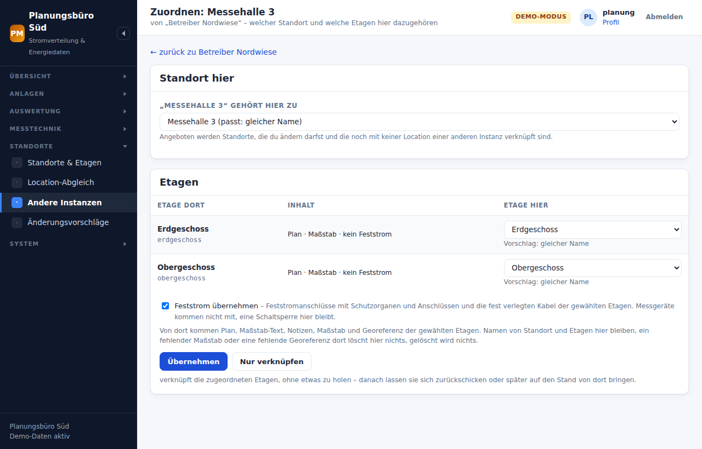

# Schnittstelle zwischen Instanzen (API)

Zwei Installationen – PowerManagement oder
[MasterAdmin](https://github.com/agrotevent/mikrotik-masteradmin) – tauschen
Standorte mit Etagen, Grundrissen, Maßstab und Georeferenz direkt
miteinander aus, zwischen zwei PowerManagement-Instanzen auch die
**Feststromanschlüsse** und die **fest verlegten Kabel**. Der Weg ist HTTP
mit einem Token je Verbindung; ein gemeinsames Git-Repository wie beim
[Location-Abgleich](bedienung.md#standorte-und-location-abgleich) braucht es
dafür nicht. Das Format ist dasselbe, nur der Weg ist ein anderer.

```
  Instanz A (teilt)                            Instanz B (übernimmt)
  ─────────────────                            ─────────────────────
  System → Schnittstelle (API)
    Zugang anlegen: Befugnisse,
    Standorte (sehen/bearbeiten)   ──Token──▶   Standorte → Andere Instanzen
                                                  A eintragen
  /api/v1/locations …            ◀── liest ──     Übernehmen / Zuordnen
                                                  … planen, Anlagen setzen …
  Standorte → Änderungsvorschläge ◀─ schickt ─    Als Vorschlag schicken
    je Etage prüfen, annehmen                       (plaene.vorschlagen)
  oder gleich übernommen          ◀─ schreibt ─   Hochladen
    (nur mit passendem Stand)                       (plaene.schreiben)
```

**In beide Richtungen, je nach Befugnis.** Was B bei A darf, legt A mit den
Befugnissen des Tokens fest:

| Befugnis | B kann damit | bei A ändert sich |
|----------|--------------|-------------------|
| `plaene.lesen` | Standorte mit Etagen, Grundrissen, Maßstab und Georeferenz lesen und **übernehmen** | nichts |
| `plaene.vorschlagen` | Änderungen **als Vorschlag** zurückschicken (schließt `lesen` ein) | erst, wenn bei A jemand den Vorschlag annimmt |
| `plaene.schreiben` | Änderungen **direkt hochladen** (schließt `vorschlagen` ein) | sofort – aber nur, wenn B den aktuellen Stand von A kennt (`basis`), oder ausdrücklich darüber hinweg (`erzwingen`) |
| `feststrom` | dazu Feststromanschlüsse mit Schutzorganen und Anschlüssen, fest verlegte Kabel und Kabelwege und ihre Steckertypen (schließt `lesen` ein; nur zwischen PowerManagement-Instanzen) | mit `vorschlagen` bzw. `schreiben` auch diese |

Zurückschicken und Hochladen gehen nur auf Standorten, die A dem Token **zum
Bearbeiten** freigegeben hat. Auf einem Standort, den das Token nur sieht,
lässt sich nur übernehmen.

## Was hinübergeht – und was nie

Hinaus geht genau das, was auch über Git geht:

- der **Standort** mit Name, Adresse, Notizen und Schlüssel,
- je **Etage** Name, Ebene, Reihenfolge, Maßstab-Text, Notizen, die
  **Plandatei** (PDF, PNG, JPG, SVG) mit Prüfsumme, der **Maßstab** – nur,
  wenn einer gesetzt ist,
- die **Georeferenz** der Etagen,
- mit `feststrom` die **Feststromanschlüsse** mit Schutzorganen und
  Anschlüssen, die **fest verlegten Kabel und Kabelwege** dazwischen und
  die Steckertypen, die sie brauchen.

**Nie** hinaus gehen Messgeräte und Messpunkte (sie brächten Schaltrechte
mit), mobile Anlagen, mobile Kabel, Kabelbrücken, Bereiche, Aufbau,
Inventar und Einsätze – und auch nicht die Dosen, Racks und Accesspoints,
die PowerManagement aus MasterAdmin als graue Orientierung kennt. Die
gehören MasterAdmin; eine leere Liste würde dort alle Dosen löschen.

Ein Token sieht nur die Standorte, die ihm freigegeben sind – alle anderen
gibt es für es nicht (dieselbe Antwort wie für einen unbekannten
Schlüssel).

## Das Protokoll

Dasselbe wie bei MasterAdmin: Anfragen an `/api/v1/…` mit dem Kopf
`Authorization: Bearer mtma_…`, Antworten als JSON. Das Präfix `mtma_`
kennzeichnet das Protokoll, nicht das Produkt – der Client von MasterAdmin
nimmt kein anderes an. So kann jede Seite mit jeder reden:

| A (teilt) | B (übernimmt) | geht |
|-----------|---------------|------|
| PowerManagement | PowerManagement | alles: Grundrisse, Georeferenz, Feststrom, zurück als Vorschlag oder direkt |
| PowerManagement | MasterAdmin | Grundrisse und Maßstab; zurück als Vorschlag |
| MasterAdmin | PowerManagement | Grundrisse, Maßstab, Dosen und Racks als Orientierung; zurück als Vorschlag |

## Seite A: Zugänge ausgeben

**System → Schnittstelle (API)** (Recht `api.manage`).


**Neuer Zugang** – anlegen darf nur, wer alle Standorte sieht (Recht
„Alle Standorte, Anlagen und Messdaten“): was ein Token sieht, regeln nicht
die eigenen Freigaben.

| Feld | Bedeutung |
|------|-----------|
| *Name*, *Notiz* | wofür der Zugang ist, etwa „Planungsbüro Süd“. Der Name steht im Audit-Log als Akteur `api:<Name>`. |
| *Befugnisse* | siehe oben. Eine Befugnis vergibt nur, wer die Rechte dahinter selbst hat (`plaene.lesen`: Karte ansehen; `vorschlagen`/`schreiben`: dazu Grundrisse pflegen; `feststrom`: Anlagen ansehen; `schreiben` mit `feststrom`: dazu Anlagen ändern und Kabel zeichnen). |
| *Standorte* | je Standort **sehen** (lesen, übernehmen) und **bearbeiten** (zurückschicken, hochladen). Gilt für alle Etagen, auch künftige. Ohne Standort sieht das Token nichts. |
| *An Benutzer binden* | optional. Ist es gesperrt, gelöscht oder außerhalb seines Gültigkeitszeitraums, ruht das Token. Angemeldet wird damit niemand – was das Token sieht, kommt nur aus seinen Befugnissen und Standorten. Binden, lösen oder umbinden nur, wer den (bisher) gebundenen Benutzer verwalten darf. |
| *Gültig bis* | bis zum Ende dieses Tages; vorgeschlagen ist ein Jahr, leer heißt unbefristet |

Nach dem Anlegen steht das Token **genau einmal** im Klartext da, zum
Kopieren, mit einem Prüfbefehl:

```bash
curl -i -H 'Authorization: Bearer mtma_…' https://strom.example/api/v1/info
```

- **Anzeigen** holt es später wieder hervor – nur mit dem eigenen Kennwort
  und nur, wer das Token genau so selbst anlegen dürfte: jede seiner
  Befugnisse vergeben und – ist es gebunden – den Benutzer verwalten. Sonst
  bekäme er Befugnisse in die Hand, die er hier selbst nicht hat; der Knopf
  fehlt dann. Jeder Abruf steht im Audit-Log (`api.token.angezeigt`, ein
  falsches Kennwort als `api.token.anzeigen_abgelehnt`). Gespeichert ist es
  als SHA-256 (darüber wird angemeldet) und mit `app.key` verschlüsselt, nie
  im Klartext.
- **Ändern** passt Befugnisse, Standorte, Bindung und Ablauf an; das Token
  bleibt dasselbe.
- **Widerrufen** wirkt sofort und löscht das verschlüsselte Token: es lässt
  sich danach nicht mehr anzeigen. Widerrufen darf jeder mit `api.manage`.
- **Löschen** geht erst nach Widerruf oder Ablauf.

Zustände in der Liste: *aktiv* (mit „bis …“), *abgelaufen*, *widerrufen*,
*ruht – Benutzer gesperrt*. *Zuletzt* nennt Zeitpunkt und Adresse des
letzten Abrufs. Wer nicht alle Standorte sieht, sieht in der Spalte
*Standorte* nur die Namen der eigenen, die übrigen als Anzahl.

Die **Adresse**, die B eintragen muss, steht oben auf der Seite. Sie kommt
aus `app.url` in `config/config.php` – ohne diesen Eintrag zeigt die Seite,
wie sie gerade aufgerufen wurde, und das stimmt hinter einem Proxy oft
nicht.

## Seite B: andere Instanzen

**Standorte → Andere Instanzen** (Recht `api.partner`).

**Instanz eintragen:** Adresse (so, wie A sie unter *Schnittstelle (API)*
nennt; ein `/api/v1` am Ende wird abgeschnitten) und das Token. B fragt
sofort `/api/v1/info` ab und nimmt die Verbindung nur, wenn das Token
mindestens `plaene.lesen` hat.

- Die Adresse lässt sich danach **nicht ändern** – sonst ließe sich ein
  hinterlegtes Token an einen fremden Server schicken. Für eine neue
  Adresse austragen und neu eintragen.
- Das Token liegt bei B verschlüsselt (`app.key`) und geht nur an diese
  Adresse. **Neues Token eintragen** ersetzt es, aber nur, wenn A es annimmt.
- **Verbindung prüfen** fragt die Befugnisse neu ab – nach einer Änderung
  bei A einmal klicken.
- *unverschlüsselt* steht an jeder http-Adresse, die nicht auf demselben
  Rechner liegt: Token und Pläne gehen dann lesbar über das Netz. Besser
  https.
- **Austragen** löst alle Verknüpfungen; die übernommenen Standorte bleiben.
  Das darf nur, wer an allen verknüpften Standorten ändern darf.

**Die Verbindung baut der Server von B auf, nicht der Browser.** Dass die
Adresse im Browser aufgeht, sagt nichts darüber, ob B sie erreicht.
Scheitert es, sagt die Meldung, an welcher Stelle:

| Meldung | heißt | Abhilfe |
|---------|-------|---------|
| *kann den Namen … nicht auflösen* | der DNS von B kennt den Namen nicht | IP von A eintragen, oder den Namen im DNS bzw. in `/etc/hosts` nachtragen |
| *bekommt von seinem DNS-Server keine Antwort* | der Nameserver von B antwortet nicht | `/etc/resolv.conf`, im Proxmox-Container unter *DNS* |
| *antwortet dem Server hier nicht* | Name gefunden, aber keine Antwort auf den Verbindungsaufbau | Firewall und Routing zwischen den Netzen |
| *nimmt … keine Verbindung an* | dort lauscht nichts auf dem Port | Port und http/https der Adresse |
| *nicht innerhalb von … s fertig geantwortet* | A ist erreichbar, aber zu langsam | später erneut |
| *spricht die Gegenseite … https?* | TLS-Handshake scheitert | http/https der Adresse |
| *vertraut dem Zertifikat … nicht* | selbst signiert, abgelaufen, anderer Name | gültiges Zertifikat, oder die ausstellende Stelle bei B hinterlegen (`/usr/local/share/ca-certificates`, `update-ca-certificates`) |
| *Das Token wird dort nicht (mehr) angenommen* | abgelaufen, widerrufen oder falsch | bei A ein Token anzeigen oder neu anlegen, hier *Neues Token eintragen* |

Von der Kommandozeile bei B nachstellen: `getent hosts <name>` und
`curl -sS http://<adresse>/api/v1/info` – ohne Token antwortet A mit 401,
und das heißt: erreichbar.

### Die Locations dort

Die Seite einer Instanz zeigt je Location von A ihre Etagen – mit Plan,
Feststrom und ob das Token sie bearbeiten darf –, daneben, welche Etage hier
dazugehört, und den Zustand:


| Zustand | heißt | zu tun |
|---------|-------|--------|
| *noch nicht hier* | nichts hier passt dazu | Übernehmen (legt den Standort neu an) oder Zuordnen … |
| *passt zu …* | ein Standort hier mit gleichem Schlüssel oder gleichem Namen, noch mit nichts verknüpft | Übernehmen (verknüpft und holt) oder Zuordnen … |
| *verknüpft – noch nicht übernommen* | „Nur verknüpfen“ gewählt | Übernehmen, oder den Stand hier hochladen bzw. zurückschicken |
| *aktuell* | hier und dort wie beim letzten Übernehmen | nichts |
| *dort geändert* | A hat geändert, hier nicht | Übernehmen |
| *hier geändert* | hier geändert, dort nicht – auch: hier gibt es Anlagen oder Kabel, die dort (noch) fehlen | Hochladen bzw. zurückschicken; Übernehmen nur mit Rückfrage (überschreibt hier) |
| *beide geändert* | beide Seiten haben geändert | Übernehmen *oder* Hochladen, beides mit Rückfrage – der gewählte Stand gilt |
| *verknüpft* (ohne Vergleich) | mit einem Standort hier verknüpft, den man selbst nicht sieht | nichts – es stehen weder seine Etagen noch sein Zustand da |

Übernehmen, Zuordnen … und Lösen stehen an jeder Location, deren Standort
hier man ändern darf (eine Freigabe mit *bearbeiten*); Hochladen und
zurückschicken nur, wo es etwas zu schicken gibt.

Verglichen wird mit dem Stand beim letzten Übernehmen: dem `stand` von A
und einem Fingerabdruck der verknüpften Etagen hier (Plan, Maßstab,
Notizen, Georeferenz, Feststrom). Mobile Anlagen und Kabel zählen nicht –
die Planung der Veranstaltung ist keine Änderung an der Location.

**Übernehmen** holt Plan, Maßstab, Notizen und Georeferenz der Etagen von
dort – mit dem Kästchen *Feststrom* daneben (vorgewählt, wenn A `feststrom`
gibt und man Anlagen und Kabel ändern darf) auch Anlagen und Kabel. Eine
unveränderte Plandatei wird nicht noch einmal geladen. Dabei bleibt hier:

- die **Namen** von Standort und Etagen, ihre Reihenfolge,
- eine **Schaltsperre** an einer Anlage – sie wird nie aufgehoben,
- **Messpunkte**, Einsätze und Inventar an den Anlagen, auch an ihren
  Abgängen,
- ein **Maßstab** und eine **Georeferenz**, wenn dort keiner gesetzt ist,
- was hier aus einer übernommenen Anlage oder einem Kabel **mobil** gemacht
  wurde: es bleibt mobil, wo es ist,
- ein Kabelende an einer Anlage, die nicht mitkommt (andere Etage, ohne
  Etage),
- alles, was es nur hier gibt: mobile Anlagen und Kabel, Kabelbrücken,
  Bereiche, Anlagen und Kabel, die dort fehlen. **Gelöscht wird nichts.**

Solange es hier Anlagen oder Kabel gibt, die dort fehlen, bleibt der
Zustand danach *hier geändert* – bis sie hochgeladen oder dort angenommen
sind.

Anlagen und Kabel werden über ihren Schlüssel dort (`partner_schluessel`)
nur **innerhalb des Standorts** wiedererkannt – eine gleichnamige Anlage an
einem anderen Standort hier wandert nie herüber.

**Zuordnen …** öffnet eine Location einzeln: Standort hier (ein
vorhandener, den man ändern darf, oder ein neuer) und je Etage dort die
Etage hier, eine neue oder *nicht übernehmen*. Jede Etage hier gehört zu
höchstens einer Etage dort.



- **Übernehmen** holt die gewählten Etagen – mit derselben Rückfrage wie
  in der Liste, wenn es hier etwas überschreibt.
- **Nur verknüpfen** merkt sich die Zuordnung, ohne etwas zu holen. Der
  Bestand hier bleibt; er lässt sich danach hochladen bzw. zurückschicken
  oder später auf den Stand von dort bringen.

**Lösen** nimmt die Verknüpfung wieder weg; der Standort hier bleibt, wie
er ist.

### Zurück zu A

Je nach Befugnis des Tokens bei A gibt es einen von zwei Knöpfen. Beide
schicken nur die verknüpften Etagen, die A zum **Bearbeiten** freigegeben
hat, mit den Schlüsseln und Etagennamen von A – A muss nicht wissen, wie B
seine Halle nennt. Eine unveränderte Plandatei bleibt zu Hause; Feststrom
geht nur zu einer PowerManagement-Instanz, und nur, wenn das Token dort
`feststrom` hat. Vor dem Senden fragt B die Befugnisse bei A neu ab: hat A
sie inzwischen geändert (etwa `schreiben` dazugegeben, sodass ein
„Vorschlag“ gleich übernommen würde), geht nichts hinaus – „Seite neu
laden“.

Feststrom geht so hinüber:

- verknüpfte Anlagen und Kabel unter ihrem Schlüssel bei A – aber nur,
  solange es sie bei A noch gibt. Was A gelöscht hat, bleibt hier, kommt
  aber nicht still zurück;
- eigene (nur hier angelegte) unter ihrem Schlüssel hier – oder, wenn der
  bei A schon etwas anderes meint, unter einem freien („-2“ …). A legt sie
  unter einem eigenen Schlüssel an und merkt sich, unter welchem sie von
  diesem Token kamen; beim Hochladen nennt A ihn gleich, sonst steht er
  beim nächsten Übernehmen dabei (`gesendet_als`). So entsteht nie eine
  zweite.

- **Hochladen** (A gibt `plaene.schreiben`): A übernimmt gleich, ohne
  Rückfrage – aber nur, wenn sich dort seit dem letzten Übernehmen nichts
  geändert hat. Danach sind beide Seiten *aktuell*.
  - Bei *hier geändert* ohne Rückfrage.
  - Bei *beide geändert* nur mit Rückfrage: es überschreibt die Änderungen
    dort (`erzwingen`). Was A darüber hinaus hat (eine neue Anlage dort
    etwa), bleibt dort – hier steht danach *dort geändert*, einmal
    Übernehmen holt es.
  - Hat A inzwischen doch etwas geändert, lehnt A ab: „Dort hat sich etwas
    geändert – erst übernehmen (oder ausdrücklich überschreiben).“
  - Bei *aktuell* und *dort geändert* gibt es den Knopf nicht – erst
    übernehmen.
- **Änderungen zurückschicken → Als Vorschlag schicken** (A gibt nur
  `plaene.vorschlagen`): mit einer Notiz, was geändert wurde und warum. Bei
  A wartet der Vorschlag, bis ihn jemand annimmt; der Zustand hier bleibt
  *hier geändert*. Nimmt A ihn an, steht hier *beide geändert* (dort hat
  sich etwas getan, hier auch) – einmal Übernehmen, und beide Seiten sind
  *aktuell*. Ein neuer Vorschlag ersetzt einen noch offenen für denselben
  Standort.

Bei A gelten dieselben Schutzregeln wie beim Übernehmen hier: Namen,
Schaltsperre und Messpunkte bleiben; ein Maßstab oder eine Georeferenz bei A
wird nie gelöscht (fehlt er in der Sendung, bleibt der dortige); gelöscht
wird nichts. Neue Steckertypen legt ein Token bei A nie an – fehlt dort
einer, lehnt A das Hochladen ab und nennt ihn.

## Vorschläge bestätigen (A)

**Standorte → Änderungsvorschläge** (Recht `api.vorschlaege`) listet jeden
Vorschlag mit Eingang, Location, Absender, Notiz und Zustand: *offen*,
*angenommen*, *direkt übernommen* (mit `plaene.schreiben` hochgeladen),
*abgelehnt*, *ersetzt* (ein neuerer Vorschlag desselben Zugangs für
denselben Standort bringt den ganzen Stand). Sichtbar ist ein Vorschlag nur
für den, der den ganzen Standort sieht – eine Freigabe für eine einzelne
Anlage darauf genügt nicht.


Ein offener Vorschlag zeigt je Etage, was sich ändern würde: neue
Plandatei (zum Herunterladen, angezeigt wird sie hier erst nach dem
Annehmen), Maßstab, Notizen, Georeferenz, Feststrom mit `+` neu, `~`
geändert und `−` fehlt im Vorschlag (bleibt hier) und neue Steckertypen.
Ein anderer Etagenname dort ist nur ein Hinweis – der Name hier bleibt.
Hat sich hier seit dem Abruf etwas geändert oder ist der Zugang inzwischen
widerrufen, steht das darüber.

- **Annehmen** übernimmt die angehakten Etagen (vorausgewählt sind die
  geänderten) und die angehakten Teile – *Grundriss, Maßstab,
  Georeferenz* und *Feststrom* –, mit denselben Schutzregeln wie oben.
  Annehmen braucht „Grundrisse pflegen“ und *bearbeiten* am Standort, für
  Feststrom dazu „Anlagen ändern“ und „Kabel zeichnen“, für neue
  Steckertypen „Steckverbinder-Katalog pflegen“. Angelegt werden nur
  Steckertypen, die ein Anschluss im Vorschlag wirklich verwendet.
- **Ablehnen** mit Grund verwirft ihn; hier ändert sich nichts. Ablehnen
  braucht ebenfalls *bearbeiten* am Standort.

Entscheiden zwei gleichzeitig, gewinnt der erste; der zweite hört
„schon entschieden“, und nichts wird doppelt angewandt.

Ein Zugang hat höchstens zehn offene Vorschläge und höchstens 60
Sendungen in der Stunde (Vorschläge und direktes Schreiben zusammen); eine
Plandatei darin ist höchstens 30 MiB groß, ein Vorschlag höchstens 48 MiB.

**Größere Pläne.** Hochladen lassen sich Grundrisse bis 100 MB; die
Schnittstelle bleibt trotzdem bei 30 MiB je Datei und 48 MiB je Sendung.
Das ist das Protokoll von MasterAdmin (dort gelten dieselben Zahlen), und
eine Datei steckt als base64 im JSON: 100 MB wären 134 MB Körper, die PHP
gemessen mit 270 MB Speicher auspackt (und nginx nimmt so einen Körper an,
bevor feststeht, ob das Token gilt). Deshalb:

- **Übernehmen** (B holt von A) geht bis 100 MB: B lädt jede Plandatei
  einzeln über `GET …/datei` herunter (gemessen 192 MB Speicher bei 100 MB).
  MasterAdmin holt Pläne über 40 MB unter Umständen nicht – seine
  Zeitgrenze für eine Antwort ist 60 Sekunden, sein Speicher 256 MB.
- **Zurückschicken** (B an A): Ein Grundriss über 30 MiB – oder einer, der
  nicht mehr in die Sendung passt (zusammen rund 33 MiB) – geht nicht mit.
  Seine Etage geht ohne Plan hinüber, und das heißt bei A wie bei
  MasterAdmin „Grundriss unverändert“; alles andere wird geschickt. Die
  Meldung nennt jeden ausgelassenen Plan. Früher scheiterte an einem
  solchen Plan die ganze Sendung.
Beim Eingang wird nichts gerendert oder gekachelt, die Dateien liegen mit
Zufallsnamen unter `storage/vorschlaege/`. Ein ersetzter Vorschlag und
direkt Geschriebenes behalten nur ihre Eckdaten (Location, Etagen, Zahlen)
– ihre Dateien und den ganzen Inhalt nicht. Entschiedene Vorschläge löscht
`bin/power wartung` nach 400 Tagen.

## Zusammenspiel mit MasterAdmin

**PowerManagement teilt, MasterAdmin übernimmt.** Bei MasterAdmin unter
*Netzdokumentation → Andere Instanzen* die Adresse und ein Token von hier
eintragen, mit `plaene.lesen` und – zum Zurückschicken – `plaene.vorschlagen`.
MasterAdmin bekommt Standorte, Etagen, Pläne und Maßstab; Dosen und Racks
meldet PowerManagement als „unbekannt“, MasterAdmin zeigt dafür nichts.
`feststrom` und `plaene.schreiben` nützen MasterAdmin nichts: Feststrom
kennt es nicht, und es schickt keinen Stand mit – ein Vorschlag von dort ist
deshalb immer einer zum Bestätigen.

**MasterAdmin teilt, PowerManagement übernimmt.** Bei MasterAdmin ein Token
mit `plaene.lesen` anlegen lassen, mit `dosen` und `patchfelder`, wenn
Dosen und Racks hier als graue Orientierung auf der Karte stehen sollen,
und mit `plaene.vorschlagen` zum Zurückschicken.

- Fehlt in einer Antwort von MasterAdmin die Liste der Dosen (Token ohne
  `dosen`), bleiben die bisherigen hier stehen; eine leere Liste heißt
  „keine“.
- Pläne im Format webp übernimmt PowerManagement nicht (die Meldung nennt
  sie).
- Zurück geht immer ein Vorschlag, ohne Dosen, Racks und Accesspoints –
  MasterAdmin lässt sie auf den Etagen, wie sie sind. Etagennamen gehen mit
  dem Namen bei MasterAdmin hinüber, weil MasterAdmin beim Annehmen
  Etagenname, Maßstab-Text und Notizen aus dem Vorschlag nimmt.

## Für Skripte: die Endpunkte

Jede Anfrage trägt `Authorization: Bearer mtma_…` – nur im Kopf, nie in der
Adresse (`?token=` zählt nicht). Es gibt keine Sitzung, kein Cookie und
keine Weiterleitung. Antworten sind JSON, außer bei Plandateien.

| Methode | Pfad | Befugnis | Antwort |
|---------|------|----------|---------|
| GET | `/api/v1/info` | – | Name der Instanz, `produkt: "powermanagement"`, `api: 1`, Formate, Befugnisse und Ablauf des Tokens |
| GET | `/api/v1/locations` | `plaene.lesen` | freigegebene Locations mit `stand` und Etagen (`plan`, `bearbeiten`, Zahl der Anlagen und Kabel mit `feststrom`, sonst `null`; `dosen`/`racks` immer `null`) |
| GET | `/api/v1/locations/{schluessel}` | `plaene.lesen` | `stand`, `location` (MasterAdmin-Format 1) und `strom` (Format 2: `georeferenz`, mit `feststrom` auch `steckertypen`, `anlagen`, `leitungen`) |
| GET | `/api/v1/locations/{schluessel}/datei?pfad=plaene/…` | `plaene.lesen` | eine Plandatei (bis 100 MB, Größe vorab in `plan.bytes`), nur unter einem Pfad aus `plan.datei` |
| POST | `/api/v1/locations/{schluessel}/vorschlaege` | `plaene.vorschlagen` (für Feststrom dazu `feststrom`) | Vorschlag einreichen – oder mit `plaene.schreiben` und `basis` direkt schreiben |

```bash
curl -H "Authorization: Bearer $TOKEN" https://strom.example/api/v1/locations
```

```json
{"ok":true,"locations":[
  {"schluessel":"demo-festival","name":"Festivalgelände Nordwiese","stand":"3f9c0a1b2c3d4e5f",
   "etagen":[{"schluessel":"gelaende","name":"Gelände","plan":true,"bearbeiten":true,
              "dosen":null,"racks":null,"anlagen":4,"leitungen":3}]}]}
```

`stand` ändert sich mit allem, was das Token zu sehen bekommt (auch mit
seinen Befugnissen und Freigaben), nicht mit mobiler Planung. Anlagen und
Kabel, die A aus einer Sendung dieses Tokens neu angelegt hat, tragen im
Detail `gesendet_als` – den Schlüssel, unter dem das Token sie geschickt
hat.

**Einreichen:**

```json
{"location":{"format":1,"art":"location","schluessel":"demo-festival",
   "etagen":[{"schluessel":"gelaende","name":"Gelände","massstab":"1:500","notizen":"",
              "plan":{"datei":"plaene/gelaende.svg","typ":"image","seite":1,"sha256":"<64 hex>"},
              "referenz":{"a":{"x":3.75,"y":95},"b":{"x":28.75,"y":95},"meter":100,"verhaeltnis":0.625}}]},
 "strom":{"format":2,"art":"strom","schluessel":"demo-festival","georeferenz":{},"anlagen":[],"leitungen":[]},
 "dateien":{"plaene/gelaende.svg":"<base64>"},
 "notiz":"Säule 2 versetzt","absender":"Planungsbüro Süd",
 "basis":"3f9c0a1b2c3d4e5f","erzwingen":false}
```

- `location` ist Pflicht; nur Etagen, die es bei A schon gibt (neue legt A
  selbst an). `dosen`, `racks`, `aps` und alle `messpunkte` fallen weg.
- Schlüssel (Location, Etagen, Anlagen, Leitungen): `a–z`, `0–9`, `-`,
  höchstens 190 Zeichen – wie in der Adresse.
- Jede Anlage braucht `name`, `anschluesse` und `schutzorgane`, jede
  Leitung `punkte` – eine leere Liste heißt „keine“, ein fehlender
  Schlüssel wird abgelehnt (422), statt hier alles zu löschen. Anlagen
  ohne Etage nimmt A nicht an; ein Kabelende an einer solchen Anlage (oder
  an einer, die nicht mitkommt) behält A, wie es ist.
- Steckertypen, die kein Anschluss verwendet, legt A nie an.
- `dateien` nur für Pläne, deren `plan.datei` im Vorschlag steht, mit
  passender Prüfsumme; eine unveränderte Datei lässt man weg.
- `basis` ist der `stand` beim letzten Abruf. Mit `plaene.schreiben` und
  `basis` schreibt A direkt; ohne `basis` wird es auch mit `schreiben` ein
  Vorschlag zum Bestätigen (keine stillen Überschreibungen ohne
  Konflikterkennung).

Antworten:

| Code | wann |
|------|------|
| 200 | gelesen |
| 201 | eingegangen: `{"ok":true,"id":12,"uebernommen":false,"message":"Vorschlag eingegangen – …"}`, direkt geschrieben: `{"ok":true,"id":13,"uebernommen":true,"stand":"<neu>","basis_passte":true,"schluessel":{"anlagen":{"<geschickt>":"<hier>"},"leitungen":{…}},"message":"Übernommen."}` – `basis_passte: false` nach `erzwingen` über einen anderen Stand; `schluessel` nennt je angewandtem Eintrag den Schlüssel bei A |
| 400 | kein JSON, oder `location` fehlt |
| 401 | Token fehlt, falsch, abgelaufen, widerrufen oder ruht – immer dieselbe Antwort |
| 403 | Befugnis fehlt, oder der Standort ist nur zum Lesen freigegeben |
| 404 | unbekannte Adresse, Location oder Datei – was das Token nicht sieht, gibt es für es nicht |
| 405 | falsche Methode (mit `Allow`) |
| 409 | `basis` veraltet: `{"ok":false,"message":"Hier hat sich seit dem Abruf etwas geändert – …","stand":"<aktuell>"}` – erst neu abrufen, oder `"erzwingen": true` |
| 413 | Körper größer als 48 MiB |
| 415 | kein `Content-Type: application/json` |
| 422 | Vorschlag abgelehnt (Format, Etage, Datei, Prüfsumme …); beim direkten Schreiben auch unbekannte Steckertypen (`"stecker":[…]`). Gespeichert wird dann nichts. |
| 429 | zehn offene Vorschläge dieses Zugangs oder 60 Sendungen in der letzten Stunde; von nginx auch bei mehr als zehn Anfragen in der Sekunde |
| 500 | unerwarteter Fehler (Details im Log von A) |

## Verhältnis zum Location-Abgleich (Git)

Beides lässt sich nebeneinander nutzen, sollte für denselben Standort aber
nicht: es wären zwei Quellen für dieselben Etagen, und keine weiß von der
anderen. Die Seite einer Instanz sagt es an einem Standort, der auch über
Git kommt („auch im Location-Abgleich (Git) – zwei Quellen“).

Git ordnet über die eigenen Schlüssel (`sync_key`) zu, die Schnittstelle
über die Schlüssel der Gegenseite (`partner_schluessel`), immer nur
innerhalb des verknüpften Standorts. Eine Übernahme von einer anderen
Instanz schreibt nie in `sync_key`; eine Anlage, die es nur hier gibt, geht
mit ihrem eigenen Schlüssel hinüber (oder einem freien, wenn der dort schon
etwas anderes meint) und wird beim nächsten Übernehmen wiedererkannt.

## Sicherheit

- Das Token steht nur im Kopf `Authorization`, nie in einer Adresse, und
  ist 240 Bit lang. nginx bremst `/api/` auf zehn Anfragen in der Sekunde
  je Adresse; Fehlversuche werden deshalb nicht einzeln protokolliert.
- Was ein Token sieht, kommt nur aus seinen Befugnissen und Standorten.
  Freigaben vergibt nur, wer alle Standorte sieht; eine Befugnis nur, wer
  die Rechte dahinter hat.
- Im Audit-Log stehen Anlegen, Ändern, Anzeigen, Widerrufen und Löschen
  von Zugängen, jeder Eingang, jedes Annehmen und Ablehnen, jedes direkte
  Schreiben (`api.schreiben`, Akteur `api:<Name>`) und auf Seite B jedes
  Eintragen, Übernehmen, Verknüpfen, Lösen, Hochladen und Zurückschicken.
  Nie das Token, sein Hash oder seine verschlüsselte Form.
- **https** zwischen den Instanzen ist dringend empfohlen. http geht (die
  nginx-Vorlage hat kein TLS), wird aber als *unverschlüsselt* markiert.
- Die Adresse einer anderen Instanz ruft der Server von B auf. Wer
  `api.partner` hat, kann ihn damit Adressen im eigenen Netz abfragen
  lassen – das Recht nur Leuten geben, denen man das zutraut. Umleitungen
  folgt B nie (das Token ginge sonst mit).
- Tokens regelmäßig tauschen: bei A einen neuen Zugang anlegen, bei B
  *Neues Token eintragen*, dann den alten bei A widerrufen.

Einrichtung von nginx, Proxy und `app.url`:
[installation-debian-lxc.md](installation-debian-lxc.md#schnittstelle-für-andere-instanzen).
Rechte im Einzelnen: [rechte.md](rechte.md#schnittstelle-api).
